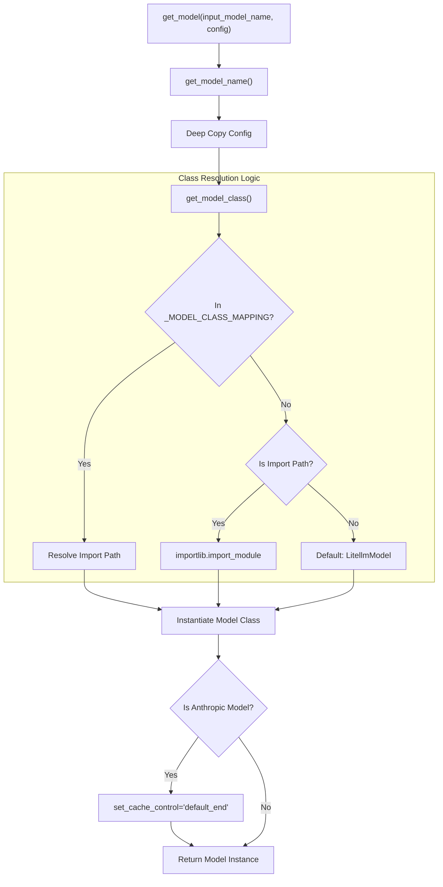

# Overview and Model Selection

<details>
<summary>Relevant source files</summary>

The following files were used as context for generating this wiki page:

- [docs/data/all_models.txt](docs/data/all_models.txt)
- [docs/models/local_models.md](docs/models/local_models.md)
- [docs/models/quickstart.md](docs/models/quickstart.md)
- [docs/models/troubleshooting.md](docs/models/troubleshooting.md)
- [src/minisweagent/models/__init__.py](src/minisweagent/models/__init__.py)
- [tests/models/test_init.py](tests/models/test_init.py)

</details>


This page provides an overview of the model integration system in mini-SWE-agent and explains how to select and configure models. The system supports a variety of model classes across multiple API providers (LiteLLM, OpenRouter, Portkey, Requesty), each implementing different interaction paradigms with language models.

For detailed documentation of specific model implementations, see [src/minisweagent/models/litellm_model.py]() (LitellmModel), other providers, action parsing strategies, and cost tracking.

## Model Architecture Overview

The model integration system abstracts multiple LLM providers through a protocol-based design. The `get_model` factory is the central entry point for instantiating these classes.

**Model Class Hierarchy**

```mermaid
graph TB
    subgraph "LiteLLM Provider"
        LitellmToolcall["LitellmModel<br/>(default)"]
        LitellmResponse["LitellmResponseModel"]
        LitellmText["LitellmTextbasedModel"]
    end
    
    subgraph "OpenRouter Provider"
        OpenRouterToolcall["OpenRouterModel"]
        OpenRouterResponse["OpenRouterResponseModel"]
        OpenRouterText["OpenRouterTextbasedModel"]
    end
    
    subgraph "Portkey Provider"
        PortkeyToolcall["PortkeyModel"]
        PortkeyResponse["PortkeyResponseAPIModel"]
    end
    
    subgraph "Requesty Provider"
        RequestyToolcall["RequestyModel"]
    end
    
    subgraph "Test Models"
        DeterministicModel["DeterministicModel"]
    end
    
    ModelProtocol["Model Protocol<br/>query()<br/>format_message()<br/>format_observation_messages()"]
    
    LitellmToolcall -.implements.-> ModelProtocol
    LitellmResponse -.implements.-> ModelProtocol
    LitellmText -.implements.-> ModelProtocol
    OpenRouterToolcall -.implements.-> ModelProtocol
    OpenRouterResponse -.implements.-> ModelProtocol
    OpenRouterText -.implements.-> ModelProtocol
    PortkeyToolcall -.implements.-> ModelProtocol
    PortkeyResponse -.implements.-> ModelProtocol
    RequestyToolcall -.implements.-> ModelProtocol
    DeterministicModel -.implements.-> ModelProtocol
```


**Key Characteristics:**
- **LiteLLM**: Primary provider supporting 100+ models through a unified API. It is the default implementation [src/minisweagent/models/__init__.py:110-113]().
- **OpenRouter**: Multi-provider routing with specialized classes for Tool Calling, Responses API, and Text-based parsing [src/minisweagent/models/__init__.py:82-84]().
- **Portkey**: Gateway with monitoring and observability features [src/minisweagent/models/__init__.py:85-86]().
- **Deterministic**: A mock model used primarily for testing and reproducing trajectories [src/minisweagent/models/__init__.py:88]().

Sources: [src/minisweagent/models/__init__.py:78-89](), [src/minisweagent/models/__init__.py:110-113]()

## Model Naming Conventions

Mini-SWE-agent generally follows the `provider/model-name` naming convention, which is passed directly to the underlying provider (usually LiteLLM).

| Provider Prefix | Example | Description |
|----------------|---------|-------------|
| `anthropic/` | `anthropic/claude-3-5-sonnet-20241022` | Anthropic models via LiteLLM |
| `openai/` | `openai/gpt-4o`, `openai/gpt-5-mini` | OpenAI models via LiteLLM |
| `google/` | `google/gemini-2.5-pro` | Google models via LiteLLM |
| `deepseek/` | `deepseek/deepseek-chat` | DeepSeek models via LiteLLM |

**Recommended Models:**
- **Standard**: `anthropic/claude-opus-4-6-20260205` [docs/models/quickstart.md:96]().
- **Reasoning**: `openai/gpt-5-mini` with `reasoning_effort` set to `high` [docs/models/quickstart.md:140-143]().

Sources: [docs/models/quickstart.md:79-101](), [docs/models/quickstart.md:134-148]()

## The get_model Factory

The `get_model()` function [src/minisweagent/models/__init__.py:45-62]() is the primary way to initialize a model object from user input or configuration files.

**Model Factory Resolution Flow**


### Model Name Resolution Precedence
The `get_model_name()` function [src/minisweagent/models/__init__.py:65-75]() follows this priority:
1. **Explicit Argument**: `input_model_name` passed to the function [tests/models/test_init.py:14-17]().
2. **Configuration**: `config["model_name"]` [tests/models/test_init.py:19-22]().
3. **Environment**: `MSWEA_MODEL_NAME` environment variable [tests/models/test_init.py:24-27]().
4. **Fallback**: Raises `ValueError` prompting user to run `mini-extra config setup` [src/minisweagent/models/__init__.py:75]().

### Model Class Mapping
The `_MODEL_CLASS_MAPPING` dictionary [src/minisweagent/models/__init__.py:78-89]() maps shortcut strings to full Python import paths:

| Shortcut | Implementation Class |
|----------|----------------------|
| `litellm` | `LitellmModel` |
| `litellm_textbased` | `LitellmTextbasedModel` |
| `litellm_response` | `LitellmResponseModel` |
| `openrouter` | `OpenRouterModel` |
| `portkey` | `PortkeyModel` |
| `portkey_response` | `PortkeyResponseAPIModel` |
| `requesty` | `RequestyModel` |
| `deterministic` | `DeterministicModel` |

Sources: [src/minisweagent/models/__init__.py:45-62](), [src/minisweagent/models/__init__.py:65-75](), [src/minisweagent/models/__init__.py:78-89](), [src/minisweagent/models/__init__.py:92-113](), [tests/models/test_init.py:10-46]()

## Advanced Configuration

### Special Handling for Anthropic
If a model name contains "anthropic", "sonnet", "opus", or "claude", the factory automatically enables prompt caching by setting `set_cache_control` to `"default_end"` [src/minisweagent/models/__init__.py:55-61](). This significantly reduces costs for long-running agent trajectories.

Sources: [src/minisweagent/models/__init__.py:55-61]()

### Local Models and Custom Registries
To use local models (e.g., via vLLM or Ollama), users typically configure the `model_kwargs` in their YAML config [docs/models/quickstart.md:186-192]():

```yaml
model:
  model_name: "my-local-model"
  model_kwargs:
    custom_llm_provider: "openai"
    api_base: "https://..."
```

Sources: [docs/models/quickstart.md:186-192]()

### Global Statistics and Limits
The `GlobalModelStats` class [src/minisweagent/models/__init__.py:13-40]() tracks total costs and call counts across the entire process lifetime. It can enforce limits via environment variables:
- `MSWEA_GLOBAL_COST_LIMIT`: Maximum USD allowed before raising `RuntimeError` [src/minisweagent/models/__init__.py:20]().
- `MSWEA_GLOBAL_CALL_LIMIT`: Maximum number of API calls allowed [src/minisweagent/models/__init__.py:21]().

The `GLOBAL_MODEL_STATS` instance [src/minisweagent/models/__init__.py:42]() is used globally to ensure budget compliance during multi-step runs.

Sources: [src/minisweagent/models/__init__.py:13-42](), [tests/models/test_init.py:142-154]()