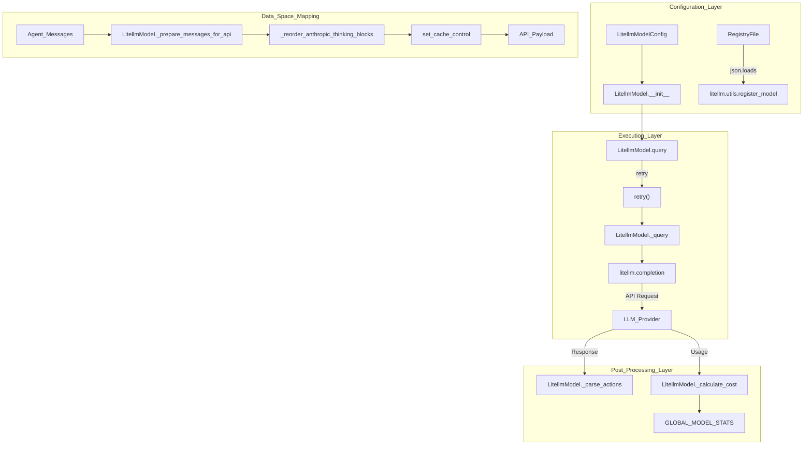
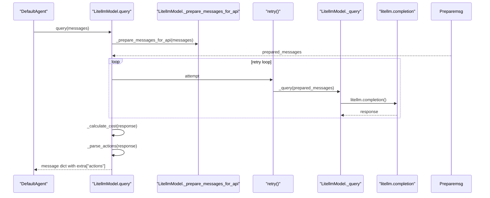

# LitellmModel

<details>
<summary>Relevant source files</summary>

The following files were used as context for generating this wiki page:

- [src/minisweagent/models/litellm_model.py](src/minisweagent/models/litellm_model.py)
- [src/minisweagent/models/openrouter_model.py](src/minisweagent/models/openrouter_model.py)
- [src/minisweagent/models/portkey_model.py](src/minisweagent/models/portkey_model.py)
- [src/minisweagent/models/utils/retry.py](src/minisweagent/models/utils/retry.py)
- [tests/models/test_actions_toolcall.py](tests/models/test_actions_toolcall.py)
- [tests/models/test_anthropic_model_integration.py](tests/models/test_anthropic_model_integration.py)
- [tests/models/test_litellm_model.py](tests/models/test_litellm_model.py)
- [tests/models/test_portkey_model.py](tests/models/test_portkey_model.py)

</details>


The `LitellmModel` class is the primary model implementation in `mini-swe-agent`, providing a unified interface to interact with any LLM provider supported by the [litellm](https://github.com/BerriAI/litellm) library. This abstraction layer handles API calls, retry logic, cost calculation, tool-call parsing, and custom model registration.

Sources: [src/minisweagent/models/litellm_model.py:49-49](), [src/minisweagent/models/litellm_model.py:64-106]()

## Configuration

The `LitellmModelConfig` class defines the configuration parameters for `LitellmModel` using Pydantic:

| Parameter | Type | Default | Description |
|-----------|------|---------|-------------|
| `model_name` | `str` | Required | LLM model identifier (e.g., `anthropic/claude-3-5-sonnet-20241022`) [src/minisweagent/models/litellm_model.py:27-29]() |
| `model_kwargs` | `dict` | `{}` | Additional arguments passed to `litellm.completion` (e.g., `temperature`) [src/minisweagent/models/litellm_model.py:30-31]() |
| `litellm_model_registry` | `Path \| str \| None` | `LITELLM_MODEL_REGISTRY_PATH` | Path to JSON file for cost tracking and model metadata [src/minisweagent/models/litellm_model.py:32-33]() |
| `set_cache_control` | `Literal["default_end"] \| None` | `None` | Set explicit cache control markers for Anthropic models [src/minisweagent/models/litellm_model.py:34-35]() |
| `cost_tracking` | `str` | `"default"` | Mode for cost tracking: `"default"` or `"ignore_errors"` [src/minisweagent/models/litellm_model.py:36-37]() |
| `format_error_template` | `str` | `"{{ error }}"` | Template used when the LM's output is not in the expected format [src/minisweagent/models/litellm_model.py:38-39]() |
| `observation_template` | `str` | (Jinja2 template) | Template used to render command execution results back to the LLM [src/minisweagent/models/litellm_model.py:40-44]() |
| `multimodal_regex` | `str` | `""` | Regex to extract multimodal content (e.g., images) [src/minisweagent/models/litellm_model.py:45-46]() |

Sources: [src/minisweagent/models/litellm_model.py:27-46]()

## Architecture Overview

Title: LitellmModel Architecture and Data Flow



This diagram bridges natural language configuration concepts to the underlying code entities in `src/minisweagent/models/litellm_model.py`, illustrating how configuration, message preparation, execution, and post-processing interact.

Sources: [src/minisweagent/models/litellm_model.py:27-135]()

## Initialization and Model Registry

The `__init__` method initializes the configuration object via `config_class` and optionally registers custom models with `litellm` if `litellm_model_registry` is provided as a valid file path:

```python
def __init__(self, *, config_class: Callable = LitellmModelConfig, **kwargs):
    self.config = config_class(**kwargs)
    if self.config.litellm_model_registry and Path(self.config.litellm_model_registry).is_file():
        litellm.utils.register_model(json.loads(Path(self.config.litellm_model_registry).read_text()))
```

The model registry enables using local or custom LLM endpoints by defining pricing and metadata, allowing `LitellmModel` to calculate costs for models not natively known to `litellm`.

Sources: [src/minisweagent/models/litellm_model.py:59-63]()

## Query Execution and Retry Logic

The `query` method orchestrates the request cycle, including message preparation, API execution with retries, cost accounting, and tool-call parsing.

### Message Preparation
Before sending messages to the API, `LitellmModel` executes `_prepare_messages_for_api`:
1. **Extra Field Stripping**: Filters out the internal `extra` metadata dictionary from each message [src/minisweagent/models/litellm_model.py:76-77]().
2. **Anthropic Thinking Blocks**: Reorders thinking blocks for Anthropic models using `_reorder_anthropic_thinking_blocks` [src/minisweagent/models/litellm_model.py:78-78]().
3. **Cache Control**: Applies cache control markers via `set_cache_control` based on configuration [src/minisweagent/models/litellm_model.py:79-79]().

### Retry Mechanism
The `query` method wraps execution using the `retry` utility from `minisweagent.models.utils.retry` [src/minisweagent/models/litellm_model.py:82-83](), [src/minisweagent/models/utils/retry.py:9-25](). It aborts immediately on fatal exceptions listed in `abort_exceptions`:
- `litellm.exceptions.UnsupportedParamsError` [src/minisweagent/models/litellm_model.py:51-51]()
- `litellm.exceptions.NotFoundError` [src/minisweagent/models/litellm_model.py:52-52]()
- `litellm.exceptions.PermissionDeniedError` [src/minisweagent/models/litellm_model.py:53-53]()
- `litellm.exceptions.ContextWindowExceededError` [src/minisweagent/models/litellm_model.py:54-54]()
- `litellm.exceptions.AuthenticationError` [src/minisweagent/models/litellm_model.py:55-55]()
- `KeyboardInterrupt` [src/minisweagent/models/litellm_model.py:56-56]()

Title: Query Execution Sequence Diagram



This sequence diagram details the method calls between the agent and `LitellmModel` during a query execution cycle.

Sources: [src/minisweagent/models/litellm_model.py:50-57](), [src/minisweagent/models/litellm_model.py:76-106](), [src/minisweagent/models/utils/retry.py:9-25]()

## Action Parsing and Tool Integration

`LitellmModel` injects the `BASH_TOOL` definition into every `litellm.completion` call [src/minisweagent/models/litellm_model.py:69-71]().

### Parsing Actions
The `_parse_actions` method extracts tool calls from the API response object:
```python
def _parse_actions(self, response) -> list[dict]:
    """Parse tool calls from the response. Raises FormatError if unknown tool."""
    tool_calls = response.choices[0].message.tool_calls or []
    return parse_toolcall_actions(
        tool_calls,
        format_error_template=self.config.format_error_template,
        template_kwargs={"finish_reason": response.choices[0].finish_reason},
    )
```
It delegates validation and transformation to `parse_toolcall_actions`, which converts tool calls into standard action dictionaries (e.g., `{"command": "..."}`) or raises `FormatError` [src/minisweagent/models/litellm_model.py:128-135]().

### Formatting Observations
Execution outputs are converted back into tool result messages via `format_observation_messages`, which calls `format_toolcall_observation_messages` [src/minisweagent/models/litellm_model.py:140-153]().

Sources: [src/minisweagent/models/litellm_model.py:69-71](), [src/minisweagent/models/litellm_model.py:128-153]()

## Cost Tracking

Cost calculation occurs after each successful completion in `_calculate_cost`:
1. It queries `litellm.cost_calculator.completion_cost(response, model=self.config.model_name)` [src/minisweagent/models/litellm_model.py:108-110]().
2. If the cost is `<= 0.0`, it raises a `ValueError` [src/minisweagent/models/litellm_model.py:111-112]().
3. If `cost_tracking` is set to `"default"` and calculation fails, it logs a critical message and raises a `RuntimeError` [src/minisweagent/models/litellm_model.py:113-125](). If `cost_tracking` is `"ignore_errors"`, it defaults the cost to `0.0` [src/minisweagent/models/litellm_model.py:114-115]().
4. Successful costs are aggregated into the global singleton `GLOBAL_MODEL_STATS` [src/minisweagent/models/litellm_model.py:85-86]().

Sources: [src/minisweagent/models/litellm_model.py:85-86](), [src/minisweagent/models/litellm_model.py:108-126]()

## Comparison with Specialized Providers

While `LitellmModel` serves as the primary multi-provider model wrapper, other specialized providers implement equivalent protocols with tailored client integrations:

| Class | Client / Mechanism | Key Difference |
|-------|--------------------|----------------|
| `PortkeyModel` | `portkey_ai.Portkey` | Supports virtual keys and provider routing headers [src/minisweagent/models/portkey_model.py:81-89]() |
| `OpenRouterModel` | `requests.post` | Direct HTTP requests to OpenRouter API with custom usage parsing [src/minisweagent/models/openrouter_model.py:60-80]() |

Sources: [src/minisweagent/models/portkey_model.py:65-90](), [src/minisweagent/models/openrouter_model.py:55-80]()