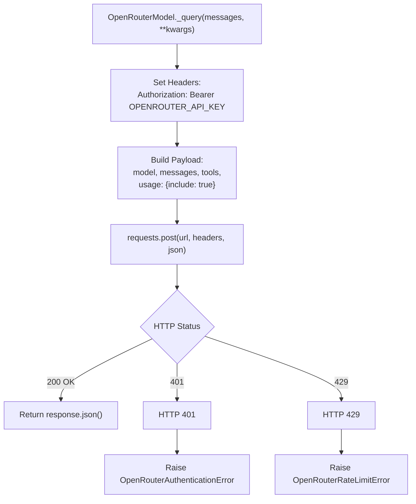
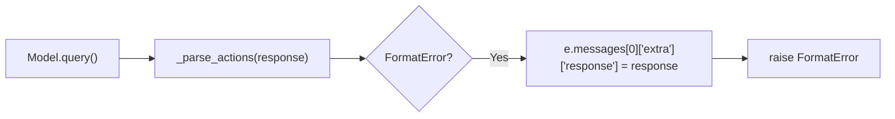

# Other Model Providers

<details>
<summary>Relevant source files</summary>

The following files were used as context for generating this wiki page:

- [src/minisweagent/models/extra/__init__.py](src/minisweagent/models/extra/__init__.py)
- [src/minisweagent/models/extra/roulette.py](src/minisweagent/models/extra/roulette.py)
- [src/minisweagent/models/litellm_response_model.py](src/minisweagent/models/litellm_response_model.py)
- [src/minisweagent/models/litellm_textbased_model.py](src/minisweagent/models/litellm_textbased_model.py)
- [src/minisweagent/models/openrouter_response_model.py](src/minisweagent/models/openrouter_response_model.py)
- [src/minisweagent/models/openrouter_textbased_model.py](src/minisweagent/models/openrouter_textbased_model.py)
- [src/minisweagent/models/portkey_response_model.py](src/minisweagent/models/portkey_response_model.py)
- [src/minisweagent/models/requesty_model.py](src/minisweagent/models/requesty_model.py)
- [tests/models/test_format_error_response_persistence.py](tests/models/test_format_error_response_persistence.py)

</details>


This page documents model provider implementations beyond `LitellmModel`: `OpenRouterModel`, `OpenRouterResponseModel`, `OpenRouterTextbasedModel`, `PortkeyModel`, `PortkeyResponseAPIModel`, `RequestyModel`, meta-models like `RouletteModel` and `InterleavingModel`, and specialized text-based or response API variants (`LitellmTextbasedModel`, `LitellmResponseModel`). These providers offer multi-provider routing, gateway monitoring, randomized/interleaved execution, and alternative API access patterns. All providers implement the model protocol and support bash command execution via tool calling or regex parsing.

For `LitellmModel` documentation, see [4.3.2](). For action parsing strategies and format variations, see [4.3.4](). For cost tracking mechanisms, see [4.3.5]().

## Provider Architecture

The following diagram maps high-level system concepts and natural language provider descriptions to their precise Python class and file implementations within the codebase:

Title: Model Provider Natural Language to Code Entity Mapping

```mermaid
graph TB
    subgraph "NaturalLanguageSpace"
        NL_OpenRouter["OpenRouter API Gateway"]
        NL_Portkey["Portkey AI Gateway"]
        NL_Requesty["Requesty Routing Gateway"]
        NL_Meta["Meta Routing & Roulette"]
        NL_Responses["Stateless Responses API"]
        NL_Text["Regex Text-Based Parsing"]
    end
    
    subgraph "CodeEntitySpace"
        OR_Class["OpenRouterModel<br/>src/minisweagent/models/openrouter_model.py"]
        ORR_Class["OpenRouterResponseModel<br/>src/minisweagent/models/openrouter_response_model.py"]
        ORT_Class["OpenRouterTextbasedModel<br/>src/minisweagent/models/openrouter_textbased_model.py"]
        
        PK_Class["PortkeyModel<br/>src/minisweagent/models/portkey_model.py"]
        PKR_Class["PortkeyResponseAPIModel<br/>src/minisweagent/models/portkey_response_model.py"]
        
        RQ_Class["RequestyModel<br/>src/minisweagent/models/requesty_model.py"]
        
        Roul_Class["RouletteModel & InterleavingModel<br/>src/minisweagent/models/extra/roulette.py"]
        
        LTR_Class["LitellmResponseModel<br/>src/minisweagent/models/litellm_response_model.py"]
        LTT_Class["LitellmTextbasedModel<br/>src/minisweagent/models/litellm_textbased_model.py"]
    end
    
    NL_OpenRouter --> OR_Class
    NL_OpenRouter --> ORR_Class
    NL_OpenRouter --> ORT_Class
    
    NL_Portkey --> PK_Class
    NL_Portkey --> PKR_Class
    
    NL_Requesty --> RQ_Class
    
    NL_Meta --> Roul_Class
    
    NL_Responses --> ORR_Class
    NL_Responses --> PKR_Class
    NL_Responses --> LTR_Class
    
    NL_Text --> ORT_Class
    NL_Text --> LTT_Class
```


**Sources**: [src/minisweagent/models/openrouter_model.py:1-150](), [src/minisweagent/models/openrouter_response_model.py:1-133](), [src/minisweagent/models/openrouter_textbased_model.py:1-79](), [src/minisweagent/models/portkey_model.py:1-200](), [src/minisweagent/models/portkey_response_model.py:1-182](), [src/minisweagent/models/requesty_model.py:1-182](), [src/minisweagent/models/extra/roulette.py:1-64](), [src/minisweagent/models/litellm_response_model.py:1-98](), [src/minisweagent/models/litellm_textbased_model.py:1-48]()

## OpenRouter Integrations

OpenRouter models are implemented across three variants depending on the interaction style: `OpenRouterModel` (chat completions), `OpenRouterResponseModel` (Responses API), and `OpenRouterTextbasedModel` (regex text parsing).

### OpenRouterModel

`OpenRouterModel` makes direct HTTP POST requests to `https://openrouter.ai/api/v1/chat/completions` [src/minisweagent/models/openrouter_model.py:60](). It handles authentication via `OPENROUTER_API_KEY` and extracts cost metrics directly from response usage objects [src/minisweagent/models/openrouter_model.py:119-130]().

Title: OpenRouter API Request Flow


**Sources**: [src/minisweagent/models/openrouter_model.py:63-90]()

## Portkey Implementations

The codebase provides two Portkey classes integrating with Portkey's AI gateway: `PortkeyModel` (standard chat completions) and `PortkeyResponseAPIModel` (stateless Responses API) [src/minisweagent/models/portkey_model.py:1-200](), [src/minisweagent/models/portkey_response_model.py:45-50]().

### PortkeyModel and PortkeyResponseAPIModel

* **Authentication**: Requires `PORTKEY_API_KEY` and optionally `PORTKEY_VIRTUAL_KEY` [src/minisweagent/models/portkey_model.py:73-89](), [src/minisweagent/models/portkey_response_model.py:59-72]().
* **Cost Calculation**: Uses `litellm.cost_calculator.completion_cost` with support for `litellm_model_name_override` [src/minisweagent/models/portkey_model.py:186](), [src/minisweagent/models/portkey_response_model.py:132-146]().
* **Stateless Responses API**: `PortkeyResponseAPIModel` flattens conversation histories because `previous_response_id` is not utilized [src/minisweagent/models/portkey_response_model.py:48-94]().

**Sources**: [src/minisweagent/models/portkey_model.py:65-128](), [src/minisweagent/models/portkey_response_model.py:45-121]()

## RequestyModel

`RequestyModel` communicates with the Requesty routing gateway at `https://router.requesty.ai/v1/chat/completions` [src/minisweagent/models/requesty_model.py:64]().

### Configuration and Headers

The `RequestyModelConfig` class defines parameters like `model_name`, `model_kwargs`, and `set_cache_control` [src/minisweagent/models/requesty_model.py:25-40](). HTTP requests include identifying headers:
* `HTTP-Referer`: `https://github.com/SWE-agent/mini-swe-agent` [src/minisweagent/models/requesty_model.py:71]()
* `X-Title`: `mini-swe-agent` [src/minisweagent/models/requesty_model.py:72]()

### Strict Cost Enforcement

`RequestyModel` mandates valid cost metrics in the API response. If `usage.get("cost")` evaluates to `0.0`, it raises a `RequestyAPIError` [src/minisweagent/models/requesty_model.py:124-132]().

**Sources**: [src/minisweagent/models/requesty_model.py:59-171]()

## Meta and Routing Models (Roulette and Interleaving)

The `minisweagent.models.extra.roulette` module defines meta-models that orchestrate multiple underlying models [src/minisweagent/models/extra/roulette.py:1-64]().

### RouletteModel and InterleavingModel

* `RouletteModelConfig`: Accepts a list of `model_kwargs` defining candidate model configurations [src/minisweagent/models/extra/roulette.py:9-13]().
* `RouletteModel`: Randomly selects one of the instantiated models at every query invocation using `random.choice()` [src/minisweagent/models/extra/roulette.py:15-34]().
* `InterleavingModel`: Subclasses `RouletteModel` and cycles through models sequentially based on call count modulo or an explicit integer `sequence` list [src/minisweagent/models/extra/roulette.py:46-64]().

**Sources**: [src/minisweagent/models/extra/roulette.py:1-64]()

## Alternative API & Parsing Variants

### Responses API Models

`LitellmResponseModel` [src/minisweagent/models/litellm_response_model.py:25](), `OpenRouterResponseModel` [src/minisweagent/models/openrouter_response_model.py:31](), and `PortkeyResponseAPIModel` [src/minisweagent/models/portkey_response_model.py:45]() implement the stateless Responses API pattern. These models flatten conversation history so that `response` objects from prior turns are unpacked into standard items for subsequent calls [src/minisweagent/models/litellm_response_model.py:29-38](), [src/minisweagent/models/openrouter_response_model.py:70-83](), [src/minisweagent/models/portkey_response_model.py:82-94]().

### Text-based Models

`LitellmTextbasedModel` [src/minisweagent/models/litellm_textbased_model.py:16]() and `OpenRouterTextbasedModel` [src/minisweagent/models/openrouter_textbased_model.py:27]() support backends lacking native tool-calling capabilities. They use regular expressions to parse bash commands from raw text output:
* Default regex: `r"```mswea_bash_command\s*\n(.*?)\n```"` [src/minisweagent/models/litellm_textbased_model.py:8](), [src/minisweagent/models/openrouter_textbased_model.py:19]()
* Enforces exact single-action constraints via `parse_regex_actions` [src/minisweagent/models/litellm_textbased_model.py:29-37](), [src/minisweagent/models/openrouter_textbased_model.py:60-68]()

**Sources**: [src/minisweagent/models/litellm_response_model.py:25-78](), [src/minisweagent/models/litellm_textbased_model.py:7-48](), [src/minisweagent/models/openrouter_textbased_model.py:18-79]()

## Common Patterns

### Format Error Response Persistence

All model implementations follow a strict contract: on a `FormatError`, the raw response must be persisted in the exception metadata (`e.messages[0]["extra"]["response"]`) to support trajectory inspection [tests/models/test_format_error_response_persistence.py:1-9]().

Title: FormatError Response Persistence Flow


**Sources**: [src/minisweagent/models/litellm_model.py:88-98](), [src/minisweagent/models/portkey_model.py:110-120](), [src/minisweagent/models/openrouter_model.py:103-109](), [tests/models/test_format_error_response_persistence.py:1-9]()

### Abort Exceptions

Each provider defines specific abort exceptions that bypass the retry loop [src/minisweagent/models/utils/retry.py:22]():

| Provider Class | Abort Exceptions |
|--------------|-----------------|
| `LitellmModel` | `UnsupportedParamsError`, `NotFoundError`, `PermissionDeniedError`, `ContextWindowExceededError`, `AuthenticationError`, `KeyboardInterrupt` [src/minisweagent/models/litellm_model.py:50-57]() |
| `OpenRouterModel` | `OpenRouterAuthenticationError`, `KeyboardInterrupt` [src/minisweagent/models/openrouter_model.py:56]() |
| `PortkeyModel` | `KeyboardInterrupt`, `TypeError`, `ValueError` [src/minisweagent/models/portkey_model.py:66]() |
| `RequestyModel` | `RequestyAuthenticationError`, `KeyboardInterrupt` [src/minisweagent/models/requesty_model.py:60]() |

**Sources**: [src/minisweagent/models/litellm_model.py:50-57](), [src/minisweagent/models/openrouter_model.py:56](), [src/minisweagent/models/portkey_model.py:66](), [src/minisweagent/models/requesty_model.py:60]()