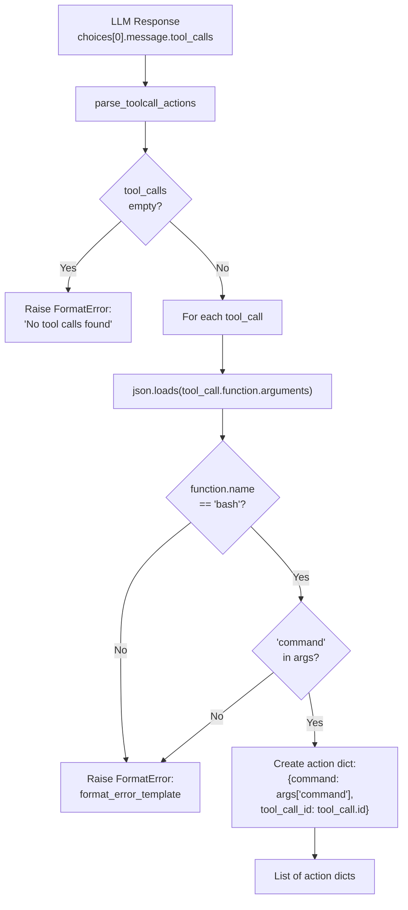
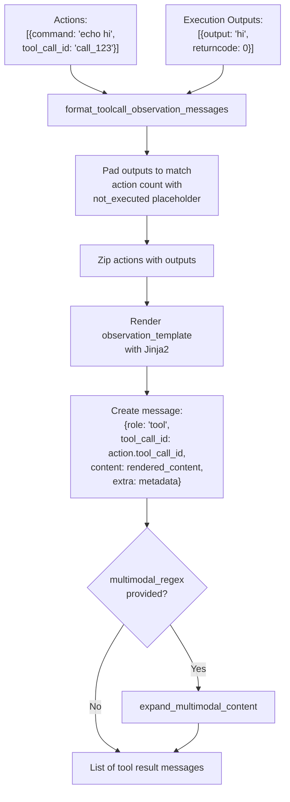
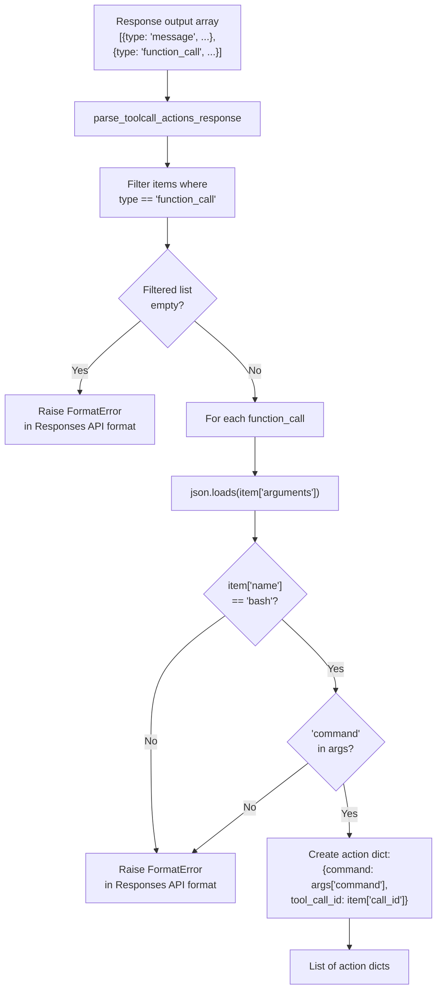
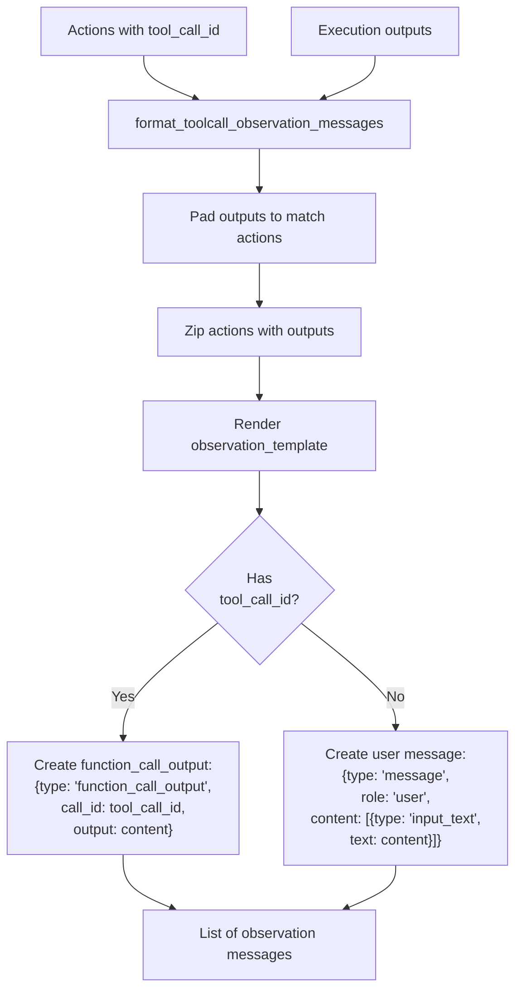
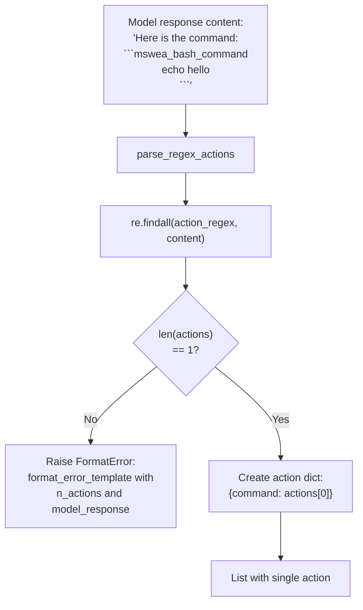
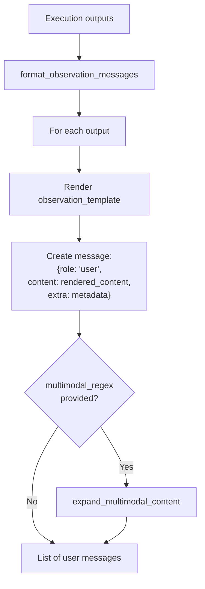
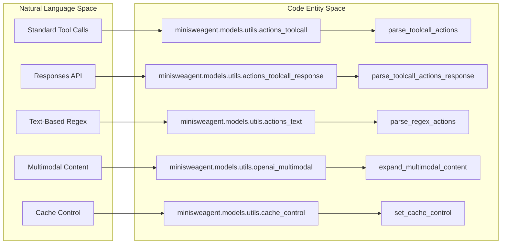

# Action Parsing Strategies

<details>
<summary>Relevant source files</summary>

The following files were used as context for generating this wiki page:

- [src/minisweagent/models/utils/actions_text.py](src/minisweagent/models/utils/actions_text.py)
- [src/minisweagent/models/utils/actions_toolcall.py](src/minisweagent/models/utils/actions_toolcall.py)
- [src/minisweagent/models/utils/actions_toolcall_response.py](src/minisweagent/models/utils/actions_toolcall_response.py)
- [src/minisweagent/models/utils/anthropic_utils.py](src/minisweagent/models/utils/anthropic_utils.py)
- [src/minisweagent/models/utils/cache_control.py](src/minisweagent/models/utils/cache_control.py)
- [src/minisweagent/models/utils/content_string.py](src/minisweagent/models/utils/content_string.py)
- [src/minisweagent/models/utils/openai_multimodal.py](src/minisweagent/models/utils/openai_multimodal.py)
- [tests/agents/test_multimodal.py](tests/agents/test_multimodal.py)
- [tests/models/test_anthropic_utils.py](tests/models/test_anthropic_utils.py)
- [tests/models/test_content_string.py](tests/models/test_content_string.py)

</details>


This page documents the three distinct strategies for parsing actions from LLM responses and formatting execution observations back to the model. These strategies abstract different LLM API conventions, enabling the agent code to remain provider-agnostic. Additionally, this page covers content/multimodal and cache-control utilities used across model integrations.

For information about model integration and provider implementations, see [Model Integration](#4.3). For details on how parsed actions are executed, see [Execution Environments](#4.4).

## Overview

mini-swe-agent supports three action parsing paradigms to accommodate different LLM API conventions:

| Strategy | Model Classes | Format | Use Case |
|----------|--------------|--------|----------|
| **Standard Tool Calls** | `LitellmModel`, `PortkeyModel`, `OpenRouterModel`, `RequestyModel` | OpenAI `tool_calls` array with nested `function` object | Default for most providers |
| **Responses API** | `LitellmResponseModel` | Flat `function_call` structure in output array | OpenAI's newer Responses API |
| **Text-Based** | `LitellmTextbasedModel` | Regex extraction from markdown code blocks | Legacy compatibility, mini-swe-agent v1.0 |

Each strategy consists of two components:
1. **Action Parser**: Extracts bash commands from the model's response.
2. **Observation Formatter**: Transforms execution results into messages for the model.

Sources: [src/minisweagent/models/utils/actions_toolcall.py:1-112](), [src/minisweagent/models/utils/actions_toolcall_response.py:1-140](), [src/minisweagent/models/utils/actions_text.py:1-70]()

## Standard Tool Calls Format

### Tool Definition

The standard tool calls format uses OpenAI's tool calling convention with a nested structure. The bash tool is defined in `BASH_TOOL` [src/minisweagent/models/utils/actions_toolcall.py:11-27]():

```python
BASH_TOOL = {
    "type": "function",
    "function": {
        "name": "bash",
        "description": "Execute a bash command",
        "parameters": {
            "type": "object",
            "properties": {
                "command": {
                    "type": "string",
                    "description": "The bash command to execute",
                }
            },
            "required": ["command"],
        },
    },
}
```

This tool definition is sent to the API provider (e.g., via `litellm.completion(tools=[BASH_TOOL])`) to instruct the model to respond with structured tool calls.

Sources: [src/minisweagent/models/utils/actions_toolcall.py:11-27]()

### Response Structure

The model responds with tool calls typically found in `response.choices[0].message.tool_calls`. The parsing logic expects a list of objects where each object contains a `function` with `name` and `arguments` [src/minisweagent/models/utils/actions_toolcall.py:53-63]().

### Action Parsing

The `parse_toolcall_actions()` function extracts actions from the response:

Title: Standard Toolcall Parsing Logic


The parsing logic performs validation and raises `FormatError` exceptions for invalid responses [src/minisweagent/models/utils/actions_toolcall.py:30-75]():
- No tool calls in response.
- Unknown tool name (not "bash").
- Missing or unparseable arguments.
- Missing "command" field in arguments.

Sources: [src/minisweagent/models/utils/actions_toolcall.py:30-75]()

### Observation Formatting

After executing actions, `format_toolcall_observation_messages()` creates tool result messages:

Title: Standard Toolcall Observation Flow


The key characteristics [src/minisweagent/models/utils/actions_toolcall.py:78-112]():
- Messages have `role: "tool"`.
- Each message includes `tool_call_id` matching the original tool call.
- If action has no `tool_call_id` (e.g., human-issued commands from `InteractiveAgent`), role becomes "user" [src/minisweagent/models/utils/actions_toolcall.py:104-108]().
- Outputs are padded with `not_executed` placeholders if execution was interrupted [src/minisweagent/models/utils/actions_toolcall.py:87-88]().

Sources: [src/minisweagent/models/utils/actions_toolcall.py:78-112]()

## OpenAI Responses API Format

### Tool Definition

The Responses API uses a flat structure without the nested `function` key, defined in `BASH_TOOL_RESPONSE_API` [src/minisweagent/models/utils/actions_toolcall_response.py:11-25]():

```python
BASH_TOOL_RESPONSE_API = {
    "type": "function",
    "name": "bash",
    "description": "Execute a bash command",
    "parameters": {
        "type": "object",
        "properties": {
            "command": {
                "type": "string",
                "description": "The bash command to execute",
            }
        },
        "required": ["command"],
    },
}
```

Sources: [src/minisweagent/models/utils/actions_toolcall_response.py:11-25]()

### Response Structure

The Responses API returns a flat `output` array containing different item types. The parsing logic filters for items where `type == "function_call"` [src/minisweagent/models/utils/actions_toolcall_response.py:72-74]().

### Action Parsing

The `parse_toolcall_actions_response()` function filters for `function_call` items:

Title: Responses API Parsing Logic


Key differences from standard tool calls [src/minisweagent/models/utils/actions_toolcall_response.py:58-103]():
- Filters `output` array for items with `type: "function_call"`.
- Accesses `call_id`, `name`, `arguments` at the top level.
- Error messages are formatted in Responses API format with `type: "message"` structure via `_format_error_message` [src/minisweagent/models/utils/actions_toolcall_response.py:28-35]().
- Includes logic to map Responses API status to `finish_reason` (e.g., mapping `max_output_tokens` to `length`) [src/minisweagent/models/utils/actions_toolcall_response.py:45-56]().

Sources: [src/minisweagent/models/utils/actions_toolcall_response.py:28-103]()

### Observation Formatting

The `format_toolcall_observation_messages()` function in the response utility creates observations in Responses API format:

Title: Responses API Observation Flow


Key differences from standard format [src/minisweagent/models/utils/actions_toolcall_response.py:106-140]():
- Messages have `type: "function_call_output"` instead of `role: "tool"` [src/minisweagent/models/utils/actions_toolcall_response.py:132]().
- Use `call_id` field instead of `tool_call_id` [src/minisweagent/models/utils/actions_toolcall_response.py:133]().
- Output content is in `output` field, not `content` [src/minisweagent/models/utils/actions_toolcall_response.py:134]().
- Human-issued commands become `type: "message"` with structured content array [src/minisweagent/models/utils/actions_toolcall_response.py:136-138]().

Sources: [src/minisweagent/models/utils/actions_toolcall_response.py:106-140]()

## Text-Based Format (Legacy)

### Overview

The text-based format uses regex extraction from model responses, requiring the model to wrap commands in markdown code blocks. This was the method used in mini-swe-agent v1.0 and the original SWE-agent. **As of v2.0, tool calls are strongly recommended** [src/minisweagent/models/utils/actions_text.py:1-4]().

### Action Parsing

The `parse_regex_actions()` function extracts commands using regex:

Title: Regex Action Parsing Logic


Critical validation [src/minisweagent/models/utils/actions_text.py:15-40]():
- Must find **exactly one** action per response.
- Zero actions or multiple actions both raise `FormatError` [src/minisweagent/models/utils/actions_text.py:25-39]().

Sources: [src/minisweagent/models/utils/actions_text.py:15-40]()

### Observation Formatting

The `format_observation_messages()` function creates simple user messages [src/minisweagent/models/utils/actions_text.py:43-70]():

Title: Text-Based Observation Flow


Key characteristics:
- All observation messages have `role: "user"` [src/minisweagent/models/utils/actions_text.py:57]().
- No `tool_call_id` linking.
- Each output generates one message.

Sources: [src/minisweagent/models/utils/actions_text.py:43-70]()

## Content Extraction and Multimodal Utilities

### Content Display Formatting

The system provides a utility `get_content_string()` in `src/minisweagent/models/utils/content_string.py` to extract human-readable text from these various message formats for logging and UI display [src/minisweagent/models/utils/content_string.py:32-44]().

It handles:
- Traditional chat strings [src/minisweagent/models/utils/content_string.py:49-50]().
- Multimodal content lists [src/minisweagent/models/utils/content_string.py:51-62]().
- OpenAI/LiteLLM `tool_calls` [src/minisweagent/models/utils/content_string.py:65-70]().
- Responses API `output` arrays [src/minisweagent/models/utils/content_string.py:73-85]().
- Anthropic `tool_use` and `tool_result` blocks [src/minisweagent/models/utils/content_string.py:55-60]().

Sources: [src/minisweagent/models/utils/content_string.py:32-87]()

### Multimodal Content Expansion

Multimodal content (such as images generated during command execution or supplied in the environment) is handled via `expand_multimodal_content()` in `src/minisweagent/models/utils/openai_multimodal.py` [src/minisweagent/models/utils/openai_multimodal.py:34-50](). 

The default regex pattern (`DEFAULT_MULTIMODAL_REGEX`) matches tags like:
`<MSWEA_MULTIMODAL_CONTENT><CONTENT_TYPE>image_url</CONTENT_TYPE>...url...</MSWEA_MULTIMODAL_CONTENT>` [src/minisweagent/models/utils/openai_multimodal.py:7-9](). 

This utility recursively traverses message dictionaries and lists, converting plain text containing multimodal tags into structured OpenAI/LiteLLM block lists (e.g., `{"type": "image_url", "image_url": {"url": ...}}`) [src/minisweagent/models/utils/openai_multimodal.py:34-50]().

Sources: [src/minisweagent/models/utils/openai_multimodal.py:1-50]()

## Cache Control Utilities

Cache control markers (primarily targeting Anthropic models via ephemeral prompt caching) are managed via `set_cache_control()` in `src/minisweagent/models/utils/cache_control.py` [src/minisweagent/models/utils/cache_control.py:1-67]().

- **Mode Support**: Operates in `"default_end"` mode to place cache control markers on the most recent messages [src/minisweagent/models/utils/cache_control.py:49-56]().
- **Deep Copying**: Operates on a deep copy of message history to avoid mutating original state [src/minisweagent/models/utils/cache_control.py:60]().
- **Marker Insertion**: Clears existing cache control points and applies `{"type": "ephemeral"}` metadata to eligible content blocks and entries, ensuring compatibility with tool use and message roles [src/minisweagent/models/utils/cache_control.py:19-47]().

Sources: [src/minisweagent/models/utils/cache_control.py:1-67]()

## Strategy Implementation Mapping

The following diagram maps the logical strategies to the code entities that implement them:

Title: Strategy to Code Entity Mapping


Sources: [src/minisweagent/models/utils/actions_toolcall.py:30-32](), [src/minisweagent/models/utils/actions_toolcall_response.py:58-60](), [src/minisweagent/models/utils/actions_text.py:15-17](), [src/minisweagent/models/utils/openai_multimodal.py:34-36](), [src/minisweagent/models/utils/cache_control.py:49-52]()

## Error Handling and Truncation

All parsing strategies are designed to handle model output errors gracefully via `FormatError`. A key feature is the ability to distinguish between a genuine format error and a model truncation (e.g., due to `max_tokens`).

### Truncation Handling

Parsing functions accept `template_kwargs` which can include `finish_reason`. The `format_error_template` (rendered via Jinja2) can use this to provide specific feedback to the model [src/minisweagent/models/utils/actions_toolcall.py:35-38](), [src/minisweagent/models/utils/actions_toolcall_response.py:67-69]().

For example, in `parse_toolcall_actions`, if no tool calls are found but `finish_reason` is `"length"`, the error template can report that the output was cut off instead of claiming the model forgot to use a tool [src/minisweagent/models/utils/actions_toolcall.py:40-51]().

Sources: [src/minisweagent/models/utils/actions_toolcall.py:30-75](), [src/minisweagent/models/utils/actions_toolcall_response.py:58-103](), [src/minisweagent/models/utils/actions_text.py:15-40]()