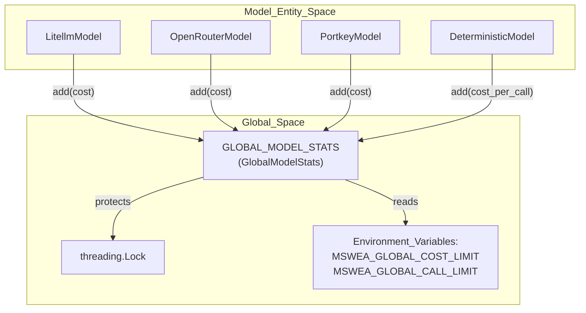
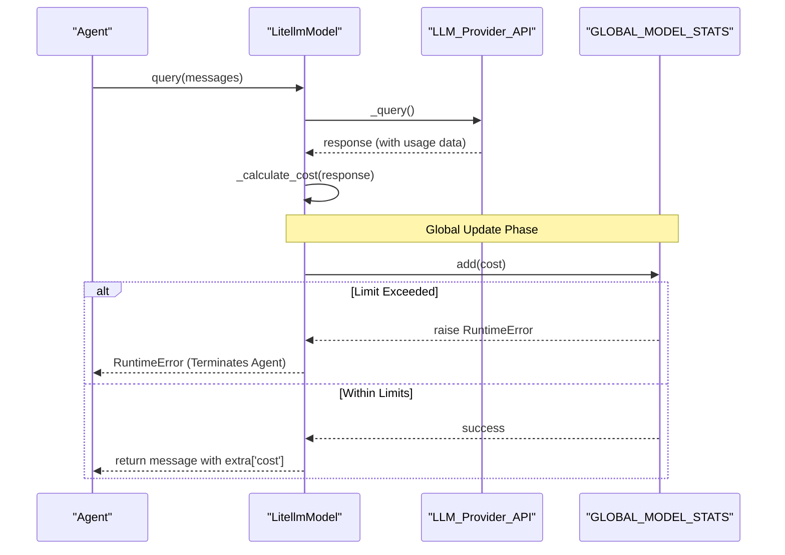

# Cost Tracking

<details>
<summary>Relevant source files</summary>

The following files were used as context for generating this wiki page:

- [docs/models/quickstart.md](docs/models/quickstart.md)
- [src/minisweagent/models/__init__.py](src/minisweagent/models/__init__.py)
- [src/minisweagent/models/litellm_model.py](src/minisweagent/models/litellm_model.py)
- [src/minisweagent/models/openrouter_model.py](src/minisweagent/models/openrouter_model.py)
- [src/minisweagent/models/portkey_model.py](src/minisweagent/models/portkey_model.py)
- [tests/models/test_init.py](tests/models/test_init.py)

</details>


## Purpose and Scope

The cost tracking system in `mini-swe-agent` monitors and limits expenses incurred from LLM API calls. It provides two levels of tracking: per-model instance tracking for individual agent execution costs, and global tracking via a thread-safe singleton that can enforce hard limits across the entire process. This ensures that autonomous agents do not exceed predefined budgets during long-running tasks or batch evaluations.

Sources: [src/minisweagent/models/litellm_model.py:13-37](), [src/minisweagent/models/__init__.py:13-42]()

## Architecture Overview

The cost tracking system consists of a global statistics aggregator (`GlobalModelStats`) and per-model logic that calculates and reports costs after every API completion.



Sources: [src/minisweagent/models/__init__.py:13-42](), [src/minisweagent/models/litellm_model.py:13-13](), [src/minisweagent/models/openrouter_model.py:11-11](), [src/minisweagent/models/portkey_model.py:12-12]()

## Cost Flow and Limit Enforcement

When a model performs a query, it follows a strict sequence to calculate costs and update the global state before returning the result to the agent.



Sources: [src/minisweagent/models/litellm_model.py:81-106](), [src/minisweagent/models/openrouter_model.py:97-117](), [src/minisweagent/models/portkey_model.py:104-128]()

## GlobalModelStats

The `GlobalModelStats` class is defined in `minisweagent.models` and acts as the central authority for cost enforcement [src/minisweagent/models/__init__.py:13-14](). A singleton instance `GLOBAL_MODEL_STATS` is instantiated across all model implementations to aggregate usage metrics [src/minisweagent/models/__init__.py:42-42]().

### Configuration and Limits
The stats tracker reads environment variables upon initialization:
*   `MSWEA_GLOBAL_COST_LIMIT`: Total USD budget (e.g., `0.50`) [src/minisweagent/models/__init__.py:20-20]().
*   `MSWEA_GLOBAL_CALL_LIMIT`: Total number of API requests allowed [src/minisweagent/models/__init__.py:21-21]().

### Thread-Safe Accumulation
The `add(cost)` method uses a `threading.Lock` to ensure that cost and call count updates are atomic, which is critical when multiple agents execute concurrently [src/minisweagent/models/__init__.py:19-32](). If either the cost limit or call limit is breached, `add(cost)` immediately raises a `RuntimeError`, halting execution [src/minisweagent/models/__init__.py:30-31]().

Sources: [src/minisweagent/models/__init__.py:13-42]()

## Model-Specific Cost Calculation

Different model providers return cost information in various formats. Each model class implements its own `_calculate_cost` method to normalize these values.

### LitellmModel
`LitellmModel` uses `litellm.cost_calculator.completion_cost` to determine the cost of a completion [src/minisweagent/models/litellm_model.py:108-110](). 

| Configuration Attribute | Description |
| :--- | :--- |
| `cost_tracking` | Set to `"default"` or `"ignore_errors"` via `MSWEA_COST_TRACKING` [src/minisweagent/models/litellm_model.py:36-37](). |
| `litellm_model_registry` | Path to a JSON file for registering custom model costs [src/minisweagent/models/litellm_model.py:32-33](). |

If a cost cannot be calculated, it raises a `RuntimeError` unless `cost_tracking: "ignore_errors"` is configured [src/minisweagent/models/litellm_model.py:113-125]().

### OpenRouterModel
OpenRouter provides cost data directly in the `usage` field of the response dictionary [src/minisweagent/models/openrouter_model.py:119-121]().
*   It extracts `usage.get("cost", 0.0)` [src/minisweagent/models/openrouter_model.py:120-121]().
*   If the cost is `0.0` or missing and `cost_tracking` is not set to `ignore_errors`, it raises a `RuntimeError` [src/minisweagent/models/openrouter_model.py:122-129]().

### PortkeyModel
`PortkeyModel` currently relies on `litellm` for cost calculation [src/minisweagent/models/portkey_model.py:41-44]().
*   It supports `litellm_model_name_override` in its config [src/minisweagent/models/portkey_model.py:45-49]() to handle cases where the Portkey model name differs from the string expected by `litellm`.
*   It can register additional models via `litellm_model_registry` [src/minisweagent/models/portkey_model.py:41-44]().

### DeterministicModel (Testing)
In testing scenarios, `DeterministicModel` supports manual cost specification for simulated responses via properties like `cost_per_call` [src/minisweagent/models/test_models.py:7-8]() to verify stats tracking without live API calls.

Sources: [src/minisweagent/models/litellm_model.py:32-37](), [src/minisweagent/models/litellm_model.py:108-126](), [src/minisweagent/models/openrouter_model.py:119-130](), [src/minisweagent/models/portkey_model.py:41-49](), [src/minisweagent/models/test_models.py:7-8]()

## Data Metadata and Trajectories

Calculated costs are stored in the `extra` field of the message dictionary returned by `query()`. This includes the cost for the specific call and a timestamp.

```python
# Example extra field construction in LitellmModel
message["extra"] = {
    "actions": actions,
    "response": response.model_dump(),
    **cost_output, # Contains {"cost": float}
    "timestamp": time.time(),
}
```

This metadata is persisted in trajectory files (e.g., `.traj.json`), allowing for post-run analysis of total expenditure using inspection tools.

Sources: [src/minisweagent/models/litellm_model.py:99-106](), [src/minisweagent/models/openrouter_model.py:110-117](), [src/minisweagent/models/portkey_model.py:121-128]()