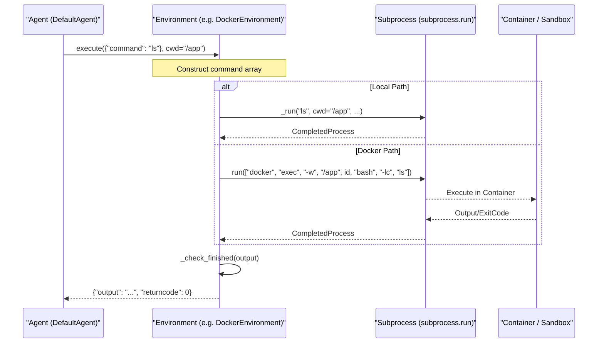

# Execution Environments

<details>
<summary>Relevant source files</summary>

The following files were used as context for generating this wiki page:

- [docs/advanced/environments.md](docs/advanced/environments.md)
- [docs/advanced/yaml_configuration.md](docs/advanced/yaml_configuration.md)
- [docs/reference/environments/swerex_modal.md](docs/reference/environments/swerex_modal.md)
- [docs/reference/index.md](docs/reference/index.md)
- [src/minisweagent/environments/README.md](src/minisweagent/environments/README.md)
- [src/minisweagent/environments/__init__.py](src/minisweagent/environments/__init__.py)

</details>


The environment layer provides a unified abstraction for executing bash commands across different execution backends. All environment implementations follow a consistent protocol, enabling the agent to execute commands identically whether running directly on the host machine, in Docker containers, Singularity sandboxes, or other isolation mechanisms. This page documents the common patterns and interfaces shared across all environment types.

For detailed information about specific environment implementations, see [LocalEnvironment](#4.4.1), [DockerEnvironment](#4.4.2), [SingularityEnvironment](#4.4.3), and [Other Environments](#4.4.4).

Sources: [docs/advanced/environments.md:1-32](), [src/minisweagent/environments/__init__.py:1-16]()

## Environment Protocol

All environment classes implement a common interface, typically following a duck-typed protocol that includes execution, configuration metadata, and resource management.

### Environment Interface Diagram
This diagram maps the logical "Execution Environment" concept to the specific class structures and methods used in the code.

```mermaid
classDiagram
    class "Environment" {
        <<Protocol>>
        +execute(action: dict, cwd: str, timeout: int) dict
        +get_template_vars(**kwargs) dict
        +serialize() dict
        +cleanup() void
    }
    class "LocalEnvironment" {
        +config: LocalEnvironmentConfig
        +execute(action, cwd, timeout) dict
    }
    class "DockerEnvironment" {
        +config: DockerEnvironmentConfig
        +container_id: str
        +execute(action, cwd, timeout) dict
        +cleanup() void
    }
    class "SingularityEnvironment" {
        +config: SingularityEnvironmentConfig
        +sandbox_dir: Path
        +execute(action, cwd, timeout) dict
        +cleanup() void
    }
    class "SwerexDockerEnvironment" {
        +config: SwerexDockerEnvironmentConfig
        +deployment: DockerDeployment
        +execute(action, cwd, timeout) dict
    }
    class "BubblewrapEnvironment" {
        +config: BubblewrapEnvironmentConfig
        +working_dir: Path
        +execute(action, cwd, timeout) dict
        +cleanup() void
    }
    
    "Environment" <|.. "LocalEnvironment"
    "Environment" <|.. "DockerEnvironment"
    "Environment" <|.. "SingularityEnvironment"
    "Environment" <|.. "SwerexDockerEnvironment"
    "Environment" <|.. "BubblewrapEnvironment"
```

**Core Interface Methods**

| Method | Returns | Purpose |
|--------|---------|---------|
| `execute(action, cwd, timeout)` | `dict[str, Any]` | Execute bash command and return result |
| `get_template_vars(**kwargs)` | `dict[str, Any]` | Provide variables for Jinja2 template rendering |
| `serialize()` | `dict` | Return configuration metadata for trajectory logging |
| `cleanup()` | `None` | Clean up resources (containers, sandboxes, etc.) |

The `execute()` method always returns a dictionary containing the command's standard output (merged with stderr) and the exit status.

Sources: [src/minisweagent/environments/local.py:19-54](), [src/minisweagent/environments/docker.py:45-138](), [src/minisweagent/environments/singularity.py:37-119](), [src/minisweagent/environments/extra/swerex_docker.py:22-55](), [src/minisweagent/environments/extra/bubblewrap.py:69-117]()

## Configuration Structure

Each environment type uses a corresponding `*Config` Pydantic model to manage its settings. These configuration classes follow a consistent pattern for defining execution parameters.

**Common Configuration Fields**

| Field | Type | Purpose | Default |
|-------|------|---------|---------|
| `cwd` | `str` | Working directory for commands | `""` (usually defaults to `/` or `os.getcwd()`) |
| `timeout` | `int` | Command execution timeout in seconds | `30` |
| `env` | `dict[str, str]` | Environment variables to set | `{}` |

**Container-Specific Fields**

| Field | Type | Purpose | Environments |
|-------|------|---------|--------------|
| `image` | `str` | Container image name/path | Docker, Singularity, SwerexDocker |
| `forward_env` | `list[str]` | Host env vars to forward | Docker, Singularity |
| `executable` | `str` | Path to container runtime binary | Docker, Singularity, Bubblewrap |

The configuration objects are instantiated via `**kwargs` in the environment constructor, allowing flexible initialization from YAML files.

Sources: [src/minisweagent/environments/local.py:13-16](), [src/minisweagent/environments/docker.py:15-43](), [src/minisweagent/environments/singularity.py:18-35](), [src/minisweagent/environments/extra/swerex_docker.py:12-19](), [src/minisweagent/environments/extra/bubblewrap.py:29-66]()

## Execution Flow

All environments follow a stateless execution pattern. Instead of maintaining an interactive shell session, each `execute` call triggers a fresh `subprocess.run` (or equivalent) call.

### Natural Language to Code Entity Mapping: Execution
This diagram shows how a "Command Execution" request moves from the Agent through the Environment implementation into the host OS.



**Key Execution Characteristics**

1. **Stateless Execution**: Each `execute()` call is independent. No persistent shell state (like local variables or exported functions) is guaranteed between calls unless written to disk.
2. **Combined Output**: `stdout` and `stderr` are merged into the `output` string.
3. **Termination Signal**: Environments monitor for a specific string `COMPLETE_TASK_AND_SUBMIT_FINAL_OUTPUT` to trigger the `Submitted` exception.

Sources: [src/minisweagent/environments/local.py:24-43](), [src/minisweagent/environments/docker.py:101-138](), [src/minisweagent/environments/local.py:72-92](), [src/minisweagent/environments/extra/bubblewrap.py:81-117](), [src/minisweagent/environments/docker.py:140-151]()

## Environment Initialization and Cleanup

The initialization process varies based on the level of isolation required.

* **LocalEnvironment**: Minimal initialization; just stores configuration.
* **DockerEnvironment**: Starts a persistent container using `docker run -d` with a `sleep` command to keep it alive for the duration of the task (default `2h`).
* **SingularityEnvironment**: Builds a writable sandbox directory from the provided image. It includes retry logic (`sandbox_build_retries`) to handle rare image build failures in HPC environments.
* **BubblewrapEnvironment**: Creates a temporary working directory for the sandbox session.

### Resource Management
Container-based environments implement cleanup to prevent resource leaks. `DockerEnvironment` uses a background `subprocess.Popen` call to stop and remove the container, ensuring the main process isn't blocked during exit.

Sources: [src/minisweagent/environments/docker.py:74-99](), [src/minisweagent/environments/singularity.py:46-65](), [src/minisweagent/environments/extra/bubblewrap.py:78-79](), [src/minisweagent/environments/docker.py:153-161](), [src/minisweagent/environments/singularity.py:134-139](), [src/minisweagent/environments/extra/bubblewrap.py:132-138]()

## Environment Selection

The `get_environment_class` factory function maps string identifiers to environment classes defined in the `_ENVIRONMENT_MAPPING`.

| Identifier | Class | Implementation Detail |
|------------|-------|-----------------------|
| `local` | `LocalEnvironment` | Direct `subprocess.run` on host. |
| `docker` | `DockerEnvironment` | Standard `docker exec` isolation. |
| `singularity` | `SingularityEnvironment` | Sandbox-based execution for HPC. |
| `swerex_docker` | `SwerexDockerEnvironment` | Uses `swerex` library for deployment. |
| `swerex_modal` | `SwerexModalEnvironment` | Modal cloud execution via `swerex`. |
| `bubblewrap` | `BubblewrapEnvironment` | Unprivileged Linux sandboxing (experimental). |
| `contree` | `ContreeEnvironment` | Safe execution via ConTree platform. |

Sources: [src/minisweagent/environments/__init__.py:8-16]()

## Child Pages

For detailed implementation details of each environment, see the following pages:

- **[LocalEnvironment](#4.4.1)**: Details on direct host execution via `subprocess.run`.
- **[DockerEnvironment](#4.4.2)**: Container lifecycle management and `docker exec` mechanics.
- **[SingularityEnvironment](#4.4.3)**: HPC-focused sandbox execution and retry logic for building images.
- **[Other Environments](#4.4.4)**: Documentation for `BubblewrapEnvironment`, `SwerexDockerEnvironment`, `SwerexModalEnvironment`, and `ContreeEnvironment`.

Sources: [docs/advanced/environments.md:1-32]()