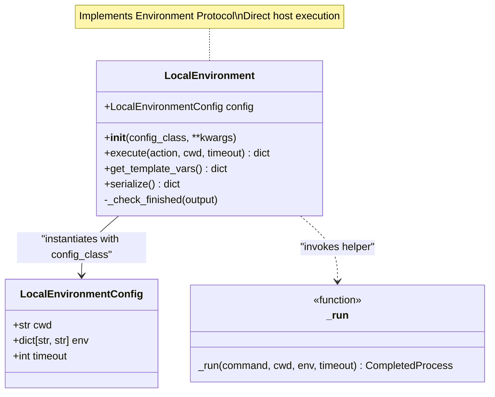
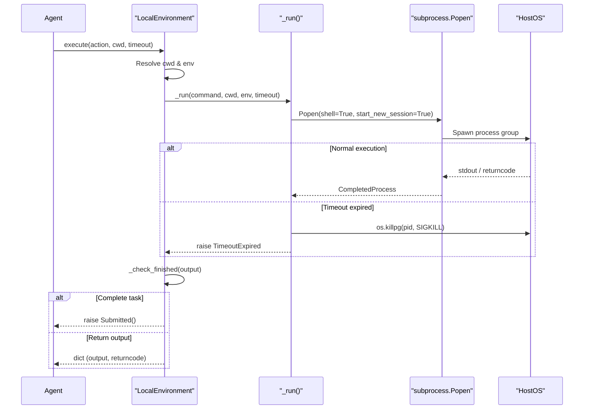

# LocalEnvironment

Relevant source files

The following files were used as context for generating this wiki page:

- [src/minisweagent/environments/docker.py](src/minisweagent/environments/docker.py)
- [src/minisweagent/environments/extra/bubblewrap.py](src/minisweagent/environments/extra/bubblewrap.py)
- [src/minisweagent/environments/extra/swerex_docker.py](src/minisweagent/environments/extra/swerex_docker.py)
- [src/minisweagent/environments/local.py](src/minisweagent/environments/local.py)
- [src/minisweagent/environments/singularity.py](src/minisweagent/environments/singularity.py)
- [tests/conftest.py](tests/conftest.py)
- [tests/environments/extra/__init__.py](tests/environments/extra/__init__.py)
- [tests/environments/extra/test_swerex_docker.py](tests/environments/extra/test_swerex_docker.py)
- [tests/environments/test_docker.py](tests/environments/test_docker.py)
- [tests/environments/test_local.py](tests/environments/test_local.py)
- [tests/test_fire.py](tests/test_fire.py)

`LocalEnvironment` executes bash commands directly on the host machine [src/minisweagent/environments/local.py:21-21](). It provides the simplest execution environment with no isolation or sandboxing, making it suitable for quick development iterations, interactive debugging, and trusted code execution scenarios where container overhead is undesirable.

For containerized execution with isolation, see [DockerEnvironment](4.4.2)() and [SingularityEnvironment](4.4.3)(). For the general environment abstraction concept, see [Execution Environments](4.4)().

---

## Overview

`LocalEnvironment` implements the environment protocol by directly spawning shell processes on the host system [src/minisweagent/environments/local.py:21-21](). Unlike containerized environments, it offers:

- **Zero overhead**: No container startup time, image pulling, or sandbox building.
- **Direct filesystem access**: Commands execute in the real filesystem, allowing the agent to modify local files directly [src/minisweagent/environments/local.py:21-21]().
- **Environment inheritance**: Full access to host environment variables (`os.environ`) [src/minisweagent/environments/local.py:29-29]().
- **Simple debugging**: Output and errors appear immediately without container networking or volume mapping layers.

**Warning**: `LocalEnvironment` provides no sandboxing. Malicious or buggy commands (e.g., `rm -rf /`) can permanently damage the host system [src/minisweagent/environments/local.py:21-21]().

Sources: [src/minisweagent/environments/local.py:19-22]()

---

## Class Structure

The implementation relies on the `LocalEnvironmentConfig` Pydantic model for configuration settings and the `LocalEnvironment` class for execution logic [src/minisweagent/environments/local.py:13-22]().

Diagram: LocalEnvironment Class Structure

**LocalEnvironment Class Structure**: Illustrates the relationship between configuration (`LocalEnvironmentConfig`), the execution class (`LocalEnvironment`), and the subprocess execution helper (`_run`) [src/minisweagent/environments/local.py:13-92]().

Sources: [src/minisweagent/environments/local.py:13-22](), [src/minisweagent/environments/local.py:72-92]()

---

## Configuration

`LocalEnvironment` is configured via `LocalEnvironmentConfig` [src/minisweagent/environments/local.py:13-17](). Because it runs directly on the host, it requires minimal parameters:

| Field | Type | Default | Description |
|-------|------|---------|-------------|
| `cwd` | `str` | `""` | Default working directory for command execution [src/minisweagent/environments/local.py:14-14](). |
| `env` | `dict[str, str]` | `{}` | Environment variables to merge with the host environment [src/minisweagent/environments/local.py:15-15](). |
| `timeout` | `int` | `30` | Default timeout in seconds for command execution [src/minisweagent/environments/local.py:16-16](). |

Sources: [src/minisweagent/environments/local.py:13-17]()

---

## Execution Flow and Process Management

The `LocalEnvironment.execute` method is the core entry point [src/minisweagent/environments/local.py:24-43](). It transforms an action dictionary into a subprocess call via the helper function `_run` [src/minisweagent/environments/local.py:29-29]() which wraps `subprocess.Popen` [src/minisweagent/environments/local.py:74-75]().

Diagram: LocalEnvironment Execution Sequence

**LocalEnvironment Execution Sequence**: Demonstrates how `LocalEnvironment.execute` bridges agent actions to host OS execution while ensuring process group cleanup on timeout [src/minisweagent/environments/local.py:24-43](), [src/minisweagent/environments/local.py:72-92]().

### Key Implementation Details:
- **Process Group Management**: The `_run` function uses `start_new_session=True` on POSIX systems [src/minisweagent/environments/local.py:84-84]() and kills the entire process group using `os.killpg(process.pid, signal.SIGKILL)` on timeout [src/minisweagent/environments/local.py:89-89]() to prevent orphaned child processes. On Windows, it falls back to `process.kill()` [src/minisweagent/environments/local.py:89-89]().
- **Stream Merging**: Redirects standard error to standard output (`stderr=subprocess.STDOUT`) to provide a single, unified output stream [src/minisweagent/environments/local.py:83-83]().
- **Encoding**: Uses `encoding="utf-8"` with `errors="replace"` to ensure binary or malformed characters do not crash execution [src/minisweagent/environments/local.py:80-81]().
- **Error Handling**: Catches execution exceptions (such as `TimeoutExpired`) and packages them into a structured result dictionary containing `output`, `returncode: -1`, `exception_info`, and `extra` metadata [src/minisweagent/environments/local.py:31-41]().

Sources: [src/minisweagent/environments/local.py:24-43](), [src/minisweagent/environments/local.py:72-92]()

---

## Environment and Working Directory Resolution

`LocalEnvironment.execute` resolves execution context dynamically:

1. **Working Directory (`cwd`)**: Resolved with precedence `execute(cwd)` argument > `self.config.cwd` > `os.getcwd()` [src/minisweagent/environments/local.py:27-27]().
2. **Environment Variables**: Merges host environment variables (`os.environ`) with configured environment variables (`self.config.env`) using the union operator (`|`), giving precedence to `self.config.env` [src/minisweagent/environments/local.py:29-29]().

Sources: [src/minisweagent/environments/local.py:27-29]()

---

## Task Completion Detection

Command output is inspected by `LocalEnvironment._check_finished` to detect task submission and termination [src/minisweagent/environments/local.py:45-56]().

- **Trigger String**: `COMPLETE_TASK_AND_SUBMIT_FINAL_OUTPUT` [src/minisweagent/environments/local.py:48-48]().
- **Condition**: Must appear on the first line of output (after stripping leading whitespace) with a `returncode` of `0` [src/minisweagent/environments/local.py:48-48]().
- **Action**: Raises a `Submitted` exception containing the remaining lines of output as the final submission content [src/minisweagent/environments/local.py:50-56]().

Sources: [src/minisweagent/environments/local.py:45-56]()

---

## Template Variables and Serialization

`LocalEnvironment` exposes methods for prompt templating and trajectory persistence.

### Template Variables
`LocalEnvironment.get_template_vars` merges configuration settings, platform information (`platform.uname()`), host environment variables (`os.environ`), and extra keyword arguments for Jinja2 template rendering [src/minisweagent/environments/local.py:58-60]().

Sources: [src/minisweagent/environments/local.py:58-60]()

### Serialization
`LocalEnvironment.serialize` records environment configuration and fully qualified class name metadata for inclusion in trajectory logs (`.traj.json`) [src/minisweagent/environments/local.py:61-70]().

Sources: [src/minisweagent/environments/local.py:61-70]()

---

## Comparison with Isolated Environments

| Feature | `LocalEnvironment` | `DockerEnvironment` | `SingularityEnvironment` | `BubblewrapEnvironment` |
|---------|------------------|-------------------|------------------------|-----------------------|
| **Execution Mechanism** | `subprocess.Popen` [src/minisweagent/environments/local.py:74-74]() | `docker exec` [src/minisweagent/environments/docker.py:107-107]() | `singularity exec` [src/minisweagent/environments/singularity.py:83-83]() | `bwrap` command [src/minisweagent/environments/extra/bubblewrap.py:86-86]() |
| **Isolation** | None (Host) [src/minisweagent/environments/local.py:21-21]() | Container (Cgroups/Namespaces) | Container (Sandbox) | Unprivileged Sandbox [src/minisweagent/environments/extra/bubblewrap.py:2-3]() |
| **Startup Time** | Instant | Container Start (~2s) [src/minisweagent/environments/docker.py:76-89]() | Sandbox Build (~10s+) [src/minisweagent/environments/singularity.py:52-56]() | Instant (temp dir) [src/minisweagent/environments/extra/bubblewrap.py:78-79]() |
| **Filesystem Persistence** | Permanent (Host Files) [src/minisweagent/environments/local.py:21-21]() | Ephemeral (Container) [src/minisweagent/environments/docker.py:30-33]() | Ephemeral (Sandbox) [src/minisweagent/environments/singularity.py:50-56]() | Ephemeral (Working Dir) [src/minisweagent/environments/extra/bubblewrap.py:78-79]() |
| **Timeout Handling** | `os.killpg` (Process Group) [src/minisweagent/environments/local.py:89-89]() | `subprocess.run` timeout [src/minisweagent/environments/docker.py:116-119]() | `subprocess.run` timeout [src/minisweagent/environments/singularity.py:97-100]() | `subprocess.run` timeout [src/minisweagent/environments/extra/bubblewrap.py:95-98]() |

Sources: [src/minisweagent/environments/local.py:21-89](), [src/minisweagent/environments/docker.py:30-119](), [src/minisweagent/environments/singularity.py:50-100](), [src/minisweagent/environments/extra/bubblewrap.py:2-98]()