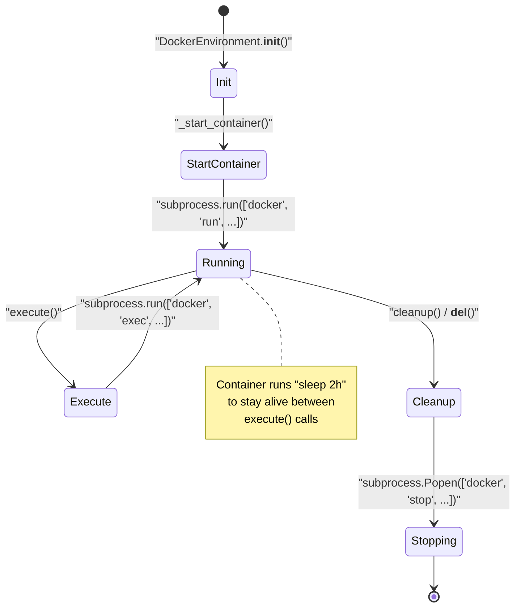
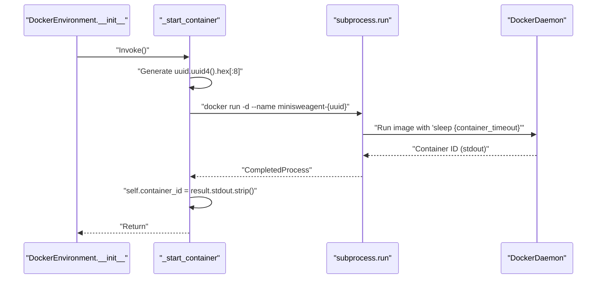
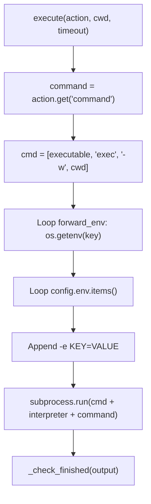
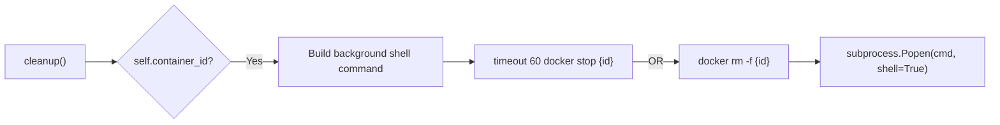
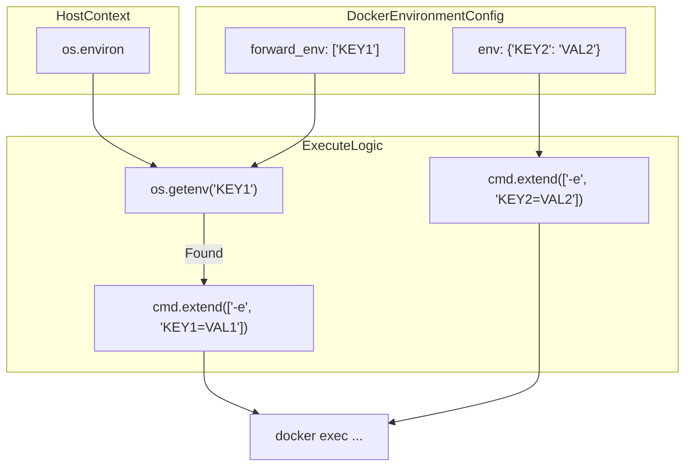

# DockerEnvironment

Relevant source files

The following files were used as context for generating this wiki page:

- [src/minisweagent/environments/docker.py](src/minisweagent/environments/docker.py)
- [src/minisweagent/environments/extra/bubblewrap.py](src/minisweagent/environments/extra/bubblewrap.py)
- [src/minisweagent/environments/extra/swerex_docker.py](src/minisweagent/environments/extra/swerex_docker.py)
- [src/minisweagent/environments/local.py](src/minisweagent/environments/local.py)
- [src/minisweagent/environments/singularity.py](src/minisweagent/environments/singularity.py)
- [tests/conftest.py](tests/conftest.py)
- [tests/environments/extra/__init__.py](tests/environments/extra/__init__.py)
- [tests/environments/extra/test_swerex_docker.py](tests/environments/extra/test_swerex_docker.py)
- [tests/environments/test_docker.py](tests/environments/test_docker.py)
- [tests/environments/test_local.py](tests/environments/test_local.py)
- [tests/test_fire.py](tests/test_fire.py)

`DockerEnvironment` provides isolated command execution within Docker containers. It implements the Environment protocol by maintaining a persistent container throughout the agent's execution lifecycle, executing commands via `docker exec` rather than creating new containers per command. This approach balances isolation with performance.

For local execution without containerization, see `src/minisweagent/environments/local.py` [src/minisweagent/environments/local.py:1-92](). For HPC environments using Apptainer/Singularity, see `src/minisweagent/environments/singularity.py` [src/minisweagent/environments/singularity.py:1-139](). For integration with the swerex runtime, see `src/minisweagent/environments/extra/swerex_docker.py` [src/minisweagent/environments/extra/swerex_docker.py:1-80]().

Sources: `src/minisweagent/environments/docker.py:45-161` [src/minisweagent/environments/docker.py:45-161]()

## Configuration

`DockerEnvironment` is configured via the `DockerEnvironmentConfig` Pydantic model defined in `src/minisweagent/environments/docker.py` [src/minisweagent/environments/docker.py:15-43](), which specifies container settings, execution parameters, and environment variable handling.

### Configuration Parameters

| Parameter | Type | Default | Description |
|-----------|------|---------|-------------|
| `image` | `str` | (required) | Docker image to use for the container [src/minisweagent/environments/docker.py:16-16]() |
| `cwd` | `str` | `"/"` | Working directory in which to execute commands [src/minisweagent/environments/docker.py:17-18]() |
| `env` | `dict[str, str]` | `{}` | Environment variables to set in the container [src/minisweagent/environments/docker.py:19-20]() |
| `forward_env` | `list[str]` | `[]` | Host environment variables to forward to the container [src/minisweagent/environments/docker.py:21-25]() |
| `timeout` | `int` | `30` | Timeout for executing commands in the container [src/minisweagent/environments/docker.py:26-27]() |
| `executable` | `str` | `os.getenv("MSWEA_DOCKER_EXECUTABLE", "docker")` | Path to the docker/container executable [src/minisweagent/environments/docker.py:28-29]() |
| `run_args` | `list[str]` | `["--rm"]` | Additional arguments to pass to the docker executable [src/minisweagent/environments/docker.py:30-33]() |
| `container_timeout` | `str` | `"2h"` | Max duration to keep container running (`sleep` format) [src/minisweagent/environments/docker.py:34-35]() |
| `pull_timeout` | `int` | `120` | Timeout in seconds for pulling images [src/minisweagent/environments/docker.py:36-37]() |
| `interpreter` | `list[str]` | `["bash", "-lc"]` | Interpreter to use to execute commands [src/minisweagent/environments/docker.py:38-42]() |

The `executable` parameter supports substitution with compatible runtime tools like `podman` [tests/conftest.py:43-64](), enabling rootless container execution. The `run_args` parameter defaults to `["--rm"]` to ensure automatic container removal upon exit [src/minisweagent/environments/docker.py:30-33]().

Sources: `src/minisweagent/environments/docker.py:15-43` [src/minisweagent/environments/docker.py:15-43](), `tests/conftest.py:43-64` [tests/conftest.py:43-64]()

## Container Lifecycle

**Diagram: Container State Transitions in DockerEnvironment**

### Initialization and Container Start

During instantiation, `DockerEnvironment.__init__()` invokes `self._start_container()` to create a long-lived container using `docker run -d` with a `sleep` command [src/minisweagent/environments/docker.py:56-60](), [src/minisweagent/environments/docker.py:74-89](). This pattern prevents overhead from spawning a new container for each agent step.

**Diagram: Container Initialization Sequence in _start_container()**

The container name follows the pattern `minisweagent-{uuid}` where `uuid` is an 8-character hexadecimal string [src/minisweagent/environments/docker.py:76-76](). The `sleep` duration defaults to `"2h"`, keeping the container responsive throughout the session [src/minisweagent/environments/docker.py:34-35](), [src/minisweagent/environments/docker.py:87-88]().

Sources: `src/minisweagent/environments/docker.py:46-60` [src/minisweagent/environments/docker.py:46-60](), `src/minisweagent/environments/docker.py:74-100` [src/minisweagent/environments/docker.py:74-100]()

### Command Execution

Command execution is handled by `execute()` via `docker exec` within the active container [src/minisweagent/environments/docker.py:101-114]().

**Diagram: Command Execution Flow in execute() Method**

The `execute()` method performs the following steps:
1. **Working Directory Setup**: Configures the `-w` flag with the target working directory (`cwd` parameter or `self.config.cwd`) [src/minisweagent/environments/docker.py:104-107]().
2. **Environment Variable Injection**: Appends variables from `forward_env` (if defined in `os.environ`) and overrides or extends them with `config.env` [src/minisweagent/environments/docker.py:108-112]().
3. **Interpreter Wrapping**: Wraps the command in `self.config.interpreter` (defaulting to `["bash", "-lc"]`) [src/minisweagent/environments/docker.py:38-39](), [src/minisweagent/environments/docker.py:113]().

The method returns a dictionary containing `output`, `returncode`, and `exception_info` [src/minisweagent/environments/docker.py:125]().

Sources: `src/minisweagent/environments/docker.py:101-139` [src/minisweagent/environments/docker.py:101-139]()

### Cleanup and Termination

Cleanup is triggered asynchronously via `cleanup()` or automatically upon garbage collection via `__del__()` [src/minisweagent/environments/docker.py:153-161]().

**Diagram: Asynchronous Container Cleanup via cleanup()**

The cleanup routine invokes a background shell command `(timeout 60 {executable} stop {id} || {executable} rm -f {id}) >/dev/null 2>&1 &` to ensure that container resources are freed without blocking execution threads [src/minisweagent/environments/docker.py:156-157]().

Sources: `src/minisweagent/environments/docker.py:153-161` [src/minisweagent/environments/docker.py:153-161]()

## Environment Variable Resolution

`DockerEnvironment` merges configuration-driven environment variables and host-forwarded variables during `execute()` [src/minisweagent/environments/docker.py:108-112]().

**Diagram: Environment Variable Resolution in DockerEnvironment.execute()**

Precedence rules:
1. Variables in `forward_env` are read from the host environment via `os.getenv()` [src/minisweagent/environments/docker.py:108-110]().
2. Variables in `config.env` are explicitly added [src/minisweagent/environments/docker.py:111-112]().
3. If a variable is present in both lists, `config.env` takes precedence because its `-e` flag is appended subsequently [src/minisweagent/environments/docker.py:111-112]().

Sources: `src/minisweagent/environments/docker.py:107-113` [src/minisweagent/environments/docker.py:107-113]()

## Submission Detection

Post-execution processing inspects output via `_check_finished(output)` [src/minisweagent/environments/docker.py:137]().

If the first line of command output matches the sentinel string `COMPLETE_TASK_AND_SUBMIT_FINAL_OUTPUT` with a `returncode` of `0`, a `Submitted` exception is raised containing the submission trajectory payload [src/minisweagent/environments/docker.py:140-151]().

Sources: `src/minisweagent/environments/docker.py:140-151` [src/minisweagent/environments/docker.py:140-151](), `src/minisweagent/exceptions.py:11` [src/minisweagent/exceptions.py:11]()

## Comparison with Other Environments

| Feature | DockerEnvironment | LocalEnvironment | SingularityEnvironment |
|---------|-------------------|------------------|------------------------|
| **Isolation** | Container (namespaces) [src/minisweagent/environments/docker.py:53-55]() | None (host process) [src/minisweagent/environments/local.py:21-21]() | Sandbox (namespaces) [src/minisweagent/environments/singularity.py:44-53]() |
| **Persistence** | Persistent container [src/minisweagent/environments/docker.py:59-59]() | Host filesystem [src/minisweagent/environments/local.py:27-27]() | Ephemeral sandbox [src/minisweagent/environments/singularity.py:44-65]() |
| **Cleanup** | Async background [src/minisweagent/environments/docker.py:157-157]() | None | Sync `shutil.rmtree` [src/minisweagent/environments/singularity.py:135-135]() |
| **Shell** | `bash -lc` [src/minisweagent/environments/docker.py:38-38]() | `shell=True` [src/minisweagent/environments/local.py:76-76]() | `bash -c` [src/minisweagent/environments/singularity.py:95-95]() |

Sources: `src/minisweagent/environments/docker.py:1-161` [src/minisweagent/environments/docker.py:1-161](), `src/minisweagent/environments/local.py:1-92` [src/minisweagent/environments/local.py:1-92](), `src/minisweagent/environments/singularity.py:1-139` [src/minisweagent/environments/singularity.py:1-139]()