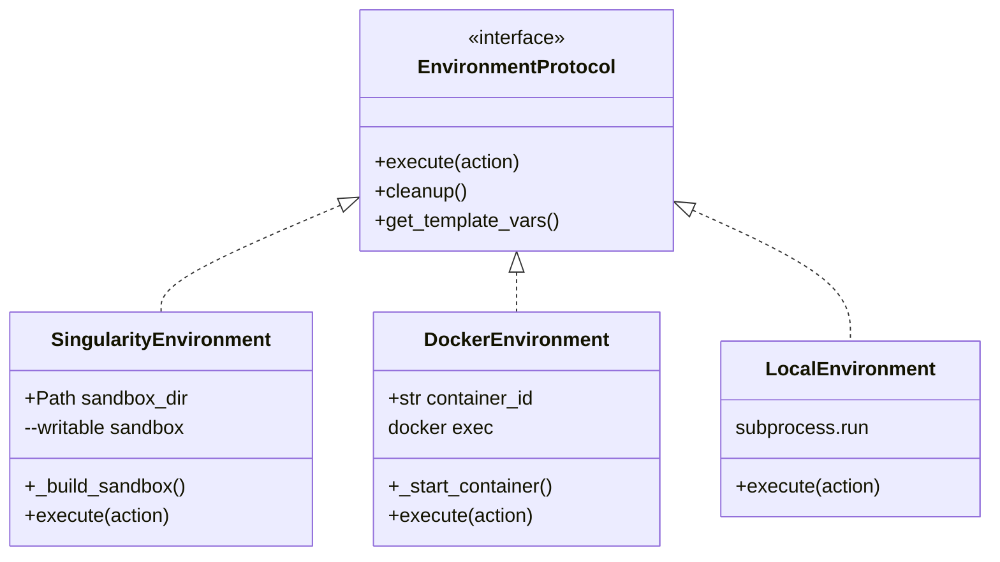

# SingularityEnvironment

<details>
<summary>Relevant source files</summary>

The following files were used as context for generating this wiki page:

- [src/minisweagent/environments/docker.py](src/minisweagent/environments/docker.py)
- [src/minisweagent/environments/extra/bubblewrap.py](src/minisweagent/environments/extra/bubblewrap.py)
- [src/minisweagent/environments/extra/swerex_docker.py](src/minisweagent/environments/extra/swerex_docker.py)
- [src/minisweagent/environments/local.py](src/minisweagent/environments/local.py)
- [src/minisweagent/environments/singularity.py](src/minisweagent/environments/singularity.py)
- [tests/environments/extra/test_bubblewrap.py](tests/environments/extra/test_bubblewrap.py)
- [tests/environments/test_singularity.py](tests/environments/test_singularity.py)

</details>


## Purpose and Scope

The `SingularityEnvironment` class provides isolated command execution using Singularity/Apptainer containers. It is specifically designed for High-Performance Computing (HPC) environments where Docker is typically unavailable due to security constraints. This environment supports building writable sandboxes, provides retry logic for image builds, and ensures strict isolation using the `--contain` and `--cleanenv` flags.

For local execution without containers, see [LocalEnvironment (4.4.1)](). For Docker-based containers, see [DockerEnvironment (4.4.2)](). For other specialized environments like Bubblewrap, see [Other Environments (4.4.4)]().

Sources: [src/minisweagent/environments/singularity.py:1-41]()

---

## Overview

`SingularityEnvironment` implements a "sandbox" approach to containerization. Unlike `DockerEnvironment`, which interacts with a persistent background daemon, `SingularityEnvironment` creates a physical directory (the sandbox) on the host filesystem that represents the container's root. Commands are then executed against this directory using ephemeral `singularity exec` calls.

**Key Features:**
- **Writable Sandbox**: Built once during initialization, allowing persistent filesystem changes across multiple `execute` calls [src/minisweagent/environments/singularity.py:44-46]().
- **HPC Compatibility**: Designed to run as an unprivileged user, often utilizing `--fakeroot` [src/minisweagent/environments/singularity.py:33-33]().
- **Retry Logic**: Automatically retries the sandbox build process up to 3 times to handle transient filesystem or network errors [src/minisweagent/environments/singularity.py:29-30]().
- **Task Completion Detection**: Automatically parses command output for the `COMPLETE_TASK_AND_SUBMIT_FINAL_OUTPUT` token to signal agent termination via the `Submitted` exception [src/minisweagent/environments/singularity.py:121-132]().

Sources: [src/minisweagent/environments/singularity.py:18-35](), [src/minisweagent/environments/singularity.py:121-132]()

---

## Architecture and Data Flow

The following diagram illustrates how `SingularityEnvironment` bridges the high-level `execute` request to the low-level `singularity` CLI.

### Command Execution Flow

```mermaid
graph TD
    subgraph "Natural Language Space"
        Task[""Fix the bug in main.py""]
    end

    subgraph "Code Entity Space: SingularityEnvironment"
        Action[""Action Dict {command: 'sed ...'}""]
        Config[""SingularityEnvironmentConfig""]
        Exec[""execute() function""]
        Build[""_build_sandbox() function""]
        Check[""_check_finished() function""]
    end

    subgraph "External System"
        S_CLI[""singularity CLI executable""]
        Sandbox[""Sandbox Directory (/tmp/minisweagent-...)""]
    end

    Task --> Action
    Action --> Exec
    Config --> Build
    Build -- "singularity build --sandbox" --> S_CLI
    S_CLI -- "creates" --> Sandbox
    Exec -- "singularity exec --writable" --> S_CLI
    S_CLI -- "modifies" --> Sandbox
    Exec --> Check
    Check -- "raises" --> Submitted[""Submitted Exception""]
```

Sources: [src/minisweagent/environments/singularity.py:37-65](), [src/minisweagent/environments/singularity.py:80-119](), [src/minisweagent/environments/singularity.py:121-132]()

---

## Configuration

The environment is configured via `SingularityEnvironmentConfig`, a Pydantic model that defines the container's behavior and constraints.

### Configuration Parameters

| Field | Type | Default | Description |
| :--- | :--- | :--- | :--- |
| `image` | `str` | Required | The source image (e.g., `docker://python:3.11` or a local `.sif` file) [src/minisweagent/environments/singularity.py:18-19](). |
| `cwd` | `str` | `"/"` | Default working directory inside the container [src/minisweagent/environments/singularity.py:20](). |
| `env` | `dict` | `{}` | Environment variables to set inside the container [src/minisweagent/environments/singularity.py:21-22](). |
| `forward_env` | `list` | `[]` | Host environment variables to pass into the container [src/minisweagent/environments/singularity.py:23-24](). |
| `timeout` | `int` | `30` | Execution timeout for each individual command [src/minisweagent/environments/singularity.py:25-26](). |
| `executable` | `str` | `singularity` | Path to binary (overridden by `MSWEA_SINGULARITY_EXECUTABLE`) [src/minisweagent/environments/singularity.py:27-28](). |
| `sandbox_build_retries` | `int` | `3` | Number of attempts to build the sandbox directory [src/minisweagent/environments/singularity.py:29-30](). |
| `global_args` | `list` | `["--quiet"]` | Arguments passed before the `exec` subcommand [src/minisweagent/environments/singularity.py:31-32](). |
| `exec_args` | `list` | `["--contain", "--cleanenv", "--fakeroot"]` | Security and isolation flags for `singularity exec` [src/minisweagent/environments/singularity.py:33-34](). |

Sources: [src/minisweagent/environments/singularity.py:18-35]()

---

## Implementation Details

### Sandbox Lifecycle Management

The sandbox is created in the system's temporary directory with a unique UUID prefix.

1.  **Initialization**: `_build_sandbox` is called during `__init__` [src/minisweagent/environments/singularity.py:38-44]().
2.  **Retry Loop**: If `singularity build` fails, the directory is cleaned up and the process retries up to `sandbox_build_retries` [src/minisweagent/environments/singularity.py:46-65]().
3.  **Cleanup**: The `cleanup` method uses `shutil.rmtree` to delete the sandbox [src/minisweagent/environments/singularity.py:134-135](). This is also registered in `__del__` to ensure resource reclamation even if the process crashes [src/minisweagent/environments/singularity.py:137-139]().

### Command Execution Logic

The `execute` method constructs a CLI command to ensure isolation and writeability [src/minisweagent/environments/singularity.py:80-95](). The use of `--writable` is critical; without it, any changes made by the agent (e.g., editing code) would be lost or would fail due to a read-only filesystem [src/minisweagent/environments/singularity.py:95-95]().

Sources: [src/minisweagent/environments/singularity.py:46-65](), [src/minisweagent/environments/singularity.py:80-119]()

---

## Comparison with Other Environments

`SingularityEnvironment` shares a similar interface with other execution providers but differs in its backend implementation.

### Component Mapping



| Feature | Singularity | Docker | Local |
| :--- | :--- | :--- | :--- |
| **Isolation** | High (Namespaces) | High (Namespaces) | None |
| **Persistence** | Writable Sandbox | Running Container | Host Filesystem |
| **Root Req.** | No (Fakeroot) | Usually Yes (Daemon) | No |
| **Cleanup** | `rmtree` [src/minisweagent/environments/singularity.py:135]() | `docker stop/rm` [src/minisweagent/environments/docker.py:156]() | N/A |

Sources: [src/minisweagent/environments/singularity.py:37-45](), [src/minisweagent/environments/docker.py:45-59](), [src/minisweagent/environments/local.py:18-21]()

---

## Error Handling and Retries

### Sandbox Build Failures
The build process is wrapped in a try-except block specifically catching `subprocess.CalledProcessError`. On failure, it logs the error via `self.logger.error` and increments the attempt counter. If all retries are exhausted, the exception is re-raised [src/minisweagent/environments/singularity.py:48-64]().

### Execution Timeouts
Command execution is protected by a timeout (default 30s). If a command exceeds this limit, a result dictionary is returned with `returncode: -1` and `exception_info` containing the error details, rather than crashing the agent [src/minisweagent/environments/singularity.py:96-117]().

Sources: [src/minisweagent/environments/singularity.py:48-64](), [src/minisweagent/environments/singularity.py:96-117]()