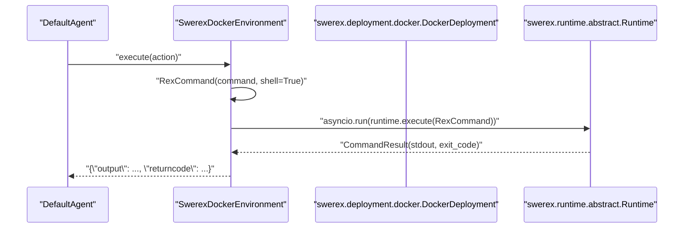
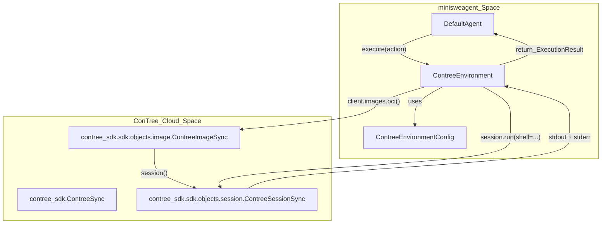

# Other Environments

Relevant source files

The following files were used as context for generating this wiki page:

- [.gitignore](.gitignore)
- [docs/reference/environments/bubblewrap.md](docs/reference/environments/bubblewrap.md)
- [docs/reference/environments/contree.md](docs/reference/environments/contree.md)
- [pyproject.toml](pyproject.toml)
- [src/minisweagent/environments/extra/contree.py](src/minisweagent/environments/extra/contree.py)
- [src/minisweagent/environments/extra/swerex_modal.py](src/minisweagent/environments/extra/swerex_modal.py)
- [tests/environments/extra/test_contree.py](tests/environments/extra/test_contree.py)
- [tests/environments/extra/test_swerex_modal.py](tests/environments/extra/test_swerex_modal.py)

This document covers alternative environment implementations beyond the core [LocalEnvironment](4.4.1), [DockerEnvironment](4.4.2), and [SingularityEnvironment](4.4.3). These specialized environments provide additional execution contexts and sandboxing options, including cloud-based execution and specialized Linux isolation.

## Overview

The `minisweagent.environments.extra` package contains additional environment implementations that extend the core capabilities. These are often used for remote execution or unprivileged local sandboxing.

| Environment | Primary Use Case | Key Feature | Dependencies |
|-------------|-----------------|-------------|--------------|
| `SwerexDockerEnvironment` | SWE-ReX integration | Async execution with enhanced runtime | `swe-rex` |
| `SwerexModalEnvironment` | Cloud-based execution | Serverless sandboxes on [Modal.com](https://modal.com) | `modal`, `swe-rex` |
| `BubblewrapEnvironment` | Linux sandboxing | Low-level, unprivileged isolation | `bubblewrap` (bwrap) |
| `ContreeEnvironment` | ConTree integration | Cloud container execution via SDK | `contree-sdk` |

Sources: [src/minisweagent/environments/extra/swerex_modal.py:37-51](), [src/minisweagent/environments/extra/contree.py:55-58](), [pyproject.toml:50-83](), [docs/advanced/environments.md:23-32]()

## SWE-ReX Environments

The `SwerexDockerEnvironment` and `SwerexModalEnvironment` leverage the [SWE-ReX](https://github.com/SWE-agent/SWE-ReX) library to provide robust sandboxing. These environments bridge SWE-ReX's asynchronous runtime with the synchronous `Environment` protocol used by `minisweagent`.

### SwerexDockerEnvironment

`SwerexDockerEnvironment` wraps the `DockerDeployment` from SWE-ReX, providing a managed Docker lifecycle. It uses `asyncio.run` internally to execute commands through the SWE-ReX runtime.

**SwerexDockerEnvironment Execution Flow**

Sources: [src/minisweagent/environments/extra/swerex_modal.py:63-89]() (Note: SwerexDocker follows a nearly identical pattern to SwerexModal's execution logic).

### SwerexModalEnvironment

`SwerexModalEnvironment` allows running tasks in serverless cloud sandboxes. This is particularly useful for parallelizing large-scale evaluations or training without managing local Docker infrastructure [src/minisweagent/environments/extra/swerex_modal.py:38-51]().

**Key Configuration (`SwerexModalEnvironmentConfig`):**
- `image`: Dockerhub image, ECR image, or path to a Dockerfile [src/minisweagent/environments/extra/swerex_modal.py:13-18]()
- `runtime_timeout`: Maximum duration the Modal sandbox stays alive (default 3600s) [src/minisweagent/environments/extra/swerex_modal.py:27-28]()
- `install_pipx`: Automatically installs `pipx`, which is required for the SWE-ReX runtime [src/minisweagent/environments/extra/swerex_modal.py:31-32]()

The environment uses `ModalDeployment` to manage the cloud lifecycle [src/minisweagent/environments/extra/swerex_modal.py:53-60]().

Sources: [src/minisweagent/environments/extra/swerex_modal.py:12-35](), [src/minisweagent/environments/extra/swerex_modal.py:53-60]()

## BubblewrapEnvironment

`BubblewrapEnvironment` uses [Bubblewrap](https://github.com/containers/bubblewrap), a low-level unprivileged sandboxing tool for Linux. It is an experimental environment and is not supported on Windows [docs/advanced/environments.md:29-30]().

### Execution and Cleanup
1. **Init**: Initializes the environment with specified wrapper arguments [tests/environments/extra/test_bubblewrap.py:13-13]().
2. **Execute**: Runs the command using `subprocess.run` with the `bwrap` executable [tests/environments/extra/test_bubblewrap.py:16-16]().
3. **Cleanup**: Removes temporary resources on destruction via `cleanup()` [tests/environments/extra/test_bubblewrap.py:21-21]().
4. **Timeout Handling**: Returns a structured output with `returncode: -1` and `exception_type: TimeoutExpired` when the execution exceeds the limit [tests/environments/extra/test_bubblewrap.py:121-127]().

Sources: [tests/environments/extra/test_bubblewrap.py:7-21](), [tests/environments/extra/test_bubblewrap.py:119-129]()

## ContreeEnvironment

`ContreeEnvironment` integrates with [ConTree](https://contree.dev) using the `contree-sdk`. It allows execution in cloud-managed containers that support Git-like execution states [src/minisweagent/environments/extra/contree.py:55-58](), [docs/advanced/environments.md:31-32]().

**Contree Architecture and Data Flow**

Sources: [src/minisweagent/environments/extra/contree.py:55-105](), [tests/environments/extra/test_contree.py:42-60]()

### Implementation Details
- **Initialization**: Validates the `ContreeConfig` and creates the working directory if `cwd_auto_create` is enabled [src/minisweagent/environments/extra/contree.py:63-72]().
- **Image Pulling**: Attempts to pull via `client.images.oci()` using the provided `image`, `image_tag`, and optional credentials [src/minisweagent/environments/extra/contree.py:74-80]().
- **Shell Command**: Wraps the command using `shlex.quote` and the configured `interpreter` (default `["bash", "-c"]`) [src/minisweagent/environments/extra/contree.py:82-84]().
- **Environment Forwarding**: Supports both static `env` and `forward_env` (from host). In case of conflict, `env` takes precedence [src/minisweagent/environments/extra/contree.py:31-37](), [src/minisweagent/environments/extra/contree.py:90-91]().
- **Error Handling**: Captures SDK exceptions, extracting `exception_type` and mapping return codes to `-1` for the agent to handle [src/minisweagent/environments/extra/contree.py:106-122]().

Sources: [src/minisweagent/environments/extra/contree.py:21-122]()

## Task Completion Logic

All "Other Environments" implement a consistent `_check_finished` method to detect task completion. If the command output starts with the magic string `COMPLETE_TASK_AND_SUBMIT_FINAL_OUTPUT` and the return code is 0, the environment raises a `Submitted` exception [src/minisweagent/environments/extra/contree.py:124-135](), [src/minisweagent/environments/extra/swerex_modal.py:91-102]().

This mechanism allows the agent to signal completion by echoing the marker followed by the final patch or answer.

Sources: [src/minisweagent/environments/extra/contree.py:124-135](), [src/minisweagent/environments/extra/swerex_modal.py:91-102]()

## Environment Feature Matrix

| Feature | SwerexDocker | SwerexModal | Bubblewrap | Contree |
|---------|--------------|-------------|------------|---------|
| **Host OS** | Any (Docker) | Any (Cloud) | Linux | Any (Cloud) |
| **Backend** | Docker | Modal.com | Linux Namespaces | ConTree |
| **Async Support** | Internal only | Internal only | No | No |
| **Cleanup** | Managed | `stop()` method | `cleanup()` method | Managed |
| **Submission** | `_check_finished` | `_check_finished` | `_check_finished` | `_check_finished` |

Sources: [src/minisweagent/environments/extra/swerex_modal.py:37-61](), [src/minisweagent/environments/extra/contree.py:55-122](), [src/minisweagent/environments/extra/swerex_modal.py:117-124](), [tests/environments/extra/test_bubblewrap.py:21-21]()