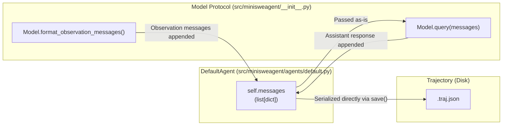
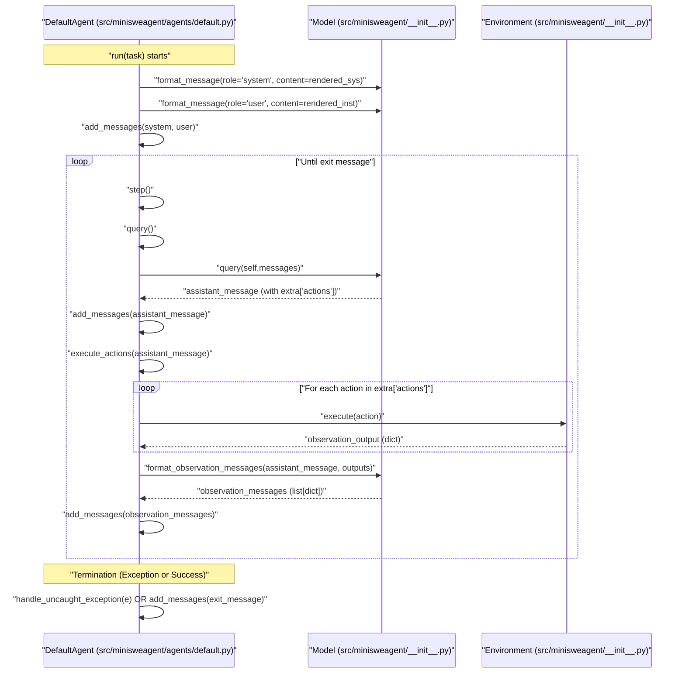

# Message Flow and Linear History

Relevant source files

The following files were used as context for generating this wiki page:

- [src/minisweagent/agents/default.py](src/minisweagent/agents/default.py)
- [tests/agents/test_default.py](tests/agents/test_default.py)

This page explains `mini-swe-agent`'s linear history design, where the `messages` list directly represents the complete conversation with the LLM. This design eliminates the distinction between trajectories and prompts, providing transparency for debugging and simplifying fine-tuning workflows.

Sources: [src/minisweagent/agents/default.py:1-3]()

## Core Principle: Messages Are Everything

The fundamental design of `mini-swe-agent` is that **every interaction with the LLM is stored as a simple list of message dictionaries**. There are no history processors, no separate trajectory representations, and no transformations between what the agent stores and what gets sent to the LLM.

### Data Flow Overview

The following diagram shows how the `messages` list acts as the single source of truth for the model, the agent, and the final output.

**Figure 1: Message-Centric Architecture**

Sources: [src/minisweagent/agents/default.py:42](), [src/minisweagent/agents/default.py:149](), [src/minisweagent/agents/default.py:157](), [src/minisweagent/agents/default.py:177-183](), [src/minisweagent/__init__.py:43-59]()

### Message Structure
Each message in the list follows a standard format compatible with OpenAI/LiteLLM. The `DefaultAgent` uses the `Model.format_message` method to ensure consistency [src/minisweagent/agents/default.py:76-85]().

| Field | Type | Description |
|-------|------|-------------|
| `role` | `str` | Either `"system"`, `"user"`, `"assistant"`, `"tool"`, or `"exit"` |
| `content` | `str` | The text content or rendered template |
| `extra` | `dict` | Metadata (cost, actions, exit status, etc.) |

Sources: [src/minisweagent/agents/default.py:75-86](), [src/minisweagent/agents/default.py:93-94](), [src/minisweagent/agents/default.py:150-152]()

## Message Lifecycle and Control Flow

The `DefaultAgent.messages` list progresses through a predictable sequence during কানা execution of the `run()` method [src/minisweagent/agents/default.py:88-124]().

**Figure 2: Sequence of Message Generation**

Sources: [src/minisweagent/agents/default.py:91-95](), [src/minisweagent/agents/default.py:126-128](), [src/minisweagent/agents/default.py:130-152](), [src/minisweagent/agents/default.py:154-157](), [src/minisweagent/__init__.py:61-71]()

### Initialization Phase
The `run` method resets the history and adds the initial context:
1. **System Message**: Rendered from `system_template` via `_render_template` [src/minisweagent/agents/default.py:93]().
2. **User Message**: Rendered from `instance_template` (containing the `task`) [src/minisweagent/agents/default.py:94]().

Sources: [src/minisweagent/agents/default.py:88-95]()

### Step Loop Phase
Each call to `step()` appends:
1. **Assistant Message**: The LLM's response. It contains an `extra` field with a list of `actions` (e.g., bash commands) and the `cost` of the API call [src/minisweagent/agents/default.py:149-152]().
2. **Observation Messages**: The results of `Environment.execute`. These are formatted by the model (e.g., as `tool` roles for tool-calling models or `user` roles for text-based models) [src/minisweagent/agents/default.py:156-157]().

Sources: [src/minisweagent/agents/default.py:126-158]()

### Termination Phase
Termination is handled via the `InterruptAgentFlow` exception hierarchy. Whether the agent succeeds (`Submitted`), fails (`LimitsExceeded`), or crashes, a final message with `role="exit"` is appended to the history [src/minisweagent/agents/default.py:108-112](), [src/minisweagent/agents/default.py:122-123](). Uncaught exceptions are caught and converted to exit messages with traceback information [src/minisweagent/agents/default.py:74-86]().

Sources: [src/minisweagent/agents/default.py:74-124]()

## Role Distribution and Pattern

The roles follow a strict pattern that matches standard LLM conversation formats, with the addition of an internal `"exit"` role used to signal the end of the trajectory.

| Role | When Added | Implementation |
|------|-----------|----------------|
| `system` | Start of run | `DefaultAgent.run` [src/minisweagent/agents/default.py:93]() |
| `user` | Task description & Observations | `DefaultAgent.run` [src/minisweagent/agents/default.py:94](), `DefaultAgent.execute_actions` [src/minisweagent/agents/default.py:157]() |
| `assistant` | After LLM query | `DefaultAgent.query` [src/minisweagent/agents/default.py:149-152]() |
| `tool` / `user` | Observations | `Model.format_observation_messages` [src/minisweagent/agents/default.py:157]() |
| `exit` | End of trajectory | `DefaultAgent.run` [src/minisweagent/agents/default.py:108-112](), [src/minisweagent/agents/default.py:122]() |

Sources: [src/minisweagent/agents/default.py:76-85](), [src/minisweagent/agents/default.py:93-94](), [src/minisweagent/agents/default.py:149-157]()

## Metadata and the `extra` Field

A key feature of the linear history is the `extra` field. While `role` and `content` are standard, `extra` stores metadata that is stripped before sending to most LLM APIs but preserved in the trajectory for audit and analysis.

*   **Assistant Messages**: Contain `actions` (parsed commands) and `cost` for that specific call [src/minisweagent/agents/default.py:150-156]().
*   **Exit Messages**: Contain `exit_status`, `submission` (the final patch/answer), and `traceback` if an error occurred [src/minisweagent/agents/default.py:79-84]().
*   **Model Stats**: Instance-wide stats like `instance_cost` and `api_calls` are merged into the `info` block during serialization [src/minisweagent/agents/default.py:165-168]().

Sources: [src/minisweagent/agents/default.py:79-84](), [src/minisweagent/agents/default.py:150](), [src/minisweagent/agents/default.py:156](), [src/minisweagent/agents/default.py:165-168]()

## Practical Benefits of Linear History

### 1. Ready for Fine-Tuning
The `messages` list is already in the correct format for fine-tuning. One can simply export the `messages` key from a `.traj.json` file and use it with OpenAI or Anthropic fine-tuning APIs without translation.

### 2. Trivial Debugging and Inspection
The `tests/agents/test_default.py` demonstrates how utilities can extract content from this linear history regardless of the underlying model format (text, tool-call, or response API) [tests/agents/test_default.py:22-54](). This makes it easy to build tools like the `inspector` that work across all model types.

### 3. State Serialization
Because the state of the agent is essentially its history, saving the agent is a matter of serializing the `messages` list and the configuration [src/minisweagent/agents/default.py:159-181](). The `save()` method handles writing this to disk at the end of every step [src/minisweagent/agents/default.py:121]().

Sources: [src/minisweagent/agents/default.py:121](), [src/minisweagent/agents/default.py:159-181](), [tests/agents/test_default.py:22-54]()

## Template Rendering
Before messages are added to the history, templates are rendered using `Jinja2` [src/minisweagent/agents/default.py:66-67](). The `get_template_vars` method aggregates variables from the Agent, Environment, and Model to ensure the templates have access to the current state (e.g., cost, step count, or environment-specific info) [src/minisweagent/agents/default.py:52-64]().

Sources: [src/minisweagent/agents/default.py:52-64](), [src/minisweagent/agents/default.py:66-67]()