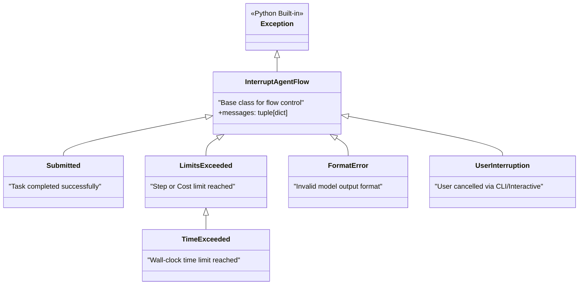
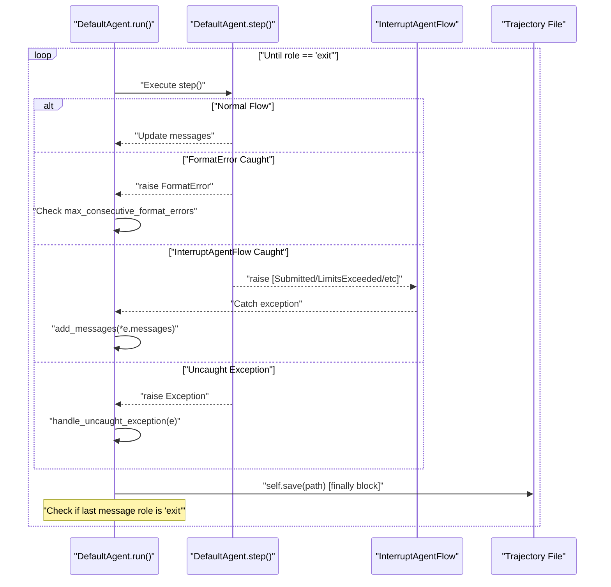

# Exception Handling

Relevant source files

The following files were used as context for generating this wiki page:

- [src/minisweagent/agents/default.py](src/minisweagent/agents/default.py)
- [src/minisweagent/exceptions.py](src/minisweagent/exceptions.py)
- [tests/agents/test_default.py](tests/agents/test_default.py)

This document describes the exception hierarchy and control flow mechanisms in mini-swe-agent. The exception system uses `InterruptAgentFlow` as a base class for all flow control exceptions. These exceptions carry structured messages that are added to the agent's message history, allowing the agent to either recover from errors or terminate gracefully with a recorded status.

---

## Exception Hierarchy

Mini-swe-agent defines a unified exception hierarchy rooted in `InterruptAgentFlow`. All exceptions in this hierarchy carry one or more structured messages (dictionaries) that follow the internal message format.

**Code Entity Space to Exception Hierarchy**

Sources: [src/minisweagent/exceptions.py:1-26](), [src/minisweagent/agents/default.py:15]()

---

## InterruptAgentFlow Base Class

`InterruptAgentFlow` is the functional core of the agent's control flow interruption mechanism. Unlike standard exceptions used for error reporting, these are intended to be caught by the agent's main loop to update the conversation state and potentially terminate the run [src/minisweagent/exceptions.py:1-7]().

**Implementation Details:**
- **Initialization**: Accepts a variable number of message dictionaries `*messages: dict` [src/minisweagent/exceptions.py:4-6]().
- **Data Flow**: When raised, the `DefaultAgent.run` loop catches the exception and extends `self.messages` with the content of `e.messages` [src/minisweagent/agents/default.py:115-116]().

Sources: [src/minisweagent/exceptions.py:1-6](), [src/minisweagent/agents/default.py:115-116]()

---

## Specific Exception Types

### Submitted
`Submitted` is raised when the environment or user detects a task completion [src/minisweagent/exceptions.py:9-11](). In the standard workflow, this is often triggered when the model emits a specific command that the environment interprets as a completion signal.
- **Role**: Signals a successful exit.
- **Status**: The `exit_status` in the trajectory is recorded as `"Submitted"` [tests/agents/test_default.py:149]().

### LimitsExceeded
`LimitsExceeded` is raised by the agent during the `query()` phase if safety thresholds defined in `AgentConfig` are met [src/minisweagent/exceptions.py:13-15](), [src/minisweagent/agents/default.py:132-139]().
- **Trigger**: Checked in `DefaultAgent.query()` [src/minisweagent/agents/default.py:132-139]().
- **Conditions**: 
    - `step_limit`: Maximum number of model calls (`n_calls`) [src/minisweagent/agents/default.py:26-27]().
    - `cost_limit`: Maximum accumulated USD cost (`cost`) [src/minisweagent/agents/default.py:28-29]().

### TimeExceeded
A subclass of `LimitsExceeded` specifically for wall-clock time limits [src/minisweagent/exceptions.py:17-19]().
- **Trigger**: Checked in `DefaultAgent.query()` against `wall_time_limit_seconds` [src/minisweagent/agents/default.py:140-147]().
- **Configuration**: Defined in `AgentConfig.wall_time_limit_seconds` [src/minisweagent/agents/default.py:30-31]().

### FormatError
`FormatError` is raised when the Language Model (LM) provides a response that the parsing logic cannot convert into valid actions [src/minisweagent/exceptions.py:25-26]().
- **Recovery**: The agent catches this and adds a feedback message to the history. It tracks `n_consecutive_format_errors` and will terminate with `RepeatedFormatError` if it exceeds `max_consecutive_format_errors` [src/minisweagent/agents/default.py:100-114]().
- **Cost Tracking**: Even if parsing fails, the cost of the query is billed if the exception contains cost metadata [src/minisweagent/agents/default.py:102]().

### UserInterruption
Used primarily by interactive implementations to stop the agent flow based on human input [src/minisweagent/exceptions.py:21-23]().

Sources: [src/minisweagent/exceptions.py:9-26](), [src/minisweagent/agents/default.py:26-33](), [src/minisweagent/agents/default.py:132-147]()

---

## Control Flow and Exception Handling

The `DefaultAgent.run` method implements the primary logic for handling these exceptions [src/minisweagent/agents/default.py:88-124]().

**Agent Run Loop Data Flow**

**Key Implementation Logic:**
1. **The Try-Except-Finally Block**: The core loop is wrapped in a block that catches `InterruptAgentFlow` and `FormatError` specifically to manage the conversation state [src/minisweagent/agents/default.py:97-120]().
2. **Persistence**: `self.save()` is called in the `finally` block, ensuring the trajectory is written to disk even on failure or interruption [src/minisweagent/agents/default.py:120-121]().
3. **Exit Condition**: The loop terminates only when the last message in the history has the role `"exit"` [src/minisweagent/agents/default.py:122-123]().

Sources: [src/minisweagent/agents/default.py:96-123](), [src/minisweagent/exceptions.py:1-26]()

---

## Uncaught Exceptions

When an exception occurs that is not a subclass of `InterruptAgentFlow` (e.g., a network error or unexpected logic error), `handle_uncaught_exception` is invoked [src/minisweagent/agents/default.py:74-86]().

**Behavior:**
- **Traceback Capture**: Captures the full error context via `traceback.format_exc()` [src/minisweagent/agents/default.py:83]().
- **Exit Message**: Formats a message with `role: "exit"`, setting `exit_status` to the exception class name and including the traceback in the `extra` field [src/minisweagent/agents/default.py:75-85]().
- **Re-raising**: The exception is re-raised after adding the exit message to the history to ensure the calling process is aware of the failure [src/minisweagent/agents/default.py:117-119]().

Sources: [src/minisweagent/agents/default.py:74-86](), [src/minisweagent/agents/default.py:117-119]()