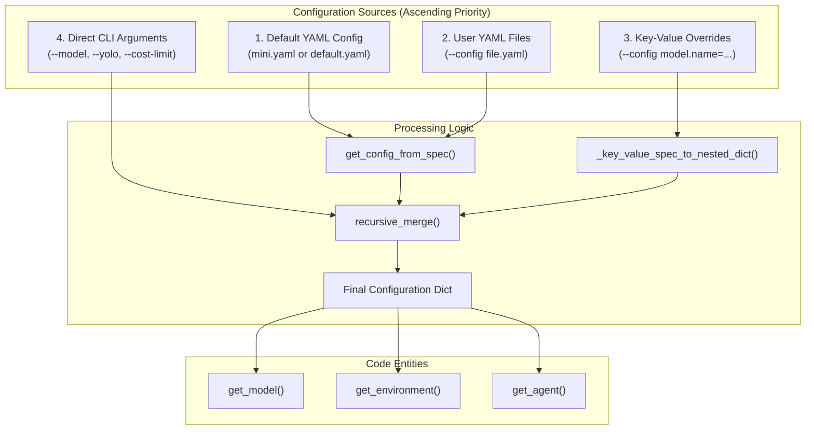
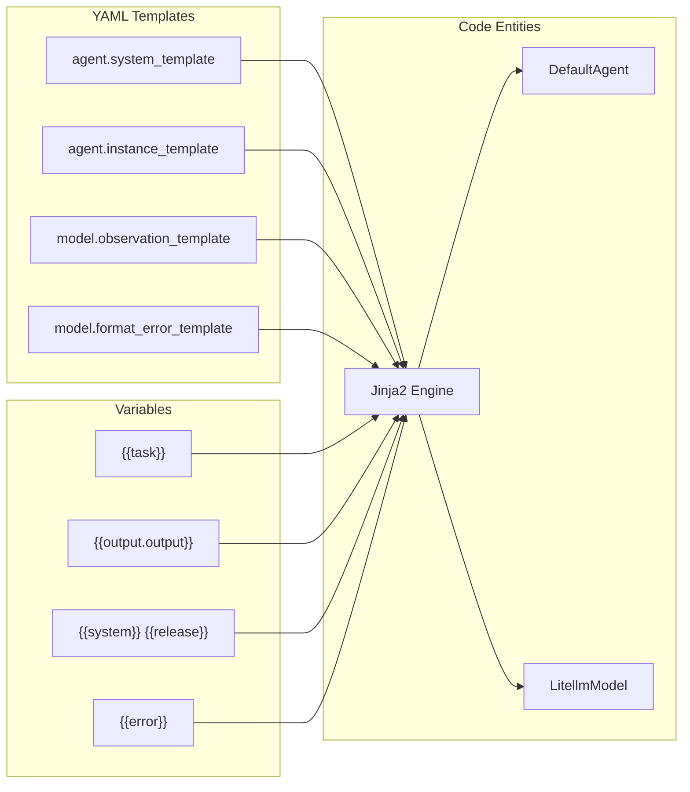

# Configuration System

Relevant source files

The following files were used as context for generating this wiki page:

- [src/minisweagent/config/README.md](src/minisweagent/config/README.md)
- [src/minisweagent/config/__init__.py](src/minisweagent/config/__init__.py)
- [src/minisweagent/run/README.md](src/minisweagent/run/README.md)
- [tests/config/test_init.py](tests/config/test_init.py)

The configuration system manages how settings are specified, merged, and applied throughout `mini-swe-agent`. It provides a flexible, multi-layered approach that combines YAML configuration files, environment variables, and command-line arguments with well-defined precedence rules.

## Overview

The configuration system is built around three core concepts:

1.  **Configuration Sources**: Settings can come from YAML files, a global `.env` file, or CLI arguments [src/minisweagent/config/__init__.py:12-61]().
2.  **Configuration Merging**: The `recursive_merge` function combines multiple configuration dictionaries with proper precedence [src/minisweagent/utils/serialize.py:6-29]().
3.  **UNSET Sentinel**: A special value that distinguishes "not specified" from "explicitly set to None" [src/minisweagent/utils/serialize.py:3]().

The system follows a **last-wins precedence** model where later configuration sources override earlier ones. This enables a flexible workflow where users can define defaults in files and selectively override them via the command line.

**Sources:** [src/minisweagent/utils/serialize.py:1-29](), [src/minisweagent/config/__init__.py:1-63]()

## Configuration Sources and Precedence

The following diagram illustrates how various configuration inputs are resolved into the final objects used by the agent using functions such as `get_config_from_spec` and `_key_value_spec_to_nested_dict`.

### Configuration Resolution Flow

### Precedence Order

Configuration sources are applied in this order (later sources override earlier ones):

| Priority | Source | Example | Purpose |
|----------|--------|---------|---------|
| 1 (Lowest) | Default config file | `mini.yaml`, `default.yaml` | Base configuration for common use cases [src/minisweagent/config/README.md:1-4]() |
| 2 | User config files | `--config my_config.yaml` | Custom reusable configurations [src/minisweagent/config/__init__.py:60-61]() |
| 3 | Key-value overrides | `--config model.model_kwargs.drop_params=false` | Fine-grained overrides without editing files [src/minisweagent/config/__init__.py:31-53]() |
| 4 (Highest) | Direct CLI arguments | `--model`, `--yolo`, `--cost-limit` | Quick one-time overrides |

**Sources:** [src/minisweagent/config/__init__.py:31-61](), [tests/config/test_init.py:13-109]()

## Configuration Files

YAML configuration files define the standard behaviors for different agents and benchmarks (such as `mini.yaml`, `default.yaml`, `swebench.yaml`, and `programbench.yaml`). Built-in configs are located within the package's configuration directory and discovered via `get_config_path` [src/minisweagent/config/__init__.py:12-28]().

For details, see [Configuration Files](#5.1).

**Sources:** [src/minisweagent/config/__init__.py:12-28](), [src/minisweagent/config/README.md:1-8]()

## Global Configuration

Global settings and environment overrides are managed via environment variables (such as `MSWEA_*` settings) and persistent configuration files like `.env`. These control directory paths, execution behavior, and default environment variables.

For details, see [Global Configuration](#5.2).

**Sources:** [src/minisweagent/config/__init__.py:19]()

## Configuration Merging

Configuration merging combines dictionaries using `recursive_merge` while respecting the `UNSET` sentinel value. It handles dot-notation overrides from the command line using `_key_value_spec_to_nested_dict` [src/minisweagent/config/__init__.py:31-53]().

For details, see [Configuration Merging](#5.3).

**Sources:** [src/minisweagent/utils/serialize.py:1-29](), [src/minisweagent/config/__init__.py:31-53]()

## Template System

The template system utilizes Jinja2 to dynamically format prompts, system instructions, and observation templates. The `get_template_vars` and rendering utilities map runtime state to variables available inside agent prompts.

### Prompt Logic Mapping

For details, see [Template System](#5.4).

**Sources:** [src/minisweagent/config/__init__.py:1-64](), [src/minisweagent/utils/serialize.py:1-29](), [tests/config/test_init.py:1-139]()