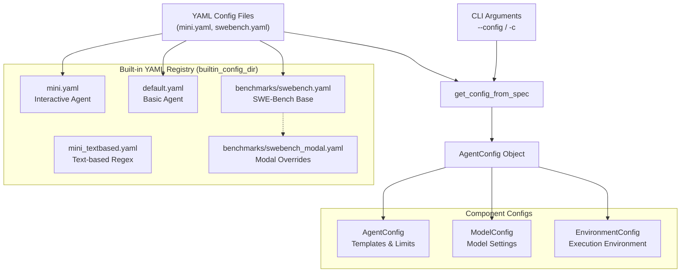
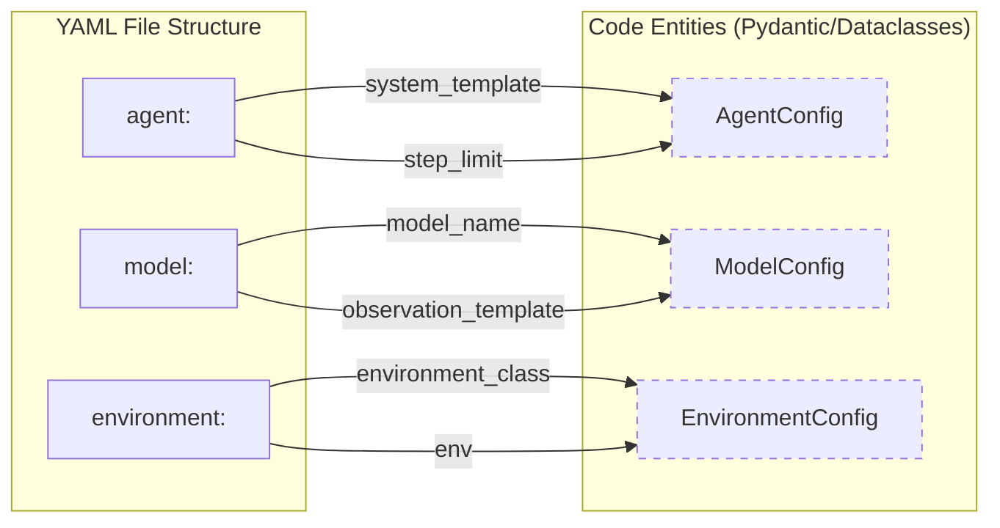
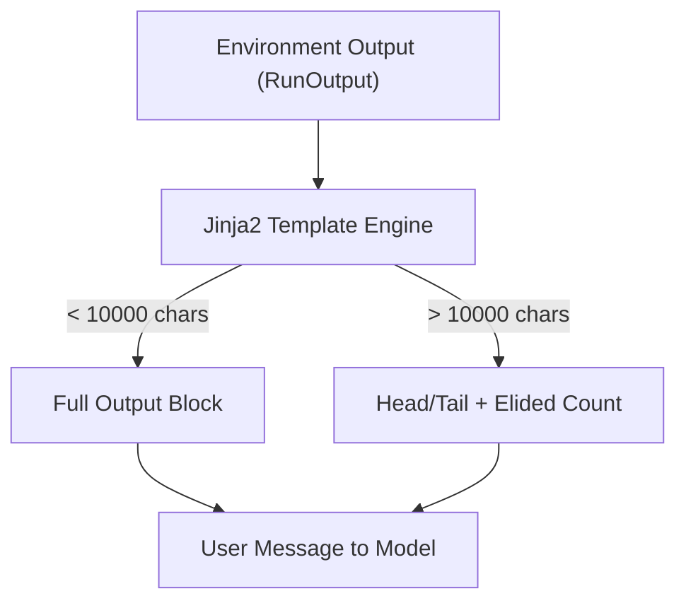

# Configuration Files

Relevant source files

The following files were used as context for generating this wiki page:

- [docs/advanced/environments.md](docs/advanced/environments.md)
- [docs/advanced/yaml_configuration.md](docs/advanced/yaml_configuration.md)
- [src/minisweagent/config/benchmarks/swebench.yaml](src/minisweagent/config/benchmarks/swebench.yaml)
- [src/minisweagent/config/benchmarks/swebench_backticks.yaml](src/minisweagent/config/benchmarks/swebench_backticks.yaml)
- [src/minisweagent/config/benchmarks/swebench_modal.yaml](src/minisweagent/config/benchmarks/swebench_modal.yaml)
- [src/minisweagent/config/benchmarks/swebench_xml.yaml](src/minisweagent/config/benchmarks/swebench_xml.yaml)
- [src/minisweagent/config/default.yaml](src/minisweagent/config/default.yaml)
- [src/minisweagent/config/mini.yaml](src/minisweagent/config/mini.yaml)
- [src/minisweagent/config/mini_textbased.yaml](src/minisweagent/config/mini_textbased.yaml)
- [tests/config/test_swebench_template.py](tests/config/test_swebench_template.py)

This page covers the YAML configuration files that define agent behavior, system prompts, template formatting, and runtime settings in `mini-swe-agent`. These files control how agents interact with models and environments during task execution by mapping YAML structures to internal configuration classes.

## Configuration File Hierarchy

The configuration system resolves settings by merging base YAML files with specialized overrides. This allows for a modular design where a base benchmark config can be extended for specific cloud environments or model parsing strategies.

Title: Configuration Resolution Flow

**Sources**: [src/minisweagent/config/mini.yaml:1-151](), [src/minisweagent/config/benchmarks/swebench.yaml:1-178](), [src/minisweagent/config/benchmarks/swebench_modal.yaml:1-10](), [docs/advanced/yaml_configuration.md:1-8]()

## Configuration File Structure

Each YAML configuration file contains three main sections that map directly to code entities used by the `Agent`, `Model`, and `Environment` protocols.

| Section | Purpose | Code Entity |
|---------|---------|--------------|
| `agent` | Prompts, workflow instructions, and execution limits | `minisweagent.agents.default.AgentConfig` |
| `model` | Model selection, API parameters, and observation formatting | `minisweagent.models.protocol.ModelConfig` |
| `environment` | Shell settings, working directory, and backend class | `minisweagent.environments.protocol.EnvironmentConfig` |

### Mapping YAML to Code Entities

The following diagram shows how YAML keys are ingested into Python dataclasses and Pydantic models.

Title: YAML to Code Entity Mapping

**Sources**: [src/minisweagent/config/mini.yaml:1-151](), [src/minisweagent/config/default.yaml:1-171](), [src/minisweagent/agents/default.py:7-7](), [tests/config/test_swebench_template.py:174-181]()

## Agent Configuration Section

The `agent` section defines the core behavior and templates used by the agent loop. It includes the logic for how the agent should reason and interact with the shell.

### Key Agent Options

| Option | Type | Purpose | File Reference |
|--------|------|---------|----------------|
| `system_template` | String | Base system prompt defining the persona and interaction rules | [src/minisweagent/config/mini.yaml:2-3]() |
| `instance_template` | String | Task-specific prompt including the `{{task}}` variable and workflow | [src/minisweagent/config/mini.yaml:4-53]() |
| `step_limit` | Integer | Maximum execution steps (0 = unlimited) | [src/minisweagent/config/mini.yaml:101-101]() |
| `cost_limit` | Float | Maximum dollar amount allowed for the run | [src/minisweagent/config/mini.yaml:102-102]() |
| `mode` | String | Interaction mode (e.g., `confirm` for human-in-the-loop) | [src/minisweagent/config/mini.yaml:103-103]() |

**Sources**: [src/minisweagent/config/mini.yaml:1-103](), [src/minisweagent/config/default.yaml:1-105]()

## Model Configuration Section

The `model` section controls how the agent communicates with LLMs and how it perceives tool outputs.

### Template Processing

The `observation_template` is a Jinja2 template that processes the `RunOutput` from the environment. It often includes logic to truncate long outputs to stay within context limits. For example, `mini.yaml` provides both `output_head` and `output_tail` if the result exceeds 10,000 characters [src/minisweagent/config/mini.yaml:113-128](). Benchmark configs like `swebench.yaml` use a similar pattern but with XML-like tags for the model to parse [src/minisweagent/config/benchmarks/swebench.yaml:131-158]().

Title: Observation Template Logic

### Model Selection and Parameters

- `model_name`: The identifier used by the provider (e.g., `gpt-5-mini`) [src/minisweagent/config/benchmarks/swebench_modal.yaml:42-42]().
- `model_kwargs`: Parameters passed to the underlying API call, such as `drop_params: true` to strip unsupported parameters for specific providers [src/minisweagent/config/mini.yaml:150-151]().
- `format_error_template`: Instructions sent back to the model when it fails to produce a valid tool call or exceeds token limits [src/minisweagent/config/mini.yaml:129-149]().

**Sources**: [src/minisweagent/config/mini.yaml:111-151](), [src/minisweagent/config/benchmarks/swebench.yaml:130-178](), [src/minisweagent/config/benchmarks/swebench_modal.yaml:41-46](), [tests/config/test_swebench_template.py:57-108]()

## Environment Configuration Section

The `environment` section configures the shell environment where commands are executed.

### Environment Options

| Option | Purpose | Example |
|--------|---------|---------|
| `environment_class` | Backend type | `docker`, `local`, `swerex_modal` |
| `cwd` | Initial working directory | `"/testbed"` |
| `timeout` | Command execution timeout in seconds | `60` |
| `env` | Dictionary of shell environment variables | `PAGER: cat`, `PIP_PROGRESS_BAR: 'off'` |
| `interpreter` | The shell used to run commands | `["bash", "-c"]` |

In `swebench_modal.yaml`, the `environment_class` is set to `swerex_modal` to redirect execution to Modal's cloud infrastructure, including specific timeouts for image building [src/minisweagent/config/benchmarks/swebench_modal.yaml:18-32]().

**Sources**: [src/minisweagent/config/mini.yaml:104-110](), [src/minisweagent/config/benchmarks/swebench.yaml:115-128](), [src/minisweagent/config/benchmarks/swebench_modal.yaml:18-35](), [docs/advanced/environments.md:14-31]()

## Built-in Configuration Files

The project includes several pre-configured YAML files for different use cases:

- **`mini.yaml`**: The default for the `mini` CLI. Uses native tool-calling (JSON) format and `confirm` mode [src/minisweagent/config/mini.yaml:1-151]().
- **`default.yaml`**: A text-based configuration that uses regex parsing for `mswea_bash_command` blocks instead of native tool calls [src/minisweagent/config/default.yaml:1-171]().
- **`mini_textbased.yaml`**: A version of the interactive agent configured to use text-based regex parsing for actions [src/minisweagent/config/mini_textbased.yaml:1-171]().
- **`benchmarks/swebench.yaml`**: Optimized for the SWE-bench benchmark. Includes specific instructions for creating git patches and submitting via `COMPLETE_TASK_AND_SUBMIT_FINAL_OUTPUT` [src/minisweagent/config/benchmarks/swebench.yaml:75-111]().
- **`benchmarks/swebench_backticks.yaml`**: A variant of the SWE-bench config that uses backtick-delimited bash blocks instead of tool calls [src/minisweagent/config/benchmarks/swebench_backticks.yaml:1-16]().
- **`benchmarks/swebench_xml.yaml`**: A variant that uses XML tags (`<mswea_bash_command>`) for action parsing [src/minisweagent/config/benchmarks/swebench_xml.yaml:1-13]().
- **`benchmarks/swebench_modal.yaml`**: Overrides the environment to use Modal cloud sandboxes for SWE-bench execution [src/minisweagent/config/benchmarks/swebench_modal.yaml:1-46]().

**Sources**: [src/minisweagent/config/mini.yaml:1-151](), [src/minisweagent/config/default.yaml:1-171](), [src/minisweagent/config/benchmarks/swebench.yaml:1-178](), [src/minisweagent/config/benchmarks/swebench_backticks.yaml:1-16](), [src/minisweagent/config/benchmarks/swebench_xml.yaml:1-13](), [src/minisweagent/config/benchmarks/swebench_modal.yaml:1-46](), [tests/config/test_swebench_template.py:19-173]()