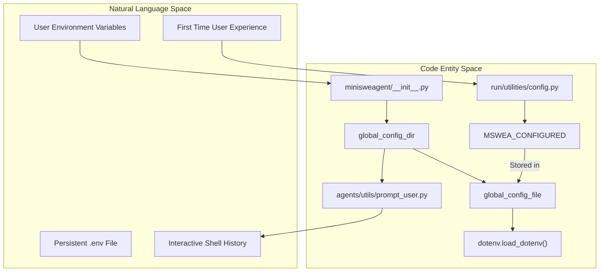
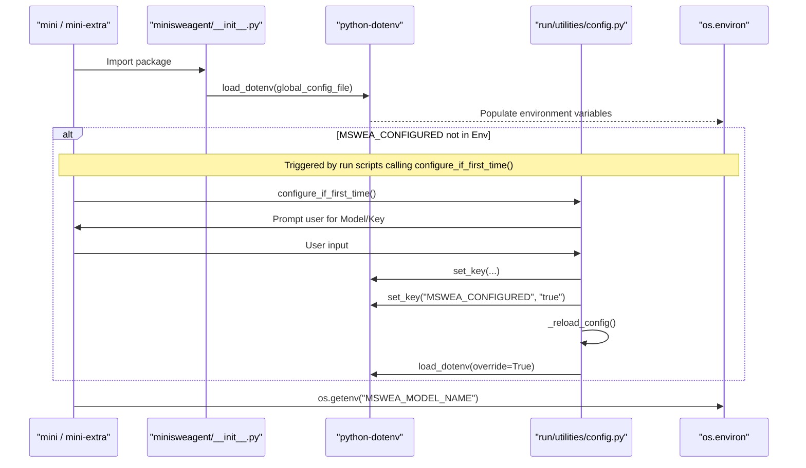

# Global Configuration

Relevant source files

The following files were used as context for generating this wiki page:

- [docs/advanced/global_configuration.md](docs/advanced/global_configuration.md)
- [docs/usage/swebench.md](docs/usage/swebench.md)
- [src/minisweagent/agents/utils/__init__.py](src/minisweagent/agents/utils/__init__.py)
- [src/minisweagent/agents/utils/prompt_user.py](src/minisweagent/agents/utils/prompt_user.py)
- [src/minisweagent/run/utilities/config.py](src/minisweagent/run/utilities/config.py)

This page documents the global configuration system for `mini-swe-agent`, which uses environment variables and a `.env` file to manage settings that apply across all agent runs. Global configuration includes API keys, default models, cost limits, and system-wide preferences.

For agent-specific settings like prompts and behavior parameters, see [Configuration Files](5.1).

## Purpose and Scope

Global configuration in `mini-swe-agent` manages:

- **API credentials** - Keys for various LLM providers (e.g., `ANTHROPIC_API_KEY`, `OPENAI_API_KEY`, `GEMINI_API_KEY`).
- **Default model selection** - The model to use when not specified elsewhere (`MSWEA_MODEL_NAME`).
- **Cost and safety limits** - Global spending and call limits (`MSWEA_GLOBAL_COST_LIMIT`, `MSWEA_GLOBAL_CALL_LIMIT`).
- **System paths** - Locations for config files, executables, and templates.
- **First-time setup state** - Whether the setup wizard has been completed (`MSWEA_CONFIGURED`).

These settings are stored as environment variables or in a `.env` file in the global configuration directory. Unlike YAML configuration files which define agent behavior for specific runs, global configuration provides system-wide defaults and credentials.

Sources: [docs/advanced/global_configuration.md:1-13](), [src/minisweagent/run/utilities/config.py:34-52](), [docs/advanced/global_configuration.md:83-97]()

## Configuration Directory and File Location

The global configuration directory is determined at package import time in the core `__init__.py` file. The resolution follows this precedence:

1.  **`MSWEA_GLOBAL_CONFIG_DIR` environment variable** - If set, this path is used directly [src/minisweagent/__init__.py:26-26]().
2.  **Platform-specific default** - Uses `platformdirs.user_config_dir("mini-swe-agent")` [src/minisweagent/__init__.py:26-26]().

The `.env` file is located at `global_config_dir / ".env"` and is automatically loaded when the package is imported using `dotenv.load_dotenv(dotenv_path=global_config_file)` [src/minisweagent/__init__.py:28-36](). Additionally, persistent history for interactive sessions is stored in `global_config_dir / "interactive_history.txt"` [src/minisweagent/agents/utils/prompt_user.py:7-7]().

**Natural Language to Code Entity Mapping: Configuration Resolution**

Sources: [src/minisweagent/__init__.py:23-36](), [docs/advanced/global_configuration.md:14-18](), [src/minisweagent/run/utilities/config.py:18-22](), [src/minisweagent/agents/utils/prompt_user.py:5-9]()

## Configuration Precedence

Settings are resolved in the following order, with earlier sources taking precedence:

1.  **CLI arguments** - Explicit flags passed to commands like `mini --model anthropic/claude-sonnet-4-5-20250929`.
2.  **Environment variables** - System environment variables set via `export` or `setx`.
3.  **`.env` file** - Variables defined in the global `.env` file.
4.  **YAML configuration** - Settings in YAML config files (lower priority for shared settings).
5.  **Built-in defaults** - Hardcoded defaults in the codebase.

Sources: [docs/advanced/global_configuration.md:14-18](), [docs/advanced/global_configuration.md:50-57]()

## Configuration Management Commands

The `mini-extra config` command suite (implemented in `src/minisweagent/run/utilities/config.py`) provides utilities for managing the global `.env` file.

### Interactive Setup (`mini-extra config setup`)

Interactive wizard for configuration. It prompts for:
- Default model name (e.g., `anthropic/claude-opus-4-6-20260205`).
- API key name and value.
- Sets `MSWEA_CONFIGURED=true` flag [src/minisweagent/run/utilities/config.py:92-92]().

The function `configure_if_first_time()` checks the `MSWEA_CONFIGURED` environment variable and triggers this setup if it is missing [src/minisweagent/run/utilities/config.py:62-67]().

Implementation: [src/minisweagent/run/utilities/config.py:69-97]()

### Key-Value Management

-   **`mini-extra config set KEY VALUE`**: Uses `dotenv.set_key()` to write to the `.env` file and calls `_reload_config()` to update the current process [src/minisweagent/run/utilities/config.py:99-111]().
-   **`mini-extra config unset KEY`**: Uses `dotenv.unset_key()` to remove a key from the `.env` file [src/minisweagent/run/utilities/config.py:113-119]().
-   **`mini-extra config edit`**: Opens the `.env` file in the editor defined by `$EDITOR` (defaults to `nano`) [src/minisweagent/run/utilities/config.py:122-127]().

Sources: [src/minisweagent/run/utilities/config.py:1-131](), [docs/advanced/global_configuration.md:19-48]()

## Environment Variables Reference

### Model and API Configuration

| Variable | Purpose | Default |
|----------|---------|---------|
| `MSWEA_MODEL_NAME` | Default model to use | Not set |
| `ANTHROPIC_API_KEY` | Anthropic API key | Not set |
| `OPENAI_API_KEY` | OpenAI API key | Not set |
| `GEMINI_API_KEY` | Google Gemini API key | Not set |
| `LITELLM_MODEL_REGISTRY_PATH` | Path to custom model registry | Not set |

Sources: [docs/advanced/global_configuration.md:64-81](), [src/minisweagent/run/utilities/config.py:42-44]()

### Cost Tracking and Limits

| Variable | Purpose | Default |
|----------|---------|---------|
| `MSWEA_COST_TRACKING` | Set to `ignore_errors` to bypass cost tracking errors | `default` |
| `MSWEA_GLOBAL_CALL_LIMIT` | Global limit on number of model calls | `0` (no limit) |
| `MSWEA_GLOBAL_COST_LIMIT` | Global cost limit in USD | `0` (no limit) |
| `MSWEA_MODEL_RETRY_STOP_AFTER_ATTEMPT` | Number of retry attempts for model API calls | `10` |

Sources: [docs/advanced/global_configuration.md:70-97](), [docs/usage/swebench.md:139-142]()

### Path Configuration

| Variable | Purpose | Default |
|----------|---------|---------|
| `MSWEA_CONFIG_DIR` | Custom directory for agent config files | Not set |
| `MSWEA_MINI_CONFIG_PATH` | Config path for `mini` run script | `package_dir/config/mini.yaml` |
| `MSWEA_INSPECTOR_STYLE_PATH` | Style path for trajectory inspector | `package_dir/config/inspector.tcss` |
| `MSWEA_SILENT_STARTUP` | Suppress version and config path printout at startup | `False` |

Sources: [docs/advanced/global_configuration.md:101-113](), [src/minisweagent/__init__.py:30-35]()

### Environment Executables

| Variable | Purpose | Default |
|----------|---------|---------|
| `MSWEA_SINGULARITY_EXECUTABLE` | Path/name to singularity/apptainer | `singularity` |
| `MSWEA_DOCKER_EXECUTABLE` | Path/name to docker | `docker` |
| `MSWEA_BUBBLEWRAP_EXECUTABLE` | Path/name to bubblewrap | `bwrap` |

Sources: [docs/advanced/global_configuration.md:117-129]()

### Custom Run Script

| Variable | Purpose | Default |
|----------|---------|---------|
| `MSWEA_DEFAULT_RUN` | Default run script entry point for the main CLI | `minisweagent.run.mini` |

Sources: [docs/advanced/global_configuration.md:133-137]()

## Data Flow: Global Configuration Lifecycle

The following diagram illustrates how the system initializes global settings and handles first-time configuration.

Sources: [src/minisweagent/__init__.py:23-36](), [src/minisweagent/run/utilities/config.py:21-23](), [src/minisweagent/run/utilities/config.py:62-67]()