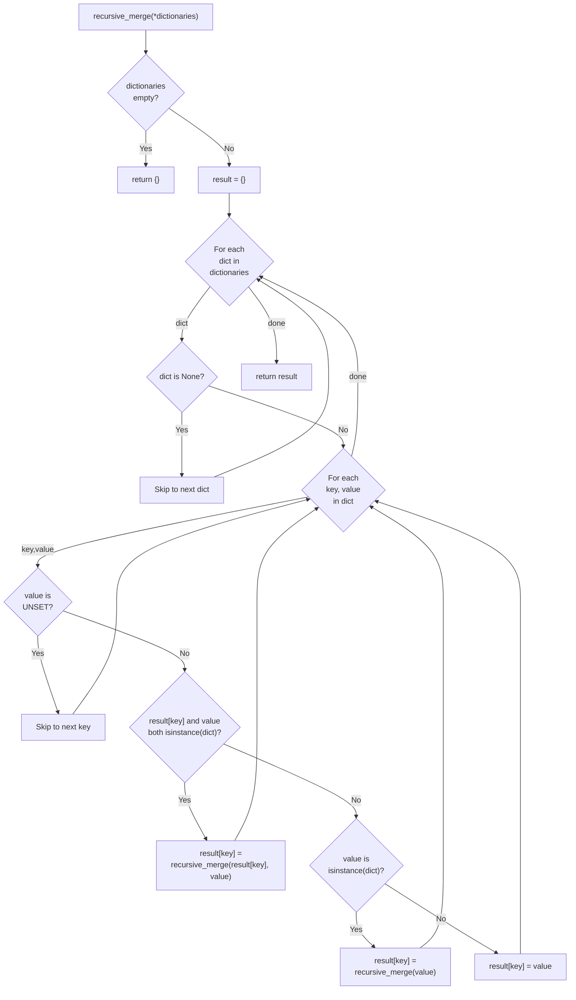
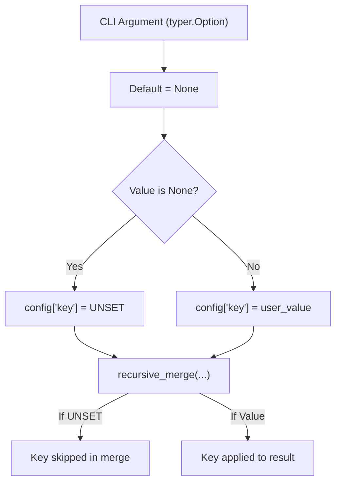
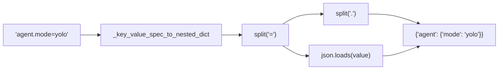
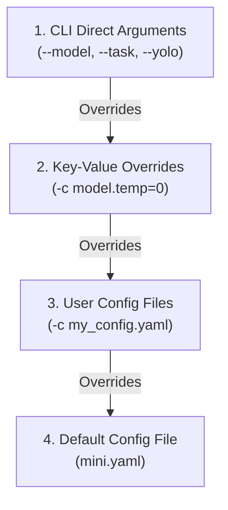

# Configuration Merging

<details>
<summary>Relevant source files</summary>

The following files were used as context for generating this wiki page:

- [src/minisweagent/config/__init__.py](src/minisweagent/config/__init__.py)
- [src/minisweagent/run/mini.py](src/minisweagent/run/mini.py)
- [tests/config/test_init.py](tests/config/test_init.py)
- [tests/run/test_cli_integration.py](tests/run/test_cli_integration.py)
- [tests/run/test_local.py](tests/run/test_local.py)
- [tests/run/test_run_hello_world.py](tests/run/test_run_hello_world.py)
- [tests/test_data/update_outputs_local.py](tests/test_data/update_outputs_local.py)

</details>


## Purpose and Scope

This document explains the configuration merging system in `mini-swe-agent`, specifically how the `recursive_merge` function combines multiple configuration dictionaries with proper precedence handling. This page focuses on the merging algorithm itself, the `UNSET` sentinel pattern, and how CLI arguments are transformed into nested dictionaries for merging.

For information about configuration file formats and structure, see [Configuration Files](5.1). For global `.env` settings and environment variables, see [Global Configuration](5.2). For template variable substitution, see [Template System](5.4).

## The recursive_merge Function

The `recursive_merge` function is the core of the configuration system. It merges multiple dictionaries recursively, with later dictionaries taking precedence over earlier ones.

### Algorithm Overview

The following diagram illustrates the data flow and logic within `recursive_merge`.

**Data Flow: recursive_merge Logic**


Sources: `recursive_merge` implementation in `src/minisweagent/utils/serialize.py` [src/minisweagent/utils/serialize.py:6-29]().

### Key Behaviors

The function implements several important behaviors:

| Scenario | Behavior | Example |
|----------|----------|---------|
| **Both nested dicts** | Recursive merge | `{"a": {"x": 1}}` + `{"a": {"y": 2}}` → `{"a": {"x": 1, "y": 2}}` |
| **Dict overrides non-dict** | Replace with dict | `{"a": "string"}` + `{"a": {"x": 1}}` → `{"a": {"x": 1}}` |
| **Non-dict overrides dict** | Replace with value | `{"a": {"x": 1}}` + `{"a": "string"}` → `{"a": "string"}` |
| **Value is UNSET** | Skip key entirely | `{"a": 1}` + `{"a": UNSET}` → `{"a": 1}` |
| **Dict is None** | Skip entire dict | `{"a": 1}` + `None` + `{"b": 2}` → `{"a": 1, "b": 2}` |
| **List values** | Override, not merge | `{"x": [1, 2]}` + `{"x": [3]}` → `{"x": [3]}` |

Sources: [src/minisweagent/utils/serialize.py:6-29](), [tests/utils/test_serialize.py:14-82]()

## The UNSET Sentinel Pattern

The `UNSET` sentinel is a unique object defined at [src/minisweagent/utils/serialize.py:3]() that allows the system to distinguish between "the user did not specify this argument" and "the user explicitly set this to a falsy value (like None, 0, or False)".

### Why UNSET is Necessary

Without `UNSET`, optional CLI arguments would default to `None`. When merged, these `None` values would overwrite valid defaults in the configuration files. By using `UNSET`, `recursive_merge` knows to skip the key, preserving the lower-precedence default.

**Logic: Sentinel Handling**


Sources: [src/minisweagent/utils/serialize.py:3](), [src/minisweagent/utils/serialize.py:20-21](), [src/minisweagent/run/mini.py:73-91]()

### Filtering Nested UNSET Values

The algorithm also filters nested dictionaries that contain only `UNSET` values. At [src/minisweagent/utils/serialize.py:24-26](), when a value is a dictionary, it is recursively merged even if it is not merging with an existing key. This ensures that:

```python
{"run": {"task": UNSET}} → {"run": {}}
{"a": {"b": {"c": UNSET}}} → {"a": {"b": {}}}
```

Sources: [src/minisweagent/utils/serialize.py:24-26](), [tests/utils/test_serialize.py:141-149]()

## Key-Value Overrides and Config Specs

The CLI allows users to provide configuration via the `-c` or `--config` flag. This flag accepts three types of input, handled by `get_config_from_spec`:
1. **Filenames**: e.g., `mini.yaml` (searched in builtin and user directories) [src/minisweagent/config/__init__.py:12-28]().
2. **Paths**: Direct paths to YAML files.
3. **Key-Value Pairs**: e.g., `model.model_name=gpt-4o`.

### Key-Value Parsing

The function `_key_value_spec_to_nested_dict` converts dot-notated strings into nested dictionaries. It also attempts to parse the value as JSON (handling numbers, booleans, and lists) before falling back to a raw string [src/minisweagent/config/__init__.py:31-53]().

**Code Entity Mapping: CLI Spec to Dict**


Sources: [src/minisweagent/config/__init__.py:31-53](), [src/minisweagent/config/__init__.py:56-61](), [tests/config/test_init.py:17-95]()

## Configuration Precedence Order

The precedence of configuration sources is determined by the order of arguments passed to `recursive_merge`. Later arguments in the list override earlier ones. In `mini.py`, the CLI arguments are converted into a final dictionary that is appended to the list of configs, giving them the highest precedence [src/minisweagent/run/mini.py:73-92]().

**Precedence Hierarchy (Highest to Lowest)**


Sources: [src/minisweagent/utils/serialize.py:9](), [src/minisweagent/config/__init__.py:56-61](), [src/minisweagent/run/mini.py:72-92]()

## Merging Examples

### Nested Dictionary Merge
```python
# Source 1 (Default)
{"model": {"model_name": "gpt-4o", "temperature": 0.0}}
# Source 2 (-c model.temperature=0.7)
{"model": {"temperature": 0.7}}

# Result
{"model": {"model_name": "gpt-4o", "temperature": 0.7}}
```

### Type Replacement
```python
# Source 1
{"environment": {"environment_class": "docker"}}
# Source 2 (CLI --environment-class local)
{"environment": {"environment_class": "local"}}

# Result
{"environment": {"environment_class": "local"}}
```

### JSON Value Parsing
The `_key_value_spec_to_nested_dict` function uses `json.loads` to correctly interpret types from the CLI string [src/minisweagent/config/__init__.py:40-43]().

| CLI String | Resulting Dict Value | Type |
|------------|----------------------|------|
| `count=42` | `42` | `int` |
| `temp=0.7` | `0.7` | `float` |
| `enabled=true` | `True` | `bool` |
| `tags=["a","b"]` | `["a", "b"]` | `list` |
| `meta={"id":1}` | `{"id": 1}` | `dict` |

Sources: [src/minisweagent/config/__init__.py:40-43](), [tests/config/test_init.py:31-60]()