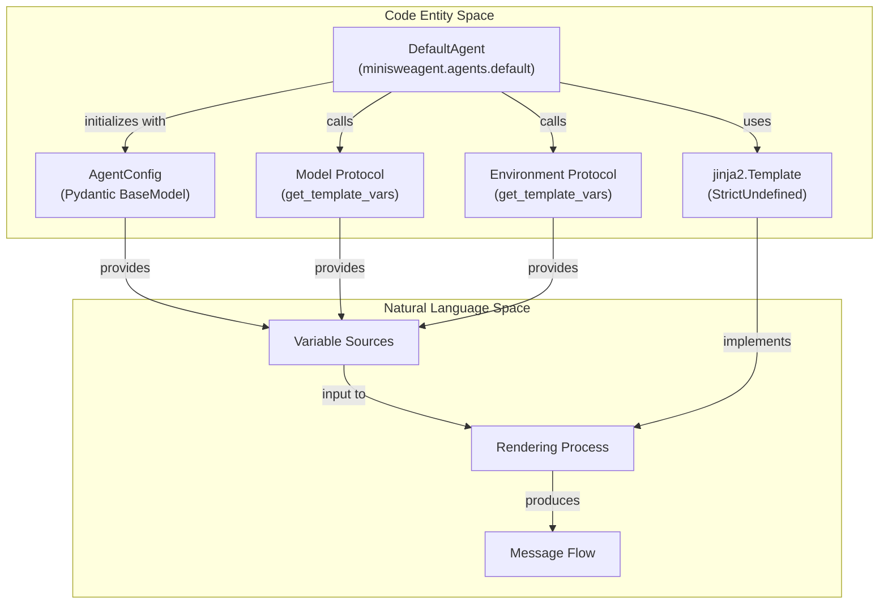
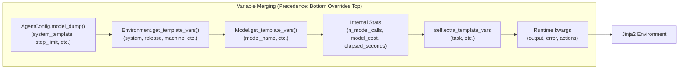
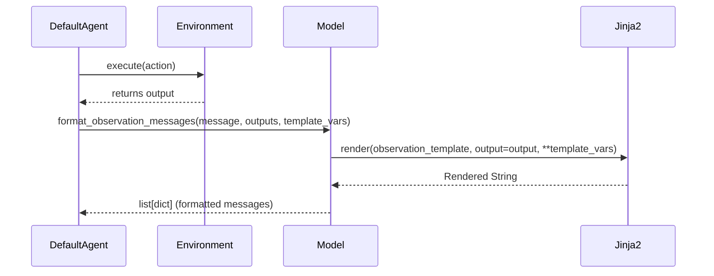

# Template System

<details>
<summary>Relevant source files</summary>

The following files were used as context for generating this wiki page:

- [src/minisweagent/agents/default.py](src/minisweagent/agents/default.py)
- [src/minisweagent/config/default.yaml](src/minisweagent/config/default.yaml)
- [src/minisweagent/config/mini.yaml](src/minisweagent/config/mini.yaml)
- [src/minisweagent/config/mini_textbased.yaml](src/minisweagent/config/mini_textbased.yaml)
- [tests/agents/test_default.py](tests/agents/test_default.py)
- [tests/config/test_swebench_template.py](tests/config/test_swebench_template.py)

</details>


The template system in mini-SWE-agent uses Jinja2 templating to dynamically generate messages sent to the language model and format observations. This enables flexible configuration of agent behavior through YAML files without modifying code. Templates are rendered with variables from multiple sources including configuration, environment, model, and task-specific data.

## Template Rendering Architecture

The template system is primarily managed by the `DefaultAgent` class [src/minisweagent/agents/default.py:38](). It uses Jinja2 with `StrictUndefined` [src/minisweagent/agents/default.py:11](), [src/minisweagent/agents/default.py:67]() to ensure that any missing template variables trigger an explicit error rather than failing silently.

### Data Flow and Code Entities

The following diagram bridges the natural language concepts of the template system to the specific code entities that implement them.



**Diagram: Mapping System Concepts to Code Entities**

Sources: [src/minisweagent/agents/default.py:11-11](), [src/minisweagent/agents/default.py:19-67]()

## Variable Sources and Precedence

The `get_template_vars` method in `DefaultAgent` [src/minisweagent/agents/default.py:52]() aggregates data from multiple components using `recursive_merge` [src/minisweagent/agents/default.py:53](). This creates a unified context for Jinja2 rendering.



**Diagram: Variable Precedence Chain**

The precedence order (highest priority last) is:
1. **Agent Configuration**: Values from the `AgentConfig` Pydantic model [src/minisweagent/agents/default.py:54]().
2. **Environment**: System-level information provided by the execution environment via `env.get_template_vars()` [src/minisweagent/agents/default.py:55]().
3. **Model**: Model-specific variables provided via `model.get_template_vars()` [src/minisweagent/agents/default.py:56]().
4. **Agent State**: Live counters for `n_model_calls`, `model_cost`, and `elapsed_seconds` [src/minisweagent/agents/default.py:57-61]().
5. **Persistent Extra Vars**: Variables like `task` that are set when `run()` is called and stored in `self.extra_template_vars` [src/minisweagent/agents/default.py:62](), [src/minisweagent/agents/default.py:90]().
6. **Immediate Kwargs**: Variables passed directly to the `get_template_vars` call during execution [src/minisweagent/agents/default.py:63]().

Sources: [src/minisweagent/agents/default.py:52-64](), [src/minisweagent/utils/serialize.py:16-16]()

## Key Templates and Their Roles

Templates are defined in the `AgentConfig` class [src/minisweagent/agents/default.py:19-34]() and configured via YAML files like `mini.yaml` [src/minisweagent/config/mini.yaml:1-151](). Note that `AgentConfig` requires `system_template` and `instance_template` to be explicitly provided [src/minisweagent/agents/default.py:22-25](), [tests/config/test_swebench_template.py:180-181]().

| Template Key | Purpose | Variables Commonly Used |
|--------------|---------|-------------------------|
| `system_template` | Defines the agent's identity and high-level rules [src/minisweagent/agents/default.py:22](). | None (usually static) |
| `instance_template` | Sets the specific task and provides environment context [src/minisweagent/agents/default.py:24](). | `{{task}}`, `{{system}}`, `{{machine}}` |
| `observation_template` | Formats the result of a bash command (defined in `model` config) [src/minisweagent/config/mini.yaml:112](). | `{{output.output}}`, `{{output.returncode}}` |
| `format_error_template` | Instructions sent when the LLM fails to follow formatting rules [src/minisweagent/config/mini.yaml:129](). | `{{error}}`, `{{actions}}`, `{{finish_reason}}` |

Sources: [src/minisweagent/agents/default.py:22-25](), [src/minisweagent/config/mini.yaml:2-149](), [tests/config/test_swebench_template.py:174-181]()

## Implementation Detail: Rendering Observations

Rendering observations is a critical loop. When an action is executed, the `Environment` returns an output object (often containing `returncode` and `output` strings) [tests/config/test_swebench_template.py:11-16](). The `DefaultAgent` then uses the `Model` to format this into a message using the `observation_template` [src/minisweagent/agents/default.py:155]().



**Diagram: Observation Rendering Sequence**

Sources: [src/minisweagent/agents/default.py:154-157](), [src/minisweagent/config/mini.yaml:112-128]()

### Handling Long Outputs
Default templates (e.g., in `mini.yaml` [src/minisweagent/config/mini.yaml:113-128]() and `default.yaml` [src/minisweagent/config/default.yaml:119-141]()) include logic to elide middle sections of command outputs if they exceed 10,000 characters to prevent context window exhaustion. This logic is verified in benchmark-specific configurations as well [tests/config/test_swebench_template.py:57-107]().

```jinja

{
  "returncode": {{ output.returncode }},
  "output": {{ output.output | tojson }}
}

{
  "returncode": {{ output.returncode }},
  "output_head": {{ output.output[:5000] | tojson }},
  "output_tail": {{ output.output[-5000:] | tojson }},
  "elided_chars": {{ output.output | length - 10000 }}
}

```

Sources: [src/minisweagent/config/mini.yaml:113-128](), [tests/config/test_swebench_template.py:57-107]()

## Summary of Available Variables

The following variables are standard across most renderings:

*   **From `AgentConfig`**: `step_limit`, `cost_limit`, `wall_time_limit_seconds` [src/minisweagent/agents/default.py:26-31]().
*   **From `Environment`**: `system` (e.g., "Linux"/"Darwin"), `release`, `version`, `machine` [src/minisweagent/config/mini.yaml:51-53]().
*   **From `DefaultAgent`**: `n_model_calls`, `model_cost`, `elapsed_seconds` [src/minisweagent/agents/default.py:57-61]().
*   **From Task Execution**: `task` [src/minisweagent/agents/default.py:90]().
*   **From Runtime (Observation)**: `output` (contains `returncode`, `output`, and optional `exception_info`) [src/minisweagent/config/mini.yaml:115-117]().
*   **From Runtime (Error)**: `error`, `actions`, and `finish_reason` (used in `format_error_template`) [src/minisweagent/config/mini.yaml:130-149]().

Sources: [src/minisweagent/agents/default.py:52-64](), [src/minisweagent/config/mini.yaml:51-149]()