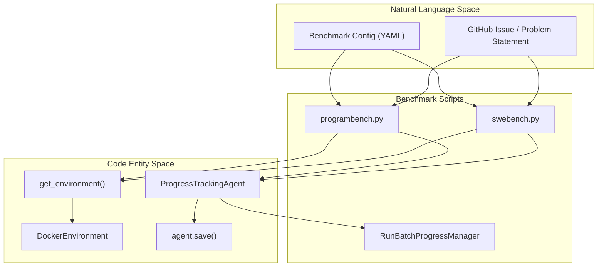
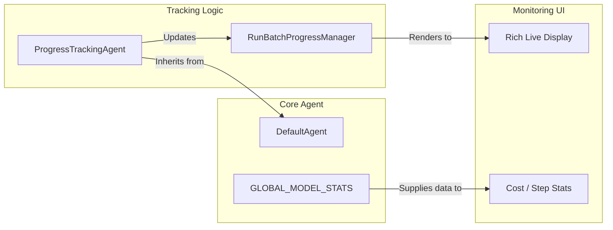

# Benchmark Integration

Relevant source files

The following files were used as context for generating this wiki page:

- [src/minisweagent/run/benchmarks/programbench.py](src/minisweagent/run/benchmarks/programbench.py)
- [src/minisweagent/run/benchmarks/swebench.py](src/minisweagent/run/benchmarks/swebench.py)
- [src/minisweagent/run/benchmarks/utils/common.py](src/minisweagent/run/benchmarks/utils/common.py)
- [src/minisweagent/run/utilities/mini_extra.py](src/minisweagent/run/utilities/mini_extra.py)
- [tests/run/test_programbench.py](tests/run/test_programbench.py)

This document covers the benchmark integration features of `mini-swe-agent`, specifically focusing on **SWE-bench** and **ProgramBench**. These integrations provide automated pipelines for evaluating agents on real-world software engineering tasks and reverse-engineering challenges.

For information about the core agent architecture, see [Core Architecture](#4). For details on configuration, see [Configuration System](#5).

---

## Overview

Benchmark integration is provided through the `mini-extra` utility, which acts as a central entry point for specialized run scripts [src/minisweagent/run/utilities/mini_extra.py:3-6]().

| Benchmark | Command | Purpose |
|-----------|---------|---------|
| **SWE-bench** | `mini-extra swebench` | Large-scale evaluation of GitHub issue resolution. |
| **SWE-bench** | `mini-extra swebench-single` | Interactive debugging of a single issue instance. |
| **ProgramBench** | `mini-extra programbench` | Evaluation on reverse-engineering and code generation tasks. |

Sources: [src/minisweagent/run/utilities/mini_extra.py:13-19]()

### Integration Architecture

The following diagram illustrates how the benchmark scripts bridge high-level task descriptions to specific code entities and execution environments.

Title: Benchmark Pipeline Architecture

Sources: [src/minisweagent/run/benchmarks/swebench.py:122-178](), [src/minisweagent/run/benchmarks/programbench.py:63-117]()

---

## SWE-bench Integration

SWE-bench evaluates an agent's ability to resolve real GitHub issues. `mini-swe-agent` supports multiple subsets (Lite, Verified, Full, etc.) via HuggingFace datasets defined in `DATASET_MAPPING` [src/minisweagent/run/benchmarks/swebench.py:53-62]().

### Batch Evaluation
The `mini-extra swebench` command processes multiple instances in parallel using a `ThreadPoolExecutor`. It manages worker threads, instance filtering (regex, slicing), and result aggregation. The `get_sb_environment` function handles the resolution of SWE-bench specific Docker images via `get_swebench_docker_image_name`, replacing double underscores with a magic token `_1776_` for Docker compatibility [src/minisweagent/run/benchmarks/swebench.py:68-76](). For details, see [SWE-bench Batch Evaluation](#6.1).

### Single Instance Testing
For debugging, `mini-extra swebench-single` allows running a specific instance interactively. It uses `get_sb_environment` [src/minisweagent/run/benchmarks/swebench_single.py:89]() and typically defaults to `InteractiveAgent` [src/minisweagent/run/benchmarks/swebench_single.py:94]() to let users inspect the agent's actions step-by-step. For details, see [SWE-bench Single Instance Testing](#6.2).

### Results and Output
SWE-bench runs produce a `preds.json` file containing the generated patches, formatted for the SWE-bench evaluation harness. The `update_preds_file` function [src/minisweagent/run/benchmarks/swebench.py:97-109]() uses an `_OUTPUT_FILE_LOCK` to ensure thread-safe writing of these results. For details, see [SWE-bench Results and Output](#6.4).

Sources: [src/minisweagent/run/benchmarks/swebench.py:53-62](), [src/minisweagent/run/benchmarks/swebench.py:68-76](), [src/minisweagent/run/benchmarks/swebench.py:97-109](), [src/minisweagent/run/benchmarks/swebench_single.py:89-96]()

---

## ProgramBench Integration

ProgramBench is a benchmark focused on reverse-engineering and complex program generation. The integration is handled by the `mini-extra programbench` command.

### Key Features
*   **Network Isolation**: By default, environments are started with `--network none` in `programbench.yaml` to prevent the agent from accessing external resources [tests/run/test_programbench.py:97-103]().
*   **Submission Layout**: Unlike SWE-bench which outputs patches, ProgramBench requires a `submission.tar.gz` containing the full state of the workspace, handled by `copy_submission` [src/minisweagent/run/benchmarks/programbench.py:46-60]().
*   **Specialized Agent**: Uses `ProgramBenchAgent` [src/minisweagent/run/benchmarks/programbench.py:33-43](), which strips large `raw_output` from tool-result messages in trajectories to keep file sizes manageable.

For details, see [ProgramBench Integration](#6.5).

Sources: [src/minisweagent/run/benchmarks/programbench.py:33-43](), [src/minisweagent/run/benchmarks/programbench.py:46-60](), [tests/run/test_programbench.py:97-103]()

---

## Progress and Monitoring

Evaluation of large benchmarks requires robust monitoring. Both benchmark runners utilize a shared progress tracking system.

### Progress Tracking
The `RunBatchProgressManager` provides a real-time `rich.live` display [src/minisweagent/run/benchmarks/swebench.py:17](). It tracks:
*   Active workers and their current instance via `on_instance_start` [src/minisweagent/run/benchmarks/swebench.py:137]().
*   Number of steps taken per instance via `ProgressTrackingAgent.step` [src/minisweagent/run/benchmarks/utils/common.py:15-17]().
*   Running cost and token usage.
*   Success/Failure status of completed tasks via `on_instance_end` [src/minisweagent/run/benchmarks/programbench.py:117]().

For details, see [Progress Tracking](#6.3).

Sources: [src/minisweagent/run/benchmarks/utils/common.py:7-17](), [src/minisweagent/run/benchmarks/swebench.py:17](), [src/minisweagent/run/benchmarks/programbench.py:117]()

### Entity Mapping: Monitoring to Code

Title: Monitoring Entity Map

Sources: [src/minisweagent/run/benchmarks/utils/common.py:7-17](), [src/minisweagent/run/benchmarks/utils/batch_progress.py]()