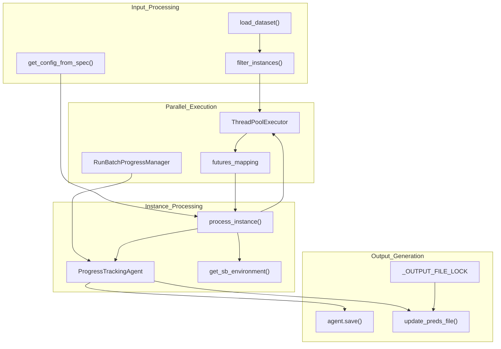
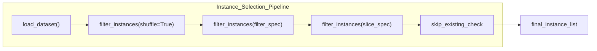
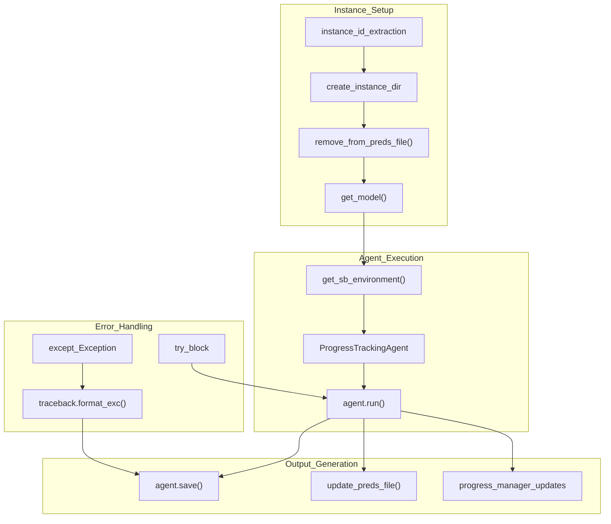
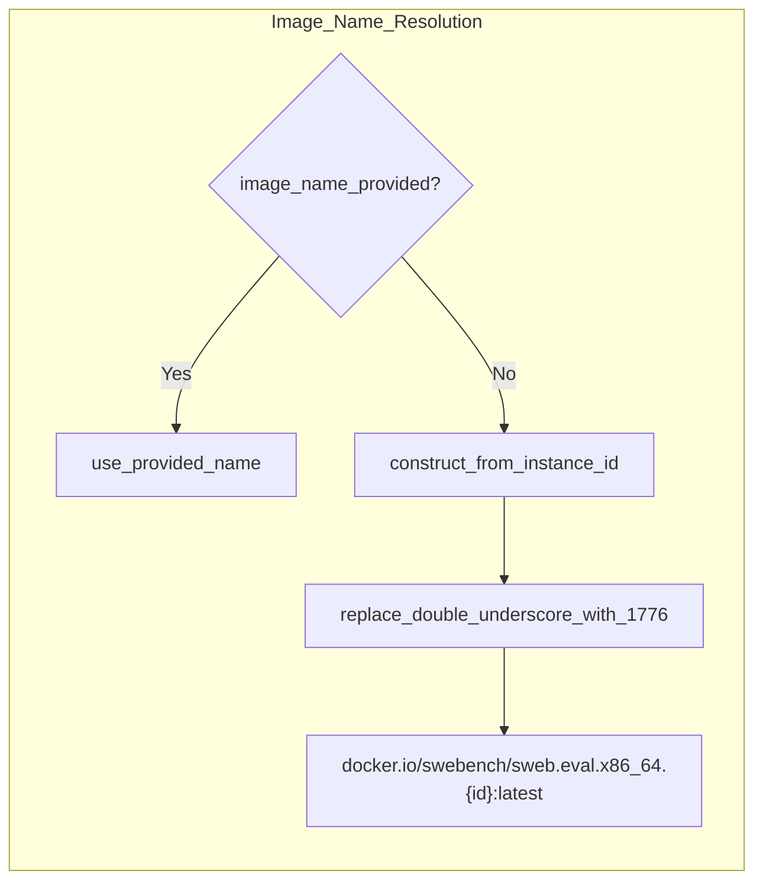
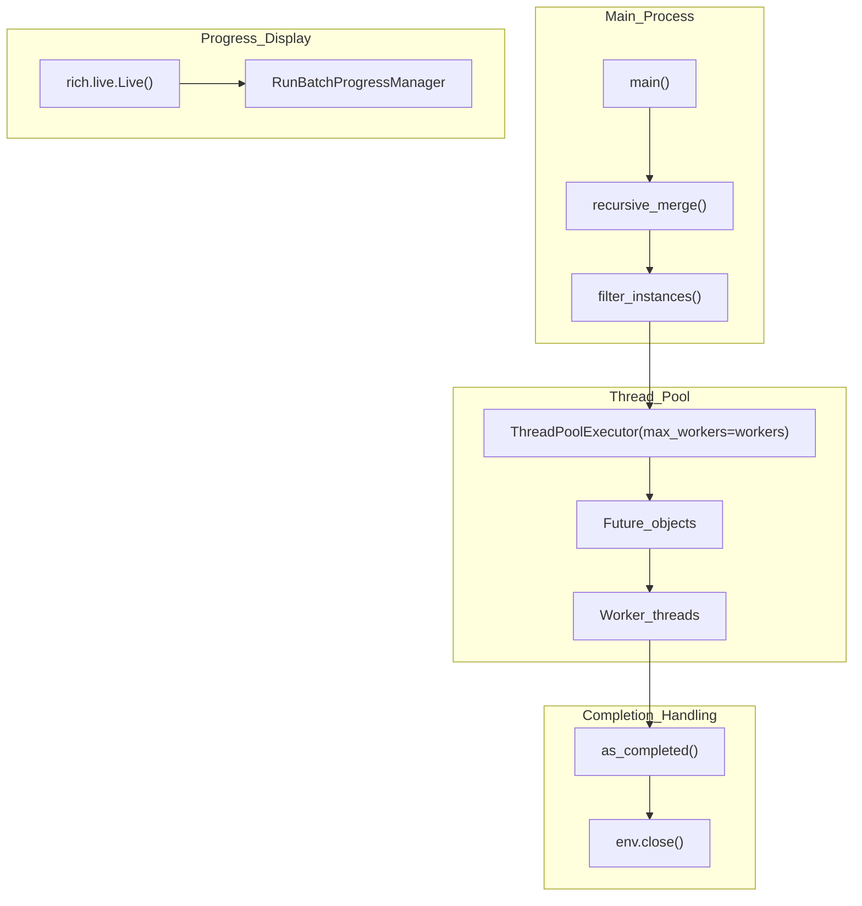
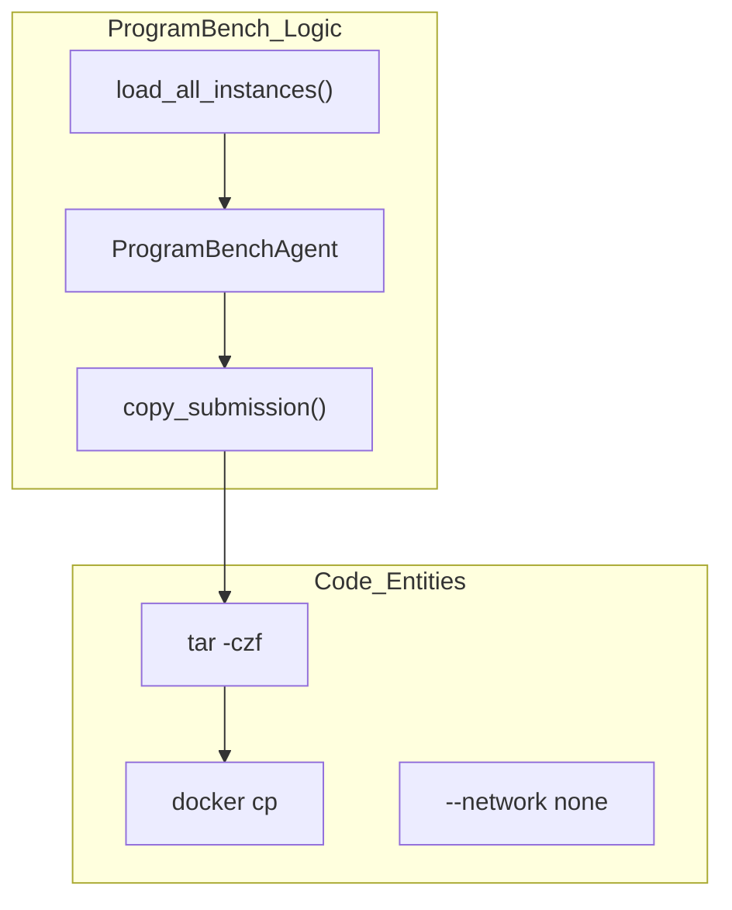

# SWE-bench Batch Evaluation

<details>
<summary>Relevant source files</summary>

The following files were used as context for generating this wiki page:

- [docs/advanced/global_configuration.md](docs/advanced/global_configuration.md)
- [docs/usage/swebench.md](docs/usage/swebench.md)
- [src/minisweagent/run/benchmarks/programbench.py](src/minisweagent/run/benchmarks/programbench.py)
- [src/minisweagent/run/benchmarks/swebench.py](src/minisweagent/run/benchmarks/swebench.py)
- [src/minisweagent/run/benchmarks/utils/common.py](src/minisweagent/run/benchmarks/utils/common.py)
- [src/minisweagent/run/utilities/mini_extra.py](src/minisweagent/run/utilities/mini_extra.py)
- [tests/run/test_programbench.py](tests/run/test_programbench.py)

</details>


This page covers the batch evaluation system for running `mini-swe-agent` on multiple SWE-bench instances simultaneously with parallel processing. Batch evaluation enables automated testing and evaluation of the agent across large datasets of software engineering tasks.

For interactive debugging and testing with individual SWE-bench instances, see [6.2 SWE-bench Single Instance Testing](). For understanding progress tracking and output formats, see [6.3 Progress Tracking]() and [6.4 SWE-bench Results and Output]().

## Purpose and Architecture

The batch evaluation system processes multiple SWE-bench instances in parallel, generating predictions and trajectory files for each instance. It supports various SWE-bench dataset subsets and provides progress tracking, error handling, and result aggregation.

### Batch Processing Flow



**Sources:** [src/minisweagent/run/benchmarks/swebench.py:122-178](), [src/minisweagent/run/benchmarks/swebench.py:275]()

## Dataset Management

The batch evaluation system supports multiple SWE-bench dataset variants through the `DATASET_MAPPING` configuration:

| Dataset Key | HuggingFace Path | Description |
|-------------|------------------|-------------|
| `full` | `princeton-nlp/SWE-Bench` | Complete SWE-bench dataset |
| `verified` | `princeton-nlp/SWE-Bench_Verified` | Verified subset with quality guarantees |
| `lite` | `princeton-nlp/SWE-Bench_Lite` | Smaller subset for quick evaluation |
| `multimodal` | `princeton-nlp/SWE-Bench_Multimodal` | Multimodal tasks |
| `multilingual` | `swe-bench/SWE-Bench_Multilingual` | Multi-language support |
| `smith` | `SWE-bench/SWE-smith` | SWE-smith variant |
| `_test` | `klieret/swe-bench-dummy-test-dataset` | Test dataset for development |
| `rebench` | `nebius/SWE-rebench` | Rebench variant |

**Sources:** [src/minisweagent/run/benchmarks/swebench.py:53-62]()

### Instance Filtering and Selection



The `filter_instances()` function provides flexible instance selection through:
- **Regex filtering**: Match instance IDs with patterns like `django__.*` via `re.match` [src/minisweagent/run/benchmarks/swebench.py:236]().
- **Slice specification**: Select ranges like `0:10` for first 10 instances using Python slice syntax [src/minisweagent/run/benchmarks/swebench.py:235]().
- **Shuffle option**: Randomize order with a deterministic seed (42) to ensure reproducibility [src/minisweagent/run/benchmarks/swebench.py:237]().

**Sources:** [src/minisweagent/run/benchmarks/swebench.py:234-237]()

## Batch Processing Pipeline

### Core Processing Function

The `process_instance()` function handles individual instance execution:



**Sources:** [src/minisweagent/run/benchmarks/swebench.py:122-178]()

### Progress Tracking Agent

The `ProgressTrackingAgent` (defined in `utils/common.py` and used in `swebench.py`) extends `DefaultAgent` to provide real-time updates to the `RunBatchProgressManager`. It overrides the `step()` method to update the instance status with the current step count and cost [src/minisweagent/run/benchmarks/utils/common.py:7-17]().

**Sources:** [src/minisweagent/run/benchmarks/swebench.py:23-24](), [src/minisweagent/run/benchmarks/swebench.py:147-153](), [src/minisweagent/run/benchmarks/utils/common.py:7-17]()

## Environment Configuration

### Docker Image Management

SWE-bench instances use specialized Docker images. The `get_swebench_docker_image_name()` function handles image name generation, including compatibility fixes for Docker:



The magic token `_1776_` replaces double underscores (`__`) because Docker image naming conventions are stricter than SWE-bench instance IDs [src/minisweagent/run/benchmarks/swebench.py:72-75]().

### Environment Setup

The `get_sb_environment()` function configures execution environments:

- **Docker/Modal**: Uses instance-specific images with `docker.io/swebench/sweb.eval.x86_64.*` pattern [src/minisweagent/run/benchmarks/swebench.py:82-84]().
- **Singularity/ConTree**: Converts Docker images with `docker://` prefix [src/minisweagent/run/benchmarks/swebench.py:85-86]().
- **Startup commands**: Executes initialization scripts defined in `run.env_startup_command` using Jinja2 templates [src/minisweagent/run/benchmarks/swebench.py:89-94]().

**Sources:** [src/minisweagent/run/benchmarks/swebench.py:68-94]()

## Parallel Execution

### ThreadPoolExecutor Architecture

The batch runner uses `concurrent.futures.ThreadPoolExecutor` to manage concurrency.



**Sources:** [src/minisweagent/run/benchmarks/swebench.py:275]()

## Output Management

### Predictions File Format

The batch evaluation generates a `preds.json` file in the root output directory. This file is updated incrementally using `update_preds_file()` [src/minisweagent/run/benchmarks/swebench.py:97-108]().

```json
{
  "instance_id": {
    "model_name_or_path": "model_name",
    "instance_id": "instance_id", 
    "model_patch": "git_patch_content"
  }
}
```

### Thread-Safe File Updates

File operations use `_OUTPUT_FILE_LOCK` (a `threading.Lock`) to prevent race conditions during parallel execution [src/minisweagent/run/benchmarks/swebench.py:65](), [src/minisweagent/run/benchmarks/swebench.py:99-108]().

### Trajectory Files

Each instance generates a trajectory file at `{output_dir}/{instance_id}/{instance_id}.traj.json` via `agent.save()` [src/minisweagent/run/benchmarks/swebench.py:163-175]().

## Command Line Interface

The batch evaluation is invoked via `mini-extra swebench`.

### Key Parameters

| Parameter | Description | Default |
|-----------|-------------|---------|
| `--subset` | SWE-bench dataset variant | `lite` |
| `--split` | Dataset split | `dev` |
| `--slice` | Slice specification (e.g., '0:5') | `""` |
| `--filter` | Filter instance IDs by regex | `""` |
| `--workers` | Number of parallel threads | `1` |
| `--output` | Output directory | (timestamped) |
| `--config` | Config specs (merged) | `swebench.yaml` |

**Sources:** [src/minisweagent/run/benchmarks/swebench.py:218-262](), [docs/usage/swebench.md:39-64]()

## ProgramBench Integration

The `mini-extra programbench` command provides a similar batch evaluation workflow for the ProgramBench benchmark.

### ProgramBench Execution Flow


- **Submission Generation**: Unlike SWE-bench which uses git patches, ProgramBench requires a full workspace archive. The `copy_submission` function tars the `/workspace` directory and uses `docker cp` to extract it [src/minisweagent/run/benchmarks/programbench.py:46-60]().
- **Network Isolation**: For security and benchmark integrity, `programbench.yaml` defaults to `--network none` [tests/run/test_programbench.py:97-102]().
- **Trajectory Sanitization**: `ProgramBenchAgent` removes `raw_output` from serialized trajectories to prevent bloat from large build logs [src/minisweagent/run/benchmarks/programbench.py:33-43]().

**Sources:** [src/minisweagent/run/benchmarks/programbench.py:1-118](), [tests/run/test_programbench.py:61-83]()

## Error Handling and Recovery

- **Exception Capture**: The `process_instance` function wraps the agent run in a `try...except` block, capturing the traceback and saving it into the trajectory's `info` field [src/minisweagent/run/benchmarks/swebench.py:157-160]().
- **Resume Capability**: By default, the runner checks if an instance already exists in `preds.json` and skips it unless `--redo-existing` is set [src/minisweagent/run/benchmarks/swebench.py:240-243]().
- **Graceful Shutdown**: `KeyboardInterrupt` triggers a shutdown of the executor, attempting to cancel pending futures while allowing active ones to finish [src/minisweagent/run/benchmarks/swebench.py:275]().

**Sources:** [src/minisweagent/run/benchmarks/swebench.py:157-177](), [src/minisweagent/run/benchmarks/swebench.py:275]()