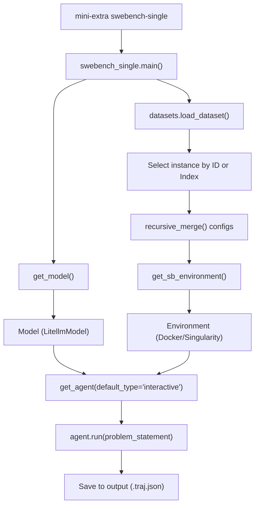
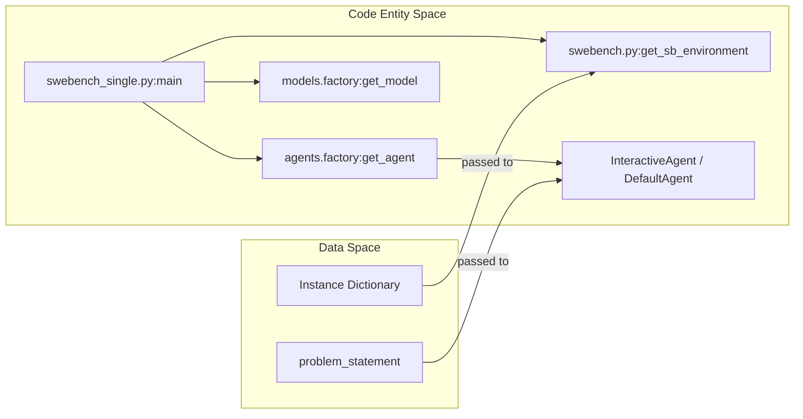

# SWE-bench Single Instance Testing

<details>
<summary>Relevant source files</summary>

The following files were used as context for generating this wiki page:

- [docs/reference/run/swebench_single.md](docs/reference/run/swebench_single.md)
- [src/minisweagent/run/benchmarks/swebench_single.py](src/minisweagent/run/benchmarks/swebench_single.py)
- [tests/run/test_swebench.py](tests/run/test_swebench.py)
- [tests/run/test_swebench_single.py](tests/run/test_swebench_single.py)

</details>


This page covers interactive debugging and testing with individual SWE-Bench instances using `mini-extra swebench-single`. This tool allows developers to run `mini-swe-agent` on a single SWE-Bench instance with full interactivity, making it ideal for debugging agent behavior, testing configuration changes, and understanding how the agent approaches specific problems.

## Overview and Purpose

Single instance testing provides an interactive debugging environment for SWE-Bench evaluation. Unlike batch processing (via `mini-extra swebench`), which runs multiple instances in parallel without user intervention, single instance testing focuses on one specific SWE-Bench task and allows real-time observation and intervention during agent execution.

Key capabilities:
- Run individual SWE-Bench instances interactively.
- Debug agent behavior step-by-step using the `interactive` agent type [src/minisweagent/run/benchmarks/swebench_single.py:94-94]().
- Test different models and configurations quickly [src/minisweagent/run/benchmarks/swebench_single.py:47-53]().
- Control execution flow with confirmation prompts or immediate exit [src/minisweagent/run/benchmarks/swebench_single.py:54-54]().

Sources: [src/minisweagent/run/benchmarks/swebench_single.py:1-56]()

## Command Line Interface

The single instance testing tool is accessed via the `mini-extra swebench-single` command, which invokes the `main` function in `src/minisweagent/run/benchmarks/swebench_single.py` [src/minisweagent/run/benchmarks/swebench_single.py:43-56]().

### Basic Usage

```bash
# Interactive mode with a specific instance ID
mini-extra swebench-single \
    --subset verified \
    --split test \
    --model anthropic/claude-3-5-sonnet-20241022 \
    -i sympy__sympy-15599

# Using instance index instead of ID (0 is the first instance)
mini-extra swebench-single \
    -m anthropic/claude-3-5-sonnet-20241022 \
    -i 0

# Automated mode without prompting for exit confirmation
mini-extra swebench-single \
    -i sympy__sympy-15599 \
    --exit-immediately
```

### Command Line Options

| Flag | Description | Default |
|------|-------------|---------|
| `-m`, `--model` | Model name (e.g., `openai/gpt-4o`) | `None` (uses config) |
| `-c`, `--config` | Path to config files or key-value overrides | `swebench.yaml` |
| `-o`, `--output` | Output trajectory file path | `last_swebench_single_run.traj.json` |
| `--subset` | SWE-Bench subset (lite, verified, etc.) or path to dataset | `lite` |
| `--split` | Dataset split (dev, test) | `dev` |
| `-i`, `--instance` | Instance ID string or numeric index | `0` |
| `--environment-class`| Environment type (`docker`, `singularity`, etc.) | From config |
| `--exit-immediately` | Skip confirmation prompt when agent finishes | `False` |
| `-l`, `--cost-limit` | Cost limit for the run (0 to disable) | `None` |

Sources: [src/minisweagent/run/benchmarks/swebench_single.py:19-20](), [src/minisweagent/run/benchmarks/swebench_single.py:43-56]()

## Instance Selection Logic

The `main` function in `swebench_single.py` handles instance selection by mapping the `--subset` argument to the actual dataset path using `DATASET_MAPPING` [src/minisweagent/run/benchmarks/swebench_single.py:59-59](). It loads the dataset using `datasets.load_dataset` and allows the user to specify the instance via a string ID or an integer index [src/minisweagent/run/benchmarks/swebench_single.py:61-66]().

Sources: [src/minisweagent/run/benchmarks/swebench_single.py:59-67]()

## Architecture and Data Flow

The following diagram illustrates how the `swebench-single` command bridges the gap between the SWE-Bench dataset and the core Agent/Environment protocols.

**Single Instance Testing Flow**

Sources: [src/minisweagent/run/benchmarks/swebench_single.py:59-96](), [src/minisweagent/run/benchmarks/swebench.py:14-15]()

**Code Entity Space Mapping**

Sources: [src/minisweagent/run/benchmarks/swebench_single.py:89-96](), [src/minisweagent/run/benchmarks/swebench.py:12-15]()

## Configuration Merging

`swebench-single` uses a specific precedence for configuration:
1. It starts with the default `swebench.yaml` [src/minisweagent/run/benchmarks/swebench_single.py:20-20]().
2. It merges any additional configs or key-value overrides provided via `-c` [src/minisweagent/run/benchmarks/swebench_single.py:70-70]().
3. It applies CLI-specific overrides (like `--yolo`, `--model`, or `--environment-class`) using the `UNSET` sentinel pattern [src/minisweagent/run/benchmarks/swebench_single.py:71-87](). This ensures that only explicitly provided flags override the config files.

The configuration for SWE-bench often involves specific templates and constraints defined in YAML files such as `swebench.yaml` [src/minisweagent/run/benchmarks/swebench_single.py:20-20]().

Sources: [src/minisweagent/run/benchmarks/swebench_single.py:69-87](), [src/minisweagent/utils/serialize.py:17-20]()

## Interactive Features and Debugging

Unlike the batch `swebench` command, `swebench-single` defaults to an interactive mode:
- **Interactive Agent**: It uses `default_type="interactive"` when calling `get_agent` [src/minisweagent/run/benchmarks/swebench_single.py:94-94]().
- **Exit Confirmation**: Unless `--exit-immediately` is set, the agent will prompt the user when it finishes its task [src/minisweagent/run/benchmarks/swebench_single.py:76-76]().
- **Output**: It saves the trajectory to a single file (default: `last_swebench_single_run.traj.json`) [src/minisweagent/run/benchmarks/swebench_single.py:19-19]().

Sources: [src/minisweagent/run/benchmarks/swebench_single.py:19-19](), [src/minisweagent/run/benchmarks/swebench_single.py:89-96]()

## Testing the Tool

The codebase includes end-to-end tests for this utility using a `DeterministicModel` to simulate agent responses without making real API calls.

| Test Function | File | Description |
|---------------|------|-------------|
| `test_swebench_single_cost_limit_zero_is_preserved` | `tests/run/test_swebench_single.py` | Verifies that explicit `cost_limit=0` is correctly merged into the agent config [tests/run/test_swebench_single.py:25-56](). |
| `test_swebench_single_end_to_end` | `tests/run/test_swebench_single.py` | Verifies the full flow with an explicit instance ID and mocked user prompts [tests/run/test_swebench_single.py:60-97](). |
| `test_swebench_single_end_to_end_exit_immediately` | `tests/run/test_swebench_single.py` | Verifies the flow when the `--exit-immediately` flag is used to skip post-run prompts [tests/run/test_swebench_single.py:100-137](). |

The `DeterministicModel` used in these tests is constructed via `_make_model_from_fixture`, which parses bash commands from text using regex to simulate agent actions [tests/run/test_swebench_single.py:11-22](). Similar logic is used for testing the batch evaluation command in `tests/run/test_swebench.py` [tests/run/test_swebench.py:20-31]().

Sources: [tests/run/test_swebench_single.py:11-137](), [tests/run/test_swebench.py:20-31]()