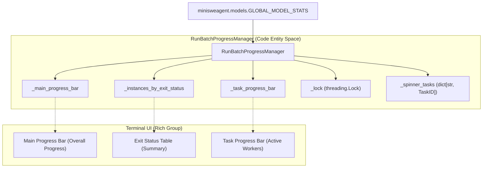
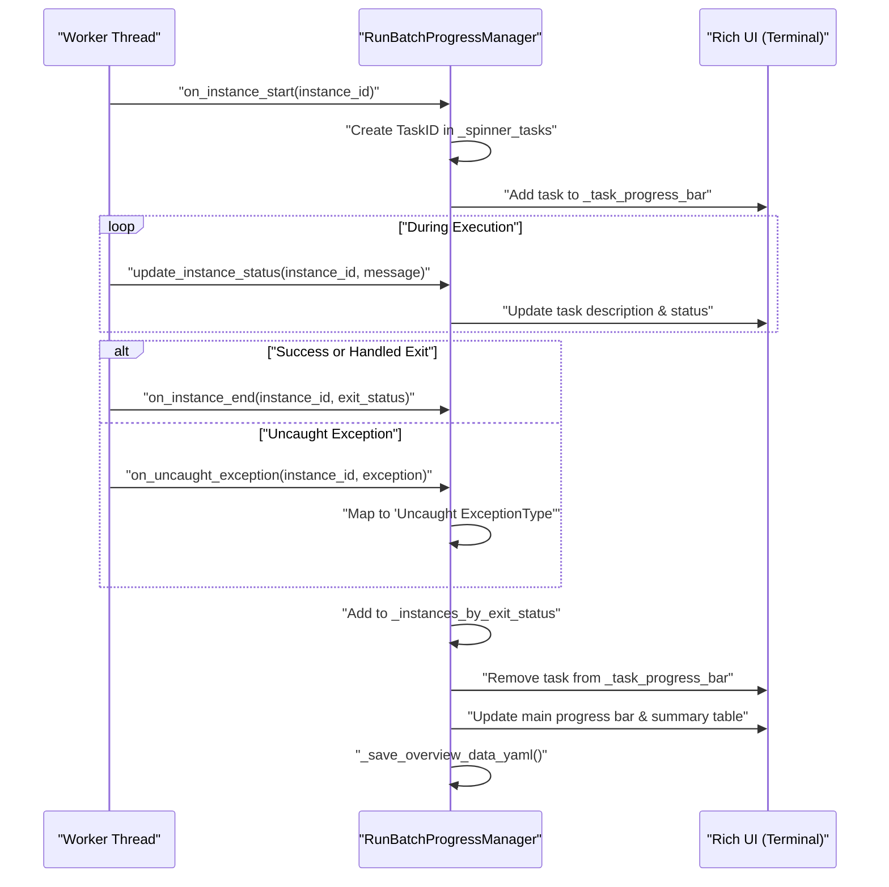

# Progress Tracking

<details>
<summary>Relevant source files</summary>

The following files were used as context for generating this wiki page:

- [src/minisweagent/run/benchmarks/utils/batch_progress.py](src/minisweagent/run/benchmarks/utils/batch_progress.py)
- [tests/run/test_batch_progress.py](tests/run/test_batch_progress.py)

</details>


This document describes the progress tracking system used during batch evaluations. The `RunBatchProgressManager` class provides live status displays, exit status tracking, and YAML report generation for parallel instance processing.

For information about batch evaluation workflow and parallel execution, see [6.1 SWE-bench Batch Evaluation](). For output formats and trajectory files, see [7.3 Output Files]().

## Overview

Progress tracking in `mini-swe-agent` serves three primary purposes:

1.  **Live Monitoring**: Display real-time status of executing instances with spinners, elapsed time, and status messages using the `rich` library.
2.  **Status Categorization**: Group instances by exit status (e.g., `Submitted`, `LimitsExceeded`, or error types) for quick evaluation.
3.  **Persistent Reporting**: Generate YAML files summarizing execution results for post-processing and checkpointing.

The progress manager operates in both single-threaded and multi-threaded batch execution modes, providing thread-safe status updates and coordinated reporting via a `threading.Lock` [src/minisweagent/run/benchmarks/utils/batch_progress.py:9]().

Sources: [src/minisweagent/run/benchmarks/utils/batch_progress.py:1-22](), [src/minisweagent/run/benchmarks/utils/batch_progress.py:9]()

## RunBatchProgressManager Class

The `RunBatchProgressManager` class coordinates progress tracking across all batch execution workers. It maintains state for in-progress instances, completed instances, and their exit statuses.

### Natural Language to Code Entity Mapping

The following diagram maps UI concepts seen in the terminal to the internal code entities of the `RunBatchProgressManager`.

Title: Terminal UI to Code Entity Mapping

Sources: [src/minisweagent/run/benchmarks/utils/batch_progress.py:36-84](), [src/minisweagent/run/benchmarks/utils/batch_progress.py:117-124]()

### Initialization and UI Components

The manager is initialized with the total number of instances and an optional YAML report path [src/minisweagent/run/benchmarks/utils/batch_progress.py:37-41](). It sets up three primary UI components wrapped in a `rich.console.Group` [src/minisweagent/run/benchmarks/utils/batch_progress.py:82]():

1.  **Main Progress Bar**: Shows overall progress, total completion count, total cost (retrieved from `minisweagent.models.GLOBAL_MODEL_STATS`), and an ETA [src/minisweagent/run/benchmarks/utils/batch_progress.py:57-67](), [src/minisweagent/run/benchmarks/utils/batch_progress.py:121]().
2.  **Exit Status Table**: A dynamic table showing the count of instances per exit status and a list of the most recent instance IDs for each status [src/minisweagent/run/benchmarks/utils/batch_progress.py:99-116]().
3.  **Task Progress Bar**: A list of active instances currently being processed by worker threads, including their current status message and elapsed time [src/minisweagent/run/benchmarks/utils/batch_progress.py:68-76]().

Sources: [src/minisweagent/run/benchmarks/utils/batch_progress.py:36-84](), [src/minisweagent/run/benchmarks/utils/batch_progress.py:117-124]()

## Instance Lifecycle Tracking

Each instance transitions through a defined lifecycle that the progress manager tracks using thread-safe hooks protected by a `threading.Lock` [src/minisweagent/run/benchmarks/utils/batch_progress.py:9]() [src/minisweagent/run/benchmarks/utils/batch_progress.py:52]().

### Lifecycle Flow

The following diagram illustrates how the `RunBatchProgressManager` methods map to the lifecycle of a task instance.

Title: Task Lifecycle and Progress Hooks

Sources: [src/minisweagent/run/benchmarks/utils/batch_progress.py:125-160](), [tests/run/test_batch_progress.py:44-51]()

### Lifecycle Methods

| Method | Purpose | Implementation Detail |
| :--- | :--- | :--- |
| `on_instance_start` | Marks beginning of processing for an ID. | Adds a new task to `_task_progress_bar` and stores the `TaskID` in `_spinner_tasks` [src/minisweagent/run/benchmarks/utils/batch_progress.py:136-143](). |
| `update_instance_status` | Updates the live message for an active task. | Updates the specific `TaskID` retrieved from `_spinner_tasks` [src/minisweagent/run/benchmarks/utils/batch_progress.py:125-134](). |
| `on_instance_end` | Finalizes an instance. | Removes task from active list, updates `_instances_by_exit_status`, increments overall progress, and triggers YAML save [src/minisweagent/run/benchmarks/utils/batch_progress.py:145-156](). |
| `on_uncaught_exception` | Handles unexpected crashes. | Wraps `on_instance_end` with a formatted exception name status [src/minisweagent/run/benchmarks/utils/batch_progress.py:158-159](). |

Sources: [src/minisweagent/run/benchmarks/utils/batch_progress.py:125-160]()

## Status and Cost Tracking

### Exit Status Categorization
The manager maintains a `defaultdict(list)` named `_instances_by_exit_status` [src/minisweagent/run/benchmarks/utils/batch_progress.py:56](). Common statuses observed in the codebase include:
*   `Submitted`: Successful agent completion.
*   `LimitsExceeded`: Hit step or cost limits.
*   `Uncaught <Exception>`: Unexpected code failures during the run loop.

The `update_exit_status_table` method recreates the summary table on every update, sorting statuses by frequency [src/minisweagent/run/benchmarks/utils/batch_progress.py:99-116]().

### Cost and ETA Calculation
The manager integrates with `minisweagent.models.GLOBAL_MODEL_STATS` to display the cumulative cost of the entire batch run in the main progress bar [src/minisweagent/run/benchmarks/utils/batch_progress.py:117-124](). ETA is calculated in `_get_eta_text()` based on the average time per completed instance multiplied by remaining instances [src/minisweagent/run/benchmarks/utils/batch_progress.py:89-97]().

Sources: [src/minisweagent/run/benchmarks/utils/batch_progress.py:56-67](), [src/minisweagent/run/benchmarks/utils/batch_progress.py:89-97](), [src/minisweagent/run/benchmarks/utils/batch_progress.py:117-124]()

## Reporting and Serialization

### YAML Reports
If a `yaml_report_path` is provided, the manager serializes the current state of `_instances_by_exit_status` to a YAML file every time an instance completes via `_save_overview_data_yaml()` [src/minisweagent/run/benchmarks/utils/batch_progress.py:155-156](), [src/minisweagent/run/benchmarks/utils/batch_progress.py:175-178](). This ensures that progress is preserved even if the batch process is interrupted.

```yaml
# Example report.yaml generated by _save_overview_data_yaml
instances_by_exit_status:
    Submitted:
        - marshmallow-code__marshmallow-2134
        - django__django-1111
    LimitsExceeded:
        - scikit-learn__scikit-learn-555
```

### Terminal Summary
The `print_report()` method provides a final text summary of all instances grouped by their exit status, intended for display after the `rich` live context has closed [src/minisweagent/run/benchmarks/utils/batch_progress.py:161-167]().

Sources: [src/minisweagent/run/benchmarks/utils/batch_progress.py:161-178](), [tests/run/test_batch_progress.py:87-99]()

## Utility Functions

The module includes a `_shorten_str` utility used to ensure the UI remains clean even with long instance IDs or status messages [src/minisweagent/run/benchmarks/utils/batch_progress.py:28-33]().

| Parameter | Behavior | Implementation |
| :--- | :--- | :--- |
| `shorten_left=False` | Truncates the end (e.g., "long_status_mess...") | `s[: max_len - 3] + "..."` [src/minisweagent/run/benchmarks/utils/batch_progress.py:29-30]() |
| `shorten_left=True` | Truncates the start (e.g., "...instance_id_end") | `"..." + s[-max_len + 3 :]` [src/minisweagent/run/benchmarks/utils/batch_progress.py:31-32]() |

Sources: [src/minisweagent/run/benchmarks/utils/batch_progress.py:28-33](), [tests/run/test_batch_progress.py:20-31]()