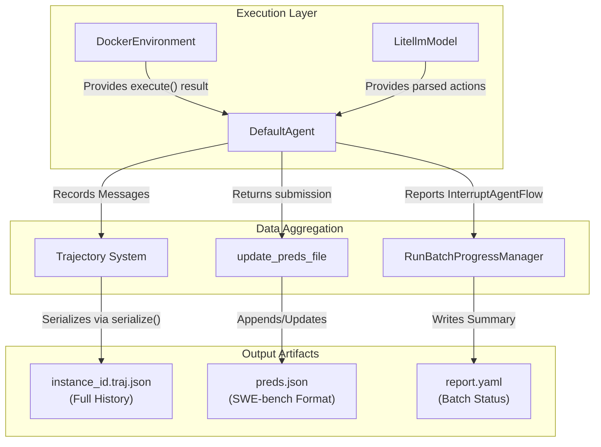
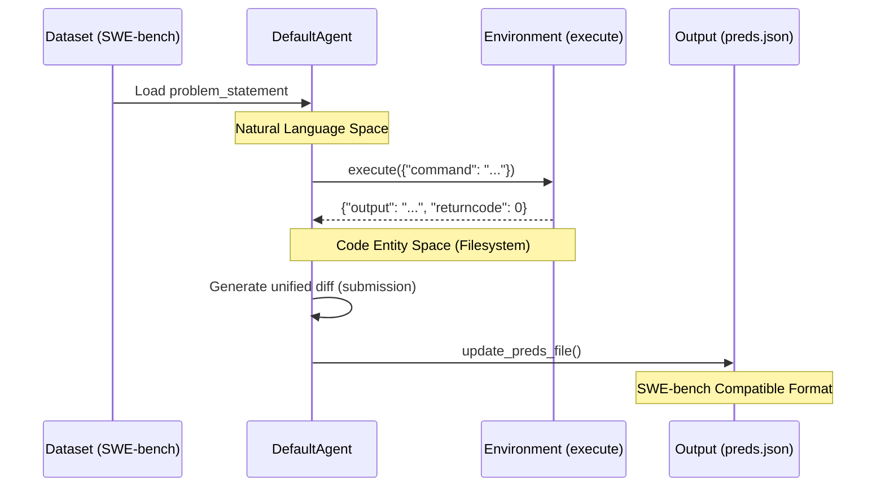

# SWE-bench Results and Output

<details>
<summary>Relevant source files</summary>

The following files were used as context for generating this wiki page:

- [src/minisweagent/run/benchmarks/swebench_single.py](src/minisweagent/run/benchmarks/swebench_single.py)
- [tests/run/test_swebench.py](tests/run/test_swebench.py)
- [tests/run/test_swebench_single.py](tests/run/test_swebench_single.py)
- [tests/test_data/results.json](tests/test_data/results.json)

</details>


This page documents the output files generated by `mini-swe-agent` during execution, particularly for SWE-bench benchmarking. It explains the structure of trajectory files, prediction files, and the data flow during evaluation.

## Output Files Overview

The system generates three primary artifacts during a run. When running batch evaluations via `mini-extra swebench` (implemented in `minisweagent.run.benchmarks.swebench`), these are organized into a structured output directory [tests/run/test_swebench.py:49-50]().

### Data Flow and Code Entities

The following diagram maps the relationship between core execution classes and the resulting file artifacts.


**Diagram: Data Flow and Output Artifacts**

Sources: [tests/run/test_swebench.py:49-50]()

## Trajectory Files (.traj.json)

Trajectory files contain the complete execution history in the `mini-swe-agent-1.1` format. They include the full conversation history, model statistics, and configuration snapshots.

### Structure
A trajectory file is a JSON object containing metadata in an `info` field and the conversation in a `messages` field.

| Field | Description |
| :--- | :--- |
| `info.model_stats` | Tracks `instance_cost` and `api_calls`. |
| `info.config` | Serialized snapshots of `agent`, `model`, and `environment`. |
| `info.exit_status` | The final status (e.g., `Submitted`, `LimitsExceeded`). |
| `messages` | List of chat messages following OpenAI format with `extra` metadata. |
| `trajectory_format`| Version identifier (currently `mini-swe-agent-1.1`). |

### Message Metadata (`extra` field)
In v2.0, messages use the model's native output as a basis, supplemented by an `extra` field for mini-specific metadata.

*   **Assistant Messages**: Include `actions` (parsed commands to execute), `cost`, and `timestamp`.
*   **Observation Messages**: Include `returncode` and `output` (wrapped in XML tags like `<output>`) and `timestamp` of execution.
*   **Final Message**: Contains the final `submission` (patch) and `exit_status`.

Sources: [tests/run/test_swebench.py:75-77]()

## Predictions File (preds.json)

The `preds.json` file aggregates results from all instances in a batch into a single file compatible with official SWE-bench evaluation scripts.

### Format Specification
The file is a dictionary where each key is a unique `instance_id`.

```json
{
  "swe-agent__test-repo-1": {
    "model_name_or_path": "anthropic/claude-sonnet-4-20250514",
    "instance_id": "swe-agent__test-repo-1",
    "model_patch": "diff --git a/tests/missing_colon.py b/tests/missing_colon.py\nindex 20edef5..5857437 100755\n--- a/tests/missing_colon.py\n+++ b/tests/missing_colon.py\n@@ -1,7 +1,7 @@\n #!/usr/bin/env python3\n \n \n-def division(a: float, b: float) -> float\n+def division(a: float, b: float) -> float:\n     return a/b"
  }
}
```
The function `update_preds_file` handles writing these entries during batch runs, ensuring that the `model_patch` is extracted from the agent's final submission [tests/run/test_swebench.py:16-17](). The `test_swebench_end_to_end` function demonstrates how `preds.json` is generated and verified [tests/run/test_swebench.py:70-73]().

Sources: [tests/run/test_swebench.py:61-73](), [tests/test_data/results.json:1-6]()

## Evaluation Workflow

The evaluation workflow bridges the gap between the agent's reasoning space and the environment's execution space.

### Workflow Diagram


**Diagram: SWE-bench Evaluation Workflow**

Sources: [src/minisweagent/run/benchmarks/swebench_single.py:89-96]()

### Handling Exit States
The system tracks various exit conditions defined in the `InterruptAgentFlow` exception hierarchy. These states are recorded in the trajectory `info.exit_status`.

*   **Submitted**: The agent successfully generated a patch and called the completion signal.
*   **LimitsExceeded**: The agent reached the `step_limit` or `cost_limit` configured in `AgentConfig` [src/minisweagent/run/benchmarks/swebench_single.py:52-53]().
*   **UserInterruption**: Triggered when a user manually stops an interactive session (e.g., via `InteractiveAgent`).

Sources: [src/minisweagent/run/benchmarks/swebench_single.py:52-53]()

### Environment Setup
For SWE-bench, the environment is typically a Docker container. The image name is dynamically constructed from the `instance_id` using `get_swebench_docker_image_name` if not explicitly provided [tests/run/test_swebench.py:80-104](). The environment startup often involves executing a command to initialize the repository state, which is passed as a dictionary to `env.execute()` [tests/run/test_swebench.py:107-119]().

Sources: [tests/run/test_swebench.py:80-119]()