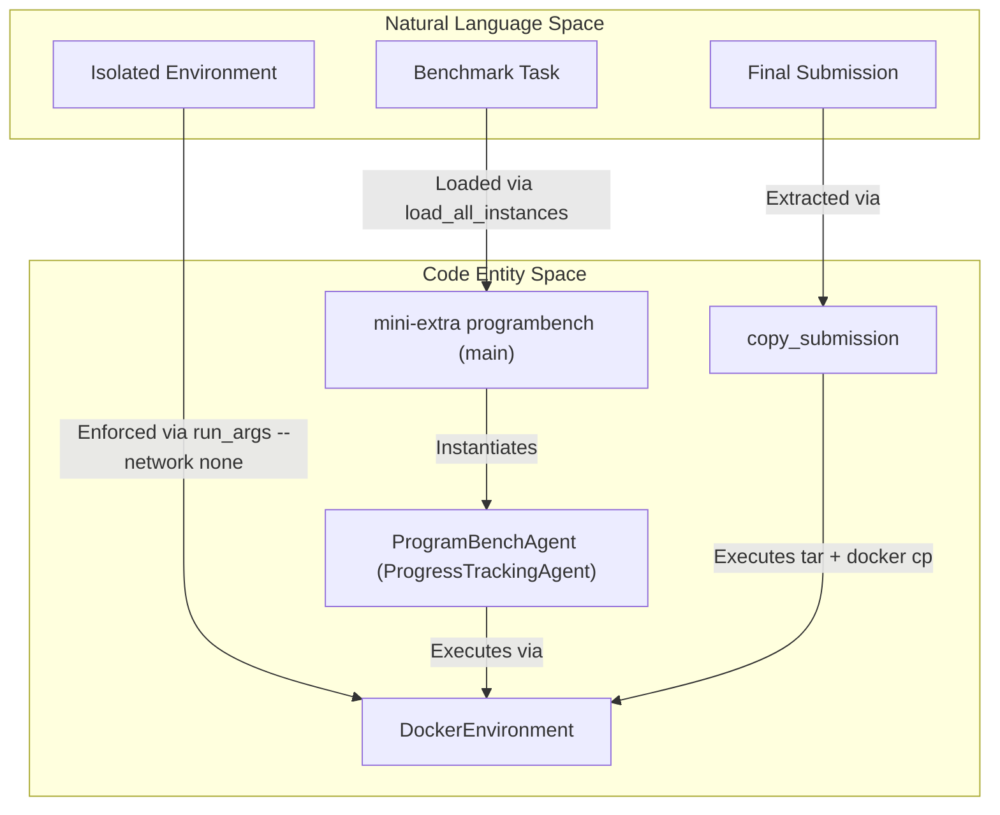
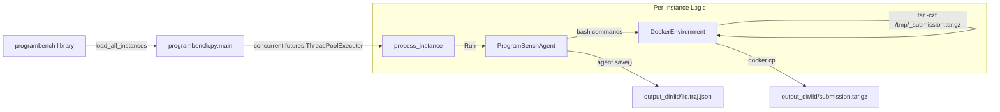

# ProgramBench Integration

Relevant source files

The following files were used as context for generating this wiki page:

- [docs/overrides/main.html](docs/overrides/main.html)
- [docs/reference/run/programbench.md](docs/reference/run/programbench.md)
- [docs/usage/programbench.md](docs/usage/programbench.md)
- [src/minisweagent/config/benchmarks/programbench.yaml](src/minisweagent/config/benchmarks/programbench.yaml)
- [src/minisweagent/run/benchmarks/programbench.py](src/minisweagent/run/benchmarks/programbench.py)
- [src/minisweagent/run/benchmarks/swebench.py](src/minisweagent/run/benchmarks/swebench.py)
- [src/minisweagent/run/benchmarks/utils/common.py](src/minisweagent/run/benchmarks/utils/common.py)
- [src/minisweagent/run/utilities/mini_extra.py](src/minisweagent/run/utilities/mini_extra.py)
- [tests/models/test_truncation_finish_reason.py](tests/models/test_truncation_finish_reason.py)
- [tests/run/test_programbench.py](tests/run/test_programbench.py)

ProgramBench is a challenging reverse-engineering benchmark designed to evaluate AI agents' ability to understand and reimplement software systems from behavioral observation. The `mini-swe-agent` provides a specialized runner for this benchmark via the `mini-extra programbench` command [src/minisweagent/run/utilities/mini_extra.py:18]().

## Overview and Purpose

The ProgramBench integration allows for batch execution of instances where the agent is dropped into a container with a compiled binary and its documentation. The goal is to produce a fresh source codebase that reproduces the binary's behavior [docs/usage/programbench.md:7-9]().

Key features of the integration include:
- **Batch Execution**: Parallel processing of multiple benchmark instances using worker threads [src/minisweagent/run/benchmarks/programbench.py:127]().
- **Network Isolation**: Strict enforcement of offline environments (using `--network none`) to prevent the agent from downloading original source code or using external help [src/minisweagent/config/benchmarks/programbench.yaml:76](), [tests/run/test_programbench.py:97-102]().
- **Output Compatibility**: Generates `submission.tar.gz` files compatible with the official `programbench eval` tool [src/minisweagent/run/benchmarks/programbench.py:24, 46-60]().
- **Trajectory Management**: Specialized serialization that prunes large raw outputs (like binary dumps or long logs) to keep trajectory files manageable [src/minisweagent/run/benchmarks/programbench.py:33-43]().

### Sources:
- [src/minisweagent/run/benchmarks/programbench.py:1-44]()
- [docs/usage/programbench.md:1-10]()
- [src/minisweagent/run/utilities/mini_extra.py:13-19]()

## System Flow: Natural Language to Code Entity

The following diagram bridges the high-level benchmark concepts to the specific code entities in the `mini-swe-agent` implementation.

**ProgramBench Execution Mapping**

### Sources:
- [src/minisweagent/run/benchmarks/programbench.py:33-60]()
- [src/minisweagent/run/benchmarks/programbench.py:122-143]()
- [src/minisweagent/run/benchmarks/utils/common.py:7-17]()
- [src/minisweagent/config/benchmarks/programbench.yaml:76]()

## Configuration and Environment

The integration relies on `programbench.yaml` for default settings. A critical aspect of ProgramBench is the requirement for a "cleanroom" environment.

### Default Configuration
The configuration specifies a detailed system prompt that outlines reverse-engineering rules, such as prohibiting decompilation or network access [src/minisweagent/config/benchmarks/programbench.yaml:5-62]().
- **Environment**: Uses the `docker` environment by default [src/minisweagent/run/benchmarks/programbench.py:86]().
- **Network**: Disables internet access via `--network none` in the environment's `run_args` [src/minisweagent/config/benchmarks/programbench.yaml:76](), [tests/run/test_programbench.py:97-102]().
- **Image**: Hardcoded to use the `task_cleanroom_v6` tag for instance images [src/minisweagent/run/benchmarks/programbench.py:28, 78]().

### Execution Logic
The `process_instance` function orchestrates the lifecycle of a single benchmark instance:

1.  **Environment Setup**: Initializes the Docker container and configures Git identity inside the sandbox [src/minisweagent/run/benchmarks/programbench.py:86-89]().
2.  **Agent Initialization**: Creates a `ProgramBenchAgent` with a path to save the trajectory [src/minisweagent/run/benchmarks/programbench.py:92-99]().
3.  **Run Loop**: Executes `agent.run()`, which manages the interaction between the LLM and the isolated environment [src/minisweagent/run/benchmarks/programbench.py:101]().
4.  **Submission Extraction**: Regardless of success or failure, it attempts to tar the `/workspace` and copy it to the host [src/minisweagent/run/benchmarks/programbench.py:110]().

### Sources:
- [src/minisweagent/run/benchmarks/programbench.py:63-118]()
- [src/minisweagent/config/benchmarks/programbench.yaml:1-62]()
- [tests/run/test_programbench.py:97-104]()

## Data Flow and Output Layout

The integration produces a structured output directory for each run. Each instance has its own subdirectory containing the full trajectory and the submission artifact.

**ProgramBench Data Flow**

### Output Files
| File | Description |
| :--- | :--- |
| `submission.tar.gz` | A gzipped tarball of the `/workspace` directory after the agent completes the task [src/minisweagent/run/benchmarks/programbench.py:46-60](). |
| `iid.traj.json` | The execution trajectory, with `raw_output` removed from message metadata to save space [src/minisweagent/run/benchmarks/programbench.py:33-43, 114](). |
| `minisweagent.log` | Central log file for the entire batch run [src/minisweagent/run/benchmarks/programbench.py:141](). |

### Sources:
- [src/minisweagent/run/benchmarks/programbench.py:33-43]()
- [src/minisweagent/run/benchmarks/programbench.py:108-116]()
- [src/minisweagent/run/benchmarks/programbench.py:138-141]()

## Key Functions and Classes

### `ProgramBenchAgent`
A subclass of `ProgressTrackingAgent` [src/minisweagent/run/benchmarks/utils/common.py:7-17]() that overrides `serialize` [src/minisweagent/run/benchmarks/programbench.py:33-36](). It iterates through the message history and removes `raw_output` from the `extra` and `observations` fields [src/minisweagent/run/benchmarks/programbench.py:37-43](). This prevents trajectory files from bloating when the agent runs commands that produce massive output.

### `copy_submission`
Handles the extraction of the agent's work from the sandbox:
1.  Runs `tar -czf` inside the container to package the `/workspace` [src/minisweagent/run/benchmarks/programbench.py:54]().
2.  Uses `subprocess.run` to call the docker executable (e.g., `docker cp`) to move the tarball from the container to the local filesystem [src/minisweagent/run/benchmarks/programbench.py:55-60]().

### `main`
The Typer command entry point [src/minisweagent/run/benchmarks/programbench.py:122](). It handles:
- **Data Selection**: Supports regex filtering (`--filter`), slicing (`--slice`), and shuffling (`--shuffle`) of instances [src/minisweagent/run/benchmarks/programbench.py:123-125, 144]().
- **Redo Logic**: Can skip instances that already have a `submission.tar.gz` in the output directory unless `--redo-existing` is set [src/minisweagent/run/benchmarks/programbench.py:146-150]().
- **Config Merging**: Merges the default `programbench.yaml` with user-provided overrides from the CLI [src/minisweagent/run/benchmarks/programbench.py:131, 154-158]().

### Sources:
- [src/minisweagent/run/benchmarks/programbench.py:33-43]()
- [src/minisweagent/run/benchmarks/programbench.py:46-60]()
- [src/minisweagent/run/benchmarks/programbench.py:121-160]()
- [src/minisweagent/run/benchmarks/utils/common.py:7-17]()