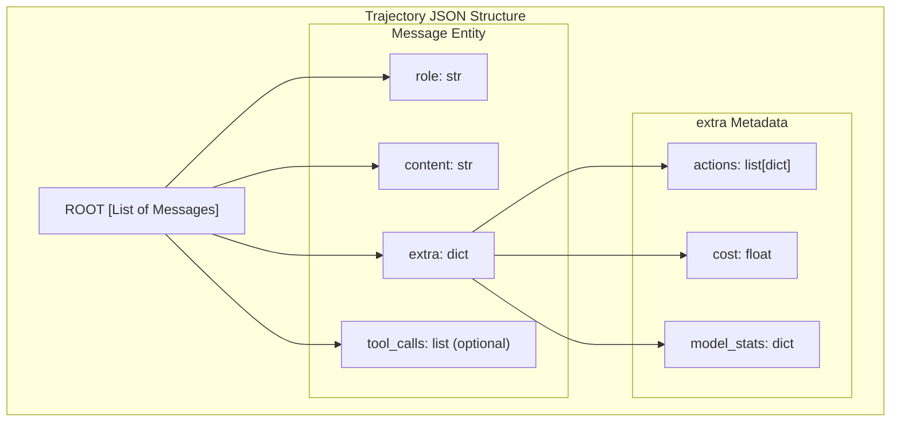
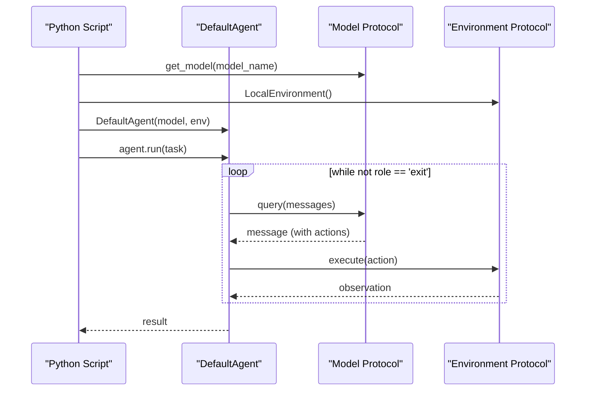

# Advanced Features

<details>
<summary>Relevant source files</summary>

The following files were used as context for generating this wiki page:

- [docs/advanced/control_flow.md](docs/advanced/control_flow.md)
- [docs/advanced/cookbook.md](docs/advanced/cookbook.md)
- [docs/reference/agents/default.md](docs/reference/agents/default.md)
- [docs/usage/python_bindings.md](docs/usage/python_bindings.md)
- [tests/models/test_test_models.py](tests/models/test_test_models.py)

</details>


This page documents advanced capabilities and extension points in mini-swe-agent. These features enable trajectory analysis, programmatic usage, live GitHub integration, and containerization strategies.

For basic usage of the CLI interfaces, see [Command Line Interface](#3). For understanding the underlying architecture that makes these features possible, see [Core Architecture](#4).

## Trajectory System

The trajectory system captures the complete execution history of an agent run, enabling reproducibility, debugging, and analysis. Trajectories are saved as JSON files containing all messages exchanged between the agent, model, and environment, along with metadata and configuration.

### Trajectory Format and Structure

The trajectory system persists agent state to disk using the `mini-swe-agent-1.1` trajectory format. This format is designed to be self-contained and follows the OpenAI chat format with additional metadata stored in an `extra` field.

**Trajectory File Structure**


Sources: [tests/test_data/github_issue.traj.json:1-76](), [tests/test_data/local.traj.json:1-26](), [docs/advanced/control_flow.md:93-111]()

### Trajectory Contents

A trajectory file contains a list of messages where each message includes an `extra` field for mini-swe-agent metadata.

| Field | Type | Description |
|-------|------|-------------|
| `role` | string | The message role: `system`, `user`, `assistant`, or `tool` |
| `content` | string | The text content or observation output |
| `extra.actions` | list[dict] | Parsed actions extracted from the model response |
| `extra.cost` | float | Incremental cost of the API call |

In the v2 architecture, tool-calling models utilize the `role: "tool"` and `tool_calls` fields to maintain compatibility with provider APIs [tests/models/test_test_models.py:128-145]().

Sources: [tests/test_data/github_issue.traj.json:1-76](), [tests/models/test_test_models.py:111-126]()

For details, see [Trajectory System](#7.1) and [Output Files](#7.3).

## Trajectory Inspector

The trajectory inspector is a terminal-based tool for browsing and analyzing saved `.traj.json` files. It is invoked via the `mini-extra inspector` command.

### Inspector Functionality

The inspector groups messages into logical "steps" where a step typically consists of an assistant's action and the resulting environment observation. This allows developers to step through the agent's reasoning and execution process linearly.

Sources: [docs/advanced/control_flow.md:14-46]()

For details, see [Trajectory Inspector](#7.2).

## Python API

Mini-swe-agent can be used programmatically by importing its components. The system uses a modular design where `Agent`, `Model`, and `Environment` components are injected at instantiation.

### Programmatic Setup

You can "mix and match" components to create custom agent flows by instantiating `DefaultAgent` or `InteractiveAgent` with specific `Model` and `Environment` implementations [docs/advanced/cookbook.md:34-121]().

**Component Interaction**


Sources: [docs/advanced/cookbook.md:38-52](), [docs/usage/python_bindings.md:10-28](), [docs/advanced/control_flow.md:15-46]()

### Basic Usage Example

```python
from minisweagent.agents.default import DefaultAgent
from minisweagent.models import get_model
from minisweagent.environments.local import LocalEnvironment

agent = DefaultAgent(
    get_model(input_model_name="anthropic/claude-3-5-sonnet-20240620"),
    LocalEnvironment(),
)
agent.run("Write a hello world program")
```

Sources: [docs/usage/python_bindings.md:10-28]()

For details, see [Python API](#7.4).

## GitHub Issue Integration

Mini-swe-agent can resolve GitHub issues by processing the issue URL and description as a task.

### Integration Flow

1.  **Task Input**: The issue description is fetched and passed as the `task` to `Agent.run()` [tests/test_data/update_outputs_github_issue.py:12-23]().
2.  **Environment**: The agent is typically pointed at a cloned repository where it can execute bash commands to reproduce and fix the issue.
3.  **Resolution**: The agent uses standard shell tools (e.g., `cat`, `sed`, `python3`) to modify the codebase [tests/test_data/github_issue.traj.json:44-68]().
4.  **Submission**: The agent signals completion by issuing the magic string `COMPLETE_TASK_AND_SUBMIT_FINAL_OUTPUT` [tests/test_data/github_issue.traj.json:76-76]().

Sources: [tests/test_data/github_issue.traj.json:1-76](), [tests/test_data/update_outputs_github_issue.py:18-21]()

For details, see [GitHub Issue Integration](#7.5).

## Advanced Customization

Mini-swe-agent is designed to be subclassed. You can override `execute_actions` in the agent to handle custom logic or extend the environment to support new capabilities.

### Custom Action Handling

By subclassing `DefaultAgent` and overriding `execute_actions`, you can intercept specific commands to run local Python code instead of shell commands [docs/advanced/cookbook.md:139-150]().

```python
class AgentWithPythonFunctions(DefaultAgent):
    def execute_actions(self, message: dict) -> list[dict]:
        for action in message.get("extra", {}).get("actions", []):
            if action.get("command", "").startswith("python_function"):
                # Custom logic here
                ...
        return super().execute_actions(message)
```

Sources: [docs/advanced/cookbook.md:139-150]()

For details, see [Python API](#7.4).