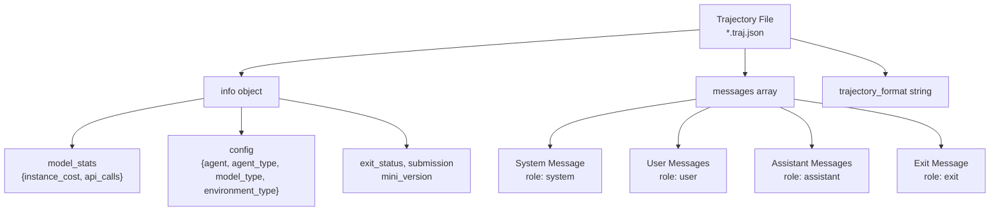
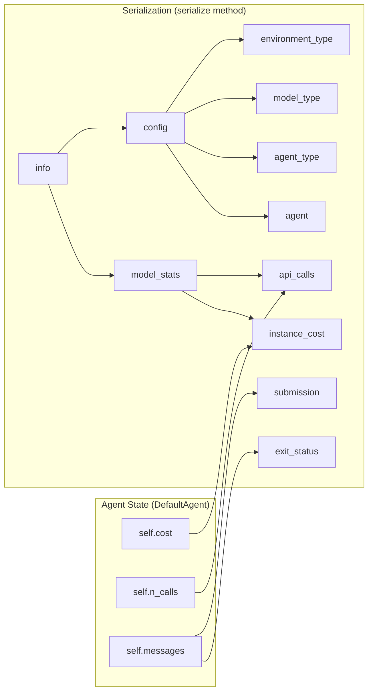
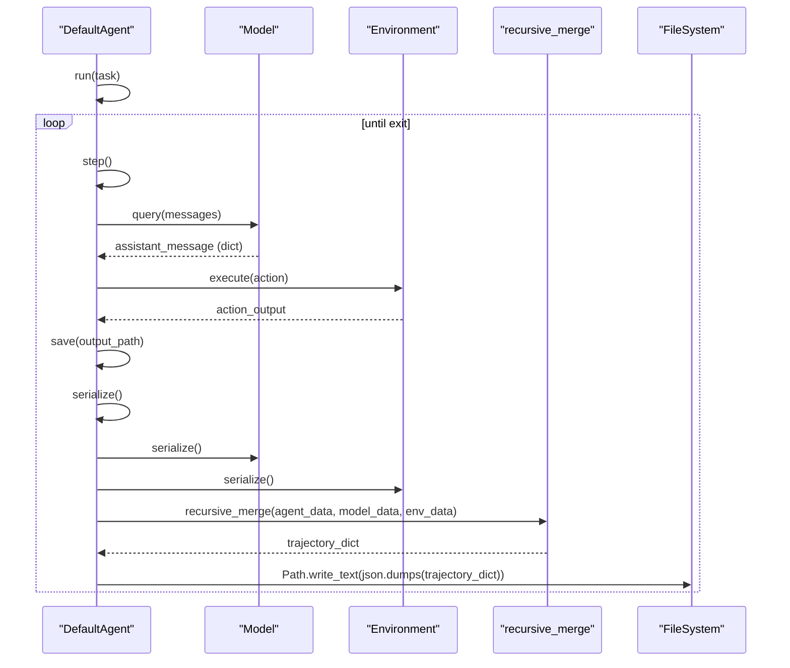

# Trajectory System

Relevant source files

The following files were used as context for generating this wiki page:

- [src/minisweagent/utils/serialize.py](src/minisweagent/utils/serialize.py)
- [tests/run/test_save.py](tests/run/test_save.py)
- [tests/test_data/github_issue.traj.json](tests/test_data/github_issue.traj.json)
- [tests/test_data/local.traj.json](tests/test_data/local.traj.json)
- [tests/test_data/update_outputs_github_issue.py](tests/test_data/update_outputs_github_issue.py)
- [tests/utils/test_serialize.py](tests/utils/test_serialize.py)

The trajectory system records the complete execution history of an agent run in a structured JSON format. Each trajectory file (`*.traj.json`) contains all messages exchanged between the agent, model, and environment, along with configuration, cost tracking, and metadata.

## Trajectory Format Overview

The trajectory format is identified as `mini-swe-agent-1.1` and consists of three top-level fields. This format is designed to be compatible with OpenAI's chat format while providing the necessary metadata for debugging and evaluation.

| Field | Type | Description |
|-------|------|-------------|
| `info` | object | Metadata about the run (cost, config, exit status) |
| `messages` | array | Complete message history in OpenAI chat format |
| `trajectory_format` | string | Format version identifier (`"mini-swe-agent-1.1"`) |

Title: Trajectory File Structure

Sources: [tests/run/test_save.py:33-49]()

## The Info Object

The `info` object aggregates run metadata and is constructed by the `DefaultAgent.serialize()` method. It provides a snapshot of the agent's state, configuration, and final outcome.

Title: Info Object Data Flow

The `model_stats` section is populated from the `DefaultAgent` instance attributes.
- `instance_cost`: Accumulated from `self.cost`.
- `api_calls`: Accumulated from `self.n_calls`.

The `config` section merges configuration and type information from components via `recursive_merge()` [src/minisweagent/utils/serialize.py:6-29]():

1.  **Agent**: `agent_type` (e.g., `"minisweagent.agents.default.DefaultAgent"`) [tests/run/test_save.py:42]().
2.  **Model**: `model_type` (e.g., `"minisweagent.models.test_models.DeterministicModel"`) [tests/run/test_save.py:43]().
3.  **Environment**: `environment_type` (e.g., `"minisweagent.environments.local.LocalEnvironment"`) [tests/run/test_save.py:44]().

Sources: [tests/run/test_save.py:33-49](), [tests/run/test_save.py:51-70](), [src/minisweagent/utils/serialize.py:6-29]()

## Message Structure and Recording

Messages follow the OpenAI chat format with an optional `extra` field for mini-swe-agent metadata.

### Recording Mechanism
Messages are recorded through `DefaultAgent.add_messages()`. This method appends messages to `self.messages`, ensuring a linear history.

### The Extra Field
The `extra` field contains metadata specific to the step execution. 

-   **Assistant Messages**: Contain `actions` (parsed commands), `cost`, and `timestamp`.
-   **Observation Messages**: Contain execution results (e.g., `<returncode>` and `<output>` strings in the content).
-   **Exit Messages**: Signal run termination.

Example of a recorded trajectory sequence:
1.  **System**: Template rendered.
2.  **User**: Task specification.
3.  **Assistant**: Model output.
4.  **User (Observation)**: Results from environment execution.

Sources: [tests/test_data/local.traj.json:1-26](), [tests/test_data/github_issue.traj.json:1-71]()

## Serialization and Persistence Flow

The agent persists its state frequently to ensure progress is not lost. The primary entry point for saving is `DefaultAgent.save()`.

Title: Trajectory Persistence Flow

The serialization process occurs in `DefaultAgent.save()`:

1.  **Step Execution**: Messages are accumulated in `self.messages`.
2.  **Serialization**: `serialize()` [tests/run/test_save.py:66]() constructs the trajectory dictionary, including the version string `mini-swe-agent-1.1` [tests/run/test_save.py:48]().
3.  **Merging**: `recursive_merge` [src/minisweagent/utils/serialize.py:6-29]() combines the agent's base data with component-specific serialized data.
4.  **Persistence**: The resulting dictionary is converted to JSON and written to the specified path [tests/run/test_save.py:28]().

Sources: [tests/run/test_save.py:10-50](), [tests/run/test_save.py:51-70](), [src/minisweagent/utils/serialize.py:6-29]()

## Format Versioning

The current format version is `mini-swe-agent-1.1` [tests/run/test_save.py:48](). This versioning allows tools like the trajectory inspector to identify the structure of the data.

-   **v1.1**: Supports structured metadata via the `info` object and the `extra` field within messages, while maintaining compatibility with standard chat formats.

Sources: [tests/run/test_save.py:48]()