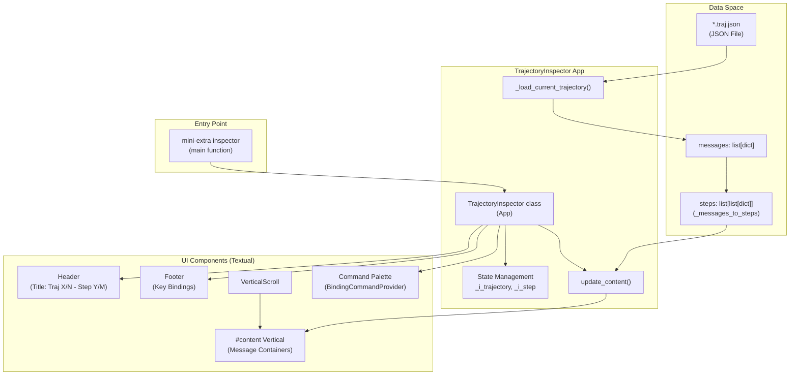
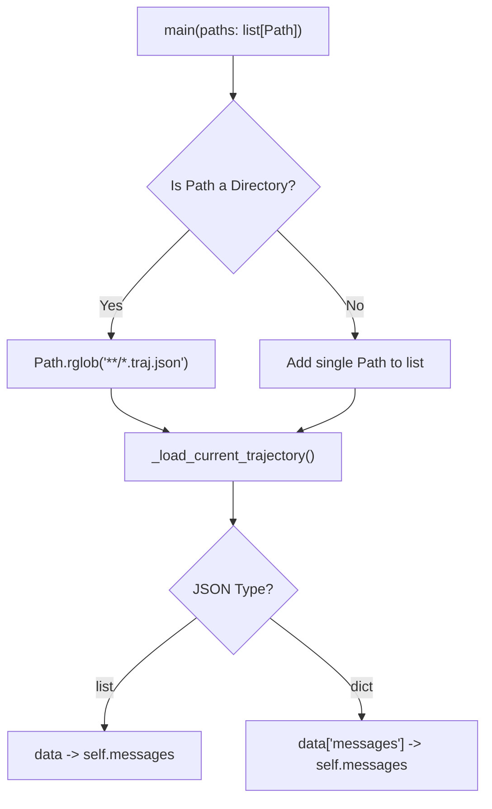

# Trajectory Inspector

<details>
<summary>Relevant source files</summary>

The following files were used as context for generating this wiki page:

- [docs/usage/inspector.md](docs/usage/inspector.md)
- [src/minisweagent/config/inspector.tcss](src/minisweagent/config/inspector.tcss)
- [src/minisweagent/run/utilities/inspector.py](src/minisweagent/run/utilities/inspector.py)
- [tests/run/test_inspector.py](tests/run/test_inspector.py)

</details>


## Purpose and Scope

The Trajectory Inspector is a terminal-based user interface (TUI) tool for browsing and analyzing saved agent execution trajectories. It provides an interactive way to examine the conversation history between the agent and the LLM, making it easier to debug agent behavior and understand decision-making processes.

The inspector is implemented using the [Textual](https://textual.textualize.io/) framework and is available via the `mini-extra inspector` (or `mini-e i`) command.

Sources: [src/minisweagent/run/utilities/inspector.py:1-6](), [docs/usage/inspector.md:1-8]()

## Overview

The inspector allows users to:
- Load one or more trajectory files from disk recursively.
- Navigate through conversation steps within a trajectory.
- Switch between multiple trajectory files.
- View formatted message content with proper role labels and action metadata.
- Open specific steps or entire trajectories in external tools like `jless`.
- Toggle the visibility of reasoning content for supported models.

Sources: [src/minisweagent/run/utilities/inspector.py:77-95](), [docs/usage/inspector.md:31-41]()

## Architecture

The inspector bridges the gap between raw JSON trajectory data and a structured visual representation of the agent's "steps".

### Data Flow and Component Interaction
Title: Trajectory Inspector Data Flow


**Architecture Components**

| Component | Type | Purpose |
|-----------|------|---------|
| `TrajectoryInspector` | `textual.app.App` | Main application class managing state and UI [src/minisweagent/run/utilities/inspector.py:79](). |
| `_i_trajectory` | `int` | Current trajectory file index (0-based) [src/minisweagent/run/utilities/inspector.py:106](). |
| `_i_step` | `int` | Current step index within trajectory (0-based) [src/minisweagent/run/utilities/inspector.py:107](). |
| `BindingCommandProvider` | `Provider` | Integrates keybindings into the Textual command palette [src/minisweagent/run/utilities/inspector.py:44-59](). |
| `_load_current_trajectory()` | Method | Loads and parses trajectory file, handling multiple formats [src/minisweagent/run/utilities/inspector.py:153-177](). |
| `update_content()` | Method | Renders current step to UI by mounting message widgets [src/minisweagent/run/utilities/inspector.py:195-230](). |

Sources: [src/minisweagent/run/utilities/inspector.py:44-190]()

## Loading Trajectories

### File Discovery and Formats

The inspector supports recursive discovery of `.traj.json` files and handles both simple message lists and complex SWE-bench style objects.

Title: Trajectory Loading Logic


Sources: [src/minisweagent/run/utilities/inspector.py:153-172](), [src/minisweagent/run/utilities/inspector.py:233-255]()

## Message Grouping and Step Navigation

### Step Calculation

The inspector groups messages into "steps" using `_messages_to_steps`. A new step is initiated whenever an `assistant` message is encountered or when `extra.actions` metadata is present.

| Function | Logic |
|----------|-------|
| `_messages_to_steps` | Iterates through `messages`. If `message.get("role") == "assistant"` or contains actions in `extra`, it starts a new sub-list [src/minisweagent/run/utilities/inspector.py:25-38](). |

Sources: [src/minisweagent/run/utilities/inspector.py:25-38]()

### Navigation State

The `i_step` and `i_trajectory` properties use setters that automatically clamp values to valid bounds and reset scroll position.

- **Step Navigation**: `right`/`l` (Next), `left`/`h` (Previous), `0` (First), `$` (Last) [src/minisweagent/run/utilities/inspector.py:82-85]().
- **Trajectory Navigation**: `L` (Next Trajectory), `H` (Previous Trajectory) [src/minisweagent/run/utilities/inspector.py:88-89]().

Sources: [src/minisweagent/run/utilities/inspector.py:82-89](), [src/minisweagent/run/utilities/inspector.py:117-151]()

## Display and Content Rendering

The UI is dynamically updated via `update_content()`. It clears the `#content` container and mounts new widgets for each message in the current step.

- **Content Extraction**: Uses `get_content_string` from `minisweagent.models.utils.content_string` to normalize message content from strings, multi-part lists, or tool calls [src/minisweagent/run/utilities/inspector.py:22](), [src/minisweagent/run/utilities/inspector.py:207]().
- **Reasoning Toggle**: Users can toggle visibility of reasoning blocks (e.g., `<thought>`) using the `r` key [src/minisweagent/run/utilities/inspector.py:92]().
- **Action Rendering**: If a message contains `extra.actions`, they are rendered as specific action blocks [src/minisweagent/run/utilities/inspector.py:217-226]().
- **Styling**: Styles are loaded from `src/minisweagent/config/inspector.tcss`. The path can be overridden via the `MSWEA_INSPECTOR_STYLE_PATH` environment variable [src/minisweagent/run/utilities/inspector.py:98-101]().

Sources: [src/minisweagent/run/utilities/inspector.py:195-230](), [src/minisweagent/config/inspector.tcss:1-56]()

## External Tools Integration

The inspector provides bindings to open the current view in `jless`, a command-line JSON viewer.

- **`e` (action_open_in_jless)**: Dumps the current step's messages to a temporary file and opens it with `jless` via `subprocess.run` [src/minisweagent/run/utilities/inspector.py:257-268]().
- **`E` (action_open_in_jless_all)**: Dumps the entire trajectory to a temporary file and opens it [src/minisweagent/run/utilities/inspector.py:270-280]().

Sources: [src/minisweagent/run/utilities/inspector.py:257-280](), [docs/usage/inspector.md:40]()

## Usage Examples

**Inspect current directory (recursive search):**
```bash
mini-extra inspector
```

**Inspect a specific file:**
```bash
mini-extra inspector outputs/test.traj.json
```

**Key Bindings Summary:**
- `q`: Quit [src/minisweagent/run/utilities/inspector.py:94]().
- `h`/`l`: Step navigation [src/minisweagent/run/utilities/inspector.py:82-83]().
- `H`/`L`: Trajectory navigation [src/minisweagent/run/utilities/inspector.py:88-89]().
- `j`/`k`: Scroll content [src/minisweagent/run/utilities/inspector.py:86-87]().
- `r`: Toggle reasoning visibility [src/minisweagent/run/utilities/inspector.py:92]().
- `e`: Open JSON in `jless` [src/minisweagent/run/utilities/inspector.py:90]().

Sources: [docs/usage/inspector.md:20-41](), [src/minisweagent/run/utilities/inspector.py:81-95]()