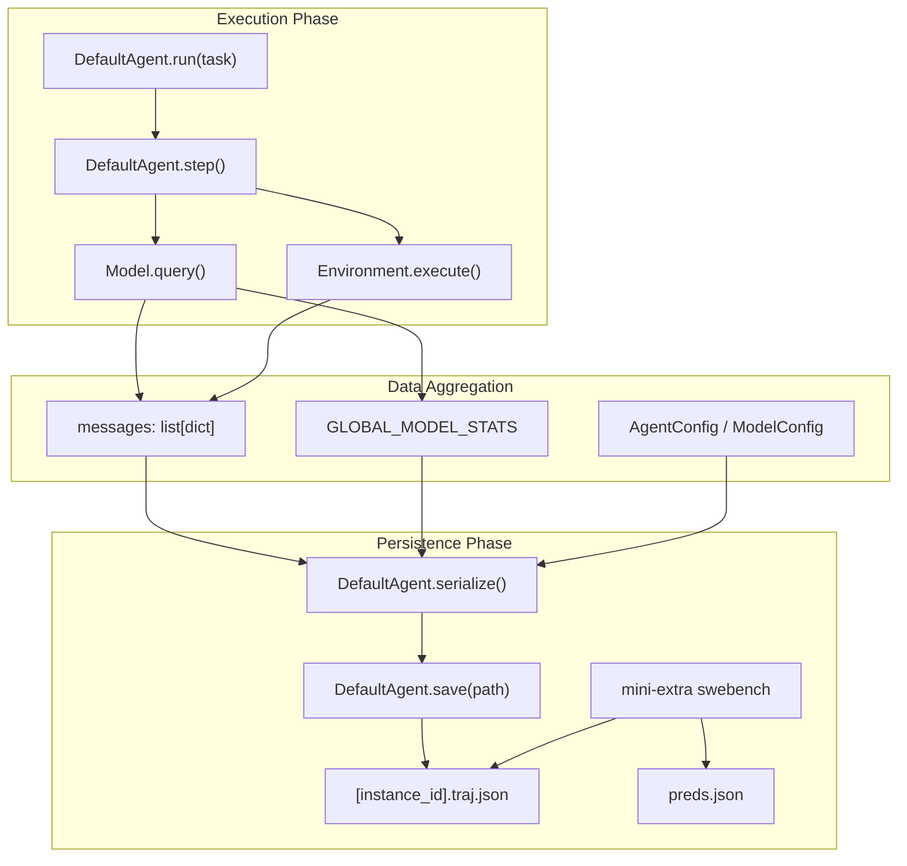

# Output Files

<details>
<summary>Relevant source files</summary>

The following files were used as context for generating this wiki page:

- [docs/advanced/v2_migration.md](docs/advanced/v2_migration.md)
- [docs/usage/output_files.md](docs/usage/output_files.md)
- [tests/test_data/github_issue.traj.json](tests/test_data/github_issue.traj.json)
- [tests/test_data/local.traj.json](tests/test_data/local.traj.json)
- [tests/test_data/update_outputs_github_issue.py](tests/test_data/update_outputs_github_issue.py)

</details>


This page documents the JSON output files generated by `mini-swe-agent` during agent runs. The system produces two primary file types: trajectory files (`.traj.json`) containing complete execution history, and prediction files (`preds.json`) containing SWE-bench compatible results.

## Overview of Output File Types

`mini-swe-agent` generates output files at different stages of execution:

| File Type | Extension | Purpose | Created By |
|---|---|---|---|
| Trajectory | `.traj.json` | Full conversation history with metadata | `DefaultAgent.save()` method [docs/usage/output_files.md:7-17]() |
| Predictions | `preds.json` | SWE-bench evaluation format | `mini-extra swebench` command [docs/usage/output_files.md:97-99]() |

### Output File Generation Flow

The following diagram illustrates how data flows from the agent execution loop into the final output files, bridging the "Natural Language Space" (task/messages) to the "Code Entity Space" (`DefaultAgent`, `LocalEnvironment`, etc.).

**Diagram: Data Flow to Output Files**


Sources: [docs/usage/output_files.md:1-112](), [docs/advanced/v2_migration.md:167-173](), [tests/test_data/update_outputs_github_issue.py:12-24]()

## Trajectory File Structure (.traj.json)

Trajectory files use the format identifier `"trajectory_format": "mini-swe-agent-1.1"` [docs/usage/output_files.md:46-48](). They contain three top-level fields: `info`, `messages`, and `trajectory_format` [docs/usage/output_files.md:21-48]().

### Info Object Fields

The `info` object contains metadata about the agent run and is populated by gathering state from the `Agent`, `Model`, and `Environment` [docs/usage/output_files.md:23-39]().

| Field | Type | Description | Source |
|---|---|---|---|
| `model_stats` | dict | Cost and API call statistics | `GLOBAL_MODEL_STATS` [docs/usage/output_files.md:24-27]() |
| `config` | dict | Complete merged configuration | `Agent.serialize()` [docs/advanced/v2_migration.md:191-192]() |
| `mini_version` | str | Version of mini-swe-agent | `minisweagent.__version__` [docs/usage/output_files.md:36-36]() |
| `exit_status` | str | Final exit status (e.g., "Submitted") | `InterruptAgentFlow` [docs/usage/output_files.md:37-37]() |
| `submission` | str | Final output/patch submitted | `extra` field of final message [docs/usage/output_files.md:38-38]() |

**Config Serialization Detail:**
The `config` block includes the fully qualified class names for each component to ensure reproducibility [docs/usage/output_files.md:28-35]().

```json
"config": {
  "agent_type": "minisweagent.agents.default.DefaultAgent",
  "model_type": "minisweagent.models.litellm_model.LitellmModel",
  "environment_type": "minisweagent.environments.local.LocalEnvironment"
}
```

Sources: [docs/usage/output_files.md:23-38](), [docs/advanced/v2_migration.md:167-173](), [docs/advanced/v2_migration.md:191-192]()

## Message Array Structure

The `messages` array contains the complete conversation history. In v2.0, `mini-swe-agent` uses the model's native output as the basis for the message and adds an `extra` field for metadata [docs/advanced/v2_migration.md:121-123]().

### Message Types by Strategy

The structure of messages in the trajectory depends on the `Action Parsing Strategy` used by the `Model` class [docs/advanced/v2_migration.md:124-127]().

**Diagram: Action Parsing Strategies to Message Format**

```mermaid
graph TD
    subgraph "Text-Based (Legacy/Regex)"
        T_Model["LitellmTextbasedModel"]
        T_Asst["Assistant: role='assistant', content='...bash...'"]
        T_Obs["Observation: role='user', content='<output>...'"]
        T_Model --> T_Asst
        T_Asst --> T_Obs
    end

    subgraph "Native Tool Calling (Default)"
        TC_Model["LitellmModel"]
        TC_Asst["Assistant: role='assistant', tool_calls=[...]"]
        TC_Obs["Observation: role='tool', tool_call_id='...'"]
        TC_Model --> TC_Asst
        TC_Asst --> TC_Obs
    end

    subgraph "Responses API"
        R_Model["LitellmResponseModel"]
        R_Asst["Assistant: role='assistant', output=[...]"]
        R_Obs["Observation: type='function_call_output'"]
        R_Model --> R_Asst
        R_Asst --> R_Obs
    end
```


Sources: [docs/advanced/v2_migration.md:82-118](), [docs/usage/output_files.md:53-55](), [docs/advanced/v2_migration.md:124-127](), [docs/advanced/v2_migration.md:145-158]()

### The `extra` Field Metadata

The `extra` field is added to messages to store mini-swe-agent specific metadata [docs/usage/output_files.md:51-52]().

**In Assistant Messages:**
* `actions`: List of parsed action dictionaries (e.g., `[{"command": "ls"}]`) [docs/usage/output_files.md:68]().
* `cost`: Cost of the specific API call [docs/usage/output_files.md:69]().
* `timestamp`: Unix timestamp of the model response [docs/usage/output_files.md:70]().
* `response`: The raw API response object [docs/usage/output_files.md:71]().

**In Observation Messages:**
* `returncode`: The shell exit code from `Environment.execute()` [docs/usage/output_files.md:80]().
* `timestamp`: Unix timestamp of the execution [docs/usage/output_files.md:81]().

**In Final Submission Messages:**
* `exit_status`: Usually `"Submitted"` [docs/usage/output_files.md:90]().
* `submission`: The final patch or text generated by the agent [docs/usage/output_files.md:91]().

Sources: [docs/usage/output_files.md:63-94](), [docs/advanced/v2_migration.md:121-123](), [tests/test_data/local.traj.json:1-26](), [tests/test_data/github_issue.traj.json:1-71]()

## `preds.json` Format

The `preds.json` file aggregates results from all instances when running benchmarks via `mini-extra swebench` [docs/usage/output_files.md:97-99](). This file is specifically formatted for compatibility with the SWE-bench evaluation harness.

### Structure

```json
{
  "instance_id": {
    "model_name_or_path": "provider/model-name",
    "instance_id": "instance_id",
    "model_patch": "diff --git ..."
  }
}
```

### Field Definitions

| Field | Description |
|---|---|
| `instance_id` | The unique identifier for the SWE-bench task (e.g., `django__django-11133`) [docs/usage/output_files.md:103](). |
| `model_name_or_path` | The name of the model used to generate the patch [docs/usage/output_files.md:104](). |
| `model_patch` | The final unified diff (patch) generated by the agent [docs/usage/output_files.md:106](). |

Sources: [docs/usage/output_files.md:97-112]()

## Key Implementation Details

### Serialization Logic
The `DefaultAgent` gathers data from the `Model` and `Environment` components. Each component must implement a `serialize()` method according to the protocol [docs/advanced/v2_migration.md:173-174]().

*   **Model Serialization**: Includes `model_name`, templates, and parsing configuration [docs/advanced/v2_migration.md:183-192]().
*   **Environment Serialization**: Includes current working directory (`cwd`) and timeout settings [docs/advanced/v2_migration.md:196-202]().

### Completion Signal
The `submission` field in output files is populated when the agent executes a command containing the completion signal: `echo COMPLETE_TASK_AND_SUBMIT_FINAL_OUTPUT` [docs/advanced/v2_migration.md:50-52](). This triggers the `Submitted` exception, which the `DefaultAgent` catches to wrap up the run and save the trajectory [docs/usage/output_files.md:85-94]().

Sources: [docs/advanced/v2_migration.md:50-52](), [docs/advanced/v2_migration.md:167-173](), [tests/test_data/github_issue.traj.json:4-8]()