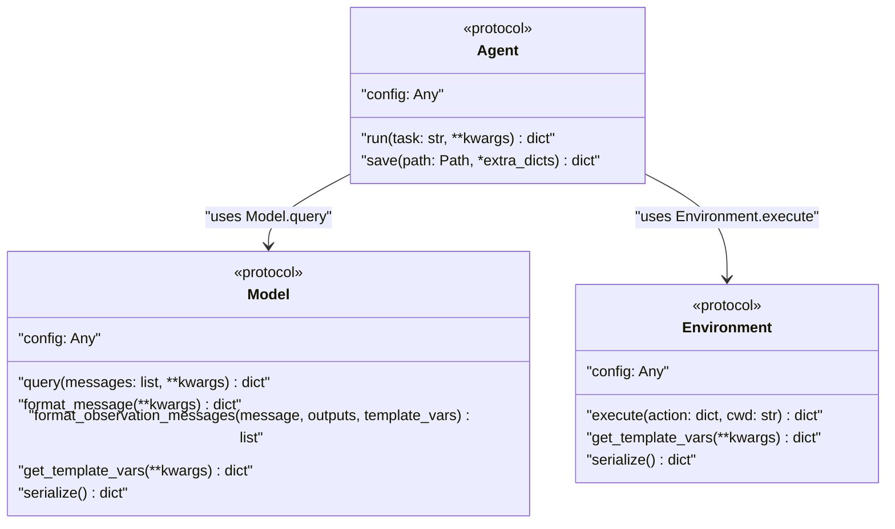

# Python API

<details>
<summary>Relevant source files</summary>

The following files were used as context for generating this wiki page:

- [docs/advanced/control_flow.md](docs/advanced/control_flow.md)
- [docs/advanced/cookbook.md](docs/advanced/cookbook.md)
- [docs/reference/agents/default.md](docs/reference/agents/default.md)
- [docs/usage/python_bindings.md](docs/usage/python_bindings.md)
- [src/minisweagent/run/hello_world.py](src/minisweagent/run/hello_world.py)
- [tests/models/test_test_models.py](tests/models/test_test_models.py)

</details>


This document covers the programmatic Python interface for `mini-swe-agent`, including the core protocols, model selection utilities, and direct instantiation of agents. This API allows you to integrate `mini-swe-agent` functionality directly into your Python applications without using the command-line interface.

## Core API Components

The `mini-swe-agent` Python API is built around three main protocols. These protocols use Python's structural typing (duck typing) to define the expected interfaces without requiring strict inheritance.

### Protocol Definitions

Title: "Core Protocol Relationships"


These protocols define the minimum interface requirements for each component. Any class implementing these methods can be used with the system.

Sources: [src/minisweagent/__init__.py:43-82]()

### Available Exports

The main package exports these key symbols for programmatic usage:

| Symbol | Type | Purpose |
|--------|------|---------|
| `Agent` | Protocol | Interface definition for agent implementations [src/minisweagent/__init__.py:73-82]() |
| `Model` | Protocol | Interface definition for language models [src/minisweagent/__init__.py:43-59]() |
| `Environment` | Protocol | Interface definition for execution environments [src/minisweagent/__init__.py:61-71]() |
| `package_dir` | Path | Location of the mini-swe-agent package [src/minisweagent/__init__.py:23-23]() |
| `__version__` | str | Current package version [src/minisweagent/__init__.py:11-11]() |
| `global_config_file` | Path | Path to global configuration file (`.env`) [src/minisweagent/__init__.py:28-28]() |
| `global_config_dir` | Path | Directory for global configuration [src/minisweagent/__init__.py:26-26]() |
| `logger` | Logger | The central logging instance [src/minisweagent/__init__.py:21-21]() |

Sources: [src/minisweagent/__init__.py:11-92]()

## Programmatic Usage Guide

To use `mini-swe-agent` programmatically, you instantiate the desired `Model` and `Environment` implementations and pass them to an `Agent` constructor.

### Hello World Example

The most basic usage involves the `DefaultAgent`, a `Model` (via `LitellmModel` or `get_model` factory), and a `LocalEnvironment`.

```python
import logging
from minisweagent.agents.default import DefaultAgent
from minisweagent.models import get_model
from minisweagent.environments.local import LocalEnvironment

# 1. Setup logging
logging.basicConfig(level=logging.DEBUG)

# 2. Initialize components
model = get_model(input_model_name="anthropic/claude-sonnet-4-5-20250929")
env = LocalEnvironment()

# 3. Create agent
agent = DefaultAgent(model=model, env=env)

# 4. Run task
result = agent.run("Write a hello world program")
```

Sources: [docs/usage/python_bindings.md:10-28](), [docs/advanced/cookbook.md:38-52]()

### Component Mix & Match

The API is designed for modularity. You can swap environments or models easily.

Title: "Component Composition in Code"
```mermaid
graph TD
    subgraph "Model_Options"
        ["get_model()"]
        ["LitellmModel"]
        ["DeterministicModel"]
    end

    subgraph "Environment_Options"
        ["LocalEnvironment"]
        ["DockerEnvironment"]
        ["SingularityEnvironment"]
    end

    subgraph "Agent_Options"
        ["DefaultAgent"]
        ["InteractiveAgent"]
    end

    ["get_model()"] --> ["DefaultAgent"]
    ["LocalEnvironment"] --> ["DefaultAgent"]

    ["LitellmModel"] --> ["InteractiveAgent"]
    ["DockerEnvironment"] --> ["InteractiveAgent"]
```

**Example: Docker Environment with Interactive Agent**
```python
from minisweagent.agents.interactive import InteractiveAgent
from minisweagent.environments.docker import DockerEnvironment
from minisweagent.models.litellm_model import LitellmModel

agent = InteractiveAgent(
    model=LitellmModel(model_name="gpt-4o"),
    env=DockerEnvironment(),
)
```

Sources: [docs/advanced/cookbook.md:70-120](), [src/minisweagent/models/test_models.py:104-104]()

## Implementation Details: DefaultAgent

The `DefaultAgent` class handles the core loop of querying the model and executing actions.

### Execution Loop Logic
When `agent.run(task)` is called:
1. It initializes messages with rendered templates [docs/advanced/control_flow.md:18-18]().
2. It enters a loop calling `self.step()` [docs/advanced/control_flow.md:19-23]().
3. `step()` calls `query()` to get a response from the `Model` [docs/advanced/control_flow.md:63-65]().
4. `query()` checks cost limits and adds the response to `self.messages` [docs/advanced/control_flow.md:78-82]().
5. `execute_actions()` takes the model response, calls `self.env.execute()` for each action, and appends observations via `Model.format_observation_messages` [docs/advanced/control_flow.md:88-90]().
6. The loop breaks if a message with `role="exit"` is added, often triggered by a `Submitted` exception [docs/advanced/control_flow.md:113-121]().

### Exception-Driven Control Flow
The agent uses specific exceptions to manage state transitions:
- `Submitted`: Raised when the task is completed [docs/advanced/control_flow.md:96-104]().
- `InterruptAgentFlow`: Base class for flow interruptions that carry messages to be added to the trajectory [docs/advanced/control_flow.md:94-95]().
- `FormatError`: Raised when the output from the LM is not in the expected format [docs/advanced/control_flow.md:107-107]().
- `LimitsExceeded`: Raised when cost or step limits are reached [docs/advanced/control_flow.md:106-106]().

Sources: [docs/advanced/control_flow.md:12-121](), [docs/reference/agents/default.md:17-29]()

## Testing API: Deterministic Models

For testing and reproducibility, the API provides deterministic models that return pre-defined outputs.

| Class | Purpose |
|-------|---------|
| `DeterministicModel` | Returns a sequence of text-based actions [src/minisweagent/models/test_models.py:9-10]() |
| `DeterministicToolcallModel` | Returns a sequence of tool-call based actions [src/minisweagent/models/test_models.py:13-14]() |
| `DeterministicResponseAPIToolcallModel` | Returns a sequence of actions using the Responses API format [src/minisweagent/models/test_models.py:11-12]() |
| `make_output` | Helper to create text output dicts [src/minisweagent/models/test_models.py:16-17]() |

**Example usage in tests:**
```python
from minisweagent.models.test_models import DeterministicModel, make_output

model = DeterministicModel(
    outputs=[
        make_output("```mswea_bash_command\necho hello\n```", [{"command": "echo hello"}]),
    ]
)
result = model.query([{"role": "user", "content": "test"}])
```

Sources: [src/minisweagent/models/test_models.py:9-18](), [tests/models/test_test_models.py:23-36]()

## Configuration and Environment Variables

The Python API respects the global configuration loaded from `.env` in the `global_config_dir`.

| Variable | Usage |
|----------|-------|
| `MSWEA_GLOBAL_CONFIG_DIR` | Custom path for global config [src/minisweagent/__init__.py:26-26]() |
| `MSWEA_SILENT_STARTUP` | Suppress version banner [src/minisweagent/__init__.py:30-30]() |
| `MSWEA_DEFAULT_RUN` | Override the default entry point import path [docs/advanced/cookbook.md:28-28]() |

Sources: [src/minisweagent/__init__.py:26-36](), [docs/advanced/cookbook.md:28-28]()