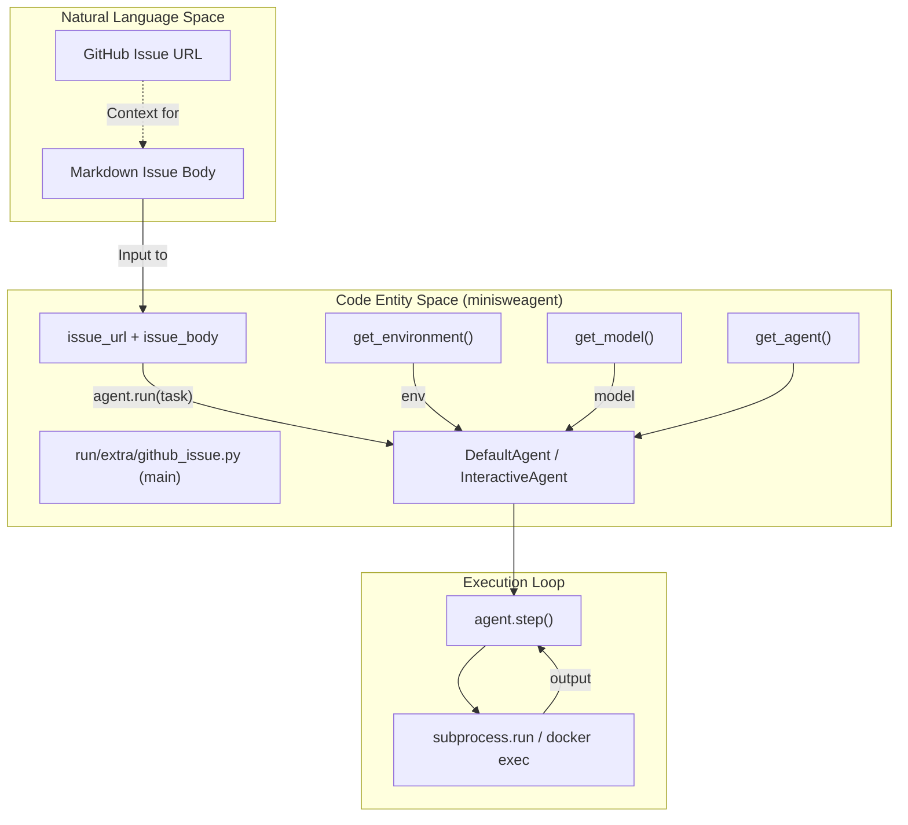
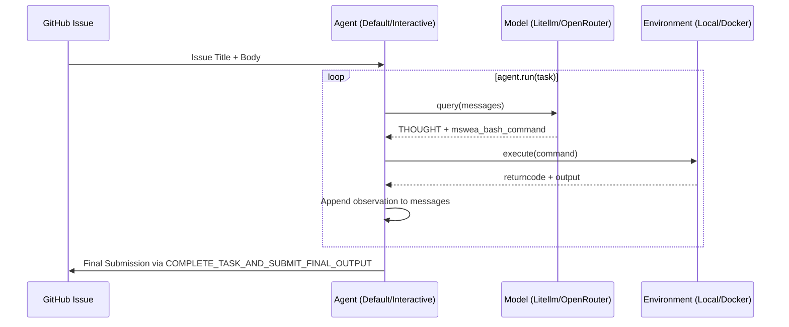

# GitHub Issue Integration

Relevant source files

The following files were used as context for generating this wiki page:

- [README.md](README.md)
- [docs/faq.md](docs/faq.md)
- [docs/index.md](docs/index.md)
- [tests/test_data/github_issue.traj.json](tests/test_data/github_issue.traj.json)
- [tests/test_data/local.traj.json](tests/test_data/local.traj.json)
- [tests/test_data/update_outputs_github_issue.py](tests/test_data/update_outputs_github_issue.py)

This document describes the GitHub issue integration in `mini-swe-agent`, which enables the agent to resolve real-world issues directly from GitHub repositories. This functionality allows the agent to transition from a natural language problem description to an active execution environment where it can modify code and verify fixes.

## Overview

The GitHub issue integration facilitates the end-to-end process of issue resolution:

1.  **Issue Context**: The agent receives the GitHub issue title and body as the initial task description.
2.  **Environment Isolation**: The task is typically executed within a `DockerEnvironment` or `LocalEnvironment` to provide a clean, isolated workspace.
3.  **Agent Execution**: The `InteractiveAgent` or `DefaultAgent` uses bash commands to explore the repo, reproduce the bug, and apply fixes.
4.  **Trajectory Persistence**: The entire session is saved to a `.traj.json` file for later inspection or evaluation.

## Workflow and Data Flow

The following diagram illustrates the transition from a Natural Language GitHub issue to a concrete execution environment and agent run, highlighting the specific entry point in the codebase.

### Natural Language to Code Entity Space

**Sources:** [README.md:108-109](), [docs/index.md:103-104](), [src/minisweagent/run/mini.py:99-102](), [tests/test_data/update_outputs_github_issue.py:9-21](), [src/minisweagent/run/mini.py:55-66]()

## Implementation Details

### Configuration and Setup

Running on a GitHub issue involves setting up the environment (cloning the repository) and initializing the agent with the issue text. The system uses a recursive configuration merging strategy to allow users to override model or agent behaviors via CLI flags or YAML files.

| Component | Responsibility |
| :--- | :--- |
| **Model** | Generates thoughts and bash commands based on the issue description and environment feedback. Created via `get_model` [src/minisweagent/run/mini.py:99](). |
| **Environment** | Provides a shell (usually via `LocalEnvironment` or `DockerEnvironment`) where the repository is checked out. Created via `get_environment` [src/minisweagent/run/mini.py:100](). |
| **Agent** | Maintains the linear history of messages and coordinates between the Model and Environment. Created via `get_agent` [src/minisweagent/run/mini.py:101](). |

**Sources:** [src/minisweagent/run/mini.py:70-92](), [tests/test_data/update_outputs_github_issue.py:18-21](), [src/minisweagent/run/mini.py:99-105]()

### Execution Environment Interaction

For GitHub issues, the agent interacts with the codebase through a structured loop. Every action is executed as an independent subprocess call which ensures stability by avoiding stateful shell session issues.

**Sources:** [src/minisweagent/run/mini.py:102](), [tests/test_data/github_issue.traj.json:4-12](), [tests/run/test_local.py:39-49]()

## Trajectory Example

A GitHub issue run generates a trajectory that maps the agent's internal reasoning to the external environment's state. Below is a representation of how a syntax error issue is handled in the `github_issue.traj.json` fixture.

| Role | Content Snippet | Purpose |
| :--- | :--- | :--- |
| **System** | `You are a helpful assistant...` | Sets the protocol rules and `mswea_bash_command` formatting [tests/test_data/github_issue.traj.json:3-5](). |
| **User** | `Please solve this issue: GitHub Issue: SyntaxError...` | The task description derived from the issue, including error logs [tests/test_data/github_issue.traj.json:7-9](). |
| **Assistant** | `THOUGHT: I'll examine the file... cat tests/missing_colon.py` | The agent's action to gather context [tests/test_data/github_issue.traj.json:11-13](). |
| **User** | `<returncode>0</returncode> <output>...</output>` | The environment's response containing the file content [tests/test_data/github_issue.traj.json:39-41](). |
| **Assistant** | `THOUGHT: I found the issue! ... sed -i ...` | The agent identifying the missing colon and applying a fix [tests/test_data/github_issue.traj.json:43-45](). |

**Sources:** [tests/test_data/github_issue.traj.json:1-60]()

## Key Entities and Testing

The GitHub issue integration is validated using deterministic models that replay known-good trajectories.

| Entity | Location | Description |
| :--- | :--- | :--- |
| `DeterministicModel` | `minisweagent.models.test_models` | A mock model used to simulate agent responses for testing [tests/test_data/update_outputs_github_issue.py:8](). |
| `github_issue.traj.json` | `tests/test_data/` | A JSON file containing a complete message history of an agent resolving a syntax error [tests/test_data/github_issue.traj.json:1](). |
| `update_trajectory` | `tests/test_data/update_outputs_github_issue.py` | A utility script that runs the agent on a mock GitHub issue to refresh test data [tests/test_data/update_outputs_github_issue.py:12-24](). |
| `DEFAULT_CONFIG` | `minisweagent.run.extra.github_issue` | The default configuration profile for GitHub issue runs [tests/test_data/update_outputs_github_issue.py:9](). |

**Sources:** [tests/test_data/update_outputs_github_issue.py:1-27](), [tests/run/test_cli_integration.py:40-49]()