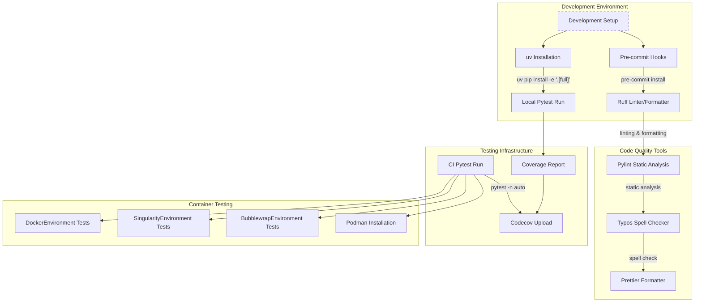
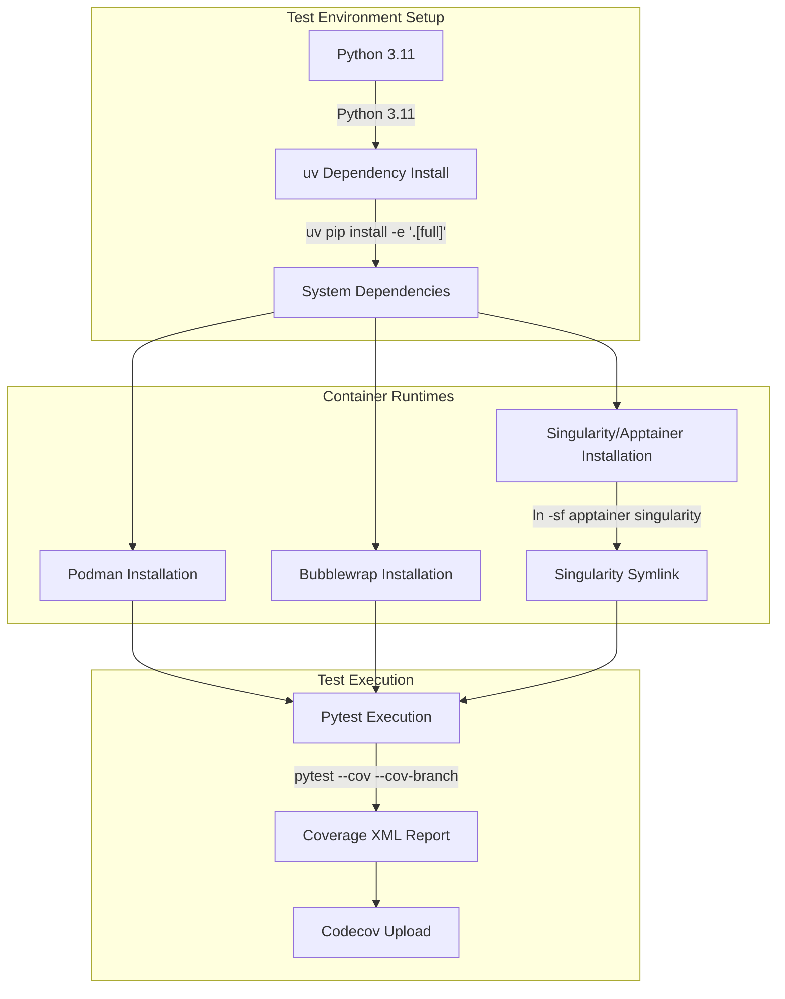

# Development

Relevant source files

The following files were used as context for generating this wiki page:

- [AGENTS.md](AGENTS.md)
- [CLAUDE.md](CLAUDE.md)
- [docs/contributing.md](docs/contributing.md)
- [docs/usage/mini.md](docs/usage/mini.md)

This document provides essential information for developers contributing to the `mini-swe-agent` codebase. It covers development setup, code quality standards, testing frameworks, CI/CD pipelines, and release processes.

For information about using `mini-swe-agent` as an end user, see [Getting Started](#2). For details about the core architecture from a developer perspective, see [Core Architecture](#4).

## Development Workflow Overview

`mini-swe-agent` follows a modern Python development workflow centered around `uv` for dependency management, automated quality checks via `pre-commit`, and comprehensive testing across multiple execution environments.

**Development Workflow with Actual Tool Configuration**

Sources: [.pre-commit-config.yaml:1-37](), [.github/workflows/pytest.yaml:40-66]()

## Testing Framework

The project uses `pytest` for unit and integration testing. The CI pipeline executes tests across multiple environments to ensure cross-platform compatibility and robust container handling.

### Test Execution Pipeline

**Testing Infrastructure with Container Support**

The testing framework requires multiple container runtimes to validate the various `Environment` implementations:
- **Podman**: Used for Docker-compatible container testing [.github/workflows/pytest.yaml:47-48]().
- **Bubblewrap**: Tested for Linux namespace isolation via `bwrap` [.github/workflows/pytest.yaml:49-52]().
- **Singularity/Apptainer**: Supported for HPC environments, installed via `.deb` package [.github/workflows/pytest.yaml:53-60]().

For details on `DeterministicModel`, test fixtures, and mocking strategies, see [Testing Framework](#8.1).

Sources: [.github/workflows/pytest.yaml:44-75]()

## Development Setup

The development environment relies on `uv` for fast, reproducible installs and `pre-commit` to ensure code quality before every commit.

| Tool | Purpose | Command |
|------|---------|---------|
| `uv` | Dependency management | `uv pip install -e '.[full]'` |
| `pre-commit` | Git hooks | `pre-commit install` |
| `mini-extra config` | Local environment setup | `mini-extra config set MSWEA_CONFIGURED 'true'` |

Local configuration is managed via the `minisweagent.run.utilities.config` module, which handles `.env` file generation and API key management [tests/run/test_extra_config.py:6-7](). The `setup` function in this module prompts for model names and API keys to populate the global configuration file [tests/run/test_extra_config.py:17-36]().

For details on development environment setup and local testing, see [Development Setup](#8.2).

Sources: [.github/workflows/pytest.yaml:61-73](), [.pre-commit-config.yaml:1-37](), [tests/run/test_extra_config.py:6-36]()

## CI/CD Pipeline

The project uses GitHub Actions for automated testing, documentation deployment, and PyPI releases.

### Workflow Architecture

```mermaid
graph TB
    subgraph "pytest.yaml"
        PYTEST_TRIGGER[Push/PR to main] --> PYTEST_EXEC[Pytest Execution]
        PYTEST_EXEC -- "pytest -v --cov" --> CODECOV_UPLOAD[Codecov Upload]
    end
    
    subgraph "pylint.yaml"  
        PYLINT_TRIGGER[Push/PR to main] --> PYLINT_EXEC[Pylint Execution]
        PYLINT_EXEC -- "pylint --errors-only" --> PYLINT_RESULT[Pylint Result]
    end
    
    subgraph "build-docs.yaml"
        DOCS_TRIGGER[Push to main/v1] --> DOCS_BUILD[MkDocs Build]
        DOCS_BUILD -- "mkdocs build --strict" --> MIKE_DEPLOY[Mike Deploy]
    end
    
    subgraph "release.yaml"
        RELEASE_TRIGGER[Published Release] --> VERSION_CHECK[Version Check]
        VERSION_CHECK -- "Check __version__" --> RELEASE_BUILD[Release Build]
        RELEASE_BUILD -- "twine upload" --> PYPI_UPLOAD[PyPI Upload]
        PYPI_UPLOAD -- "pipx/uvx run" --> SMOKE_TEST[Smoke Test]
    end
```

**GitHub Actions Workflow Structure**

The release process includes a strict version check to ensure the `__version__` string in `src/minisweagent/__init__.py` matches the Git release tag [.github/workflows/release.yaml:28-49](). After publication, smoke tests are run using `pipx` and `uvx` to verify the CLI commands `mini`, `mini-extra`, and `mini-e` [.github/workflows/release.yaml:79-129]().

For details on documentation deployment and the release process, see [CI/CD Pipeline](#8.3).

Sources: [.github/workflows/pytest.yaml:2-32](), [.github/workflows/build-docs.yaml:1-55](), [.github/workflows/release.yaml:1-129](), [.github/workflows/pylint.yaml:1-53]()

## Code Quality

Mini-swe-agent maintains high code standards through automated linting, formatting, and spell checking.

- **Ruff**: Handles both linting and formatting with the `--fix` argument [.pre-commit-config.yaml:24-31]().
- **Pylint**: Configured to fail only on errors (`--errors-only`) in CI to prevent blocking on minor stylistic warnings [.github/workflows/pylint.yaml:49-53]().
- **Typos**: Scans Python, Markdown, and YAML files for spelling errors, excluding `pyproject.toml` [.pre-commit-config.yaml:17-22]().
- **Prettier**: Used for formatting JavaScript and CSS files [.pre-commit-config.yaml:33-37]().

For details on pre-commit hooks and code quality tools, see [Code Quality](#8.4).

Sources: [.pre-commit-config.yaml:17-37](), [.github/workflows/pylint.yaml:49-53]()