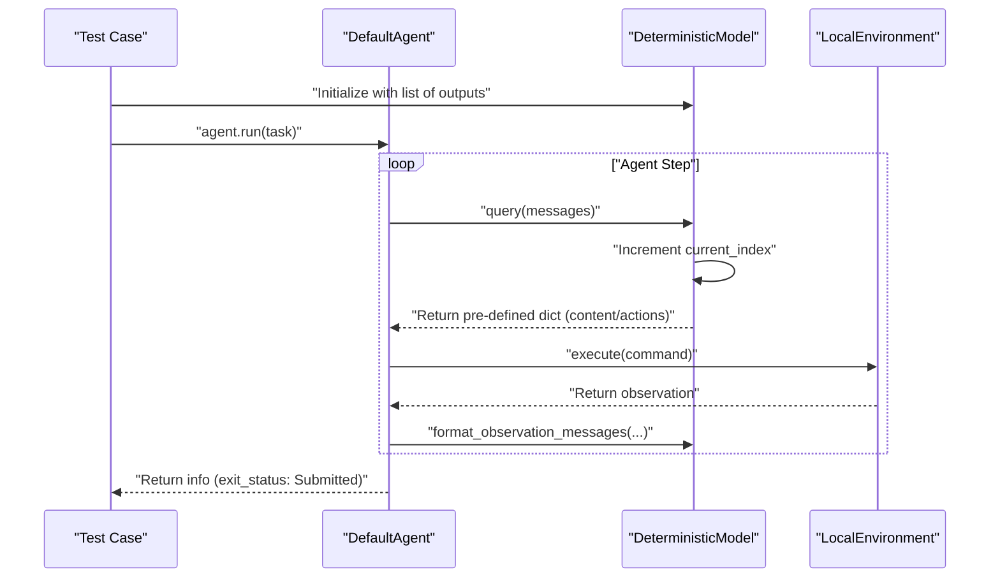
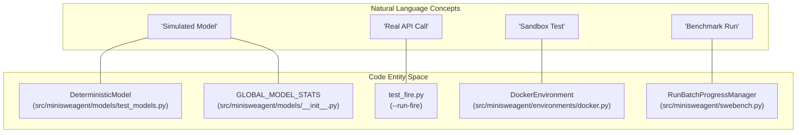
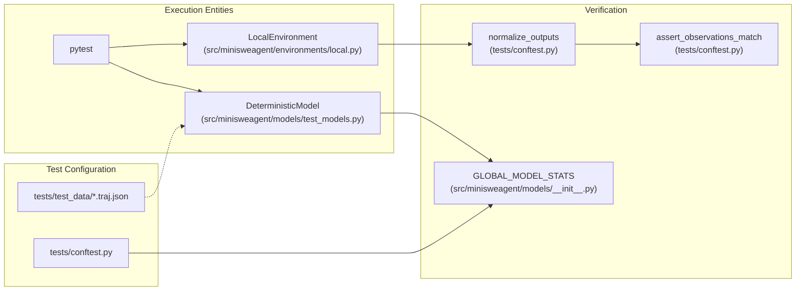

# Testing Framework

Relevant source files

The following files were used as context for generating this wiki page:

- [src/minisweagent/__init__.py](src/minisweagent/__init__.py)
- [src/minisweagent/models/test_models.py](src/minisweagent/models/test_models.py)
- [tests/agents/__init__.py](tests/agents/__init__.py)
- [tests/config/__init__.py](tests/config/__init__.py)
- [tests/conftest.py](tests/conftest.py)
- [tests/environments/__init__.py](tests/environments/__init__.py)
- [tests/environments/extra/__init__.py](tests/environments/extra/__init__.py)
- [tests/environments/extra/test_swerex_docker.py](tests/environments/extra/test_swerex_docker.py)
- [tests/environments/test_docker.py](tests/environments/test_docker.py)
- [tests/environments/test_local.py](tests/environments/test_local.py)
- [tests/models/__init__.py](tests/models/__init__.py)
- [tests/run/__init__.py](tests/run/__init__.py)
- [tests/test_fire.py](tests/test_fire.py)

The testing framework in `mini-swe-agent` is designed to ensure the reliability of autonomous agents through a combination of deterministic simulation, environment-specific integration tests, and real-world "fire" tests. It leverages `pytest` and specialized mock models to verify agent logic without incurring API costs during standard development.

## Deterministic Testing with Mock Models

To test agent logic (parsing, loop control, and error handling) without real LLM calls, the framework uses `DeterministicModel` and its variants. These classes implement the `Model` protocol [src/minisweagent/__init__.py:43-60]() but return pre-defined sequences of responses.

### Model Simulation Classes

| Class | Purpose | Source |
|-------|---------|--------|
| `DeterministicModel` | Simulates text-based models (regex parsing). | [src/minisweagent/models/test_models.py:104-145]() |
| `DeterministicToolcallModel` | Simulates models using OpenAI-style tool calls. | [src/minisweagent/models/test_models.py:160-205]() |
| `DeterministicResponseAPIToolcallModel` | Simulates the OpenAI Responses API format. | [src/minisweagent/models/test_models.py:221-267]() |

### Data Flow in Deterministic Tests

The following diagram shows how `DeterministicModel` interacts with the `DefaultAgent` during a test case.

**Diagram: Deterministic Agent Interaction Flow**

Sources: [src/minisweagent/models/test_models.py:110-116](), [src/minisweagent/models/test_models.py:121-130]()

## Fire Tests: Real API Integration

"Fire tests" are specialized integration tests that make real API calls to providers like OpenAI, Anthropic (via OpenRouter), Portkey, and Requesty. These are excluded from standard test runs to prevent unexpected costs.

- **Trigger**: Must be explicitly run using the `--run-fire` flag. [tests/test_fire.py:34-39](), [tests/conftest.py:12-20]()
- **Guardrails**: Fire tests enforce a strict `cost_limit` (typically $0.03) and use a simple `ls` task to minimize token usage. [tests/test_fire.py:55-60]()
- **Coverage**: They verify that different `model_class` configurations correctly handle authentication and response parsing across different provider implementations. Verified providers include `LitellmModel`, `OpenRouterModel`, `PortkeyModel`, and `RequestyModel`. [tests/test_fire.py:73-159]()

Sources: [tests/test_fire.py:1-65](), [tests/conftest.py:12-20](), [tests/test_fire.py:73-159]()

## Test Fixtures and Mocking Strategies

### Global State Management
Tests that verify cost limits or call counts use the `reset_global_stats` fixture. This ensures that `GLOBAL_MODEL_STATS` is cleared between tests and uses a `threading.Lock` to remain thread-safe during parallel execution. [tests/conftest.py:22-41]()

### Deterministic Model Helpers
The testing framework provides helper functions to quickly generate formatted model outputs for deterministic tests:
- `make_output`: Creates standard text-based responses with embedded actions. [src/minisweagent/models/test_models.py:16-28]()
- `make_toolcall_output`: Generates OpenAI-style tool call responses. [src/minisweagent/models/test_models.py:31-44]()
- `make_response_api_output`: Formats outputs for the Responses API. [src/minisweagent/models/test_models.py:47-72]()

### Environment Specifics
- **Container Detection**: The `container_executable` fixture [tests/conftest.py:55-64]() detects if `docker` or `podman` is available and running on the host, setting `MSWEA_DOCKER_EXECUTABLE` to ensure `DockerEnvironment` uses the correct binary. The `_get_container_executable` function [tests/conftest.py:43-51]() performs this check.
- **Trajectory Loading**: The `get_test_data` utility [tests/conftest.py:67-87]() loads `.traj.json` files from `tests/test_data/` to extract `model_responses` and `expected_observations` for regression testing.
- **Output Normalization**: `normalize_outputs` [tests/conftest.py:90-96]() strips container IDs and non-deterministic timestamps from command outputs to allow for stable string comparisons.

Sources: [tests/conftest.py:22-136](), [src/minisweagent/models/test_models.py:16-72]()

## Test Organization

The test suite is organized by component to ensure isolated verification of agent, model, and environment logic.

| Directory | Focus | Key Files / Classes |
|-----------|-------|-----------|
| `tests/agents/` | Logic for `DefaultAgent` and `InteractiveAgent`. | `DefaultAgent` [src/minisweagent/agents/default.py:27](), `InteractiveAgent` [src/minisweagent/agents/interactive.py:37]() |
| `tests/environments/` | Shell execution across `Local`, `Docker`, and `Swerex`. | `LocalEnvironment` [src/minisweagent/environments/local.py:31](), `DockerEnvironment` [src/minisweagent/environments/docker.py:49]() |
| `tests/models/` | Validation of `DeterministicModel` and cost tracking. | `DeterministicModel` [src/minisweagent/models/test_models.py:104](), `GLOBAL_MODEL_STATS` [src/minisweagent/models/__init__.py:60]() |

### Mapping Natural Language Tests to Code Entities

This diagram associates high-level testing concepts with the specific classes and files that implement them.

**Diagram: Concept to Code Mapping**

Sources: [tests/test_fire.py:1-20](), [tests/environments/test_docker.py:58-68](), [src/minisweagent/models/test_models.py:104-107](), [tests/conftest.py:27-41]()

### Testing Component Interaction

This diagram bridges the high-level testing goals with the code entities that manage the data flow during a test execution.

**Diagram: Test Execution Entity Space**

Sources: [tests/conftest.py:27-41](), [tests/conftest.py:67-125](), [src/minisweagent/models/test_models.py:104-116]()