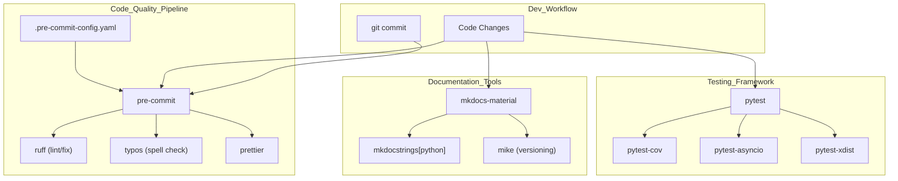
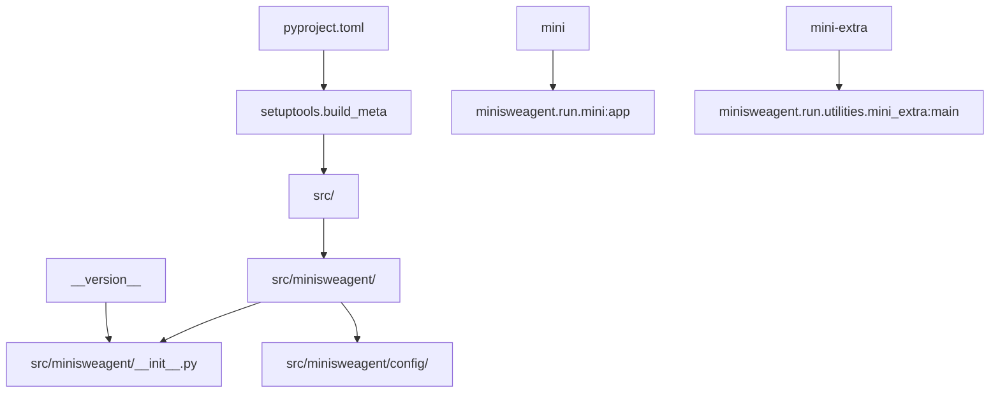
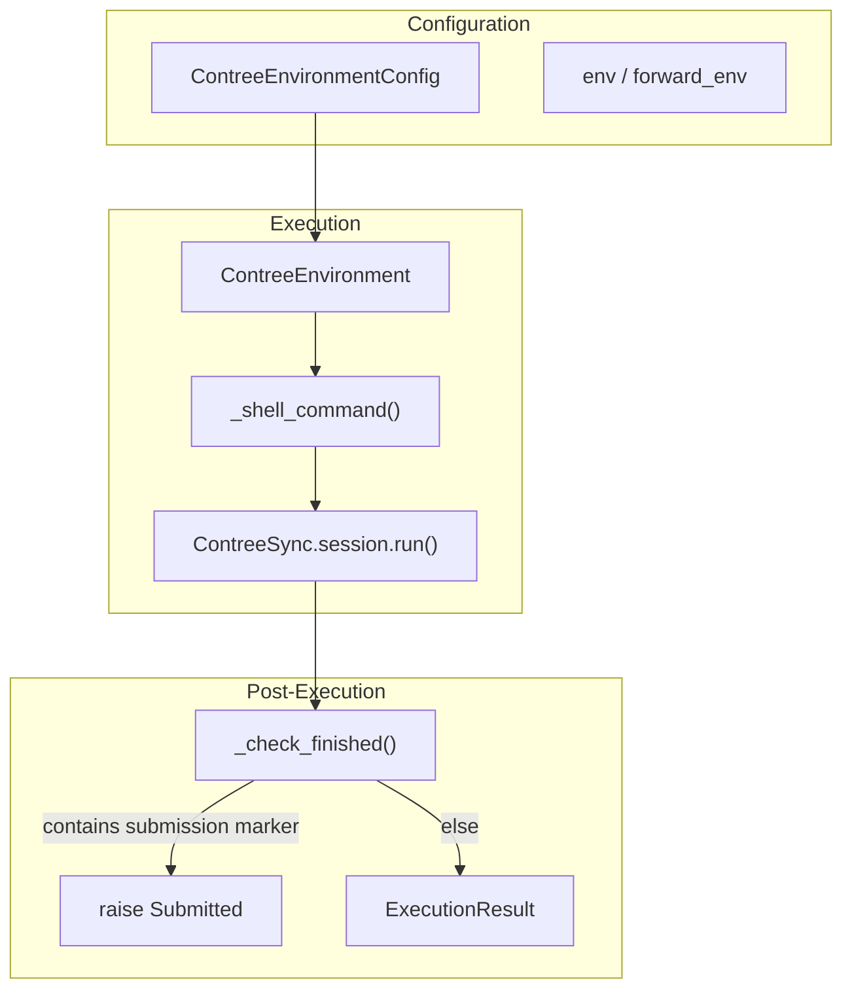

# Development Setup

<details>
<summary>Relevant source files</summary>

The following files were used as context for generating this wiki page:

- [.github/bump_version.py](.github/bump_version.py)
- [.gitignore](.gitignore)
- [docs/quickstart.md](docs/quickstart.md)
- [docs/reference/environments/contree.md](docs/reference/environments/contree.md)
- [mkdocs.yml](mkdocs.yml)
- [pyproject.toml](pyproject.toml)
- [src/minisweagent/environments/extra/contree.py](src/minisweagent/environments/extra/contree.py)
- [tests/environments/extra/test_contree.py](tests/environments/extra/test_contree.py)

</details>


This page covers setting up a development environment for `mini-swe-agent`, including dependencies, installation methods, development tooling, local testing, and version bumping. For additional details about the testing framework, continuous integration/deployment, and code quality tools, refer to sections 8.1, 8.3, and 8.4 respectively.

---

## Prerequisites

- **Python Version:** Python 3.10 or higher is required for development and running `mini-swe-agent`. This is ensured by the project's `[project]` configuration in `pyproject.toml` which specifies `requires-python = ">=3.10"` [pyproject.toml:11-11]().
  
- **Project Philosophy:** The codebase emphasizes minimalism and hackability, making it suitable for contributors seeking a lightweight and flexible AI software engineering agent framework [docs/contributing.md:14-19]().

---

## Installation Methods

The project supports multiple installation paths depending on your needs: typical development, full feature set, or isolated CLI usage.

### 1. Development Installation (Recommended)

To set up a full-featured development environment with testing, linting, and documentation capabilities, install the project in editable mode with the `dev` extras:

```bash
pip install -e ".[dev]"
```

This installs the project alongside crucial development dependencies including `pytest`, `pre-commit`, `ruff`, and documentation tools [pyproject.toml:63-78]().

### 2. Full Installation With All Optional Features

For contributors or users needing all environment integrations such as Docker support (`swe-rex`), Modal, and Contree environments:

```bash
pip install -e ".[full]"
```

This installs all base and optional dependencies for expanded runtime supports [pyproject.toml:50-56]().

### 3. Isolated CLI Usage

If you only want to run CLI tools (`mini` and `mini-extra`) without Python SDK access:

- **Using `uvx`**

  ```bash
  uvx mini-swe-agent   # Run mini CLI
  uvx --from mini-swe-agent mini-extra  # Run extra utilities
  ```

- **Using `pipx`**

  ```bash
  pipx install mini-swe-agent
  mini  # CLI
  mini-extra  # extra utilities
  ```

Refer to the quickstart for detailed steps and environment variable setup [docs/quickstart.md:20-95]().

---

## Core Dependencies

The project relies on a set of fundamental Python libraries that supply configuration handling, model integration, CLI features, and runtime utilities:

| Dependency       | Version/Notes                                              | Purpose                               |
|------------------|------------------------------------------------------------|-------------------------------------|
| `pyyaml`         | Latest                                                     | YAML config parsing                  |
| `jinja2`         | Latest                                                     | Template rendering                   |
| `pydantic`       | ≥ 2.0 (required for safe mutable defaults)                 | Data validation                     |
| `litellm`        | ≥ 1.75.5, excluding compromised versions 1.82.7/1.82.8    | Language model integration           |
| `tenacity`       | Latest                                                     | Retry support                      |
| `rich`           | Latest                                                     | Rich terminal UI (progress bars)    |
| `python-dotenv`  | Latest                                                     | Environment variable loading         |
| `typer`          | Latest                                                     | Command-line interface framework    |
| `openai`         | Excluded versions 1.100.0 and 1.100.1 due to issues        | OpenAI API integration               |

These dependencies are declared in `pyproject.toml` under `[project] dependencies` and grouped by optional extras [pyproject.toml:33-48]().

---

## Development Toolchain

The development workflow leverages several tools integrated via `pre-commit` hooks for linting, formatting, and spell checking, alongside testing and documentation frameworks:



- **Pre-commit hooks** ensure style and correctness checks run on code before commits.
- **pytest** enables running tests, including in parallel with `pytest-xdist`.
- **mkdocs** and associated plugins build rich HTML documentation from source markdown files.

Sources: [pyproject.toml:63-78](), [.pre-commit-config.yaml:1-37]().

---

## Package Structure and Build System

The project uses a standard modern Python package layout with `setuptools` configured as the build backend. The source is located in `src/minisweagent/`. Key points include:

- Dynamic versioning reads from the `__version__` attribute in `src/minisweagent/__init__.py`.
- Entry points defined for CLI commands `mini` and `mini-extra` mapping to Python callables.
- Configuration files included in the package using `setuptools.package-data`.



This structure allows easy development and installation with support for editable installs and script entry points [pyproject.toml:1-3, 89-93, 98-106](). 

---

## Pre-commit Hooks Setup

`mini-swe-agent` employs `pre-commit` hooks configured in `.pre-commit-config.yaml` to automate:

- Checking for large files, merge conflicts, case conflicts, symlink problems.
- Typo detection in source and markdown files.
- Linting and formatting using `ruff`.
- Formatting web-related assets with `prettier`.

Initialize pre-commit hooks in your repository with:

```bash
pre-commit install
```

This ensures consistent code quality checks before commits.

---

## Local Configuration and Testing

### Configuration Setup

`mini-swe-agent` supports persistent configuration through environment variables and a `.env` file managed by `python-dotenv`. The CLI helper `mini-extra config` provides commands for managing this config:

- `mini-extra config setup` launches an interactive setup wizard for initial model configuration and API keys.
- `mini-extra config set KEY VALUE` manually sets configuration entries persistently.
- `mini-extra config unset KEY` removes configuration entries.
- `mini-extra config edit` opens the config file in the default editor for direct editing.

These commands help manage environment settings required for model access and API keys [tests/run/test_extra_config.py:6-6, 19-19, 28-28, 125-125]().

### Local Testing

The recommended test runner is `pytest`. Run tests locally and in continuous integration environments with:

```bash
pytest -n auto
```

which parallelizes tests for speed. This helps validate functionality during development [docs/contributing.md:29-29](). 

---

## Specialized Environment Development - ConTree Environment

For development involving the ConTree sandboxed execution environment, `mini-swe-agent` includes `ContreeEnvironment`. This class executes bash commands inside ConTree containers using the `contree-sdk` client.

Key classes:
- `ContreeEnvironmentConfig`: Holds configuration options such as:
  - `contree_config`: API endpoint and token dictionary or object.
  - `image`, `image_tag`: Container image information.
  - `cwd`: Working directory inside the container.
  - `env`, `forward_env`: Environment variables for execution.
  - `timeout` and other execution controls.

- `ContreeEnvironment`: Uses `ContreeSync` client to pull images, create sessions, and execute commands with environment variables, timeouts, and working directory control.

Execution flow:
- Configure environment via `ContreeEnvironmentConfig`.
- Pull container image with credentials if needed.
- Create a session for command execution.
- Execute commands wrapped in a shell (`bash -c`).
- Combine and return stdout/stderr output, return codes, and exceptions.
- Detect special submission marker in output to raise `Submitted` exception which signals task completion.



This environment requires the `contree-sdk` dependency installed via the `[contree]` extras group:

```bash
pip install "mini-swe-agent[contree]"
```

and environment variables for token and base URL for authentication:

```bash
export CONTREE_TOKEN="your-contree-token"
export CONTREE_BASE_URL="your-base-url"
```

Usage in commands can be specified by passing `--environment-class contree` or configured in `swebench.yaml`.

Sources: [src/minisweagent/environments/extra/contree.py:21-135](), [tests/environments/extra/test_contree.py:42-159](), [docs/reference/environments/contree.md:1-45]().

---

## Version Bumping

A helper script `.github/bump_version.py` automates version updates in the project:

- Reads the current version string from `src/minisweagent/__init__.py`'s `__version__` attribute.
- Prompts the user to input a new version.
- Overwrites the version string in the file.
- Commits the updated file with a message "Bump version".

To use it:

```bash
python .github/bump_version.py
```

This ensures consistent version tagging in source and prepares for releases.

Sources: [.github/bump_version.py:1-43]()

---

## Ruff Linting and Formatting

The project uses `ruff` for linting with a customized configuration:

- Maximum line length: 120 characters.
- Enforces import sorting, modern syntax, and conventions to prevent mutable default arguments.
- Includes spell checking with `typos`.
- Uses double quotes and spaces for indentation matching Black style.

```toml
[tool.ruff]
exclude = [".git", ".venv", "build", "dist", "tests/test_data", ...]

line-length = 120
select = ["E", "F", "I", "UP", "B", "RET", "PTH", "PT", "EM", "SIM"]
ignore = ["E501", "E402", "E722", ...]

[tool.ruff.format]
quote-style = "double"
indent-style = "space"
```

This configuration enables auto-fixing and coding style enforcement through `pre-commit` or manual invocation [pyproject.toml:108-251]().

---

# Summary

This page has detailed the development setup for `mini-swe-agent`, including prerequisite versions, installation variants, dependency groups, essential tooling integration, configuration management, specialized environment setup (notably ConTree), and the versioning workflow. By adhering to these guidelines, contributors and maintainers can efficiently prepare their development environments for coding, testing, and releasing.

---

Sources:  
- [pyproject.toml:1-104]()  
- [docs/quickstart.md:1-95]()  
- [src/minisweagent/environments/extra/contree.py:21-135]()  
- [tests/environments/extra/test_contree.py:42-159]()  
- [.github/bump_version.py:1-43]()  
- [docs/reference/environments/contree.md:1-45]()  
- [.pre-commit-config.yaml:1-37]()