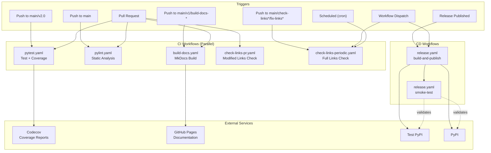
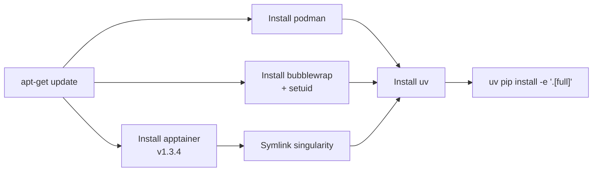

# CI/CD Pipeline

<details>
<summary>Relevant source files</summary>

The following files were used as context for generating this wiki page:

- [.github/.codecov.yml](.github/.codecov.yml)
- [.github/workflows/build-docs.yaml](.github/workflows/build-docs.yaml)
- [.github/workflows/check-links-periodic.yaml](.github/workflows/check-links-periodic.yaml)
- [.github/workflows/check-links-pr.yaml](.github/workflows/check-links-pr.yaml)
- [.github/workflows/pylint.yaml](.github/workflows/pylint.yaml)
- [.github/workflows/pytest.yaml](.github/workflows/pytest.yaml)
- [.github/workflows/release.yaml](.github/workflows/release.yaml)

</details>


This document describes the GitHub Actions workflows that implement continuous integration and continuous deployment for `mini-swe-agent`. The CI/CD pipeline includes automated testing, static analysis, documentation building, and package publishing.

---

## Overview

The CI/CD pipeline consists of several GitHub Actions workflows that automate quality assurance and deployment. All CI workflows (pytest, pylint, build-docs) exclude documentation-only changes to optimize CI usage and avoid unnecessary runs.

| Workflow | File | Purpose | Trigger |
|----------|------|---------|---------|
| **Pytest** | `.github/workflows/pytest.yaml` | Run tests with coverage reporting | Push/PR to main/v2.0 |
| **Pylint** | `.github/workflows/pylint.yaml` | Static analysis (errors only) | Push/PR to main |
| **Build Docs** | `.github/workflows/build-docs.yaml` | Build and deploy documentation | Push/PR to main/v1 |
| **Release** | `.github/workflows/release.yaml` | Publish to PyPI/Test PyPI | Release tag or manual |
| **Check Links PR** | `.github/workflows/check-links-pr.yaml` | Validate Markdown links in modified files | PR |
| **Check Links Periodic** | `.github/workflows/check-links-periodic.yaml` | Full validation of all Markdown links | Push to main/schedule/manual |

Sources: [.github/workflows/pytest.yaml:2-31](), [.github/workflows/pylint.yaml:1-29](), [.github/workflows/build-docs.yaml:1-13](), [.github/workflows/release.yaml:1-12](), [.github/workflows/check-links-pr.yaml:1-2](), [.github/workflows/check-links-periodic.yaml:1-11]()

---

## Workflow Execution Flow

The following diagram illustrates the relationship between GitHub triggers, internal CI/CD jobs, and external services.



**Workflow Trigger and Execution Flow**

Sources: [.github/workflows/pytest.yaml:7-31](), [.github/workflows/build-docs.yaml:3-13](), [.github/workflows/release.yaml:3-12](), [.github/workflows/pylint.yaml:6-29](), [.github/workflows/check-links-pr.yaml:1-2](), [.github/workflows/check-links-periodic.yaml:3-11]()

---

## CI Workflows

### Pytest Workflow

The pytest workflow runs the complete test suite with coverage analysis and uploads results to Codecov. It is specifically configured to handle the system-level dependencies required for sandbox environments.

**System Dependencies Setup:**



**System Dependency Installation Steps**

1.  **podman** [.github/workflows/pytest.yaml:47-48](): Required for `DockerEnvironment`.
2.  **bubblewrap** [.github/workflows/pytest.yaml:49-52](): Required for `BubblewrapEnvironment`. The workflow ensures setuid permissions via `sudo chmod u+s $(which bwrap)`.
3.  **apptainer** [.github/workflows/pytest.yaml:53-60](): Required for `SingularityEnvironment`. It installs Apptainer v1.3.4 and creates a `singularity` symlink for compatibility.

**Environment Configuration:**
The workflow configures the agent using `mini-extra config set` to inject necessary API keys and set `MSWEA_CONFIGURED` to `true` [.github/workflows/pytest.yaml:67-73]().

**Test Execution:**
The workflow uses `uv` to install dependencies and `pytest-xdist` for parallel execution [.github/workflows/pytest.yaml:64-75]():
```bash
pytest -v --cov --cov-branch --cov-report=xml -n auto
```
Coverage reports are uploaded to Codecov using `codecov/codecov-action@v7` [.github/workflows/pytest.yaml:77-80](). The Codecov configuration in `.github/.codecov.yml` sets a project target of 50% coverage and marks patch coverage as informational [.github/.codecov.yml:2-12]().

Sources: [.github/workflows/pytest.yaml:45-80](), [.github/.codecov.yml:2-12]()

---

### Pylint Workflow

The pylint workflow performs static analysis, configured to fail only on critical errors to prevent blocking development on minor style warnings.

**Execution:**
```bash
pylint minisweagent/ --errors-only
```
[.github/workflows/pylint.yaml:49-53]()

The `--errors-only` flag ensures the workflow only fails on `E` (Error) and `F` (Fatal) level messages [.github/workflows/pylint.yaml:51-53]().

Sources: [.github/workflows/pylint.yaml:31-53]()

---

### Build Docs Workflow

The build-docs workflow manages the documentation site using `mkdocs` and `mike` for versioning. It includes a caching step for `mkdocs-material` to speed up builds [.github/workflows/build-docs.yaml:36-41]().

**Deployment Logic:**
-   **main branch:** Deploys to `v2` and `latest` aliases [.github/workflows/build-docs.yaml:46-48]().
-   **v1 branch:** Deploys to `v1` alias [.github/workflows/build-docs.yaml:49-51]().
-   **Strict Build:** Always runs `mkdocs build --strict` to catch broken links or configuration errors [.github/workflows/build-docs.yaml:52-55]().

Sources: [.github/workflows/build-docs.yaml:36-55]()

---

## Release Process

The release process is a two-stage pipeline: **build-and-publish** followed by **smoke-test**.

### 1. Build and Publish
The workflow validates that the package version in `src/minisweagent/__init__.py` matches the GitHub release tag before proceeding [.github/workflows/release.yaml:28-50]().

**Version Validation Logic:**
```bash
PACKAGE_VERSION=$(grep -oP '^__version__\s*=\s*"\K[^"]+' src/minisweagent/__init__.py)
TAG_VERSION="${TAG_NAME#v}"
```
[.github/workflows/release.yaml:32-36]()

The package is built using the `build` module and verified with `twine check` [.github/workflows/release.yaml:58-62]().
Depending on the `test_pypi` input, the package is uploaded to Test PyPI or the official PyPI using `pypa/gh-action-pypi-publish@release/v1` [.github/workflows/release.yaml:64-77]().

### 2. Smoke Test Job
The `smoke-test` job runs after publication to ensure the package is installable and the CLI entry points work correctly. It waits 60 seconds for PyPI propagation [.github/workflows/release.yaml:94-97]().

**Tested Installation Methods:**
-   **pipx run:** Validates ephemeral execution from Test PyPI or PyPI [.github/workflows/release.yaml:99-105]().
-   **uvx:** Validates `uv`-based execution from Test PyPI or PyPI [.github/workflows/release.yaml:107-113]().
-   **pip install:** Validates standard installation and checks `mini`, `mini-extra`, and `mini-e` commands from Test PyPI or PyPI [.github/workflows/release.yaml:115-129]().

Sources: [.github/workflows/release.yaml:28-129]()

---

## Link Checking

The repository maintains link integrity through two workflows:
1.  **PR Check (`check-links-pr.yaml`):** Validates only modified files in pull requests [.github/workflows/check-links-pr.yaml:1-13](). This workflow uses `tcort/github-action-markdown-link-check@v1` with `check-modified-files-only: 'yes'` [.github/workflows/check-links-pr.yaml:11]().
2.  **Periodic Check (`check-links-periodic.yaml`):** A full scan of all Markdown files running twice daily via cron, on pushes to `main`, and via manual `workflow_dispatch` [.github/workflows/check-links-periodic.yaml:1-11](). This workflow uses `tcort/github-action-markdown-link-check@v1` without the `check-modified-files-only` option, ensuring a comprehensive check [.github/workflows/check-links-periodic.yaml:18-21](). Both workflows use a shared configuration file `.github/mlc_config.json` [.github/workflows/check-links-pr.yaml:13](), [.github/workflows/check-links-periodic.yaml:21]().

Sources: [.github/workflows/check-links-pr.yaml:1-13](), [.github/workflows/check-links-periodic.yaml:1-21]()

---

## Summary of Secrets

| Secret Name | Usage |
|-------------|-------|
| `GITHUB_TOKEN` | Auth for GitHub API and Actions [.github/workflows/pytest.yaml:5]() |
| `CODECOV_TOKEN` | Auth for uploading coverage reports [.github/workflows/pytest.yaml:79]() |
| `OPENAI_API_KEY` | Model auth for integration tests [.github/workflows/pytest.yaml:70]() |
| `OPENROUTER_API_KEY` | Model auth for OpenRouter integration tests [.github/workflows/pytest.yaml:71]() |
| `REQUESTY_API_KEY` | Model auth for Requesty integration tests [.github/workflows/pytest.yaml:73]() |
| `TEST_PYPI_API_TOKEN` | Auth for Test PyPI uploads [.github/workflows/release.yaml:68]() |
| `PYPI_API_TOKEN` | Auth for production PyPI uploads [.github/workflows/release.yaml:76]() |

Sources: [.github/workflows/pytest.yaml:5-79](), [.github/workflows/release.yaml:68-76]()