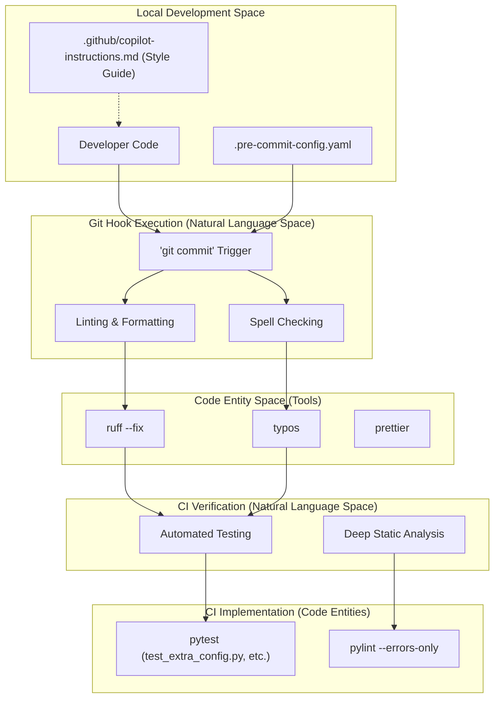
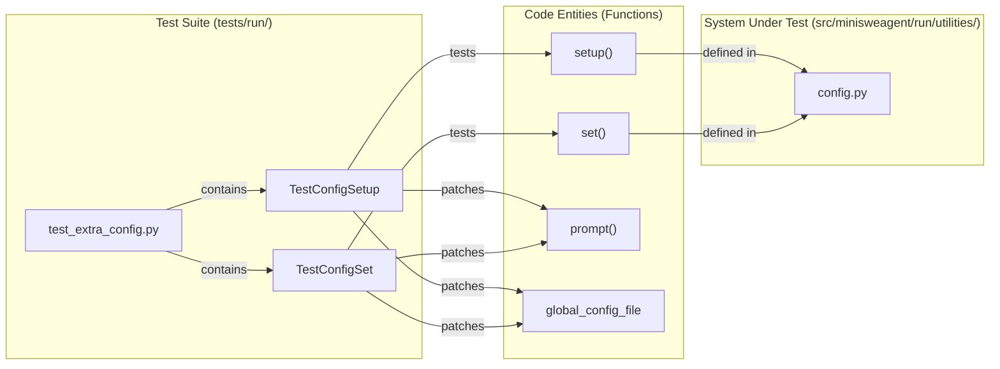

# Code Quality

<details>
<summary>Relevant source files</summary>

The following files were used as context for generating this wiki page:

- [.github/ISSUE_TEMPLATE/bug.yml](.github/ISSUE_TEMPLATE/bug.yml)
- [.github/ISSUE_TEMPLATE/config.yml](.github/ISSUE_TEMPLATE/config.yml)
- [.github/ISSUE_TEMPLATE/question.yml](.github/ISSUE_TEMPLATE/question.yml)
- [.github/PULL_REQUEST_TEMPLATE.md](.github/PULL_REQUEST_TEMPLATE.md)
- [.github/copilot-instructions.md](.github/copilot-instructions.md)
- [.pre-commit-config.yaml](.pre-commit-config.yaml)
- [tests/run/test_extra_config.py](tests/run/test_extra_config.py)

</details>


This page documents the code quality tools, testing infrastructure, and coding standards enforced in the `mini-swe-agent` repository. The project uses automated tooling to maintain a minimalist, high-quality codebase with consistent style and strict error checking.

## Overview

Mini-swe-agent enforces code quality through four primary mechanisms:

1.  **Ruff**: A high-performance Python linter and formatter that replaces multiple tools like `flake8`, `isort`, and `black`.
2.  **Pylint**: Used specifically for deep static analysis and catching logical errors in CI.
3.  **Pre-commit hooks**: Automated checks that run before each git commit to ensure no "dirty" code enters the repository.
4.  **GitHub Actions**: CI pipelines that execute the full test suite (`pytest`), linting, and documentation builds on every push and pull request.

The project follows a "minimalist code" philosophy, rewarding concise implementations and strictly enforcing modern Python 3.10+ idioms.

Sources: [.pre-commit-config.yaml:1-37](), [.github/copilot-instructions.md:10-12]()

## Code Quality Tool Chain

The following diagram illustrates the flow from local development to remote CI verification, associating the natural language "Quality Check" steps with the specific code entities and configurations that drive them.



**Code Quality Flow: Development to CI**

Sources: [.pre-commit-config.yaml:4-37](), [.github/copilot-instructions.md:1-36](), [tests/run/test_extra_config.py:1-12]()

## Pre-commit Hooks

The project uses `pre-commit` to manage git hooks. These are defined in `.pre-commit-config.yaml` and ensure that every commit meets basic quality standards before it is even pushed to the server.

### Hook Categories

| Hook ID | Repository | Purpose |
| :--- | :--- | :--- |
| `check-added-large-files` | `pre-commit-hooks` | Prevents bloating the repo with large binaries. [.pre-commit-config.yaml:8-8]() |
| `detect-private-key` | `pre-commit-hooks` | Security check to prevent accidental credential leaks. [.pre-commit-config.yaml:13-13]() |
| `typos` | `crate-ci/typos` | Spell checker for code, docs, and configs. [.pre-commit-config.yaml:20-20]() |
| `ruff` | `astral-sh/ruff-pre-commit` | Runs the linter with the `--fix` argument. [.pre-commit-config.yaml:28-29]() |
| `ruff-format` | `astral-sh/ruff-pre-commit` | Enforces consistent code formatting. [.pre-commit-config.yaml:31-31]() |
| `prettier` | `mirrors-prettier` | Formats non-python assets like JS or CSS. [.pre-commit-config.yaml:36-37]()

The `typos` hook specifically targets `.py`, `.md`, `.rst`, `.yaml`, and `.toml` files, while excluding `pyproject.toml` to avoid false positives on dependency names. [.pre-commit-config.yaml:17-23]()

Sources: [.pre-commit-config.yaml:1-37]()

## Linting and Static Analysis

### Ruff Configuration
Ruff is the primary engine for style enforcement. It is configured to run in the pre-commit pipeline and enforces:
*   **Import Sorting**: Integrated linting.
*   **Code Formatting**: Replaces standalone formatters via `ruff-format`. [.pre-commit-config.yaml:31-31]()
*   **Automatic Fixes**: Enabled via `args: ["--fix"]` in the pre-commit configuration. [.pre-commit-config.yaml:29-29]()

### Pylint and CI
While Ruff handles style and common errors, `pylint` is used in CI to catch deeper logical issues. The `pylint.yaml` workflow runs `pylint` on the `minisweagent/` directory but is configured to fail only on real errors (Error and Fatal levels) using the `--errors-only` flag.

Sources: [.pre-commit-config.yaml:24-32]()

## Coding Standards and Style Guide

The project maintains a strict style guide in `.github/copilot-instructions.md` to ensure the codebase remains "simplest, smallest, and most readable".

### Core Style Principles
*   **Minimalism**: "This repository rewards minimal code. Try to be as concise as possible." [.github/copilot-instructions.md:12-12]()
*   **Modern Python**: Target Python 3.10+. Use `pathlib` instead of `os.path` and `Path.read_text()` over `with ...open()` constructs. [.github/copilot-instructions.md:3-5]()
*   **Type Annotations**: Mandatory use of type annotations. Use built-in generics like `list` instead of `List`. [.github/copilot-instructions.md:2-2]()
*   **Configuration**: Use `dataclass` for keeping track of config. [.github/copilot-instructions.md:8-8]()
*   **Exception Handling**: Do not catch exceptions unless explicitly told to. Exceptions are a good way to show problems to a user. [.github/copilot-instructions.md:9-11]()

### Test Style Requirements
The testing philosophy is documented to ensure contributors follow `pytest` best practices:
*   **No Trivial Tests**: Every test should test for at least one, preferably multiple points of failure. [.github/copilot-instructions.md:21-21]()
*   **No Unnecessary Mocking**: "Do not mock/patch anything that you're not explicitly asked to do." [.github/copilot-instructions.md:20-20]()
*   **Concise Assertions**: Avoid splitting code into multiple lines for assertions; use `assert func() == b`. [.github/copilot-instructions.md:22-22]()
*   **Parametrization**: The first argument to `pytest.mark.parametrize` must be a tuple, and the second must be a list. [.github/copilot-instructions.md:23-23]()

Sources: [.github/copilot-instructions.md:1-36]()

## Testing Infrastructure

The project uses `pytest` for its test suite, integrated with `pytest-xdist` for parallel execution and `pytest-cov` for coverage reporting in CI.

### Example: Configuration Testing
The `tests/run/test_extra_config.py` file demonstrates how the `mini-extra config` commands are tested using `pytest` fixtures and mocking of user prompts and file systems. For instance, `TestConfigSetup` tests the `setup()` function by patching `global_config_file` and `prompt` to simulate user input and verify `.env` file creation and content [tests/run/test_extra_config.py:14-36](). Similarly, `TestConfigSet` verifies the `set()` function's behavior, including prompting for missing key-value pairs [tests/run/test_extra_config.py:117-165]().



**Testing the Configuration Utility**

Sources: [tests/run/test_extra_config.py:6-12](), [tests/run/test_extra_config.py:17-36](), [tests/run/test_extra_config.py:117-165]()

### Continuous Integration (CI) Pipelines
The project's quality is verified through several GitHub Actions workflows:
*   **Pytest**: Runs the full suite on Ubuntu, installing dependencies like `podman`, `bubblewrap`, and `apptainer` to test environment implementations.
*   **Pylint**: Performs static analysis.
*   **Build-Docs**: Ensures documentation can be built strictly without errors using `mkdocs build --strict`.
*   **Release Smoke Tests**: On release, the CI installs the package from PyPI/TestPyPI and runs `--help` commands to verify the CLI entry points (`mini`, `mini-extra`, `mini-e`).
*   **Version Verification**: During the release process, the CI checks that the `__version__` in `src/minisweagent/__init__.py` matches the git release tag.

## Issue and Pull Request Templates

To streamline contributions and maintain clear communication, `mini-swe-agent` utilizes GitHub issue and pull request templates.

### Issue Templates
The repository provides specific templates for different types of issues:
*   **Bug Report**: Located at `.github/ISSUE_TEMPLATE/bug.yml`, this template prompts users for a clear description of the bug, reproduction steps, and relevant output, including error messages and operating system details. It also suggests including the full trajectory of a `mini` run to aid in debugging [.github/ISSUE_TEMPLATE/bug.yml:1-19]().
*   **Question**: The `.github/ISSUE_TEMPLATE/question.yml` template is for general inquiries that are not bug reports, encouraging detailed descriptions [.github/ISSUE_TEMPLATE/question.yml:1-11]().
*   **Config**: The `.github/ISSUE_TEMPLATE/config.yml` file defines contact links, such as a Slack channel for open-ended discussions not suitable for GitHub issues [.github/ISSUE_TEMPLATE/config.yml:1-4]().

### Pull Request Template
The `.github/PULL_REQUEST_TEMPLATE.md` provides a basic template for pull requests, reminding contributors to reference any issues fixed by the PR [.github/PULL_REQUEST_TEMPLATE.md:1-7]().

```mermaid
graph TD
    subgraph "GitHub Repository"
        GH_REPO["mini-swe-agent"]
    end

    subgraph "Issue Templates"
        BUG_YML[".github/ISSUE_TEMPLATE/bug.yml"]
        QUESTION_YML[".github/ISSUE_TEMPLATE/question.yml"]
        CONFIG_YML[".github/ISSUE_TEMPLATE/config.yml"]
    end

    subgraph "Pull Request Template"
        PR_MD[".github/PULL_REQUEST_TEMPLATE.md"]
    end

    GH_REPO --> BUG_YML
    GH_REPO --> QUESTION_YML
    GH_REPO --> CONFIG_YML
    GH_REPO --> PR_MD

    BUG_YML -- "Guides users to report" --> "Bug Description"
    BUG_YML -- "Suggests including" --> "Trajectory File"
    QUESTION_YML -- "Guides users to ask" --> "Detailed Questions"
    CONFIG_YML -- "Provides" --> "Contact Links (e.g., Slack)"
    PR_MD -- "Reminds contributors to" --> "Reference Issues"
```

**GitHub Templates for Contributions**

Sources: [.github/ISSUE_TEMPLATE/bug.yml:1-23](), [.github/ISSUE_TEMPLATE/question.yml:1-11](), [.github/ISSUE_TEMPLATE/config.yml:1-4](), [.github/PULL_REQUEST_TEMPLATE.md:1-7]()