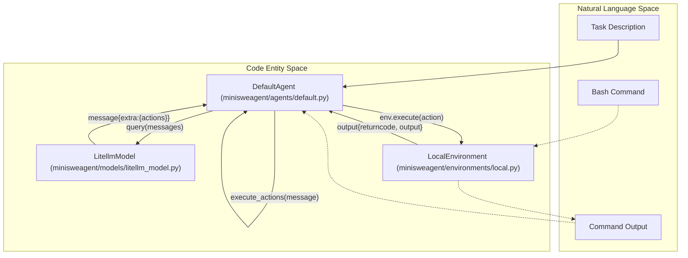
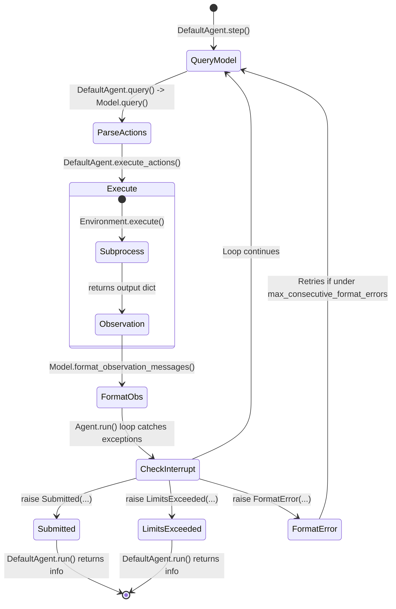

# Glossary

Relevant source files

The following files were used as context for generating this wiki page:

- [README.md](README.md)
- [docs/faq.md](docs/faq.md)
- [docs/index.md](docs/index.md)
- [src/minisweagent/__init__.py](src/minisweagent/__init__.py)
- [src/minisweagent/exceptions.py](src/minisweagent/exceptions.py)
- [src/minisweagent/models/test_models.py](src/minisweagent/models/test_models.py)

This page provides definitions for codebase-specific terms, jargon, and domain concepts used throughout `mini-swe-agent`.

## Core Concepts

### Linear History
A design philosophy where every interaction (thought, action, and observation) is strictly appended to a single list of messages. Unlike agents that use complex branching or hidden tool states, `mini-swe-agent` ensures that the trajectory saved is exactly what the model saw during execution [src/minisweagent/agents/default.py:42-42](), [src/minisweagent/agents/default.py:69-72](). Every step of the agent just appends to the messages, making it ideal for debugging and fine-tuning [README.md:45-47](), [README.md:77-78]().
Sources: [README.md:45-47](), [README.md:77-78](), [src/minisweagent/agents/default.py:42-42](), [src/minisweagent/agents/default.py:69-72]()

### Stateless Execution
The practice of running each shell command in a fresh process or independent `exec` call rather than maintaining a persistent interactive shell session. This improves stability by preventing environmental "poisoning" from previous commands [README.md:48-50](). In `mini`, every action is executed as a `subprocess.run` or equivalent call, meaning the agent cannot change directories or export persistent environment variables without prefixing them to the command [docs/faq.md:115-117]().
Sources: [README.md:48-50](), [docs/faq.md:115-117]()

### Trajectory
A JSON-serialized record of an agent's run. It includes the full message history, model metadata, environment configuration, and the final submission. The `serialize` method in `DefaultAgent` gathers this data into a format compatible with the trajectory inspector [src/minisweagent/agents/default.py:159-172]().
Sources: [src/minisweagent/agents/default.py:159-172]()

## System Components

### Agent
The orchestrator of the loop. It manages the message history, calls the `Model`, and passes actions to the `Environment` [src/minisweagent/__init__.py:73-81]().
*   **DefaultAgent**: The standard implementation of the run loop [src/minisweagent/agents/default.py:38-38]().
*   **InteractiveAgent**: A subclass that allows for human-in-the-loop confirmation and manual intervention.
Sources: [src/minisweagent/__init__.py:73-81](), [src/minisweagent/agents/default.py:38-38]()

### Model
A wrapper around an LLM provider (e.g., LiteLLM, OpenRouter, Portkey). Its primary job is to take a list of messages and return a structured response containing "actions" [src/minisweagent/__init__.py:43-59]().
*   **Action Parsing**: The process of extracting bash commands from the model's response. `LitellmModel` uses `parse_toolcall_actions` to extract these from API tool calls [src/minisweagent/models/litellm_model.py:128-135]().
Sources: [src/minisweagent/__init__.py:43-59](), [src/minisweagent/models/litellm_model.py:128-135]()

### Environment
The execution layer where bash commands are actually run [src/minisweagent/__init__.py:61-71]().
*   **LocalEnvironment**: Runs commands directly on the host machine using `subprocess.run` [src/minisweagent/agents/default.py:144-144]().
*   **DockerEnvironment**: Runs commands inside a container using `docker exec` [README.md:29-29]().
*   **SingularityEnvironment**: Uses Singularity/Apptainer to create a writable sandbox for command execution [README.md:29-29]().
*   **ContreeEnvironment**: A specialized environment for isolated execution using the Contree SDK [src/minisweagent/environments/extra/contree.py:13-13]().
Sources: [README.md:29-29](), [src/minisweagent/__init__.py:61-71](), [src/minisweagent/agents/default.py:144-144](), [src/minisweagent/environments/extra/contree.py:13-13]()

### Component Relationship Diagram
This diagram shows how the abstract Protocols map to concrete implementations and how data flows between them.

"Natural Language Space to Code Entity Space: Components"

Sources: [src/minisweagent/agents/default.py:126-157](), [src/minisweagent/__init__.py:39-82](), [src/minisweagent/models/litellm_model.py:81-106]()

## Jargon & Abbreviations

| Term | Definition | Code Pointer |
| :--- | :--- | :--- |
| **BASH_TOOL** | The JSON schema defining the `execute_bash` tool provided to LLMs. | [src/minisweagent/models/utils/actions_toolcall.py:15-15]() |
| **Submission** | The final output generated by the agent, triggered by the magic string `COMPLETE_TASK_AND_SUBMIT_FINAL_OUTPUT`. | [src/minisweagent/exceptions.py:16-16]() |
| **YOLO Mode** | Running the agent without requiring human confirmation for actions (common in CLI usage). | [src/minisweagent/run/benchmarks/swebench_single.py:52-52]() |
| **Extra Field** | A metadata dictionary attached to messages to store non-standard info like cost, timestamps, and raw API responses. | [src/minisweagent/models/litellm_model.py:100-105]() |
| **Global Stats** | A global tracker (`GLOBAL_MODEL_STATS`) for cumulative model costs across all instances in a run. | [src/minisweagent/models/test_models.py:7-7]() |
| **MSWEA_*** | Prefix for environment variables used to configure the agent (e.g., `MSWEA_COST_TRACKING`). | [src/minisweagent/__init__.py:26-26]() |
Sources: [src/minisweagent/__init__.py:26-26](), [src/minisweagent/exceptions.py:16-16](), [src/minisweagent/models/litellm_model.py:100-105](), [src/minisweagent/models/test_models.py:7-7](), [src/minisweagent/models/utils/actions_toolcall.py:15-15](), [src/minisweagent/run/benchmarks/swebench_single.py:52-52]()

## Execution Flow

The agent operates in a "Query-Execute-Observe" loop. The transition between these states is managed by specific exceptions.

"Natural Language Space to Code Entity Space: Execution Flow"

Sources: [src/minisweagent/agents/default.py:88-124](), [src/minisweagent/agents/default.py:126-157](), [src/minisweagent/exceptions.py:1-26]()

## Benchmark Terms

*   **SWE-bench**: A benchmark for evaluating software engineering agents on real GitHub issues [README.md:19-19]().
*   **ProgramBench**: A challenging reverse-engineering benchmark for AI agents [README.md:9-9]().
*   **Instance ID**: A unique identifier for a specific issue in a benchmark (e.g., `swe-agent__test-repo-1`) [tests/run/test_swebench.py:61-61]().
*   **Preds File**: `preds.json`, a file containing the model-generated patches or submissions for a batch of benchmark instances [tests/run/test_swebench.py:70-73]().
*   **Trajectory File**: `*.traj.json`, a detailed log of an agent's steps for a specific task, containing messages and metadata [src/minisweagent/agents/default.py:159-172]().
*   **Subset**: A specific version or filter of a benchmark (e.g., `_test` subset of SWE-bench) [tests/run/test_swebench.py:46-46]().
Sources: [README.md:19-19](), [README.md:9-9](), [src/minisweagent/agents/default.py:159-172](), [tests/run/test_swebench.py:46-46](), [tests/run/test_swebench.py:61-61](), [tests/run/test_swebench.py:70-73]()