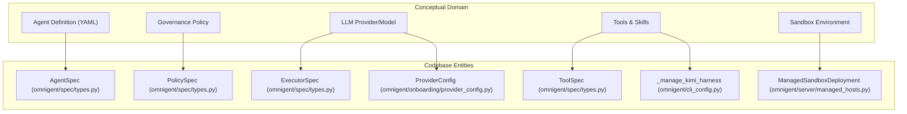

# Omnigent Overview

<details>
<summary>Relevant source files</summary>

The following files were used as context for generating this wiki page:

- [.github/actions/setup-uv/action.yml](.github/actions/setup-uv/action.yml)
- [.github/actions/setup-uv/verify-cache.mjs](.github/actions/setup-uv/verify-cache.mjs)
- [.github/actions/setup-uv/verify-cache.test.mjs](.github/actions/setup-uv/verify-cache.test.mjs)
- [README.md](README.md)
- [docs/UNINSTALL_DESIGN.md](docs/UNINSTALL_DESIGN.md)
- [examples/extensions/hello-page/web/package.json](examples/extensions/hello-page/web/package.json)
- [feature-map/login-and-host-auth.md](feature-map/login-and-host-auth.md)
- [integrations/slack/pyproject.toml](integrations/slack/pyproject.toml)
- [omnigent/_build_info.pyi](omnigent/_build_info.pyi)
- [omnigent/host/service.py](omnigent/host/service.py)
- [omnigent/host/service_entry.py](omnigent/host/service_entry.py)
- [omnigent/install_ledger.py](omnigent/install_ledger.py)
- [omnigent/resources/scripts/__init__.py](omnigent/resources/scripts/__init__.py)
- [omnigent/util/uuid.py](omnigent/util/uuid.py)
- [omnigent/version.py](omnigent/version.py)
- [pnpm-lock.yaml](pnpm-lock.yaml)
- [pnpm-workspace.yaml](pnpm-workspace.yaml)
- [pyproject.toml](pyproject.toml)
- [scripts/build_subpackages.py](scripts/build_subpackages.py)
- [scripts/install_oss.sh](scripts/install_oss.sh)
- [scripts/uninstall_oss.sh](scripts/uninstall_oss.sh)
- [sdks/python-client/README.md](sdks/python-client/README.md)
- [sdks/python-client/pyproject.toml](sdks/python-client/pyproject.toml)
- [sdks/ui/README.md](sdks/ui/README.md)
- [sdks/ui/pyproject.toml](sdks/ui/pyproject.toml)
- [setup.py](setup.py)
- [tests/e2e/test_host_disable_stale_plist_e2e.py](tests/e2e/test_host_disable_stale_plist_e2e.py)
- [tests/e2e/test_subpackage_license_artifacts_e2e.py](tests/e2e/test_subpackage_license_artifacts_e2e.py)
- [tests/e2e_ui/files/test_markdown_preview_tex.py](tests/e2e_ui/files/test_markdown_preview_tex.py)
- [tests/host/test_service.py](tests/host/test_service.py)
- [tests/scripts/__init__.py](tests/scripts/__init__.py)
- [tests/scripts/test_install_oss.py](tests/scripts/test_install_oss.py)
- [tests/test_install_ledger.py](tests/test_install_ledger.py)
- [tests/test_setup_web_ui_build.py](tests/test_setup_web_ui_build.py)
- [tests/test_subpackage_legal_files.py](tests/test_subpackage_legal_files.py)
- [tests/test_uninstall_cli.py](tests/test_uninstall_cli.py)
- [tests/test_uninstall_oss.py](tests/test_uninstall_oss.py)
- [uv.lock](uv.lock)
- [uv.toml](uv.toml)
- [web/electron/package.json](web/electron/package.json)
- [web/package.json](web/package.json)

</details>


Omnigent is an open-source **meta-harness** and agent framework designed to run, coordinate, and govern AI agents such as Claude Code, Codex, Cursor, Pi, and custom YAML agents. It provides a common orchestration layer that allows users to swap or combine harnesses without rewriting code, enforce governance policies, and collaborate in real-time across devices [README.md:5-9](), [pyproject.toml:5-15]().

## What is Omnigent?

Omnigent unifies fragmented agent tooling into a single cohesive runtime and server ecosystem. It enables users to supervise multiple agents concurrently, utilize diverse LLM providers, and execute tasks inside secure, isolated sandboxes. Its declarative YAML specification and robust inner harness abstractions bridge high-level agent definitions with low-level process and terminal management, creating a flexible and extensible platform [README.md:27-53](), [omnigent/spec/types.py:170-175]().

## Key Capabilities

*   **Device-Agnostic Sessions**: User sessions are persistent and synchronized across multiple devices and interfaces, including terminal REPLs, web browsers, and mobile clients. State such as messages, sub-agent jobs, terminal sessions, and shared files stays in sync [README.md:27-30]().
*   **Multi-Agent Orchestration**: Run and manage multiple agents simultaneously in the same session, mixing Claude Code, Codex, Cursor, Pi, and user-defined agents. Agents can interact, review each other’s work, or specialize tasks flexibly [README.md:32-35]().
*   **Dynamic Model Integration**: Omnigent supports integrating any LLM provider configured via first-party API keys, subscriptions, or compatible gateways like OpenRouter, Groq, and Databricks, enabling runtime flexibility and provider routing [README.md:37-39](), [omnigent/onboarding/provider_config.py]().
*   **Cloud Sandboxes**: Run agents inside disposable, managed sandbox environments using providers like Modal, Daytona, Blaxel, E2B, Kubernetes, CoreWeave, Boxlite, microsandbox, OpenShell, or Databricks, facilitating workflows that require scalable or isolated execution [README.md:44-51](), [omnigent/server/managed_hosts.py:1-50]().
*   **Policy-Driven Governance**: Use policy specifications specifying ALLOW/DENY/ASK rules to enforce safety, cost, and operational constraints on agents. Policies can govern entire servers, individual agents, or specific conversations [README.md:53-56](), [omnigent/spec/types.py]().

Sources: [README.md:27-56](), [omnigent/server/managed_hosts.py:1-50](), [omnigent/spec/types.py:1-180]()

## Architecture Overview

Omnigent is architected as a modular system composed of loosely coupled subsystems:

*   **Server** (`omnigent/server/`): A FastAPI web server managing HTTP/REST and WebSocket APIs, session orchestration, authentication, accounts, projects, and policies.
*   **Runner** (`omnigent/runner/`): A dedicated FastAPI application orchestrating harness subprocesses, managing tools and skill dispatch, and handling terminal multiplexing.
*   **Inner Harness Layer** (`omnigent/inner/` & `omnigent/harnesses/`): Provides agent executors, sandboxes, terminal management, egress proxy, and the harness capability registry.
*   **Runtime & Workflow Engine** (`omnigent/runtime/`): Contains the agent execution loops, LLM invocation, tool dispatching logic, policy enforcement, checkpointing, and runtime data models.
*   **Clients & Frontends** (`sdks/python-client/`, `sdks/ui/`, `web/`): Python SDKs, terminal REPLs, and a React/TypeScript web UI with Electron and mobile shells for multi-device interoperability.

### Top-Level System Architecture

```mermaid
graph TD
    subgraph "Interfaces"
        WebUI["Web Frontend"] --> "web/ (React/TS SPA)"
        TerminalUI["Terminal REPL"] --> "sdks/ui/ (TerminalHost)"
        PythonSDK["Python Client SDK"] --> "sdks/python-client/ (OmnigentClient)"
    end

    subgraph "Omnigent Server"
        ServerAPI["FastAPI Server"] --> "omnigent/server/app.py"
        DB["Database"] --> "omnigent/db/db_models.py"
        Auth["Authentication"] --> "omnigent/server/auth.py"
        ManagedHosts["Managed Hosts & Sandboxes"] --> "omnigent/server/managed_hosts.py"
    end

    subgraph "Omnigent Runner"
        RunnerApp["Runner FastAPI App"] --> "omnigent/runner/app.py"
        HarnessMgr["Harness Process Manager"]
        WSTunnel["WebSocket Tunnel"] --> "omnigent/runner/transports/ws_tunnel/"
    end

    subgraph "Inner Harness Layer"
        HarnessExecutors["Agent Executors: Claude, Codex, Kimi, etc."]
        Sandbox["Sandboxing (bwrap/seatbelt)"]
        TerminalMgr["Terminal Registry"] --> "omnigent/terminals/registry.py"
    end

    subgraph "Runtime & Workflow Engine"
        WorkflowEngine["Agent Loop"] --> "omnigent/runtime/workflow.py"
        ToolDispatch["Tool Dispatcher"]
        PolicyEngine["Policy Engine"] --> "omnigent/runtime/policies/engine.py"
    end

    WebUI --> ServerAPI
    TerminalUI --> PythonSDK
    PythonSDK --> ServerAPI

    ServerAPI --> DB
    ServerAPI -. WebSocket Tunnel .-> WSTunnel
    WSTunnel --> RunnerApp
    RunnerApp --> HarnessMgr
    HarnessMgr --> HarnessExecutors
    HarnessExecutors --> Sandbox
    HarnessExecutors --> TerminalMgr

    RunnerApp --> WorkflowEngine
    WorkflowEngine --> ToolDispatch
    WorkflowEngine --> PolicyEngine
    WorkflowEngine --> HarnessExecutors
```

Sources: [omnigent/server/app.py:1-100](), [omnigent/runner/app.py:1-160](), [omnigent/server/routes/_sessions/orchestration.py:90-115](), [omnigent/runtime/workflow.py:1-150](), [omnigent/runtime/policies/engine.py:1-80]()

### Mapping Natural Language Concepts to Code Entities

This diagram connects the conceptual domains of AI agents and governance to concrete codebase entities:



Sources: [omnigent/spec/types.py:170-175](), [omnigent/cli_config.py:60-65](), [omnigent/server/managed_hosts.py:1-50](), [omnigent/onboarding/provider_config.py]()

## Major Subsections & Architecture

Omnigent’s modular design is reflected in its detailed subsections and child documentation pages:

*   **Getting Started**: Covers installation, first run, CLI commands (`omnigent`, `omni`), the setup wizard, and local development environment setup. For details, see [Getting Started](#1.1) [README.md:64-150](), [omnigent/cli.py:1-100]().

*   **Example Agents**: Walkthrough of the bundled example agents (Polly, Debby, Scribe, Sentinel, Kimi, Remy, Deep-Research, AWS Analyst), their YAML specs, sub-agent wiring, skills, and instructions to run them. For details, see [Example Agents: Polly, Debby, Scribe, Sentinel, Kimi, Remy, Deep-Research, and AWS Analyst](#1.2) [README.md:32-35]().

*   **Core Architecture**: Detailed insights into the agent YAML spec, data model definitions, the runtime & workflow engine driving the agent loop (`omnigent/runtime/workflow.py`), inner harness executors & sandboxes, the runner subsystem, and the FastAPI server with session orchestration. For details, see [Core Architecture](#2).

*   **LLM Client & Model Routing**: Multi-provider LLM client SDK with model catalog management, context windows, and smart routing of LLM requests. For details, see [LLM Client & Model Routing](#3).

*   **Policies & Governance**: Architecture of policy enforcement, including the policy registry, CEL evaluation, approval cycles, and builtin policy rules. For details, see [Policies & Governance](#4).

*   **Tools System**: System for declaring, registering, and dispatching builtin, MCP, Python function, and sub-agent tools. For details, see [Tools System](#5).

*   **Onboarding & Provider Configuration**: Details on the setup wizard, credential management, provider config storage, harness installation, and sandbox provider abstraction and plugins. For details, see [Onboarding & Provider Configuration](#6).

*   **Web Frontend (ap-web)**: React/TypeScript web UI, app shell, pages, chat components, state management, theming, Electron desktop app, and mobile shells. For details, see [Web Frontend (ap-web)](#7).

*   **SDKs & Client Frontends**: Python Client SDK for automated session and stream management, Terminal UI SDK components, and REPL building blocks. For details, see [SDKs & Client Frontends](#8).

*   **Deployment**: Guides for Docker, self-hosted setups, cloud platform targets, Kubernetes manifests, and authentication/multi-user configurations. For details, see [Deployment](#9).

*   **CI/CD & Developer Workflows**: GitHub Action workflows, merge-ready gates, code quality tooling, release automation, and the `omnidev` local development supervisor. For details, see [CI/CD & Developer Workflows](#10).

*   **Testing**: Structure and coverage of unit, integration, end-to-end, UI, and benchmark tests. For details, see [Testing](#11).

*   **Integrations & Extensions**: First-party integrations such as Slack bot, session import, telemetry, and observability hooks. For details, see [Integrations & Extensions](#12).

*   **Glossary**: Definitions of core terms and domain concepts with annotation references for onboarding engineers. For details, see [Glossary](#13).

Sources: [README.md:64-150](), [omnigent/cli.py:1-100](), [omnigent/server/app.py:1-100](), [omnigent/runner/app.py:1-160](), [omnigent/spec/types.py](), [omnigent/runtime/workflow.py:1-150](), [omnigent/runtime/policies/engine.py:1-80](), [omnigent/onboarding/provider_config.py](), [omnigent/cli_config.py:40-70](), [omnigent/server/managed_hosts.py:1-70](), [web/electron/package.json:1-40]()

---

This overview provides a concise entry point into the Omnigent ecosystem, highlighting its purpose as a unified meta-harness and orchestration framework for AI agent workflows supporting rich governance, extensibility, and multi-platform collaboration.

For starting Omnigent, refer to the [Getting Started](#1.1) page to learn about installation and CLI usage. Explore example agent configurations and best practices on the [Example Agents: Polly, Debby, Scribe, Sentinel, Kimi, Remy, Deep-Research, and AWS Analyst](#1.2) page. For developers and system integrators, the [Core Architecture](#2) page dives into internal subsystems and runtime models.