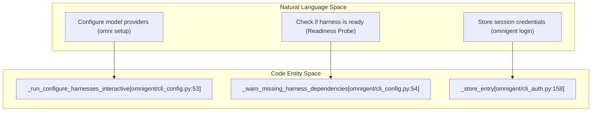
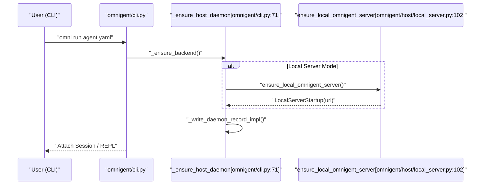

# Getting Started

<details>
<summary>Relevant source files</summary>

The following files were used as context for generating this wiki page:

- [README.md](README.md)
- [docs/UNINSTALL_DESIGN.md](docs/UNINSTALL_DESIGN.md)
- [feature-map/login-and-host-auth.md](feature-map/login-and-host-auth.md)
- [omnigent/_build_info.pyi](omnigent/_build_info.pyi)
- [omnigent/_startup_events.py](omnigent/_startup_events.py)
- [omnigent/cli.py](omnigent/cli.py)
- [omnigent/cli_auth.py](omnigent/cli_auth.py)
- [omnigent/cli_native.py](omnigent/cli_native.py)
- [omnigent/harness_startup_config.py](omnigent/harness_startup_config.py)
- [omnigent/host/_daemon_entry.py](omnigent/host/_daemon_entry.py)
- [omnigent/host/daemon_lifecycle.py](omnigent/host/daemon_lifecycle.py)
- [omnigent/host/mcp_tools.py](omnigent/host/mcp_tools.py)
- [omnigent/host/service.py](omnigent/host/service.py)
- [omnigent/host/service_entry.py](omnigent/host/service_entry.py)
- [omnigent/inner/model_signer.py](omnigent/inner/model_signer.py)
- [omnigent/install_ledger.py](omnigent/install_ledger.py)
- [omnigent/resources/scripts/__init__.py](omnigent/resources/scripts/__init__.py)
- [omnigent/util/uuid.py](omnigent/util/uuid.py)
- [scripts/install_oss.sh](scripts/install_oss.sh)
- [scripts/uninstall_oss.sh](scripts/uninstall_oss.sh)
- [setup.py](setup.py)
- [tests/cli/test_backend.py](tests/cli/test_backend.py)
- [tests/cli/test_cli.py](tests/cli/test_cli.py)
- [tests/cli/test_cli_auth.py](tests/cli/test_cli_auth.py)
- [tests/cli/test_host_daemon_env.py](tests/cli/test_host_daemon_env.py)
- [tests/conftest.py](tests/conftest.py)
- [tests/e2e/test_host_disable_stale_plist_e2e.py](tests/e2e/test_host_disable_stale_plist_e2e.py)
- [tests/host/test_cli_host.py](tests/host/test_cli_host.py)
- [tests/host/test_daemon_lifecycle.py](tests/host/test_daemon_lifecycle.py)
- [tests/host/test_service.py](tests/host/test_service.py)
- [tests/runner/test_native_terminal_interactive.py](tests/runner/test_native_terminal_interactive.py)
- [tests/scripts/__init__.py](tests/scripts/__init__.py)
- [tests/scripts/test_install_oss.py](tests/scripts/test_install_oss.py)
- [tests/test_harness_startup_config.py](tests/test_harness_startup_config.py)
- [tests/test_install_ledger.py](tests/test_install_ledger.py)
- [tests/test_setup_web_ui_build.py](tests/test_setup_web_ui_build.py)
- [tests/test_startup_events.py](tests/test_startup_events.py)
- [tests/test_uninstall_cli.py](tests/test_uninstall_cli.py)
- [tests/test_uninstall_oss.py](tests/test_uninstall_oss.py)

</details>


This page details the installation procedures, CLI invocation mechanics (`omnigent` / `omni`), the Omnigent setup wizard, harness readiness evaluation, and local development environment setup. It covers internal implementation details including key functions, data flow, and system interactions relevant for developers onboarding into the Omnigent codebase.

---

## 1. Installation & Prerequisites

Omnigent requires a modern toolchain to support asynchronous execution, secure terminal sandboxing, and Node-based agent runtimes.

### 1.1 Prerequisites

- **Python 3.12+**: Required for the runtime and type-driven development [omnigent/cli.py:1-26]().

- **`uv`**: Recommended for fast Python package and virtual environment management [README.md:143-146]().

- **Node.js 22 LTS or newer**: Required by Node-based coding harnesses (e.g. Claude Code, Codex, Pi). This is necessary because those CLIs depend on functionality (`worker_threads.markAsUncloneable`) introduced in Node.js 22.10. The system verifies this via a preflight check implemented in `omnigent.cli_config` [README.md:148-151]().

- **`tmux`**: Required for native terminal harness commands (`claude`, `codex`, `cursor`, `hermes`, `kiro`) [README.md:162-164]().

- **Bubblewrap (`bwrap`)**: On Linux, used for sandboxing in native terminal harnesses to isolate filesystem and network access.

### 1.2 Installation Methods

- **Automated script:** One-liner installs Omnigent with optional extras:
  ```bash
  curl -fsSL https://raw.githubusercontent.com/omnigent-ai/omnigent/main/scripts/install_oss.sh | sh
  ```
  [README.md:67-71]()

- **Extras:** You can enable optional features like `databricks` model provider or `modal` sandbox provider by specifying extras [README.md:80-84]().

- **Manual:** Via `uv` tool or direct pip installs:
  ```bash
  uv tool install omnigent
  ```
  [README.md:100-106]()

Sources: [omnigent/cli.py:1-26](), [README.md:63-164]()

---

## 2. CLI Commands & Daemon Architecture

The Omnigent CLI is the primary interface and uses the `click` framework (`click.Group`). It is invoked via two main commands: `omnigent` and its alias `omni` [omnigent/cli.py:31-33]().

### 2.1 Command Overview

- `omnigent run <agent.yaml>`: Launch an Omnigent session REPL for an agent [tests/cli/test_cli.py:161-184]().

- `omnigent host [--server URL]`: Manage the host daemon that runs long-lived sessions or acts as a local orchestrator [tests/host/test_cli_host.py:1-197]().

- Native harness commands, like `omnigent claude`, `omnigent codex`, spawn respective terminal UIs wrapped by Omnigent [omnigent/cli_native.py:58-98]().

### 2.2 Host Daemon & Server Lifecycle

Omnigent uses a **host daemon** process that maintains server state and orchestrates runner subprocesses. This allows persistent sessions and reuse across CLI invocations.

- `_ensure_host_daemon` ensures the host daemon is running for a given target server or locally [tests/cli/test_backend.py:174-192]().

- The CLI resolves the backend server URL by either discovering a running local server or connecting to a specified remote server URL [omnigent/cli.py:38-124]().

- If no remote server is specified, the CLI spawns a persistent **local Omnigent server** process via `ensure_local_omnigent_server()` and connects the host daemon to it [omnigent/host/local_server.py:97-108]().

- The local server's lifecycle is managed by the host daemon, and its state is tracked via pidfiles and signature files to guarantee reuse only if configuration matches [omnigent/host/local_server.py:100-108]().

Sources: [omnigent/cli.py:31-124](), [tests/cli/test_backend.py:1-192](), [tests/host/test_cli_host.py:1-197](), [omnigent/host/local_server.py:97-108]()

---

## 3. Omnigent Setup Wizard & Credential Management

Omnigent provides an interactive setup flow to help users configure provider credentials, install harnesses, and validate readiness.

### 3.1 Setup Wizard

The `omnigent setup` command launches an interactive CLI flow implemented in `omnigent.cli_config` that requests user input to configure model providers and harnesses [omnigent/cli.py:47-55]().

### 3.2 Authentication Token Storage

Authentication tokens and session credentials are securely stored under the Omnigent data directory in `auth_tokens.json` with atomic write semantics (`_write_tokens_file`) and `0o600` file permissions enforced [omnigent/cli_auth.py:46-156]().

Sources: [omnigent/cli.py:47-55](), [omnigent/cli_auth.py:46-156]()

---

## 4. Harness Readiness & Version Enforcement

Omnigent evaluates harness readiness along two axes: configured credentials and installed binaries.

### 4.1 Readiness Evaluation

- Binary-gated harnesses require both credentials and CLI binaries installed to be marked ready [omnigent/cli_config.py:51-54]().
- In-process SDK harnesses evaluate readiness dynamically by testing credential availability [tests/host/test_host_daemon_env.py:103-128]().

Sources: [omnigent/cli_config.py:51-54](), [tests/host/test_host_daemon_env.py:103-128]()

---

## 5. Local Development Environment

For local development without orchestrating external services, Omnigent supports local server startup via `ensure_local_omnigent_server()` [omnigent/host/local_server.py:97-108]().

Sources: [omnigent/host/local_server.py:97-108]()

---

## 6. Technical Architecture Diagrams

### 6.1 Natural Language Space to Code Entity Space: Setup and Readiness

This diagram illustrates the relationship between user concepts and the core code entities executing those actions in Omnigent.



Sources: [omnigent/cli_config.py:51-55](), [omnigent/cli_auth.py:158-170]()

---

### 6.2 CLI Invocation and Daemon Resolution Flow

This sequence diagram shows the CLI command flow for session execution, daemon process management, and local server lifecycle.



Sources: [omnigent/cli.py:71-104](), [omnigent/host/local_server.py:97-108]()

---

# Summary

Getting started with Omnigent involves installing prerequisites, then using the CLI commands to launch or attach to agent sessions. The system manages reusable host daemon and backend server processes transparently, allowing interactive or native harness usage with automatic startup and configuration flows.

Sources: [omnigent/cli.py:1-193](), [omnigent/cli_config.py:45-55](), [omnigent/cli_auth.py:1-182](), [omnigent/host/local_server.py:97-108]()