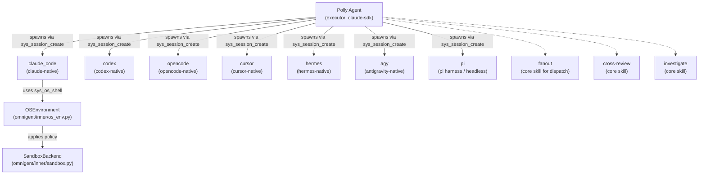

# Example Agents: Polly, Debby, Scribe, Sentinel, Kimi, Remy, Deep-Research, and AWS Analyst

<details>
<summary>Relevant source files</summary>

The following files were used as context for generating this wiki page:

- [docs/AGENT_YAML_SPEC.md](docs/AGENT_YAML_SPEC.md)
- [examples/remy/config.yaml](examples/remy/config.yaml)
- [omnigent/entities/environment_filesystem.py](omnigent/entities/environment_filesystem.py)
- [omnigent/inner/_cwd_scan.py](omnigent/inner/_cwd_scan.py)
- [omnigent/inner/bwrap_sandbox.py](omnigent/inner/bwrap_sandbox.py)
- [omnigent/inner/datamodel.py](omnigent/inner/datamodel.py)
- [omnigent/inner/loader.py](omnigent/inner/loader.py)
- [omnigent/inner/os_env.py](omnigent/inner/os_env.py)
- [omnigent/inner/sandbox.py](omnigent/inner/sandbox.py)
- [omnigent/inner/seatbelt_sandbox.py](omnigent/inner/seatbelt_sandbox.py)
- [omnigent/onboarding/agent/tools/python/list_builtin_tools.py](omnigent/onboarding/agent/tools/python/list_builtin_tools.py)
- [omnigent/runner/app.py](omnigent/runner/app.py)
- [omnigent/runner/tool_dispatch.py](omnigent/runner/tool_dispatch.py)
- [omnigent/runtime/prompt.py](omnigent/runtime/prompt.py)
- [omnigent/spec/omnigent.py](omnigent/spec/omnigent.py)
- [omnigent/spec/parser.py](omnigent/spec/parser.py)
- [omnigent/spec/types.py](omnigent/spec/types.py)
- [omnigent/tools/builtins/__init__.py](omnigent/tools/builtins/__init__.py)
- [omnigent/tools/builtins/async_inbox.py](omnigent/tools/builtins/async_inbox.py)
- [omnigent/tools/builtins/hindsight.py](omnigent/tools/builtins/hindsight.py)
- [omnigent/tools/builtins/spawn.py](omnigent/tools/builtins/spawn.py)
- [omnigent/tools/manager.py](omnigent/tools/manager.py)
- [tests/e2e/omnigent/test_example_remy.py](tests/e2e/omnigent/test_example_remy.py)
- [tests/e2e/test_subagent_long_handoff_reachable_e2e.py](tests/e2e/test_subagent_long_handoff_reachable_e2e.py)
- [tests/e2e_ui/agents/test_subagent_long_handoff_retrieval.py](tests/e2e_ui/agents/test_subagent_long_handoff_retrieval.py)
- [tests/inner/test_bwrap_sandbox.py](tests/inner/test_bwrap_sandbox.py)
- [tests/inner/test_bwrap_symlink_mask_3265.py](tests/inner/test_bwrap_symlink_mask_3265.py)
- [tests/inner/test_cwd_scan.py](tests/inner/test_cwd_scan.py)
- [tests/inner/test_loader.py](tests/inner/test_loader.py)
- [tests/inner/test_os_env.py](tests/inner/test_os_env.py)
- [tests/inner/test_os_env_grant_reach.py](tests/inner/test_os_env_grant_reach.py)
- [tests/inner/test_os_env_runtime_imports.py](tests/inner/test_os_env_runtime_imports.py)
- [tests/inner/test_sandbox.py](tests/inner/test_sandbox.py)
- [tests/inner/test_seatbelt_sandbox.py](tests/inner/test_seatbelt_sandbox.py)
- [tests/onboarding/test_list_builtin_tools.py](tests/onboarding/test_list_builtin_tools.py)
- [tests/resources/examples/agent_with_os_env_bwrap.yaml](tests/resources/examples/agent_with_os_env_bwrap.yaml)
- [tests/resources/examples/agent_with_os_env_seatbelt.yaml](tests/resources/examples/agent_with_os_env_seatbelt.yaml)
- [tests/runner/test_app_sessions_native_events_lifecycle.py](tests/runner/test_app_sessions_native_events_lifecycle.py)
- [tests/runner/test_hindsight_local_dispatch.py](tests/runner/test_hindsight_local_dispatch.py)
- [tests/runner/test_runner_dispatch.py](tests/runner/test_runner_dispatch.py)
- [tests/runtime/test_prompt.py](tests/runtime/test_prompt.py)
- [tests/spec/test_omnigent_adapter.py](tests/spec/test_omnigent_adapter.py)
- [tests/spec/test_parser.py](tests/spec/test_parser.py)
- [tests/tools/builtins/test_async_inbox.py](tests/tools/builtins/test_async_inbox.py)
- [tests/tools/builtins/test_hindsight.py](tests/tools/builtins/test_hindsight.py)
- [tests/tools/builtins/test_registry_unified.py](tests/tools/builtins/test_registry_unified.py)
- [tests/tools/builtins/test_spawn.py](tests/tools/builtins/test_spawn.py)
- [tests/tools/builtins/test_sys_session.py](tests/tools/builtins/test_sys_session.py)
- [tests/tools/test_manager.py](tests/tools/test_manager.py)

</details>


This page provides a detailed technical walkthrough of the illustrative example agents bundled with Omnigent:

- **Polly**
- **Debby**
- **Scribe**
- **Sentinel**
- **Kimi**
- **Remy**
- **Deep-Research**
- **AWS Analyst**

These agents serve as production-grade demonstration templates illustrating multi-agent orchestration, sub-agent wiring, skill integration, policy guardrails, and how to launch them via the CLI.

---

## 1. Overview

Omnigent includes several pre-configured example agents located under the `examples/` directory. Each agent defines a self-contained bundle with:

- An authoritative `config.yaml` defining the `AgentSpec`
- Optional bundled skills in `skills/`
- Optional nested sub-agents in `agents/`
- Declared toolkits and environment configurations

These example agents can be executed directly via the CLI `omnigent run <agent>` command, which loads the YAML spec, instantiates the runtime environment, and launches the agent.

**Key example agents and their intended use:**

| Agent | Summary |
|---|---|
| **Polly** | Multi-agent coding orchestrator delegating tasks to diverse coding sub-agents |
| **Debby** | Dual-head brainstorming partner that fans out queries to multiple sub-agents |
| **Scribe** | Documentation orchestrator featuring sub-agents specialized for code analysis |
| **Sentinel** | Security audit agent utilizing scanner and reviewer sub-agents |
| **Kimi** | Harness launcher wrapping native Kimi Code CLI (aka Kiro) |
| **Remy** | Hindsight long-term memory assistant integrating `hindsight` tools |
| **Deep-Research** | Single-agent deep web researcher using MCP web search and fetch tools |
| **AWS Analyst** | MCP-powered AWS cloud data querying and analysis agent |

These agents illustrate advanced usage patterns including sub-agent dispatch, asynchronous task fan-out/fan-in, multi-harness orchestration, native terminal wrapping, policy-based guardrails, and MCP tool integration.

Sources: `[examples/polly/config.yaml:1-70]()`, `[omnigent/runner/app.py:1-7]()`, `[examples/remy/config.yaml:1]()`, `[tests/runner/test_runner_dispatch.py:76-81]()`

---

## 2. Agent YAML Configuration and Structure

Each example agent is defined primarily by its `config.yaml` following the `spec_version: 1` schema, which produces a fully validated `AgentSpec` [omnigent/spec/parser.py:1-2](). The spec encompasses:

- Agent identity: `name`, `description`, and optionally `instructions` or `AGENTS.md` [omnigent/spec/parser.py:71-73]()
- Executor configuration: model, context window, and runtime harness type (e.g. `claude-sdk`, `claude-native`, `kiro-native`, `pi`) [omnigent/spec/types.py:52-55]()
- Sub-agent listings via `tools.agents`, pointing to named nested agents with their own configurations [omnigent/spec/types.py:64-66]()
- Skill bundles under `skills/` for custom domain expertise [omnigent/spec/types.py:63-64]()
- Tools section declaring builtins, MCP tools, or client-specified external toolkits [omnigent/spec/types.py:64-66]()
- Guardrails and policies restricting hazardous actions [omnigent/spec/types.py:49-51]()

### Examples of agent config structure

- Polly explicitly enables `spawn: true` to register the `sys_session_create` tool for dynamic session spawning `[examples/polly/config.yaml:13-17]()`.
- Sub-agents in Polly define isolated executors with terminal harnesses and permission settings `[examples/polly/agents/claude_code/config.yaml:1-65]()`.
- Remy configures hindsight tools via `tools.builtins` for cross-session memory `[examples/remy/config.yaml:1-10]()`.
- Deep-Research uses a single `claude-sdk` harness with MCP web search/fetch tools auto-discovered `[examples/deep-research/config.yaml:1-84]()`.
- Kimi uses direct native CLI wrapping with a `kiro-native` harness `[tests/runner/test_runner_dispatch.py:76-102]()`.

### Configuration table summary:

| Agent | Execution Harness | Sub-Agents / Tools | Special Features |
|---|---|---|---|
| Polly | `claude-sdk` (orchestrator) | `claude_code`, `codex`, `opencode`, `cursor`, `hermes`, `agy`, `pi`| Multi-harness orchestration and fan-out |
| Debby | Multiple CLI terminal harnesses (e.g., `claude-native` & GPT) | Dual sub-agent fanout | Simultaneous multiple perspectives |
| Scribe | Custom doc-gen harness | Sub-agents specialized for documentation | Code-to-doc generation |
| Sentinel | Scanner and reviewer subagents| Security audit tasks | Cross-check vulnerability scanning |
| Kimi | `kiro-native` (native CLI) | None | Native harness session wrapper |
| Remy | `claude-sdk` | `hindsight_retain`, `hindsight_recall`, `hindsight_reflect` | Long-term memory with Hindsight SDK tools |
| Deep-Research| `claude-sdk` | MCP web search/fetch tools | Deep web MCP search & synthesis |
| AWS Analyst | `claude-sdk` | MCP AWS toolkit | Cloud data analytics via MCP |

### Guardrails and Policies

Example agents apply guardrail policies — e.g., `blast_radius` function restricting command-line actions like `rm -rf /`, disabling force-pushes, or unsafe git operations — using dynamic policy tooling `[examples/polly/agents/claude_code/config.yaml:57-65]()`, `[omnigent/runner/policy_proxy.py:1-100]()`. These run on every relevant tool call to protect against unbounded or destructive workflows. The `_evaluate_policy_via_omnigent` function in the runner is responsible for policy evaluation `[omnigent/runner/policy_proxy.py:147]()`.

Sources: `[examples/polly/config.yaml:1-125]()`, `[examples/polly/agents/claude_code/config.yaml:1-65]()`, `[omnigent/spec/types.py:67-70]()`, `[omnigent/runner/policy_proxy.py:1-100]()`

---

## 3. Wiring and Sub-Agent Implementation

Omnigent's runtime converts the YAML agent spec to typed `AgentSpec` and `ExecutorSpec` dataclasses that the `WorkflowEngine` consumes. Tool registration happens via `ToolManager`.

- Sub-agent declarations under `tools.agents:` map to individual bundled sub-agent specs located under `agents/<name>/config.yaml` `[omnigent/spec/parser.py:50-70]()`.
- Each sub-agent is launched as an independent session with its own executor and runtime harness.
- Parent agents call sub-agents via the `sys_session_send` and `sys_session_create` tools from the builtin toolset `[omnigent/tools/builtins/spawn.py:1-80]()`.

### Diagram: Natural Language Space to Code Entity Space — Sub-Agent Orchestration Wiring

```mermaid
graph TD
    subgraph "NaturalLanguageSpace"
        YAMLSpec["AgentSpec YAML config (e.g. polly config.yaml)"]
        SubAgents["tools.agents (list of deployed sub-agent names)"]
        HarnessSpec["executor.config.harness ('claude-sdk', 'claude-native', etc)"]
    end

    subgraph "CodeEntitySpace"
        WorkflowEngine["WorkflowEngine (omnigent/runtime/workflow.py)"]
        ToolManager["ToolManager (omnigent/tools/manager.py)"]
        SpawnTool["SysSessionSendTool (omnigent/tools/builtins/spawn.py)"]
        Executor["Executor (e.g., ClaudeSDKExecutor)"]
        RunnerApp["Runner FastAPI App (omnigent/runner/app.py)"]
    end

    YAMLSpec --> WorkflowEngine
    SubAgents --> ToolManager
    HarnessSpec --> Executor
    ToolManager --> SpawnTool
    SpawnTool --> RunnerApp: "POST /v1/sessions/{parent_id}/subagents"
    RunnerApp --> Executor: "Spawns new harness process"
```

Sources: `[omnigent/spec/parser.py:50-70]()`, `[omnigent/tools/builtins/spawn.py:1-80]()`, `[omnigent/runner/app.py:1-150]()`, `[omnigent/tools/manager.py:100-180]()`

### Async Fan-out and Inbox Pattern

Agents fan out tasks by asynchronously spawning sub-agent sessions:

1. **Fan-out:** The orchestrator (e.g., Polly) uses `SysSessionSendTool` to create sub-agent sessions for separate tasks `[examples/polly/skills/fanout/SKILL.md:1-30]()`. The runner's `_mint_acp_subagent_child` function handles the creation of ACP sub-agents `[omnigent/runner/app.py:85]()`.
2. **Yield:** The parent yields execution to allow sub-agents to proceed concurrently.
3. **Inbox Reporting:** Completed sub-agents post reply messages to the parent’s inbox queue via `SysSessionSendTool` or saved session turns `[examples/polly/config.yaml:110-115]()`. The `_deliver_subagent_completion` function in the runner handles the delivery of sub-agent results `[omnigent/runner/app.py:178]()`.
4. **Read Inbox:** Parent reads completions and results with `SysReadInboxTool` to progress the workflow `[omnigent/tools/builtins/async_inbox.py:71-75]()`.

Sources: `[examples/polly/skills/fanout/SKILL.md:1-30]()`, `[omnigent/tools/builtins/spawn.py:40-80]()`, `[omnigent/runner/app.py:85]()`, `[omnigent/runner/app.py:178]()`, `[omnigent/tools/builtins/async_inbox.py:71-75]()`

---

## 4. Polly: Multi-Agent Coding Orchestrator

**Polly** acts as a technical lead that coordinates multiple coding sub-agents to collaboratively implement, review, and explore a coding task. Polly never writes code directly but issues fine-grained, scoped tasks to specialized coding sub-agents.

### Key Technical Elements

- **Executor:** Runs on the `claude-sdk` harness with a large 1M token context window and no pinned model or profile, allowing provider model default resolution `[examples/polly/config.yaml:28-36]()`.
- **Spawn:** `spawn: true` is enabled so Polly can dynamically spawn sub-agents as independent sessions. This capability is managed by the `SysSessionLaunchTool` and `SysSessionCreateTool` `[omnigent/tools/builtins/spawn.py:1-80]()`.
- **Sub-Agents:** Polly commands exactly seven sub-agents, each with distinct harnesses and vendors:
  - `claude_code` (`claude-native`)
  - `codex` (`codex-native`)
  - `opencode` (`opencode-native`)
  - `cursor` (`cursor-native`)
  - `hermes` (`hermes-native`)
  - `agy` (Google Antigravity, `antigravity-native`)
  - `pi` (headless `pi` harness)
Their roles vary from implementation through review to exploration `[examples/polly/config.yaml:57-69]`, `[examples/polly/agents/claude_code/config.yaml:1-65]()`.
- **Permission Bypass:** Sub-agents use config flags like `permission_mode: auto` or `yolo: true` to auto-approve requests and avoid manual intervention `[examples/polly/agents/claude_code/config.yaml:10-12]`, `[examples/polly/agents/codex/config.yaml:10-12]()`.
- **Spine Skills:** Core skills such as `fanout`, `cross-review`, and `investigate` are bundled and loaded to orchestrate workflows `[tests/e2e/omnigent/test_example_polly.py:140-150]`, `[examples/polly/skills/fanout/SKILL.md:1-20]()`.
- **Roster Preflight:** On initialization, Polly checks which sub-agents are available on the host by calling `sys_session_get_info({})` and inspecting `configured_harnesses`. Fallback is a shell probe (`command -v`) to verify worker CLI binaries `[examples/polly/config.yaml:74-100]()`.
- **Blast Radius Policy:** Uses a policy function to restrict destructive operations on git and shell commands to avoid unsafe state modifications `[examples/polly/agents/claude_code/config.yaml:56-65]()`, `[omnigent/inner/os_env.py:1-22]()`. The `OSEnvironment` class manages OS interactions and applies sandbox policies `[omnigent/inner/os_env.py:1-2096]()`.

### Diagram: Polly Agent Sub-Agent Architecture



Sources: `[examples/polly/config.yaml:29-70]()`, `[examples/polly/agents/claude_code/config.yaml:1-65]()`, `[tests/e2e/omnigent/test_example_polly.py:30-150]()`, `[omnigent/tools/builtins/spawn.py:1-80]()`, `[omnigent/inner/os_env.py:1-2096]()`, `[omnigent/inner/sandbox.py:1-1484]()`

---

## 5. Remy: Hindsight Long-Term Memory Assistant

**Remy** is an example agent that integrates Hindsight long-term memory tools to persist and recall prior information across sessions.

### Implementation Highlights

- **Tools:** Remy registers `hindsight_retain`, `hindsight_recall`, and `hindsight_reflect` tools imported lazily from `omnigent.tools.builtins.hindsight` `[omnigent/tools/builtins/hindsight.py:1-250]()`. These tools are managed by the `ToolManager` `[omnigent/tools/manager.py:1-100]()`.
- **Agent Spec:** The Remy bundle's `config.yaml` declares these tools under the built-in tools list and uses the `claude-sdk` harness for core LLM execution `[examples/remy/config.yaml:1-10]()`.
- **Hindsight SDK:** These tools use semantic memory banks allowing Remy to store key facts, retrieve related past memories with similarity, and reflect on recalled knowledge to enhance responses. The `HindsightTool` class provides the core logic `[omnigent/tools/builtins/hindsight.py:1-250]()`.
- **Use Case:** Demonstrates session-to-session LLM context stitching beyond the single turn, enabling persistent personal assistant style workflows.

Sources: `[examples/remy/config.yaml:1-10]()`, `[omnigent/tools/builtins/hindsight.py:1-250]()`, `[omnigent/tools/manager.py:1-100]()`

---

## 6. Kimi: Kimi Code Harness Launcher

**Kimi** (also known as Kiro Code) demonstrates a native terminal harness wrapper to embed an existing terminal coding tool into Omnigent.

### Details

- **Harness:** Targets the native `kiro-native` harness as defined in agent configs and code dispatch routines. The `canonicalize_harness` function resolves harness aliases `[omnigent/harness_aliases.py:1-50]()`.
- **Redirection:** The CLI entrypoint in `omnigent/runner/app.py` detects native wrapper sessions by inspecting wrapper labels and redirects execution to `run_kiro_native` in the harness module `[tests/runner/test_runner_dispatch.py:76-102]()`. The runner's `_launch_native_terminal` function is key to this process `[omnigent/runner/app.py:133]()`.
- **Purpose:** This illustrates Omnigent’s ability to reuse existing terminal-based assistants as subagents or full agents through terminal harness hijacking.

Sources: `[tests/runner/test_runner_dispatch.py:76-102]()`, `[omnigent/runner/app.py:133]()`, `[omnigent/harness_aliases.py:1-50]()`

---

## 7. Deep-Research and AWS Analyst

### Deep-Research

- A single-agent specialized researcher agent based on `claude-sdk` harness.
- Uses MCP servers (e.g., Keenable) for live web search/fetch. MCP tools are dispatched via `RunnerMcpManager` `[omnigent/runner/tool_dispatch.py:43]()`.
- Implements a researched and cited answer pattern: decomposes queries, retrieves live data, cross-checks across multiple sources, and synthesizes results with citations `[examples/deep-research/config.yaml:1-84]()`.
- MCP toolsets provide `search_web_pages` and `fetch_page_content` tools for the agent to utilize.

### AWS Analyst

- Uses MCP-based AWS tools with a `claude-sdk` brain to retrieve and analyze AWS infrastructure data.
- MCP enables cloud-native querying over logs, resource catalogs, and monitoring data.

Sources: `[examples/deep-research/config.yaml:1-84]()`, `[omnigent/runner/tool_dispatch.py:43]()`

---

## 8. Running the Example Agents

### Command-Line Interface

Agents are designed to be run using the omnigent CLI:

```bash
# Launch Polly multi-agent orchestrator
omnigent run examples/polly

# Launch Remy memory assistant
omnigent run examples/remy

# Run Kimi native harness wrapper
omnigent run kimi
```

- The CLI loads the agent bundle, validating and expanding environment variables. The `parse` function in `omnigent.spec.parser` handles this `[omnigent/spec/parser.py:23]()`.
- It registers all tools, skills, and sub-agents specified. The `ToolManager` is responsible for tool registration `[omnigent/tools/manager.py:1-100]()`.
- It launches the FastAPI runner subprocess in the local environment or connects to a remote Omnigent server `[omnigent/runner/app.py:1-42]()`.
- Sessions and sub-agents run asynchronously with communication over WebSocket or HTTP APIs on the runner server.

### Diagram: CLI Execution Flow for Example Agents

```mermaid
sequenceDiagram
    User->>CLI: "omnigent run <agent_path>"
    CLI->>SpecParser["omnigent.spec.parser.parse()"]: "Parse agent_path/config.yaml"
    SpecParser-->>CLI: "Returns AgentSpec"
    CLI->>RunnerApp["omnigent.runner.app.FastAPI"]: "POST /v1/sessions with AgentSpec"
    RunnerApp->>HarnessProcessManager["HarnessProcessManager"]: "Spawns new harness subprocess"
    HarnessProcessManager-->>RunnerApp: "Harness client ready"
    RunnerApp-->>CLI: "Session ID + status"
    CLI->>User: "Prints connection info + launches UI if enabled"
```

Sources: `[omnigent/runner/app.py:1-42]()`, `[omnigent/spec/parser.py:23]()`, `[tests/runner/test_runner_dispatch.py:100-135]()`, `[omnigent/tools/manager.py:1-100]()`

---

## 9. Summary of Key Code Entities

| Code Entity | File Path and Lines | Role Description |
|---|---|---|
| `AgentSpec` | `[omnigent/spec/types.py:60-100]()` | Typed data structure representing the full agent spec. |
| `parse` (spec parser) | `[omnigent/spec/parser.py:23]()` | Parses and validates an agent YAML bundle into an `AgentSpec`. |
| `ToolManager` | `[omnigent/tools/manager.py:1-100]()` | Registers and manages tool instances for agents and sub-agents. |
| `SysSessionSendTool` | `[omnigent/tools/builtins/spawn.py:40-80]()` | Tool implementation for spawning sessions and sub-agents. |
| `RunnerApp` | `[omnigent/runner/app.py:1-42]()` | The FastAPI application that manages harness subprocesses and dispatches tools. |
| `_evaluate_policy_via_omnigent` | `[omnigent/runner/policy_proxy.py:147]()` | Evaluates policies by proxying to the Omnigent server. |

---

This concludes the detailed technical walkthrough of the bundled example agents shipped with Omnigent and how they are configured, orchestrated, and run. They exemplify layered architecture of defined YAML specs, runtime tool registration, asynchronous multi-agent workflows, and native harness integration.

Sources:

- `[examples/polly/config.yaml:1-125]()`
- `[examples/polly/agents/claude_code/config.yaml:1-65]()`
- `[tests/e2e/omnigent/test_example_polly.py:30-150]()`
- `[omnigent/tools/builtins/hindsight.py:1-230]()`
- `[examples/remy/config.yaml:1-10]()`
- `[tests/runner/test_runner_dispatch.py:76-102]()`
- `[examples/deep-research/config.yaml:1-84]()`
- `[omnigent/runner/app.py:1-42]()`
- `[omnigent/spec/parser.py:23]()`
- `[omnigent/tools/manager.py:1-100]()`
- `[omnigent/runner/policy_proxy.py:147]()`
- `[omnigent/tools/builtins/spawn.py:40-80]()`