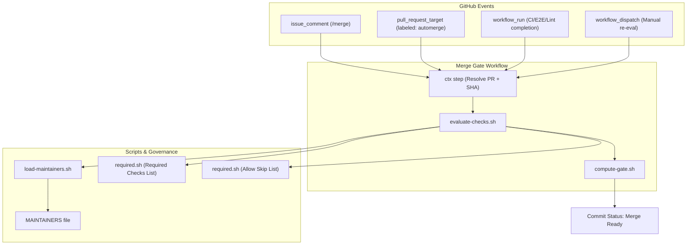
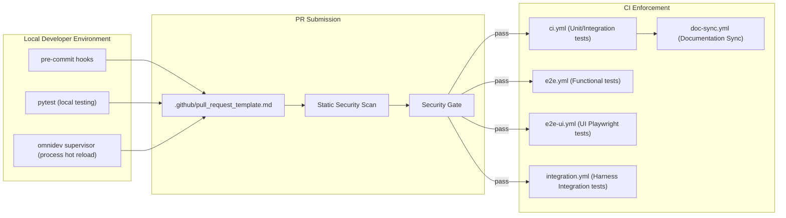

# CI/CD & Developer Workflows

Relevant source files

The following files were used as context for generating this wiki page:

- [.github/actions/run-omnigent-agent/action.yml](.github/actions/run-omnigent-agent/action.yml)
- [.github/ci-deps/package.json](.github/ci-deps/package.json)
- [.github/scripts/ci/backcompat-pairwise-matrix.sh](.github/scripts/ci/backcompat-pairwise-matrix.sh)
- [.github/scripts/ci/dependency_scope.py](.github/scripts/ci/dependency_scope.py)
- [.github/scripts/ci/e2e-shard-matrix.sh](.github/scripts/ci/e2e-shard-matrix.sh)
- [.github/scripts/ci/integration-matrix.sh](.github/scripts/ci/integration-matrix.sh)
- [.github/scripts/merge-ready/evaluate-checks.sh](.github/scripts/merge-ready/evaluate-checks.sh)
- [.github/scripts/merge-ready/required.sh](.github/scripts/merge-ready/required.sh)
- [.github/scripts/polly-review-summary.py](.github/scripts/polly-review-summary.py)
- [.github/workflows/ci.yml](.github/workflows/ci.yml)
- [.github/workflows/doc-sync.yml](.github/workflows/doc-sync.yml)
- [.github/workflows/e2e-ui.yml](.github/workflows/e2e-ui.yml)
- [.github/workflows/e2e.yml](.github/workflows/e2e.yml)
- [.github/workflows/flake-stress-e2e.yml](.github/workflows/flake-stress-e2e.yml)
- [.github/workflows/flake-stress-ui.yml](.github/workflows/flake-stress-ui.yml)
- [.github/workflows/flake-stress.yml](.github/workflows/flake-stress.yml)
- [.github/workflows/integration.yml](.github/workflows/integration.yml)
- [.github/workflows/issue-triage.yml](.github/workflows/issue-triage.yml)
- [.github/workflows/polly-review.yml](.github/workflows/polly-review.yml)
- [.github/workflows/security-triage.yml](.github/workflows/security-triage.yml)
- [.github/workflows/server-compat.yml](.github/workflows/server-compat.yml)
- [.github/workflows/windows.yml](.github/workflows/windows.yml)
- [docs/DATABASE_BEST_PRACTICES.md](docs/DATABASE_BEST_PRACTICES.md)
- [tests/scripts/test_dependency_ci.py](tests/scripts/test_dependency_ci.py)
- [tests/scripts/test_merge_ready_required.py](tests/scripts/test_merge_ready_required.py)
- [tests/scripts/test_polly_review_output.py](tests/scripts/test_polly_review_output.py)
- [tests/scripts/test_polly_review_prompt.py](tests/scripts/test_polly_review_prompt.py)
- [tests/scripts/test_polly_review_summary.py](tests/scripts/test_polly_review_summary.py)
- [tests/scripts/test_polly_review_trigger.py](tests/scripts/test_polly_review_trigger.py)

This section provides a high-level overview of the automation infrastructure, merge gates, and code quality standards that govern the Omnigent codebase. The system is designed to ensure high reliability through a tiered testing strategy and a custom automated merge gate that enforces strict quality requirements before code reaches the `main` branch.

## GitHub Actions Workflows

Omnigent leverages GitHub Actions extensively to manage the lifecycle of Pull Requests, releases, and related tasks. The workflow suite is organized into several main categories:

- **CI (Pytest Suites):** The central Continuous Integration workflow runs a distributed matrix of unit and integration tests spanning many facets of the codebase — including `runtime-core`, `server-rest`, `inner-rest`, and others. Sharding and test distribution (`worksteal` mode) efficiently parallelize tests across runners, balancing speed and resource utilization [.github/workflows/ci.yml:49-115]().

- **End-to-End (E2E) & UI Tests:** E2E tests run primarily against an in-process mock LLM server to avoid requiring real credentials. The E2E suite shards tests into 8 shards with controlled parallelism to fit within runner time limits [.github/workflows/e2e.yml:3-139](). The companion E2E UI tests shard Playwright browser tests across a 10-shard matrix; these include complex native harness render-parity checks with mocked dependencies and run on *all* PRs, including forks [.github/workflows/e2e-ui.yml:1-151]().

- **Integration Tests:** These tests run the journey-style scenarios on each supported harness against the mock LLM server. They provide broad integration coverage and run on all PRs without secrets dependency [.github/workflows/integration.yml:3-115]().

- **Security Scanning:** A dedicated security scan workflow (`security-scan.yml`) statically analyzes the diff of every PR before any build or test runs. It uses a variety of detectors including semgrep, secret detection, exfiltration patterns, workflow misuse linting, and dependency vulnerability scanning based on `uv.lock` and other lockfiles. This process scales trust tiers, scanning untrusted contributors but skipping trusted authors and maintainers, with the logic centralized in `should-scan.sh`.

- **Release Automation:** Automated workflows like `draft-release-notes.yml` synthesize changelog snippets from merged PRs to streamline release notes management.

- **AI-Powered Review and Triage:**
    - **Polly AI Review:** The `polly-review.yml` workflow spins up a local Omnigent server, starts a Polly session with the PR diff, waits for the cross-vendor review to complete, and posts findings as a PR comment. It triggers on `pull_request_target` events, `/review` comments, or `workflow_dispatch` [.github/workflows/polly-review.yml:1-40]().
    - **Issue Triage:** The `issue-triage.yml` workflow provides AI-powered triage for new and edited issues. It classifies components, assigns priority, routes to contributors, flags incomplete issues, identifies duplicates, and assigns owners. This workflow is designed to be prompt-injection resistant by isolating LLM access from GitHub mutation actions [.github/workflows/issue-triage.yml:1-31]().
    - **Security Alert Triage:** The `security-triage.yml` workflow performs scheduled AI triage of open Dependabot and CodeQL alerts. It classifies alerts and can dismiss false positives or wont-fix issues, or collect serious findings into private GitHub Security Advisory drafts [.github/workflows/security-triage.yml:1-29]().

These workflows interoperate with a reusable **Security Gate** poller (`security-gate.yml`) that acts as a common first job dependency, waiting for the single `Security Scan` check's result and mirroring it to block downstream CI jobs on failures.

For a detailed listing and explanation of all workflow files, triggers, and their roles, see the child page [GitHub Actions Workflows](#10.1).

---

## Merge-Ready Gate System

Omnigent employs a custom "Merge Ready" gate as the **single required branch protection check**. It consolidates results from all critical CI, test, and code quality workflows into a single pass/fail signal that determines whether a PR is mergeable.

### Gate Evaluation and Triggers

- The required check list is defined in `.github/scripts/merge-ready/required.sh` and includes all essential test shards (unit tests, E2E shards, UI shards, integration legs, etc.) [.github/scripts/merge-ready/required.sh:9-74]().
- The `ALLOW_SKIP` list in the same file specifies checks that can be legitimately absent in some runs (e.g., draft PRs, path-ignored PRs) [.github/scripts/merge-ready/required.sh:76-139]().

- Multiple event triggers cause the gate job to run:
  - Pull requests labeled with `automerge` to enable continuous merge gate updates and GitHub's native auto-merge.
  - Completion of major workflows (`CI`, `Lint`, `E2E Tests`, `E2E UI Tests`, etc.) via `workflow_run` event.
  - Slash command `/merge` comments by authorized maintainers to manually trigger evaluation and merging.
  - Manual programmatic dispatch to re-evaluate the gate state.

### Gate Logic

- The gate uses scripts like `evaluate-checks.sh` to read the status of all required checks. It incorporates workflows and check runs from GitHub's API to determine if all prerequisites are met.
- The `is_allow_skip()` function in `required.sh` determines if a check can be skipped [.github/scripts/merge-ready/required.sh:143-149]().
- The `workflow_for()` function maps a check name to its producing workflow, helping distinguish genuine skips from pending or re-running checks [.github/scripts/merge-ready/required.sh:167-182]().

- The final aggregate status is computed by `compute-gate.sh`, which posts a "Merge Ready" commit status on the PR's head SHA. This status acts as the gate for GitHub branch protection.

- Maintainers and the contributing team listing are loaded by `load-maintainers.sh`, enabling trust and automation logic in the gate.

### Merge Ready Gate Architecture

This gate enforces that all quality criteria and test requirements pass before a PR can merge. There is no bypass except for manual admin override through GitHub's native "merge without waiting for checks" feature (enforce_admins=false) — preserving both security and stability.

For an in-depth explanation of the gate's components and automation scripts, see [Merge-Ready Gate & Review Automation](#10.2).

---

## PR Template, Code Quality & Release Automation

Omnigent promotes high code quality and consistent contributor experience through standardized templates, linters, and release workflows.

- **PR Template:** A `.github/pull_request_template.md` ensures that contributors classify their change type and document test coverage rationale consistently.

- **Pre-commit & Linters:** Developers benefit from pre-commit hooks and tooling like `oxlint` and `prettier` to maintain coding style and prevent quality regressions. These hooks help catch problems before pushing code.

- **Security Gating:** All CI workflows depend on a reusable security gate job that prevents untrusted PR code from running tests until it passes a deterministic static security scan. This protects runner environments and avoids exposing secrets until the code is vetted.

- **Release Workflows:** Release branch merges trigger automated changelog generation from PR `## Changelog` sections, version bumping, and Homebrew formula updates for streamlined release management.

- **Documentation Sync:** The `doc-sync.yml` workflow keeps `omnigent-site` documentation in sync with merged PRs. On push to `main`, it resolves the merged PR, classifies its doc impact, labels it, and drafts an `omnigent-site` PR if documentation is needed. This targets per-minor staging branches (`X.Y-docs`) to avoid deploying in-progress docs to `main` directly [.github/workflows/doc-sync.yml:1-12]().

The following diagram depicts the quality enforcement workflow from local development through PR submission and CI validation:

For a full breakdown of PR standards, linting, pre-commit tools, and release automation, please visit [PR Template, Code Quality & Releases](#10.3).

---

## omnidev: Local Development Supervisor

To facilitate a productive developer workflow, Omnigent includes `omnidev`, a Rust-based supervisor tool located in `dev/omnidev/`.

Key features of omnidev:

- Provides a terminal user interface (TUI) that manages multiple **pods**, each pod being a local Omnigent worktree environment with isolated SQLite state, configuration, and auto-assigned network ports.

- Automatically watches source files (`omnigent/**/*.py`) and triggers hot reloads of server and host processes without manual restart, improving iteration speed.

- Enables CLI command forwarding from `omnidev` to the appropriate pod, maintaining consistent environments.

- Offers built-in commands for installing and updating Omnigent versions in the local workspace.

These capabilities streamline local development by providing stable, well-supervised environments with rapid feedback and process management.

For detailed operational and architectural information, see [omnidev: Local Development Supervisor](#10.4).

---

## Automated Bug Lifecycle Agents

Omnigent builds upon CI infrastructure with specialized developer agents that automate the bug reproduction and resolution lifecycle:

- **repro-agent:** Captures bug reproduction workflows by interacting with the running system and generating durable end-to-end tests representing the problematic scenario.

- **resolve-agent:** Analyzes reproduction data, performs root cause analysis, generates fixes, and manages the PR lifecycle until the bug is reliably resolved.

These agents run in isolated driver environments under `dev/repro-agent/` and `dev/resolve-agent/`, respectively. They utilize recorded "lanes" and controlled environments for reliable, automated troubleshooting.

For their comprehensive design and user guidance, see [repro-agent & resolve-agent: Automated Bug Lifecycle](#10.5).

---

This overview orients engineers on the overall Omnigent CI/CD and developer workflow ecosystem. For full details, please follow the respective child pages linked above.

---

**Sources:**
[.github/workflows/ci.yml:1-115]()
[.github/workflows/e2e.yml:1-139]()
[.github/workflows/e2e-ui.yml:1-151]()
[.github/workflows/integration.yml:1-115]()
[.github/workflows/polly-review.yml:1-40]()
[.github/workflows/issue-triage.yml:1-31]()
[.github/workflows/security-triage.yml:1-29]()
[.github/workflows/doc-sync.yml:1-12]()
[.github/scripts/merge-ready/required.sh:9-74]()
[.github/scripts/merge-ready/required.sh:76-139]()
[.github/scripts/merge-ready/required.sh:143-149]()
[.github/scripts/merge-ready/required.sh:167-182]()