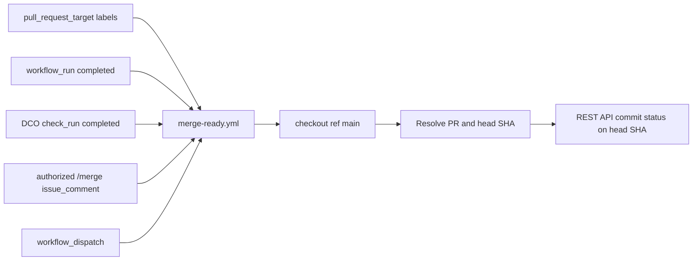
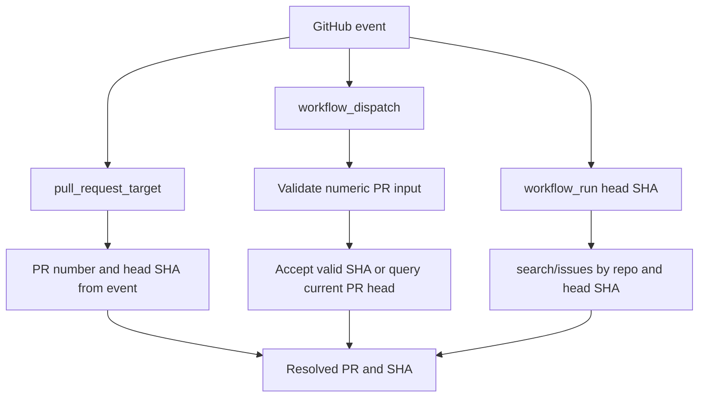
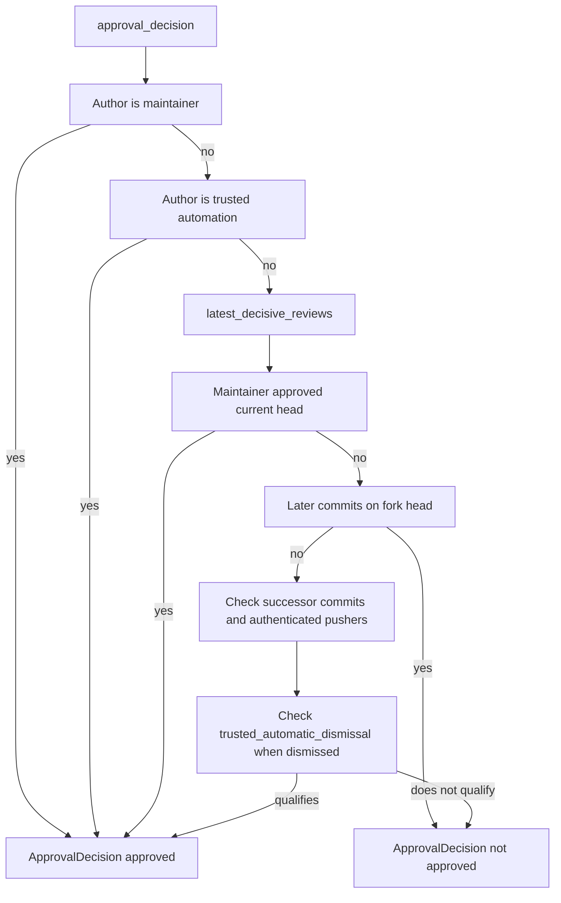
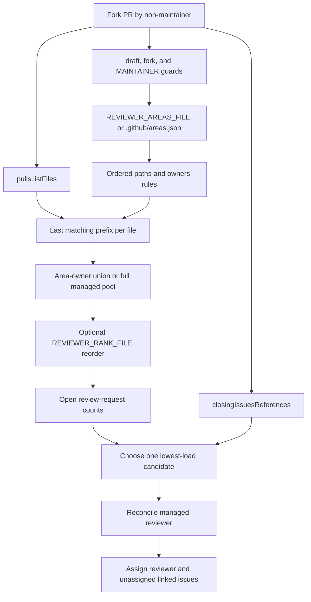
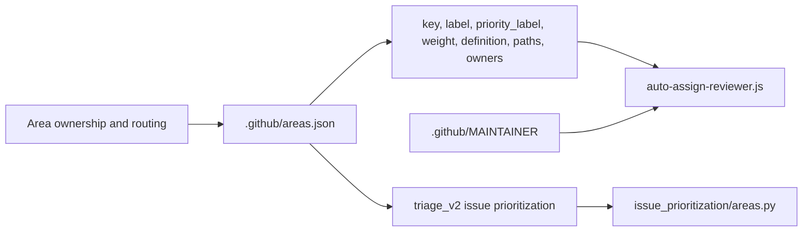
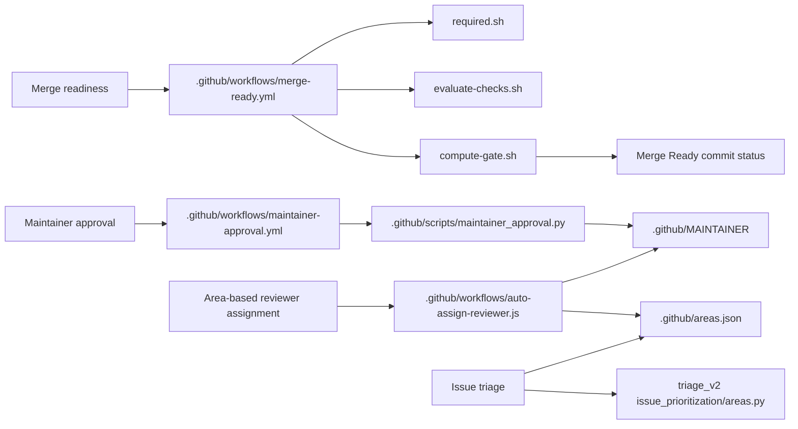

# Merge-Ready Gate & Review Automation

Relevant source files

The following files were used as context for generating this wiki page:

- [.github/CODEOWNERS](.github/CODEOWNERS)
- [.github/ISSUE_TEMPLATE/bug_report.yml](.github/ISSUE_TEMPLATE/bug_report.yml)
- [.github/ISSUE_TEMPLATE/config.yml](.github/ISSUE_TEMPLATE/config.yml)
- [.github/ISSUE_TEMPLATE/feature_request.yml](.github/ISSUE_TEMPLATE/feature_request.yml)
- [.github/actions/dependency-ci-scope/action.yml](.github/actions/dependency-ci-scope/action.yml)
- [.github/agents/doc-classifier/config.yaml](.github/agents/doc-classifier/config.yaml)
- [.github/agents/doc-drafter/config.yaml](.github/agents/doc-drafter/config.yaml)
- [.github/agents/feature-blog-drafter/config.yaml](.github/agents/feature-blog-drafter/config.yaml)
- [.github/agents/feature-blog-scout/config.yaml](.github/agents/feature-blog-scout/config.yaml)
- [.github/agents/release-post-formatter/config.yaml](.github/agents/release-post-formatter/config.yaml)
- [.github/areas.json](.github/areas.json)
- [.github/dependabot-automerge.json](.github/dependabot-automerge.json)
- [.github/dependabot-automerge.md](.github/dependabot-automerge.md)
- [.github/dependabot.yml](.github/dependabot.yml)
- [.github/open-code-review/README.md](.github/open-code-review/README.md)
- [.github/open-code-review/rules.json](.github/open-code-review/rules.json)
- [.github/scripts/ci/README.md](.github/scripts/ci/README.md)
- [.github/scripts/ci/python-matrix.json](.github/scripts/ci/python-matrix.json)
- [.github/scripts/ci/require_results.py](.github/scripts/ci/require_results.py)
- [.github/scripts/dependabot_automerge.py](.github/scripts/dependabot_automerge.py)
- [.github/scripts/dependabot_policy.py](.github/scripts/dependabot_policy.py)
- [.github/scripts/issue_triage_assignment_test.py](.github/scripts/issue_triage_assignment_test.py)
- [.github/scripts/maintainer_approval.py](.github/scripts/maintainer_approval.py)
- [.github/scripts/maintainer_approval_test.py](.github/scripts/maintainer_approval_test.py)
- [.github/scripts/merge-ready/compute-gate.sh](.github/scripts/merge-ready/compute-gate.sh)
- [.github/scripts/security-scan/sensitive-paths.sh](.github/scripts/security-scan/sensitive-paths.sh)
- [.github/scripts/waiting_on_author.py](.github/scripts/waiting_on_author.py)
- [.github/scripts/waiting_on_author_test.py](.github/scripts/waiting_on_author_test.py)
- [.github/security/TRIAGE.md](.github/security/TRIAGE.md)
- [.github/triage/config.yaml](.github/triage/config.yaml)
- [.github/triage/security/config.yaml](.github/triage/security/config.yaml)
- [.github/triage_v2/src/issue_prioritization/areas.py](.github/triage_v2/src/issue_prioritization/areas.py)
- [.github/triage_v2/src/issue_prioritization/intake.py](.github/triage_v2/src/issue_prioritization/intake.py)
- [.github/triage_v2/tests/test_intake.py](.github/triage_v2/tests/test_intake.py)
- [.github/workflows/areas.test.js](.github/workflows/areas.test.js)
- [.github/workflows/auto-assign-reviewer-test.yml](.github/workflows/auto-assign-reviewer-test.yml)
- [.github/workflows/auto-assign-reviewer.js](.github/workflows/auto-assign-reviewer.js)
- [.github/workflows/auto-assign-reviewer.test.js](.github/workflows/auto-assign-reviewer.test.js)
- [.github/workflows/auto-assign-reviewer.yml](.github/workflows/auto-assign-reviewer.yml)
- [.github/workflows/feature-blog.yml](.github/workflows/feature-blog.yml)
- [.github/workflows/maintainer-approval.yml](.github/workflows/maintainer-approval.yml)
- [.github/workflows/merge-ready.yml](.github/workflows/merge-ready.yml)
- [.github/workflows/open-code-review.yml](.github/workflows/open-code-review.yml)
- [.github/workflows/publish-changelog.yml](.github/workflows/publish-changelog.yml)
- [.github/workflows/waiting-on-author-review-run.yml](.github/workflows/waiting-on-author-review-run.yml)
- [.github/workflows/waiting-on-author-review.yml](.github/workflows/waiting-on-author-review.yml)
- [.github/workflows/waiting-on-author-test.yml](.github/workflows/waiting-on-author-test.yml)
- [.github/workflows/waiting-on-author.yml](.github/workflows/waiting-on-author.yml)
- [.gitignore](.gitignore)
- [.oss-scanner/Dockerfile](.oss-scanner/Dockerfile)
- [.oss-scanner/Dockerfile.dockerignore](.oss-scanner/Dockerfile.dockerignore)
- [.oss-scanner/threat_model.md](.oss-scanner/threat_model.md)
- [designs/issue-triage-proposal.md](designs/issue-triage-proposal.md)
- [designs/prioritization/issue-prioritization-v2.md](designs/prioritization/issue-prioritization-v2.md)
- [designs/prioritization/score_prototype.py](designs/prioritization/score_prototype.py)
- [tests/scripts/test_dependabot_automerge.py](tests/scripts/test_dependabot_automerge.py)
- [tests/scripts/test_dependabot_config.py](tests/scripts/test_dependabot_config.py)
- [tests/scripts/test_merge_ready_compute_gate.py](tests/scripts/test_merge_ready_compute_gate.py)
- [tests/scripts/test_open_code_review_workflow.py](tests/scripts/test_open_code_review_workflow.py)
- [web/src/shell/PdfViewer.tsx](web/src/shell/PdfViewer.tsx)

## Purpose and scope

This page documents the merge-readiness and review automation described by the available repository files: the `Merge Ready` workflow, maintainer-approval check, reviewer assignment, and the shared `.github/areas.json` ownership map. It also describes the documented relationship between that map and issue triage. The supplied excerpts do not include the implementation of `required.sh`, `evaluate-checks.sh`, `compute-gate.sh`, or the `triage_v2` workflow, so their internal algorithms are not specified here. [.github/workflows/merge-ready.yml:1-21](), [.github/workflows/maintainer-approval.yml:1-21](), [.github/workflows/auto-assign-reviewer.js:1-15](), [.github/areas.json:1-17]()

Sources: `.github/workflows/merge-ready.yml`, `.github/workflows/maintainer-approval.yml`, `.github/workflows/auto-assign-reviewer.js`, `.github/areas.json`

---

## Overview

The gate publishes a `Merge Ready` commit status on a pull request’s head SHA. It is explicitly separate from the `Maintainer Approval` required check: the former represents readiness evaluation, while the latter requires maintainer approval or a qualifying trusted author. [.github/workflows/merge-ready.yml:4-12](), [.github/workflows/maintainer-approval.yml:1-7]()

The merge-ready workflow re-evaluates on selected PR label changes, eligible workflow completions, DCO check completion, authorized `/merge` comments, and manual dispatch. Its comments state that it checks out trusted scripts from `main` rather than running PR-head gate logic. [.github/workflows/merge-ready.yml:6-12](), [.github/workflows/merge-ready.yml:23-48](), [.github/workflows/merge-ready.yml:67-120]()

Reviewer assignment is a separate automation path. Its documented scope is non-draft fork PRs from non-maintainer authors, with reviewer candidates drawn from area owners in `.github/areas.json`. The same JSON file is documented as the common area/ownership source for reviewer assignment and issue triage. [.github/workflows/auto-assign-reviewer.js:1-20](), [.github/workflows/auto-assign-reviewer.js:91-115](), [.github/areas.json:1-17]()

Sources: `.github/workflows/merge-ready.yml`, `.github/workflows/maintainer-approval.yml`, `.github/workflows/auto-assign-reviewer.js`, `.github/areas.json`

---

## 1. Merge-Ready Gate System

### Workflow triggers and trust boundary

The workflow is named `Merge Ready`. It posts a commit status using the REST API so the status is attached to the PR head SHA, although the workflow itself runs from the default branch. The workflow comment specifically identifies `pull_request_target` as the mechanism that ensures the workflow definition comes from `main`, preventing a PR from changing the gate logic it runs. [.github/workflows/merge-ready.yml:1-12](), [.github/workflows/merge-ready.yml:23-33]()

The declared events are `pull_request_target` label changes, completed `workflow_run` events for named workflows, completed `check_run` events, created issue comments, and `workflow_dispatch`. The job-level condition narrows those events: label-triggered evaluations are limited to `automerge`, `hold-automerge`, and `skip-security-scan`; `check_run` evaluation is limited to the DCO check from the `dco` app; and `/merge` comments must come from an OWNER, MEMBER, or COLLABORATOR who is not a bot. [.github/workflows/merge-ready.yml:23-48](), [.github/workflows/merge-ready.yml:67-106]()

The job grants write permissions for contents, pull requests, and statuses, plus read permissions for checks and Actions. The workflow comment identifies the Actions permission as necessary for classifying missing checks. Its checkout step explicitly selects `main` and limits checkout to the gate and related scripts/configuration. [.github/workflows/merge-ready.yml:50-66](), [.github/workflows/merge-ready.yml:107-122]()

**Diagram: Merge Ready event and trust boundary**

Sources: `.github/workflows/merge-ready.yml`

### PR and head-SHA resolution

The workflow resolves the PR and commit SHA according to event type. For `pull_request_target`, it takes the PR number and head SHA from the PR event. For manual dispatch, it validates the PR input as numeric and accepts a supplied SHA only if it matches the hexadecimal SHA pattern; otherwise it obtains the current PR head SHA through `gh pr view`. [.github/workflows/merge-ready.yml:123-160]()

For workflow-run events, the workflow comments explain that fork PR payloads may have an empty `pull_requests` array. The shown resolver defines `resolve_pr_from_sha()` using the GitHub search API, rather than the commit-to-pulls endpoint, because fork head commits live in the fork repository. The excerpt ends before the remaining event-resolution branches, so their exact implementation is not described here. [.github/workflows/merge-ready.yml:123-145]()

**Diagram: Event context to PR identity**

Sources: `.github/workflows/merge-ready.yml`

### Gate scripts and check evaluation

The page scope names `required.sh`, `evaluate-checks.sh`, and `compute-gate.sh` as the merge-gate scripts. The available workflow excerpt shows that it checks out `.github/scripts/merge-ready`, and its permissions comment says `evaluate-checks.sh` reads the Actions-runs API to classify missing checks. The script contents and line ranges for the three gate scripts were not included in the supplied material; therefore this page does not enumerate required checks, describe skip rules, or infer how `compute-gate.sh` calculates its result. [.github/workflows/merge-ready.yml:58-66](), [.github/workflows/merge-ready.yml:109-120]()

The workflow’s introductory comments establish the external contract: the gate posts one readiness status, separate from `Maintainer Approval`, and there is no CI-bypass label. For a genuine emergency, the documented route is a repository administrator using GitHub’s native merge-without-waiting affordance; the workflow comment notes `enforce_admins=false`. [.github/workflows/merge-ready.yml:4-21]()

Sources: `.github/workflows/merge-ready.yml`

### Labels and auto-merge intent

The workflow comment describes `automerge` as enabling GitHub auto-merge on label addition and opting into continuous gate updates, including green and red updates. The job’s event condition also recognizes `hold-automerge` and `skip-security-scan` label changes, but the supplied excerpt does not show the downstream behavior for those labels. [.github/workflows/merge-ready.yml:14-21](), [.github/workflows/merge-ready.yml:67-79]()

The `/merge` comment path is restricted to pull-request comments containing `/merge`, excludes bot actors, and accepts only OWNER, MEMBER, or COLLABORATOR associations. The available excerpt establishes the authorization condition, but does not show the later command-processing or auto-merge API call. [.github/workflows/merge-ready.yml:97-106]()

Sources: `.github/workflows/merge-ready.yml`

---

## 2. Maintainer Approval

`Maintainer Approval` is a required check implemented as a workflow job that remains unsuccessful until a maintainer approval or a trusted-author condition qualifies. It is intentionally distinct from the `Merge Ready` status. [.github/workflows/maintainer-approval.yml:1-7]()

The workflow runs on `pull_request_target` for opened, reopened, synchronized, ready-for-review, and labeled/unlabeled events. It checks out the evaluator from `main`, and its comments state that it runs no PR code and reads `.github/MAINTAINER` from the trusted default-branch context. Its concurrency configuration does not cancel an in-progress run, because cancellation could leave the check red. [.github/workflows/maintainer-approval.yml:9-17](), [.github/workflows/maintainer-approval.yml:23-56](), [.github/workflows/maintainer-approval.yml:30-33]()

The workflow invokes `.github/scripts/maintainer_approval.py` with the repository, PR number, and `omni-resolve-agent[bot]` as both a trusted author and trusted successor. It grants the job read access to PRs and Actions, and write access to statuses; the workflow comments identify status invalidation as part of dependency-exemption handling. [.github/workflows/maintainer-approval.yml:35-43](), [.github/workflows/maintainer-approval.yml:68-80]()

### Approval decision model

`ApprovalDecision` carries an `approved` boolean and a reason string. `latest_decisive_reviews()` selects each user’s latest review among `APPROVED`, `CHANGES_REQUESTED`, and `DISMISSED`, ordering reviews by submission timestamp and then ID. [.github/scripts/maintainer_approval.py:15-36]()

`approval_decision()` accepts a maintainer author or trusted automation author immediately. Otherwise, it considers each maintainer’s latest decisive review: an approval of the current head qualifies; an approval predating later commits can carry forward only under the script’s trusted-successor rules. The function explicitly rejects carrying approval across later commits on a fork head, and checks authenticated pushers rather than relying on commit email identity. [.github/scripts/maintainer_approval.py:39-67](), [.github/scripts/maintainer_approval.py:72-135]()

For a dismissed approval to qualify through trusted successors, `trusted_automatic_dismissal()` checks the review-dismissal timeline event, matching review ID, approval state, empty dismissal message, trusted actor, and dismissal commit among successor SHAs. [.github/scripts/maintainer_approval.py:120-126](), [.github/scripts/maintainer_approval.py:138-162]()

**Diagram: Maintainer approval decision path**

Sources: `.github/scripts/maintainer_approval.py`

### Re-evaluation after reviews and pushes

The workflow comments state that `pull_request_target` does not fire on review submissions, so separate `maintainer-approval-rerun.yml` and `-rerun-run.yml` workflows re-run approval evaluation after an approving review. Those workflow files were named in the supplied comments but their contents were not provided, so their trigger and implementation details are not expanded here. [.github/workflows/maintainer-approval.yml:16-17]()

The approval workflow also documents that approval may carry across later commits only when every push since approval is by trusted automation, judged using authenticated actors for head runs rather than commit email. The evaluator implements this through the `pushers` callback and successor checks. [.github/workflows/maintainer-approval.yml:19-21](), [.github/scripts/maintainer_approval.py:53-59](), [.github/scripts/maintainer_approval.py:89-119]()

Sources: `.github/workflows/maintainer-approval.yml`, `.github/scripts/maintainer_approval.py`

---

## 3. Automated Reviewer Assignment

### Scope and safeguards

The reviewer-assignment module exports an async function receiving the GitHub client, event context, and workflow core interface. It targets exactly one reviewer, skips missing or draft PRs, and then limits processing to fork PRs authored by non-maintainers. The fork test compares full head and base repository names. [.github/workflows/auto-assign-reviewer.js:52-73]()

Maintainer identities are loaded from `.github/MAINTAINER`; if the file cannot be read, the action warns and returns without assigning. The author comparison is case-insensitive. These checks make the assignment path fail closed when it cannot establish whether the author is a maintainer. [.github/workflows/auto-assign-reviewer.js:61-89]()

Sources: `.github/workflows/auto-assign-reviewer.js`

### Ownership mapping and candidate construction

The action reads `.github/areas.json` by default, with `REVIEWER_AREAS_FILE` available for tests. It excludes logins in `assignment_paused`, builds ordered path-prefix rules from each area’s `paths` and `owners`, and creates a managed reviewer pool from the remaining owners. [.github/workflows/auto-assign-reviewer.js:91-115]()

For each changed file, the action scans the ordered rules and retains the last prefix match. It unions the matched area owners across files. If no changed file matches a configured path, the documented policy falls back to the full owner pool. Candidates exclude the PR author. An optional ranking file may reorder the allowlisted candidate pool, but the comments state it cannot add candidates; without ranking, selection is based on load balancing. [.github/workflows/auto-assign-reviewer.js:13-15](), [.github/workflows/auto-assign-reviewer.js:117-134]()

The area configuration documents that paths are prefixes and that the last matching area wins per file. It therefore requires broad prefixes to precede more-specific children. It also documents that owners must be maintainers listed in `.github/MAINTAINER`, and that ownership tests use a frozen fixture so real ownership changes do not churn decision-logic tests. [.github/areas.json:18-52]()

Sources: `.github/workflows/auto-assign-reviewer.js`, `.github/areas.json`

### Load balancing and linked issues

The action’s documented balancing policy counts current open review requests across the repository and chooses among candidates with the fewest requests, using a random tie-break. Only handles from the managed area-owner pool are eligible for reconciliation, so manually added reviewers outside that pool are not removed. [.github/workflows/auto-assign-reviewer.js:22-26]()

Linked issues are used to keep the PR reviewer and issue assignee aligned. A linked issue already assigned to someone in the managed reviewer pool can determine the reviewer; the selected reviewer is then assigned to linked issues without an assignee. The action also handles PR `edited` events in promote-only mode: it can adopt a linked issue assignee, but avoids replacing an existing reviewer with a fresh load-balanced choice. The comments cap push-down assignments because the PR body controls linked-issue references. [.github/workflows/auto-assign-reviewer.js:28-51]()

The supplied unit-test excerpt demonstrates these behaviors with a mocked GitHub client: it uses frozen area configuration, mocked changed-file and open-PR results, linked-issue GraphQL data, and captured reviewer/assignee changes. It also tests paused owners and verifies that pauses do not remove existing reviewers or assignees. [.github/workflows/auto-assign-reviewer.test.js:1-17](), [.github/workflows/auto-assign-reviewer.test.js:19-110](), [.github/workflows/auto-assign-reviewer.test.js:118-144]()

**Diagram: Reviewer assignment from PR files to GitHub updates**

Sources: `.github/workflows/auto-assign-reviewer.js`, `.github/workflows/auto-assign-reviewer.test.js`, `.github/areas.json`

---

## 4. Shared Area Configuration and Issue Triage

### `.github/areas.json` as the routing source

`.github/areas.json` describes itself as the shared source of truth for issue triage and PR reviewer assignment, replacing the older `.github/reviewers` and `.github/ISSUE_ASSIGNEES` files. It uses JSON because the GitHub-script environment and CI runner are documented as lacking a YAML parser, while both JavaScript and Python can read JSON natively. [.github/areas.json:1-10]()

The top-level `assignment_paused` list temporarily excludes logins from issue triage, reviewer assignment, linked-issue assignment, and waiting-on-author review re-requests. The configuration states that paused users’ existing assignments and review requests are not removed. [.github/areas.json:12-17]()

Each area can define a stable `key`, a `comp:*` label, a `priority_label`, a weight and its source, a prose `definition`, file-prefix `paths`, and `owners`. The file documents that matching is based on `filename.startsWith(prefix)` and that the last matching area wins per file. [.github/areas.json:18-48]()

### Relationship to `triage_v2`

The configuration documents `.github/areas.json` as an input to issue triage, and the supplied repository-file list identifies `.github/triage_v2/src/issue_prioritization/areas.py` as a related implementation file. The available material does not include that module’s contents or the `triage_v2` workflow implementation; therefore, this page does not assert its classification, scoring, label-application, or assignment algorithm. [.github/areas.json:1-17]()

**Diagram: Natural-language ownership model mapped to code entities**

Sources: `.github/areas.json`, `.github/workflows/auto-assign-reviewer.js`, `.github/triage_v2/src/issue_prioritization/areas.py`

### Configuration validation and reviewer tests

The configuration comments state that `areas.test.js` validates the live `.github/areas.json`: owners must appear in `.github/MAINTAINER`, labels must be existing component labels, areas need at least two owners, and path resolution is checked. The test implementation itself was not included in the supplied excerpts. [.github/areas.json:42-48]()

The reviewer logic tests deliberately use `auto-assign-reviewer.fixture.json`, not the live ownership map, so ownership edits do not cause decision-logic test churn. The test sets `REVIEWER_AREAS_FILE` to a temporary fixture-derived file and can set `REVIEWER_RANK_FILE` to exercise ranking behavior independently. [.github/workflows/auto-assign-reviewer.test.js:1-17](), [.github/workflows/auto-assign-reviewer.test.js:38-50]()

Sources: `.github/areas.json`, `.github/workflows/auto-assign-reviewer.test.js`

---

## Gate and review automation data flow

This diagram connects the human-facing concepts—merge readiness, maintainer approval, reviewer ownership, and issue triage—to the code entities visible in the supplied materials. The gate-script names are shown as the named implementation components, but their internals are not inferred from the unavailable file contents. [.github/workflows/merge-ready.yml:4-12](), [.github/workflows/maintainer-approval.yml:1-17](), [.github/workflows/auto-assign-reviewer.js:1-15](), [.github/areas.json:1-17]()

**Diagram: Natural-language workflows to repository entities**

Sources: `.github/workflows/merge-ready.yml`, `.github/workflows/maintainer-approval.yml`, `.github/scripts/maintainer_approval.py`, `.github/workflows/auto-assign-reviewer.js`, `.github/areas.json`

---

## Summary table

| Entity | Responsibility supported by the available material |
|---|---|
| `.github/workflows/merge-ready.yml` | Triggers gate evaluation and posts the `Merge Ready` status on the PR head SHA. |
| `.github/scripts/merge-ready/required.sh` | Named as a merge-gate script; implementation was not included in the supplied excerpt. |
| `.github/scripts/merge-ready/evaluate-checks.sh` | Named as a merge-gate script; workflow comments say it reads Actions runs to classify missing checks. |
| `.github/scripts/merge-ready/compute-gate.sh` | Named as a merge-gate script; implementation was not included in the supplied excerpt. |
| `.github/workflows/maintainer-approval.yml` | Runs the separate `Maintainer Approval` required check from trusted workflow context. |
| `.github/scripts/maintainer_approval.py` | Evaluates maintainer reviews, trusted authors, and trusted successor pushes. |
| `.github/workflows/auto-assign-reviewer.js` | Selects and reconciles one managed reviewer for eligible fork PRs. |
| `.github/areas.json` | Shared area, path, label, owner, weight, and paused-assignment configuration. |
| `.github/triage_v2/src/issue_prioritization/areas.py` | Identified as a triage-v2 area module; implementation was not included in the supplied excerpt. |

Sources: `.github/workflows/merge-ready.yml`, `.github/workflows/maintainer-approval.yml`, `.github/scripts/maintainer_approval.py`, `.github/workflows/auto-assign-reviewer.js`, `.github/areas.json`

---

## Summary

The merge gate publishes a single `Merge Ready` status on the PR head SHA and keeps it separate from the required `Maintainer Approval` check. Gate evaluation runs from trusted default-branch scripts, and the documented policy provides no CI-bypass label; emergency merges use GitHub’s native administrator affordance. [.github/workflows/merge-ready.yml:4-21](), [.github/workflows/merge-ready.yml:109-120]()

Maintainer approval is evaluated against the current PR head, with narrowly defined trusted-author and trusted-successor cases. Reviewer automation separately uses `.github/areas.json` to route eligible fork PRs, balance review load, and synchronize reviewer selection with linked issues. The same configuration is identified as an input to issue triage, though the supplied excerpts do not expose `triage_v2` internals. [.github/scripts/maintainer_approval.py:39-59](), [.github/scripts/maintainer_approval.py:72-135](), [.github/workflows/auto-assign-reviewer.js:1-15](), [.github/areas.json:1-17]()

Sources: `.github/workflows/merge-ready.yml`, `.github/scripts/maintainer_approval.py`, `.github/workflows/auto-assign-reviewer.js`, `.github/areas.json`