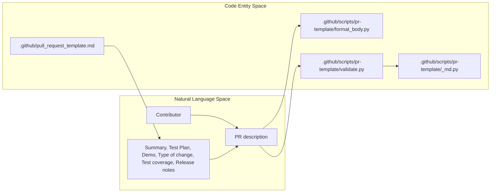
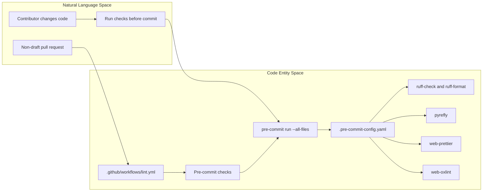
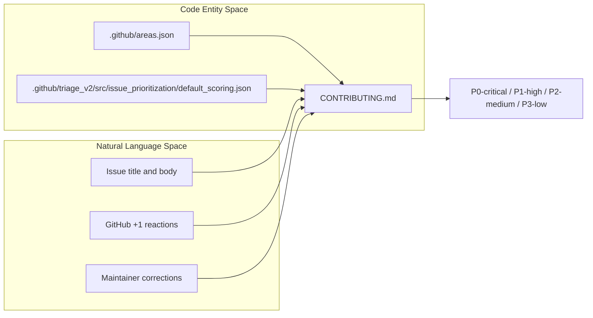
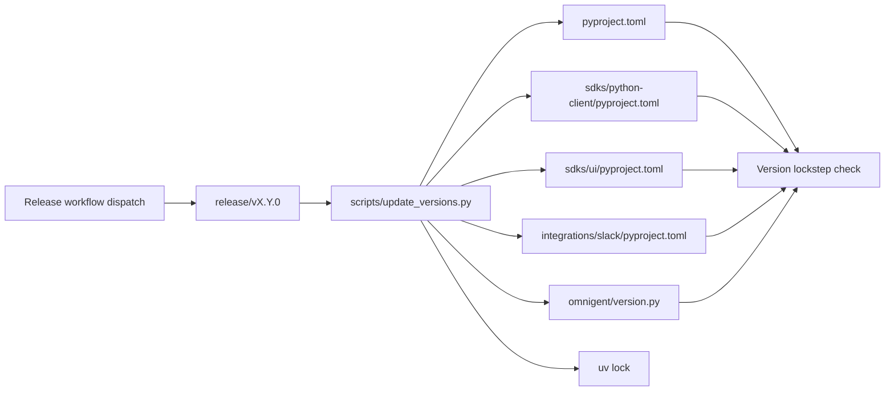
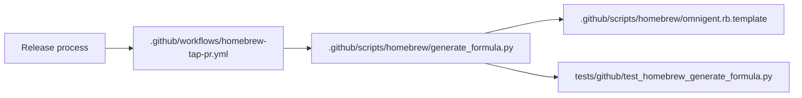
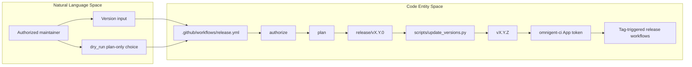
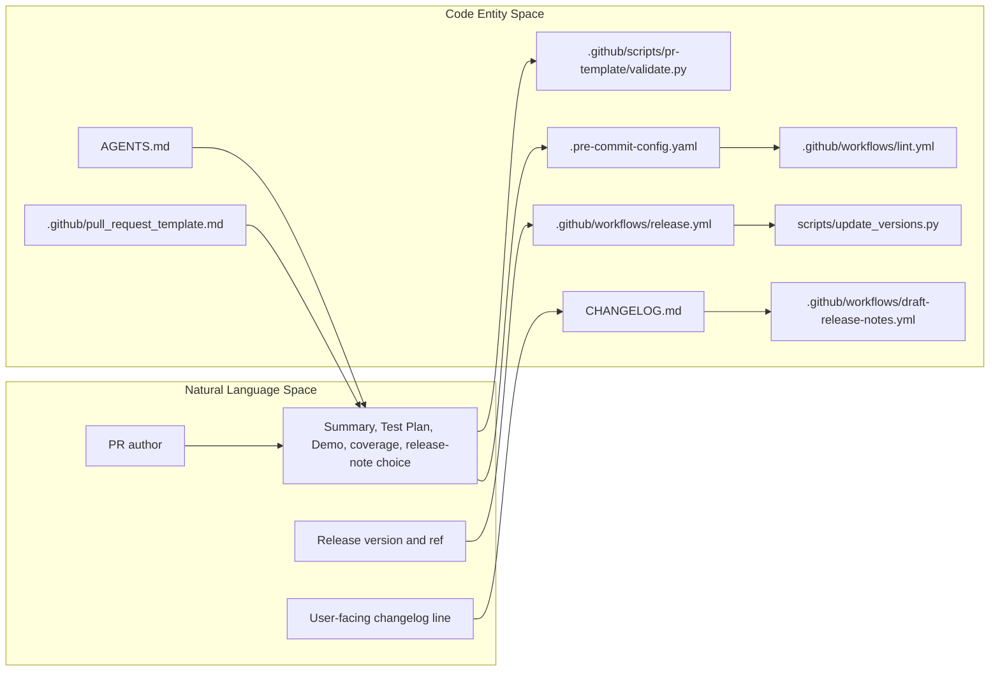

# PR Template, Code Quality & Releases

Relevant source files

The following files were used as context for generating this wiki page:

- [.github/agents/release-notes-drafter/config.yaml](.github/agents/release-notes-drafter/config.yaml)
- [.github/pull_request_template.md](.github/pull_request_template.md)
- [.github/scripts/changelog/compose_notes.py](.github/scripts/changelog/compose_notes.py)
- [.github/scripts/changelog/generate.py](.github/scripts/changelog/generate.py)
- [.github/scripts/changelog/release_to_mdx.py](.github/scripts/changelog/release_to_mdx.py)
- [.github/scripts/homebrew/generate_formula.py](.github/scripts/homebrew/generate_formula.py)
- [.github/scripts/homebrew/omnigent.rb.template](.github/scripts/homebrew/omnigent.rb.template)
- [.github/scripts/pr-template/_md.py](.github/scripts/pr-template/_md.py)
- [.github/scripts/pr-template/format_body.py](.github/scripts/pr-template/format_body.py)
- [.github/scripts/pr-template/validate.py](.github/scripts/pr-template/validate.py)
- [.github/workflows/autoformat-pr.yml](.github/workflows/autoformat-pr.yml)
- [.github/workflows/bump-version.yml](.github/workflows/bump-version.yml)
- [.github/workflows/dependabot-automerge.yml](.github/workflows/dependabot-automerge.yml)
- [.github/workflows/draft-release-notes.yml](.github/workflows/draft-release-notes.yml)
- [.github/workflows/finalize-release.yml](.github/workflows/finalize-release.yml)
- [.github/workflows/homebrew-tap-pr.yml](.github/workflows/homebrew-tap-pr.yml)
- [.github/workflows/lint.yml](.github/workflows/lint.yml)
- [.github/workflows/nightly-release.yml](.github/workflows/nightly-release.yml)
- [.github/workflows/oss-regen-on-comment.yml](.github/workflows/oss-regen-on-comment.yml)
- [.github/workflows/oss-regenerate-and-smoke.yml](.github/workflows/oss-regenerate-and-smoke.yml)
- [.github/workflows/release.yml](.github/workflows/release.yml)
- [.github/workflows/stale.yml](.github/workflows/stale.yml)
- [.github/workflows/sync-openapi-to-site.yml](.github/workflows/sync-openapi-to-site.yml)
- [.pre-commit-config.yaml](.pre-commit-config.yaml)
- [AGENTS.md](AGENTS.md)
- [CHANGELOG.md](CHANGELOG.md)
- [CONTRIBUTING.md](CONTRIBUTING.md)
- [designs/RELEASE-AUTOMATION.md](designs/RELEASE-AUTOMATION.md)
- [justfile](justfile)
- [scripts/update_versions.py](scripts/update_versions.py)
- [tests/github/__init__.py](tests/github/__init__.py)
- [tests/github/test_changelog_generate.py](tests/github/test_changelog_generate.py)
- [tests/github/test_compose_notes.py](tests/github/test_compose_notes.py)
- [tests/github/test_homebrew_generate_formula.py](tests/github/test_homebrew_generate_formula.py)
- [tests/github/test_homebrew_pillow_wheel_miss.py](tests/github/test_homebrew_pillow_wheel_miss.py)
- [tests/github/test_pr_autoformat.py](tests/github/test_pr_autoformat.py)
- [tests/github/test_pr_template_validate.py](tests/github/test_pr_template_validate.py)
- [tests/github/test_release_notes_workflow.py](tests/github/test_release_notes_workflow.py)
- [tests/github/test_release_to_mdx.py](tests/github/test_release_to_mdx.py)
- [tests/scripts/test_update_versions.py](tests/scripts/test_update_versions.py)
- [web/ios/Omnigent/Info-Debug.plist](web/ios/Omnigent/Info-Debug.plist)
- [web/ios/Omnigent/Info-Release.plist](web/ios/Omnigent/Info-Release.plist)
- [web/ios/RELEASE.md](web/ios/RELEASE.md)
- [web/ios/fastlane/Fastfile](web/ios/fastlane/Fastfile)
- [web/ios/fastlane/Snapfile](web/ios/fastlane/Snapfile)
- [web/ios/fastlane/metadata/en-US/description.txt](web/ios/fastlane/metadata/en-US/description.txt)
- [web/ios/fastlane/metadata/en-US/promotional_text.txt](web/ios/fastlane/metadata/en-US/promotional_text.txt)
- [web/ios/fastlane/simulator.rb](web/ios/fastlane/simulator.rb)
- [web/ios/fastlane/test/simulator_test.rb](web/ios/fastlane/test/simulator_test.rb)

## Purpose and scope

This page explains Omnigent’s contributor-facing PR requirements, local and CI code-quality checks, repository governance, changelog and release-note preparation, lockstep versioning, Homebrew formula automation, and release workflow. The contributor workflow is documented in `CONTRIBUTING.md` and `AGENTS.md`; CI runs the configured pre-commit checks and a separate version-lockstep check. [CONTRIBUTING.md:98-147](); [AGENTS.md:28-75](); [.github/workflows/lint.yml:1-7]()

Sources: `CONTRIBUTING.md:98-147`, `AGENTS.md:28-75`, `.github/workflows/lint.yml:1-7`

## Overview

The development and release process connects contributor-authored PR descriptions to local and CI validation, then carries approved changes through changelog harvesting and release preparation. The repository also provides local `just` shortcuts and release automation that validates version inputs, plans branch and tag changes, and pushes using a GitHub App token rather than `GITHUB_TOKEN`. [AGENTS.md:28-75](); [justfile:1-17](); [.github/workflows/lint.yml:1-7](); [.github/workflows/release.yml:1-20]()

| Area | Implementation |
|---|---|
| PR authoring | The PR template and contributor guidance require summary, test plan, type and coverage selections, and release-note guidance. [AGENTS.md:45-75]() |
| Local quality | Pre-commit runs Python, custom project, web, TypeScript, and platform-specific checks according to file filters. [`.pre-commit-config.yaml:1-6`]() [`.pre-commit-config.yaml:8-27`]() [`.pre-commit-config.yaml:29-93`]() |
| CI quality | The `Pre-commit checks` job runs pre-commit on non-draft PRs and pushes to `main` and release branches. [`.github/workflows/lint.yml:1-17`]() [`.github/workflows/lint.yml:44-49`]() |
| Governance | Contributor instructions define PR content and issue-prioritization policy; release and lockfile regeneration workflows enforce separate authorization rules. [AGENTS.md:45-75](); [CONTRIBUTING.md:9-50](); [.github/workflows/release.yml:61-83](); [.github/workflows/oss-regen-on-comment.yml:19-20]() |
| Release preparation | Release-time changelog generation uses PR `## Changelog` sections or titles; a separate workflow drafts release notes. [CHANGELOG.md:1-6](); [.github/workflows/draft-release-notes.yml:1-23]() |
| Versioning | The release workflow stamps a lockstep version; CI checks that the four packages remain aligned. [`.github/workflows/release.yml:1-6`]() [`.github/workflows/lint.yml:148-162`]() |

Sources: `AGENTS.md:45-75`, `CONTRIBUTING.md:9-50`, `justfile:1-17`, `.pre-commit-config.yaml:1-93`, `.github/workflows/lint.yml:1-17`, `.github/workflows/lint.yml:44-49`, `.github/workflows/lint.yml:148-162`, `.github/workflows/release.yml:1-6`, `.github/workflows/release.yml:61-83`, `.github/workflows/oss-regen-on-comment.yml:19-20`, `.github/workflows/draft-release-notes.yml:1-23`, `CHANGELOG.md:1-6`

## 1. PR Template and Validation

### PR template

The repository’s PR template is `.github/pull_request_template.md`. Contributor guidance says to preserve its sections and checkbox rows, except that the Changelog section may be removed when the author recommends no release notes. [AGENTS.md:45-50](); [AGENTS.md:60-71]()

The contributor guidance describes the expected content:

| Template area | Contributor requirement |
|---|---|
| Summary | Explain what changed and why. [AGENTS.md:52-53]() |
| Test Plan | Describe how the change was verified. [AGENTS.md:52-53]() |
| Demo | Provide video or images for UI/frontend changes; use `N/A` for non-visual changes. [AGENTS.md:54-57]() |
| Type of change and Test coverage | Select at least one applicable option in each section. [AGENTS.md:58-59]() |
| Coverage notes | Explain the choice when “Manual verification completed” or “Not applicable” is selected. [AGENTS.md:60-61]() |
| Release notes and Changelog | Select exactly one Yes/No option and retain both rows. If Yes, write a user-facing changelog line; if No, remove the optional Changelog section. [AGENTS.md:62-71]() |

Demo media should be uploaded as GitHub attachments rather than committed solely as PR evidence. The guidance also asks contributors to redact private data before uploading. [AGENTS.md:77-87]()

### PR body formatting and validation

PR-template tooling is located in `.github/scripts/pr-template/`, including `format_body.py`, `validate.py`, and `_md.py`; dedicated tests are listed under `tests/github/`. [AGENTS.md:47-50](); [`.github/scripts/pr-template/format_body.py`]() [`.github/scripts/pr-template/validate.py`]() [`.github/scripts/pr-template/_md.py`]() [`.github/workflows/autoformat-pr.yml`]() [`.github/workflows/lint.yml:1-7`]()

The supplied file contents do not include the bodies of those scripts or workflows, so this page does not specify their parsing algorithms, exact validation rules, or invocation sequence. The contributor-facing requirements above are documented in `AGENTS.md`. [AGENTS.md:45-75]()

### PR description lifecycle

The diagram associates the contributor-facing PR workflow with the repository’s template and the named formatting and validation entities. The available source text establishes the template path and script names, but does not expose the scripts’ internal call graph. [AGENTS.md:45-50](); [`.github/scripts/pr-template/format_body.py`]() [`.github/scripts/pr-template/validate.py`]() [`.github/scripts/pr-template/_md.py`]()

**Diagram: Contributor PR description and validation entities**

Sources: `AGENTS.md:45-50`, `AGENTS.md:52-71`, `.github/scripts/pr-template/format_body.py`, `.github/scripts/pr-template/validate.py`, `.github/scripts/pr-template/_md.py`

### Governance and contributor expectations

For larger changes, contributors are asked to open an issue first to discuss the approach. Contributors must not include secrets, internal URLs, customer data, or private configuration in issues, tests, examples, or logs. [CONTRIBUTING.md:1-7]()

`AGENTS.md` asks contributors to reuse existing helpers, add tests for non-trivial functions and exported APIs, run relevant tests, and document unrelated pre-existing failures in the PR. It also directs contributors to run pre-commit before committing. [AGENTS.md:6-32]()

Issue-prioritization guidance states that an LLM classifies issue type, severity, and affected areas, while deterministic arithmetic computes priority. The formula is severity points multiplied by component weight, plus community-demand points; maintainer-set overrides are preserved. [CONTRIBUTING.md:9-25](); [CONTRIBUTING.md:27-50]()

Sources: `CONTRIBUTING.md:1-7`, `CONTRIBUTING.md:9-50`, `AGENTS.md:6-32`

## 2. Local Code Quality: Pre-commit Hooks

The repository configures local hooks in `.pre-commit-config.yaml`. It excludes the built web UI bundle at `omnigent/server/static/web-ui/`, which is vendored/minified output that should not be linted or automatically fixed. [`.pre-commit-config.yaml:1-6`]()

### Hook groups

| Area | Hooks and behavior |
|---|---|
| Python formatting and lint | `ruff-check` runs Ruff with `--fix`; `ruff-format` applies formatting. Both use the repository virtual environment. [`.pre-commit-config.yaml:8-20`]() |
| Python typing | `pyrefly` runs `pyrefly check` for relevant Python, stub, and dependency/configuration changes. It runs without passing individual filenames. [`.pre-commit-config.yaml:22-27`]() |
| Test-quality rules | Test-only hooks check for globally clobbering asyncio monkeypatches and unconditional `@pytest.mark.skip`. [`.pre-commit-config.yaml:29-43`]() |
| Model IDs and custom lint | A model-ID hook checks selected source/config extensions; an aggregate custom-lint hook invokes `dev.lint.custom_lint` and a Node test. [`.pre-commit-config.yaml:45-62`]() |
| Web formatting and lint | `web-prettier` formats selected web files; `web-oxlint` runs Oxlint with warnings denied and unused disable directives reported. [`.pre-commit-config.yaml:64-86`]() |
| TypeScript | Separate `tsc` hooks cover the web app, VS Code extension, web extension SDK, and hello-extension example. [`.pre-commit-config.yaml:88-121`]() |
| Mobile code | Android hooks run `ktlint` formatting and checks; the shown configuration begins the iOS Swift-format hooks later in the file. [`.pre-commit-config.yaml:123-146`]() |

Pre-commit can run on staged files during `git commit` or over all tracked files with `pre-commit run --all-files`. `AGENTS.md` notes that CI runs the same checks. [AGENTS.md:28-32]()

### Local setup and common checks

`CONTRIBUTING.md` recommends macOS or Linux for development and WSL2 on Windows. It documents `uv` environment setup, the optional web prerequisites, and commands for pytest, Ruff, Pyrefly, and pre-commit. [CONTRIBUTING.md:98-147]()

The `justfile` provides setup recipes: `_check-uv` checks Ruff, Pyrefly, and pre-commit; `_ensure-uv` synchronizes all extras and the dev group; `check` aggregates prerequisite checks; and `ensure` installs or checks the Python, iOS, and `omnidev` prerequisites. [justfile:9-44]()

### CI enforcement and lockfile checks

The `Lint` workflow runs for pull requests and pushes to `main` and `release/v[0-9]*`. Draft PRs skip the pre-commit job; `ready_for_review` is one of the PR events that triggers the workflow. [`.github/workflows/lint.yml:1-17`]() [`.github/workflows/lint.yml:44-49`]()

Before installing dependencies, CI checks that the committed `uv.lock` uses the public PyPI index. It then performs `uv sync --locked`, installs frontend dependencies with a frozen lockfile, regenerates the pnpm lockfile to detect drift, checks pnpm override consistency, and runs pre-commit across all files. [`.github/workflows/lint.yml:60-89`]() [`.github/workflows/lint.yml:91-123`]() [`.github/workflows/lint.yml:142-146`]()

CI installs `ktlint` before pre-commit because the local wrapper may skip when the binary is absent; the workflow verifies the downloaded binary against a pinned SHA-256. [`.github/workflows/lint.yml:125-140`]()

### Code-quality data flow

This diagram maps the contributor’s local checks to the named hook configuration and CI job. The workflow first applies its security gate, then prepares dependencies and invokes pre-commit. [AGENTS.md:28-32](); [`.pre-commit-config.yaml:1-6`]() [`.github/workflows/lint.yml:35-49`]() [`.github/workflows/lint.yml:142-146`]()

**Diagram: Local and CI quality checks**

Sources: `AGENTS.md:28-32`, `.pre-commit-config.yaml:1-6`, `.pre-commit-config.yaml:8-27`, `.pre-commit-config.yaml:64-86`, `.github/workflows/lint.yml:35-49`, `.github/workflows/lint.yml:142-146`

## 3. Issue Triage & Prioritization

`CONTRIBUTING.md` describes issue prioritization as a triage aid, not a delivery promise or roadmap commitment. An LLM classifies issue type, severity, and affected areas; deterministic arithmetic computes the score. [CONTRIBUTING.md:9-25]()

The documented score is:

`score = severity points × component weight + community-demand points`

Severity values are S0=100, S1=60, S2=30, and S3=10; component weights currently range from 0.9 to 1.4; and GitHub `+1` reactions add demand points, capped at 12 reactions. An issue labeled `needs-info` scores zero until missing information arrives. [CONTRIBUTING.md:23-32]()

| Priority label | Score |
|---|---:|
| `P0-critical` | 100 or higher |
| `P1-high` | 60–99.99 |
| `P2-medium` | 25–59.99 |
| `P3-low` | Below 25 |

Maintainers can correct severity, component, or priority labels, and automation preserves maintainer-set priority overrides. The scoring configuration and component map are identified as `.github/triage_v2/src/issue_prioritization/default_scoring.json` and `.github/areas.json`. [CONTRIBUTING.md:34-50](); [CONTRIBUTING.md:60-62]()

The supplied content does not include the triage workflow or implementation files, so the following is a policy-level diagram rather than a claim about workflow job order. [CONTRIBUTING.md:9-25](); [CONTRIBUTING.md:27-50]()

**Diagram: Issue prioritization inputs and score**

Sources: `CONTRIBUTING.md:9-25`, `CONTRIBUTING.md:27-50`, `CONTRIBUTING.md:60-62`

## 4. Changelog & Release Notes

`CHANGELOG.md` states that it is generated at release time from each PR’s `## Changelog` section, or from the PR title when that section is absent. Entries are tagged using the PR’s `Type of change`, include linked PRs and author credits, and are distinct from curated highlights published under `/releases`. [CHANGELOG.md:1-6]()

The `Draft release notes` workflow describes two release-preparation outputs: a PR updating the granular `CHANGELOG.md`, and an update to the GitHub Release draft body combining AI-written highlights, community thanks, and a full changelog link. It runs after the `GitHub Release` workflow or by manual dispatch. [`.github/workflows/draft-release-notes.yml:1-19`]() [`.github/workflows/draft-release-notes.yml:25-49`]()

The workflow separates release-note generation from the minimal GitHub Release workflow. Its comments state that the drafting work runs from the trusted default branch for `workflow_run`, rather than executing project code from the tagged commit. [`.github/workflows/draft-release-notes.yml:14-23`]()

The workflow resolves the tag and decides whether to proceed before checkout. It distinguishes final version tags from prerelease tags, supports dry-run modes for manual dispatch, and then checks out the selected workflow commit for previews or `main` for release writes. [`.github/workflows/draft-release-notes.yml:75-141`]()

Sources: `CHANGELOG.md:1-6`, `.github/workflows/draft-release-notes.yml:1-23`, `.github/workflows/draft-release-notes.yml:25-49`, `.github/workflows/draft-release-notes.yml:75-141`

## 5. Version Bumping & Lockstep Enforcement

The release workflow describes a lockstep version process: a dispatch such as `0.6.0rc1` creates or reuses `release/v0.6.0`, stamps the version using `scripts/update_versions.py` plus `uv lock`, and tags the result. Later release phases reuse the release branch head. [`.github/workflows/release.yml:1-6`]()

The `Lint` workflow has a separate `Version lockstep check` job. Its comments state that four packages release in lockstep with identical versions and exact `==` sibling pins, and that the check catches drift before release. [`.github/workflows/lint.yml:148-162`]()

Tests for `scripts/update_versions.py` identify the version-carrying files as the root `pyproject.toml`, `sdks/python-client/pyproject.toml`, `sdks/ui/pyproject.toml`, `integrations/slack/pyproject.toml`, and `omnigent/version.py`. The tests verify that `set_version` updates all five locations and that `check` detects drift, missing pins, and missing version lines. [tests/scripts/test_update_versions.py:35-43](); [tests/scripts/test_update_versions.py:56-70](); [tests/scripts/test_update_versions.py:85-99](); [tests/scripts/test_update_versions.py:112-143]()

| Versioning concern | Implementation evidence |
|---|---|
| Version stamping | `scripts/update_versions.py` is called by the release workflow for lockstep stamping. [`.github/workflows/release.yml:1-6`]() |
| Version-bearing files | Four Python project files and `omnigent/version.py` are exercised by the script tests. [tests/scripts/test_update_versions.py:35-43]() |
| Exact sibling pins | Tests check exact package pins and ensure a stale pin raises an error. [tests/scripts/test_update_versions.py:56-70]() [tests/scripts/test_update_versions.py:123-129]() |
| Drift detection | Tests cover disagreement between package versions and a stale runtime constant. [tests/scripts/test_update_versions.py:85-91]() [tests/scripts/test_update_versions.py:112-121]() |
| CI enforcement | `Version lockstep check` runs in the lint workflow. [`.github/workflows/lint.yml:148-162`]() |

The available test excerpt includes `next_dev_version` parameter cases, but does not show the implementation of the version calculation. [tests/scripts/test_update_versions.py:146-155]()

**Diagram: Version bump and lockstep checks**

Sources: `.github/workflows/release.yml:1-6`, `.github/workflows/lint.yml:148-162`, `tests/scripts/test_update_versions.py:35-43`, `tests/scripts/test_update_versions.py:56-70`, `tests/scripts/test_update_versions.py:85-99`, `tests/scripts/test_update_versions.py:112-143`

## 6. Homebrew Formula Auto-generation

The repository includes Homebrew formula-generation and tap-PR automation files: `.github/scripts/homebrew/generate_formula.py`, `.github/scripts/homebrew/omnigent.rb.template`, `.github/workflows/homebrew-tap-pr.yml`, and dedicated tests. [`.github/scripts/homebrew/generate_formula.py`]() [`.github/scripts/homebrew/omnigent.rb.template`]() [`.github/workflows/homebrew-tap-pr.yml`]() [tests/github/test_homebrew_generate_formula.py]()

The supplied materials list these files but do not include their contents. Consequently, implementation details such as PyPI request behavior, dependency selection, formula rendering, and the workflow’s exact trigger and push sequence cannot be verified here. The generator, template, workflow, and test names identify the code entities involved without asserting unshown behavior. [`.github/scripts/homebrew/generate_formula.py`]() [`.github/scripts/homebrew/omnigent.rb.template`]() [`.github/workflows/homebrew-tap-pr.yml`]() [tests/github/test_homebrew_generate_formula.py]()

**Diagram: Homebrew formula code entities**

Sources: `.github/scripts/homebrew/generate_formula.py`, `.github/scripts/homebrew/omnigent.rb.template`, `.github/workflows/homebrew-tap-pr.yml`, `tests/github/test_homebrew_generate_formula.py`

## 7. GitHub Actions Release Workflows

### Release workflow (`release.yml`)

The `Release` workflow is manually dispatched with a version, optional ref, dry-run option, and optional CI/benchmark skip switches. Its documented version format accepts final `X.Y.Z` and `X.Y.ZrcN` forms; it derives a `v`-prefixed tag and a `release/vX.Y.0` branch. [`.github/workflows/release.yml:21-49`]() [`.github/workflows/release.yml:99-118`]()

The workflow serializes release runs, authorizes the dispatcher by querying repository collaborator permissions, and permits only `admin` or `maintain` roles. [`.github/workflows/release.yml:55-83`]()

The plan job resolves whether a release branch already exists and selects the base commit. For an existing branch, `ref` is only checked for disagreement when it is explicitly non-default; for a new branch, the selected `ref` supplies the base. The workflow also treats a tag at the converged release commit as already complete and refuses to silently move a tag. [`.github/workflows/release.yml:85-99`]() [`.github/workflows/release.yml:120-156`]()

The workflow uses the `omnigent-ci` GitHub App token to push the release branch and tag. The workflow comments explain that tags pushed with `GITHUB_TOKEN` do not trigger the downstream release chain. PyPI publishing is explicitly handled separately, through a secure release repository after this workflow completes. [`.github/workflows/release.yml:8-17`]()

The default `dry_run` value is `true`; the plan job validates and prints the intended action without pushing. Re-dispatching after failure is designed to converge: an existing branch is reused, an already-stamped version does not require a new commit, and a tag at the converged commit is a no-op. [`.github/workflows/release.yml:15-20`]() [`.github/workflows/release.yml:35-39`]()

### Related workflows

| Workflow | Responsibility documented in the supplied files |
|---|---|
| `lint.yml` | Runs pre-commit checks and version lockstep validation on applicable PRs and pushes. [`.github/workflows/lint.yml:1-17`]() [`.github/workflows/lint.yml:44-49`]() [`.github/workflows/lint.yml:148-162`]() |
| `oss-regen-on-comment.yml` | Allows authorized maintainers to request lockfile regeneration on same-repository PRs using `/regen`; optional upgrade package tokens are validated before use. [`.github/workflows/oss-regen-on-comment.yml:1-20`]() [`.github/workflows/oss-regen-on-comment.yml:79-107`]() [`.github/workflows/oss-regen-on-comment.yml:139-151`]() |
| `oss-regenerate-and-smoke.yml` | Checks lockfile consistency on a schedule or manual dispatch, regenerates only drifted lockfiles, then performs a Docker build and CLI smoke test. [`.github/workflows/oss-regenerate-and-smoke.yml:1-18`]() [`.github/workflows/oss-regenerate-and-smoke.yml:51-76`]() [`.github/workflows/oss-regenerate-and-smoke.yml:98-108`]() |
| `draft-release-notes.yml` | Harvests changelog material and prepares release notes after a successful GitHub Release workflow or manual dispatch. [`.github/workflows/draft-release-notes.yml:1-23`]() [`.github/workflows/draft-release-notes.yml:25-49`]() |

The lockfile regeneration-on-comment workflow reads maintainers from `.github/MAINTAINER` on `main`, requires an authorized commenter, and restricts pushes to same-repository PRs. [`.github/workflows/oss-regen-on-comment.yml:19-20`]() [`.github/workflows/oss-regen-on-comment.yml:31-50`]() [`.github/workflows/oss-regen-on-comment.yml:54-77`]() [`.github/workflows/oss-regen-on-comment.yml:139-151`]()

### Release workflow data flow

This diagram maps release inputs to workflow entities and the branch/tag push. The workflow’s comments describe downstream workflows as dependent on the tag push; the diagram stops at that boundary rather than claiming details of downstream publishing. [`.github/workflows/release.yml:1-17`]() [`.github/workflows/release.yml:21-49`]() [`.github/workflows/release.yml:61-99`]() [`.github/workflows/release.yml:100-156`]()

**Diagram: Release dispatch to tag**

Sources: `.github/workflows/release.yml:1-17`, `.github/workflows/release.yml:21-49`, `.github/workflows/release.yml:61-99`, `.github/workflows/release.yml:100-156`

## 8. Local development shortcuts

The root `justfile` defaults to listing recipes. Its setup group provides `just check` and `just ensure`; the development group includes `just dev` and `just dev-mobile`, which ensure `omnidev` is installed before launching it. [justfile:1-2](); [justfile:9-17](); [justfile:27-54]()

`AGENTS.md` points contributors to `just --list` and names shortcuts including `just ensure`, `just dev`, `just dev-mobile`, `just run-ios`, `just run-android`, Electron recipes, and `just normalize-locks`. [AGENTS.md:34-43]()

The supplied excerpt of `justfile` does not include the `lint`, `lint-all`, or `normalize-locks` recipe definitions, so their underlying commands are not detailed here. [AGENTS.md:34-43]()

Sources: `justfile:1-2`, `justfile:9-17`, `justfile:27-54`, `AGENTS.md:34-43`

## 9. Maintainer and release governance

Release dispatch is gated by the repository’s actual collaborator role; the workflow requires `admin` or `maintain` rather than using a manually maintained allowlist. [`.github/workflows/release.yml:61-83`]()

The `/regen` lockfile workflow uses `.github/MAINTAINER` as its authorization source, and it only pushes to same-repository PR branches. [`.github/workflows/oss-regen-on-comment.yml:19-20`]() [`.github/workflows/oss-regen-on-comment.yml:31-50`]() [`.github/workflows/oss-regen-on-comment.yml:139-151`]()

Contributor guidance distinguishes release-note recommendations from release-note publication: the PR author chooses Yes or No, but release-note curation is described as a recommendation to maintainers. Breaking changes must be marked Yes, and the changelog line should describe compatibility impact. [AGENTS.md:62-71]()

Sources: `.github/workflows/release.yml:61-83`, `.github/workflows/oss-regen-on-comment.yml:19-20`, `.github/workflows/oss-regen-on-comment.yml:31-50`, `.github/workflows/oss-regen-on-comment.yml:139-151`, `AGENTS.md:62-71`

## 10. End-to-end entity map

The following diagram connects contributor language and release inputs to repository entities. It is an index of the documented relationships, not an assertion that every file invokes every other file. The PR template path and section requirements are documented in `AGENTS.md`; release and changelog behavior is documented in the release workflow and changelog files. [AGENTS.md:45-71](); [`.pre-commit-config.yaml:1-6`]() [`.github/workflows/lint.yml:44-49`]() [`.github/workflows/release.yml:1-17`]() [CHANGELOG.md:1-6]()

**Diagram: Contributor and release language mapped to code entities**

Sources: `AGENTS.md:45-71`, `.pre-commit-config.yaml:1-6`, `.github/workflows/lint.yml:44-49`, `.github/workflows/release.yml:1-17`, `CHANGELOG.md:1-6`, `.github/workflows/draft-release-notes.yml:1-23`, `.github/scripts/pr-template/validate.py`

---

## References and Sources

- PR authoring and contributor expectations: `AGENTS.md:6-32`, `AGENTS.md:45-87`
- Contributor setup and common checks: `CONTRIBUTING.md:98-147`
- Issue-prioritization policy: `CONTRIBUTING.md:9-62`
- Pre-commit hook configuration: `.pre-commit-config.yaml:1-146`
- CI lint and version-lockstep workflow: `.github/workflows/lint.yml:1-17`, `.github/workflows/lint.yml:35-49`, `.github/workflows/lint.yml:60-146`, `.github/workflows/lint.yml:148-162`
- Local task recipes: `justfile:1-54`
- Release workflow: `.github/workflows/release.yml:1-156`
- Changelog format: `CHANGELOG.md:1-6`
- Draft release notes workflow: `.github/workflows/draft-release-notes.yml:1-23`, `.github/workflows/draft-release-notes.yml:25-49`, `.github/workflows/draft-release-notes.yml:75-165`
- Lockfile regeneration workflows: `.github/workflows/oss-regen-on-comment.yml:1-20`, `.github/workflows/oss-regenerate-and-smoke.yml:1-18`
- Version-bump test coverage: `tests/scripts/test_update_versions.py:35-143`
- Additional implementation files identified in the supplied file list: `.github/pull_request_template.md`, `.github/scripts/pr-template/format_body.py`, `.github/scripts/pr-template/validate.py`, `.github/scripts/pr-template/_md.py`, `scripts/update_versions.py`, `.github/scripts/changelog/generate.py`, `.github/scripts/changelog/compose_notes.py`, `.github/scripts/homebrew/generate_formula.py`, `.github/workflows/homebrew-tap-pr.yml`

Sources: `AGENTS.md:6-32`, `AGENTS.md:45-87`, `CONTRIBUTING.md:9-62`, `CONTRIBUTING.md:98-147`, `.pre-commit-config.yaml:1-146`, `.github/workflows/lint.yml:1-17`, `.github/workflows/lint.yml:35-49`, `.github/workflows/lint.yml:60-146`, `.github/workflows/lint.yml:148-162`, `justfile:1-54`, `.github/workflows/release.yml:1-156`, `CHANGELOG.md:1-6`, `.github/workflows/draft-release-notes.yml:1-165`, `.github/workflows/oss-regen-on-comment.yml:1-20`, `.github/workflows/oss-regenerate-and-smoke.yml:1-18`, `tests/scripts/test_update_versions.py:35-143`, `.github/pull_request_template.md`, `.github/scripts/pr-template/format_body.py`, `.github/scripts/pr-template/validate.py`, `.github/scripts/pr-template/_md.py`, `scripts/update_versions.py`, `.github/scripts/changelog/generate.py`, `.github/scripts/changelog/compose_notes.py`, `.github/scripts/homebrew/generate_formula.py`, `.github/workflows/homebrew-tap-pr.yml`