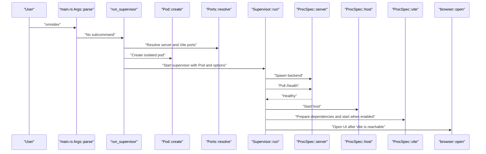

# omnidev: Local Development Supervisor

<details>
<summary>Relevant source files</summary>

The following files were used as context for generating this wiki page:

- [dev/omnidev/Cargo.lock](dev/omnidev/Cargo.lock)
- [dev/omnidev/Cargo.toml](dev/omnidev/Cargo.toml)
- [dev/omnidev/README.md](dev/omnidev/README.md)
- [dev/omnidev/src/browser.rs](dev/omnidev/src/browser.rs)
- [dev/omnidev/src/install.rs](dev/omnidev/src/install.rs)
- [dev/omnidev/src/lan.rs](dev/omnidev/src/lan.rs)
- [dev/omnidev/src/main.rs](dev/omnidev/src/main.rs)
- [dev/omnidev/src/omnigent_cmd.rs](dev/omnidev/src/omnigent_cmd.rs)
- [dev/omnidev/src/paths.rs](dev/omnidev/src/paths.rs)
- [dev/omnidev/src/pod.rs](dev/omnidev/src/pod.rs)
- [dev/omnidev/src/process.rs](dev/omnidev/src/process.rs)
- [dev/omnidev/src/profile.rs](dev/omnidev/src/profile.rs)
- [dev/omnidev/src/supervisor.rs](dev/omnidev/src/supervisor.rs)
- [dev/omnidev/src/tui/mod.rs](dev/omnidev/src/tui/mod.rs)
- [dev/omnidev/src/tui/render.rs](dev/omnidev/src/tui/render.rs)
- [dev/omnidev/src/watcher.rs](dev/omnidev/src/watcher.rs)
- [dev/omnidev/tests/pod_setup.rs](dev/omnidev/tests/pod_setup.rs)

</details>


## Purpose and scope

`omnidev` is a Rust binary for local Omnigent development. Its default mode supervises a checkout-specific pod containing the backend server, host daemon, and Vite frontend. The binary also provides commands to install and update a git-based Omnigent tool and a passthrough for running Omnigent CLI commands with the pod’s environment [dev/omnidev/README.md:1-18](), [dev/omnidev/src/main.rs:1-12,45-53]().

This page describes the pod model, process and reload flows, TUI, LAN testing, and install-management surfaces. Sources: `dev/omnidev/README.md`, `dev/omnidev/src/main.rs`

---

## Core capabilities

The binary has three surfaces:

| Surface | Entry point | Purpose |
|---|---|---|
| Pod supervisor | Run `omnidev` without a subcommand | Starts and supervises the checkout’s backend and, unless disabled, Vite frontend; provides the TUI. [dev/omnidev/src/main.rs:99-139,175-177](), [dev/omnidev/src/supervisor.rs:124-172]() |
| Install management | `install`, `update`, `check`, `refresh`, `shell-hook` | Manages a git-based installation and update checks without requiring a local checkout. [dev/omnidev/src/main.rs:55-97,144-174](), [dev/omnidev/src/install.rs:1-4]() |
| Omnigent passthrough | `omnidev omnigent …` | Runs an Omnigent CLI command from the checkout using the pod’s isolated environment. [dev/omnidev/src/main.rs:86-96,175-187](), [dev/omnidev/src/omnigent_cmd.rs:1-10,25-40]() |

In supervisor mode, a pod isolates Omnigent state and ports per checkout. The supervisor starts the server, waits for health before starting the host, prepares web dependencies when needed, and starts Vite if enabled. It restarts crashed children with backoff, while backend source changes trigger a server/host restart and frontend changes are handled by Vite HMR [dev/omnidev/README.md:14-33,50-65](), [dev/omnidev/src/supervisor.rs:124-172]().

Sources: `dev/omnidev/README.md`, `dev/omnidev/src/main.rs`, `dev/omnidev/src/supervisor.rs`, `dev/omnidev/src/omnigent_cmd.rs`

---

## Pod isolation architecture

A `Pod` represents one development instance associated with a repository root and a pod directory. `Pod::create` delegates to `create_with_profile`, which creates `data/omnigent`, `artifacts`, `logs`, and `config` subdirectories. It also attempts to seed the pod’s `config.yaml` from the developer’s real Omnigent configuration; a seed failure is reported but does not abort pod creation [dev/omnidev/src/pod.rs:11-67]().

The isolation is intentionally limited to Omnigent’s own state. The pod environment overrides Omnigent data, database, server URL, and config-home settings while retaining the inherited home directory, credentials, and tool caches [dev/omnidev/src/pod.rs:169-189](), [dev/omnidev/README.md:67-81]().

### Pod fields and storage

| `Pod` field or method | Role |
|---|---|
| `repo_root` | Checkout root used for process working directories and repository-relative paths. [dev/omnidev/src/pod.rs:11-20]() |
| `dir` | Pod root for isolated state and logs. [dev/omnidev/src/pod.rs:11-20,44-47]() |
| `ports` | Server and Vite ports. [dev/omnidev/src/pod.rs:11-20]() |
| `vite_host` | Vite bind address. [dev/omnidev/src/pod.rs:11-20]() |
| `trusted_origins` | LAN origins that can be passed to the server allowlist. [dev/omnidev/src/pod.rs:16-19,187-189]() |
| `profile` | Optional process/layout profile. [dev/omnidev/src/pod.rs:19,36-43]() |
| `chat_db()` / `db_uri()` | Path and SQLite URI for the pod database. [dev/omnidev/src/pod.rs:69-76]() |
| `config_dir()` / `artifacts_dir()` | Pod-local configuration and artifact paths. [dev/omnidev/src/pod.rs:78-87]() |
| `server_url()` | Loopback backend URL used by processes and Vite’s proxy configuration. [dev/omnidev/src/pod.rs:89-91,169-175]() |
| `log_file(name)` | Path to a named process log under the pod’s `logs/` directory. [dev/omnidev/src/pod.rs:165-167]() |

The README documents the default pod location as `${XDG_CACHE_HOME:-~/.cache}/omnidev/<repo-name>-<hash>/`, keyed to the canonical checkout path. It also documents `--pod-dir` as an override and `--clean` as a way to wipe the pod before startup [dev/omnidev/README.md:90-109]().

Sources: `dev/omnidev/src/pod.rs`, `dev/omnidev/README.md`

### Environment overrides

`Pod::env()` builds the environment overrides applied to child processes:

| Variable | Pod value or purpose |
|---|---|
| `OMNIGENT_DATA_DIR` | Pod-local `data/omnigent` directory. [dev/omnidev/src/pod.rs:176-180]() |
| `OMNIGENT_DATABASE_URI` | Pod-local SQLite database URI. [dev/omnidev/src/pod.rs:74-76,176-181]() |
| `OMNIGENT_URL` | Pod server’s loopback URL; also the Vite proxy target. [dev/omnidev/src/pod.rs:89-91,169-185]() |
| `OMNIGENT_CONFIG_HOME` | Pod-local `config` directory. [dev/omnidev/src/pod.rs:82-87,182-185]() |
| `OMNIGENT_WS_ALLOWED_ORIGINS` | Added when the pod has trusted LAN origins. [dev/omnidev/src/pod.rs:16-18,187-189]() |

The pod does not replace `HOME` or `XDG_*`; those remain inherited. This keeps credentials and package caches available to the processes Omnigent runs [dev/omnidev/src/pod.rs:169-175](), [dev/omnidev/src/omnigent_cmd.rs:7-10,119-156]().

Sources: `dev/omnidev/src/pod.rs`, `dev/omnidev/src/omnigent_cmd.rs`

### Port allocation and repository identity

`omnidev` supports default server and Vite ports, explicit `--server-port` and `--vite-port` overrides, and a per-pod directory override [dev/omnidev/README.md:98-109](), [dev/omnidev/src/main.rs:99-133](). The pod setup tests verify that resolved ports are persisted in `pod.toml`, reused when still available, and kept distinct across sibling pod directories [dev/omnidev/tests/pod_setup.rs:104-142]().

The tests also exercise repository discovery: a nested directory resolves upward to a root containing `.git`, `omnigent/`, and `web/`; an external profile can relax the usual checkout layout requirement [dev/omnidev/tests/pod_setup.rs:27-58](). The exact implementation of path discovery and port probing is in `paths.rs` and `ports.rs`, whose contents are not included here.

Sources: `dev/omnidev/README.md`, `dev/omnidev/src/main.rs`, `dev/omnidev/tests/pod_setup.rs`

---

## Process supervision and command specification

The default process set is the Omnigent server, host daemon, and Vite. `ProcSpec` packages a process’s program, arguments, working directory, and extra environment values [dev/omnidev/src/process.rs:8-15]().

| Process | Command shape | Startup relationship |
|---|---|---|
| Server | `uv run --python <pinned> omnigent --log-to-stderr server --host 127.0.0.1 --port <p> --database-uri <db> --artifact-location <dir>` [dev/omnidev/src/process.rs:45-71]() | Started first; the supervisor waits for server health. [dev/omnidev/README.md:50-56](), [dev/omnidev/src/supervisor.rs:124-147]() |
| Host | `uv run --python <pinned> omnigent --log-to-stderr host --server http://127.0.0.1:<p>` [dev/omnidev/src/process.rs:74-101]() | Started after the server is healthy. [dev/omnidev/README.md:54-56]() |
| Web preparation | `pnpm install` from the web directory [dev/omnidev/src/process.rs:103-121]() | Run when dependencies are missing or stale. [dev/omnidev/src/pod.rs:114-147](), [dev/omnidev/src/supervisor.rs:142-146]() |
| Vite | `pnpm run dev --host <host> --port <p> --strictPort` from the web directory [dev/omnidev/src/process.rs:123-144]() | Started when Vite is enabled; its proxy points at the pod server through `OMNIGENT_URL`. [dev/omnidev/README.md:56-65](), [dev/omnidev/src/pod.rs:169-185]() |

For the default profile, `Pod::needs_web_prepare()` returns true if `node_modules/` is absent or if either `pnpm-lock.yaml` or `web/package.json` is newer than the installed modules directory. Profiles can supply their own web directory and dependency manifests [dev/omnidev/src/pod.rs:105-147]().

The supervised Omnigent processes receive `OMNIGENT_LOG_TTY_FD=2` and `OMNIGENT_LOG_FORCE_COLOR=1` so their output can be captured through pipes while retaining color for the TUI [dev/omnidev/src/process.rs:35-42,47-71,76-100]().

Sources: `dev/omnidev/src/process.rs`, `dev/omnidev/src/pod.rs`, `dev/omnidev/src/supervisor.rs`, `dev/omnidev/README.md`

### Supervisor lifecycle

`Supervisor::new` takes the pod, shared TUI state, Vite enablement, and LAN-origin option. It caches `pod.env()` and initializes three process slots, an expected-stop set, and an exit channel [dev/omnidev/src/supervisor.rs:77-114]().

`Supervisor::run` logs the pod and any trusted origins, starts the backend, then prepares and starts Vite when enabled. It also schedules browser opening after Vite becomes reachable. Its main `tokio::select!` loop receives TUI/watcher commands and child-exit events [dev/omnidev/src/supervisor.rs:124-172,175-192]().

| Command | Effect |
|---|---|
| `Cmd::Restart(ProcId)` | Restarts the selected process; the command documentation notes that selecting the host restarts the backend pair. [dev/omnidev/src/supervisor.rs:36-41,149-156]() |
| `Cmd::RestartBackend` | Restarts the server and then the host after health checks. [dev/omnidev/src/supervisor.rs:41-42,153-157]() |
| `Cmd::Reload(usize)` | Records the changed-file count and initiates backend restart. [dev/omnidev/src/supervisor.rs:43-44,157-161]() |
| `Cmd::Shutdown` | Tears down the processes and ends the supervisor loop. [dev/omnidev/src/supervisor.rs:45-46,162-165]() |

Each `Slot` tracks the running process group ID, a generation number, consecutive crash count, and start time. The supervisor also tracks generations stopped intentionally so those exits are not mistaken for crashes [dev/omnidev/src/supervisor.rs:49-75,77-90]().

Sources: `dev/omnidev/src/supervisor.rs`

---

## Data flow: initialization and process launch

The diagram connects the user-facing `omnidev` command to its code entities: `run_supervisor`, `Pod`, `Ports`, `ProcSpec`, and `Supervisor::run`. The provided excerpt shows the supervisor startup sequence and process specifications; the full `run_supervisor` and port-resolution implementations are not included.

**Diagram: checkout command to supervised processes**



Sources: `dev/omnidev/src/main.rs:141-177`, `dev/omnidev/src/supervisor.rs:124-192`, `dev/omnidev/src/process.rs:45-144`, `dev/omnidev/src/pod.rs:22-67`, `dev/omnidev/tests/pod_setup.rs:104-142`

---

## Hot reload via source watcher

`watcher::spawn` watches the backend directory recursively and uses a 500 ms debouncer to coalesce file-change bursts. It counts qualifying paths and sends one `Cmd::Reload(changed)` command for each debounced result with changes [dev/omnidev/src/watcher.rs:18-79]().

A path qualifies only when the event is a create, modify, or remove; the extension is `.py`; it is not under `__pycache__`; and it is not ignored by the repository’s root `.gitignore` or `.git/info/exclude` rules. Access events are excluded to avoid reload loops caused by imports. With debug logging enabled, observed paths and skip reasons are written to shared event state [dev/omnidev/src/watcher.rs:36-69,81-115,117-125]().

When the supervisor receives `Cmd::Reload(n)`, it logs the number of changed files and restarts the backend pair. Frontend source is deliberately not watched by this mechanism because Vite handles frontend updates through HMR [dev/omnidev/src/supervisor.rs:157-161](), [dev/omnidev/src/watcher.rs:1-3]().

**Diagram: file change to backend reload**

```mermaid
flowchart LR
    Source as "omnigent/**/*.py"
    Watch as "watcher::spawn"
    Debounce as "500 ms debouncer"
    Filter as "is_mutating + classify"
    Cmd as "Cmd::Reload(changed)"
    Loop as "Supervisor::run"
    Restart as "start_backend_restart"
    Pair as "server + host"

    Source --> Watch
    Watch --> Debounce
    Debounce --> Filter
    Filter -->|"Qualifying changes"| Cmd
    Cmd --> Loop
    Loop --> Restart
    Restart --> Pair
```

Sources: `dev/omnidev/src/watcher.rs:18-79,81-115`, `dev/omnidev/src/supervisor.rs:124-172`

---

## TUI: interactive process and log supervisor

`App` owns the current log view, scroll/follow/wrap settings, search state, and a sender for supervisor commands. `App::run` sets up the terminal, draws through `render::draw`, reads keyboard input, and restores the terminal when it exits [dev/omnidev/src/tui/mod.rs:74-97,99-145]().

The available views are server, host, Vite, and combined logs. The combined view is source-tagged; per-process output is written through to `<pod>/logs/{server,host,vite}.log` for inspection outside the TUI [dev/omnidev/src/tui/mod.rs:25-32](), [dev/omnidev/README.md:32-33,93-97]().

### Key features and bindings

| Key | Action |
|---|---|
| `1`, `2`, `3`, `0` | Focus server, host, Vite, or combined view. [dev/omnidev/src/tui/mod.rs:165-172]() |
| `Tab` | Cycle views. [dev/omnidev/src/tui/mod.rs:168-172]() |
| `j` / `k`, arrows | Scroll one line. [dev/omnidev/src/tui/mod.rs:174-176]() |
| `f`, Space, `PgDn` / `b`, `PgUp` | Scroll by a page. [dev/omnidev/src/tui/mod.rs:177-180]() |
| `d` / `u` | Scroll by half a page. [dev/omnidev/src/tui/mod.rs:181-182]() |
| `g` / `G` | Go to top / bottom. [dev/omnidev/src/tui/mod.rs:183-184]() |
| `F` | Toggle tail-follow. [dev/omnidev/src/tui/mod.rs:186-192]() |
| `/` / `?`, `n` / `N` | Search forward/backward and repeat search. [dev/omnidev/src/tui/mod.rs:195-199]() |
| `q`, Ctrl-C | Quit the TUI. [dev/omnidev/src/tui/mod.rs:147-155,165-167]() |

The README additionally documents `r` for restarting the selected process and `R` for restarting the backend pair [dev/omnidev/README.md:136-147](). The TUI translates key events into `Cmd` values sent to the supervisor; the command enum and supervisor dispatch are defined in `supervisor.rs` [dev/omnidev/src/supervisor.rs:36-47,149-170]().

### TUI-to-code control flow

**Diagram: keyboard input to supervisor command**

```mermaid
flowchart LR
    Keys as "tui::App::on_key"
    Sender as "App.cmds"
    Commands as "supervisor::Cmd"
    Run as "Supervisor::run"
    Restart as "restart_one / start_backend_restart"
    Exit as "shutdown"

    Keys -->|"Restart key"| Sender
    Keys -->|"Quit key"| Sender
    Sender --> Commands
    Commands --> Run
    Run -->|"Restart or Reload"| Restart
    Run -->|"Shutdown"| Exit
```

Sources: `dev/omnidev/src/tui/mod.rs:74-97,147-200`, `dev/omnidev/src/supervisor.rs:36-47,149-170`

---

## LAN testing and trusted origins

For device testing, `--vite-host 0.0.0.0` binds Vite on all interfaces. Vite’s API proxy still targets the pod server through loopback [dev/omnidev/README.md:111-112](), [dev/omnidev/src/process.rs:123-144](), [dev/omnidev/src/pod.rs:89-91,169-185]().

`--trust-lan-origins` asks `omnidev` to enumerate the machine’s LAN IPv4 addresses and add matching Vite origins to `OMNIGENT_WS_ALLOWED_ORIGINS`. The allowlist is merged with any value already exported; the README describes it as exact-match rather than disabling origin checks. The trusted origins are reported in the combined log at startup. IPv4 LAN origins are covered automatically; `.local` hostnames and HTTPS origins require manual allowlist configuration [dev/omnidev/README.md:114-135](), [dev/omnidev/src/pod.rs:16-18,187-189](), [dev/omnidev/src/supervisor.rs:133-140]().

**Diagram: LAN option to server environment**

```mermaid
flowchart LR
    Args as "RunArgs::trust_lan_origins"
    Lan as "LAN IPv4 origin enumeration"
    Pod as "Pod.trusted_origins"
    Env as "Pod::env"
    Allowlist as "OMNIGENT_WS_ALLOWED_ORIGINS"
    Server as "ProcSpec::server"

    Args --> Lan
    Lan --> Pod
    Pod --> Env
    Env --> Allowlist
    Allowlist --> Server
```

Sources: `dev/omnidev/src/main.rs:114-121`, `dev/omnidev/src/pod.rs:16-19,176-189`, `dev/omnidev/src/process.rs:45-71`, `dev/omnidev/README.md:114-135`

---

## Install management and Omnigent passthrough

### Install, update, and update-check commands

`InstallConfig` records the repository, git ref, and extras, and serializes that configuration as TOML. Defaults are the Omnigent repository, `main`, the `databricks` extra, and Python 3.12 [dev/omnidev/src/install.rs:14-37,39-59]().

`install` saves the requested configuration, runs `uv tool install`, and records the installed ref’s remote SHA when possible. `update` loads the persisted configuration (or defaults), saves it, and reinstalls with `--reinstall` so a moving ref is resolved again [dev/omnidev/src/install.rs:92-133,135-142](). The top-level CLI dispatches install management before checkout discovery, allowing those subcommands to run from anywhere [dev/omnidev/src/main.rs:55-85,141-174]().

The install preflight requires `uv` and `pnpm`; the latter is needed because installing from git builds the web UI from source [dev/omnidev/src/install.rs:75-90](). `check`, `refresh`, and `shell-hook` dispatch to the update-check and shell-hook modules [dev/omnidev/src/main.rs:76-85,168-174](); their internal behavior is not detailed in the supplied source excerpts.

### Omnigent passthrough

`omnidev omnigent …` resolves the repository and pod, creates the pod directory if needed, and runs `uv run --python <pinned> omnigent …` from the repository root. The passthrough applies `Pod::env()` but does not add the log-mirroring variables used by supervised processes; it inherits the user’s stdio and can coexist with a running supervisor [dev/omnidev/src/main.rs:86-96,180-194](), [dev/omnidev/src/omnigent_cmd.rs:1-10,25-53]().

**Diagram: command surfaces and code entities**

```mermaid
flowchart TD
    Args as "main.rs Args::parse"
    Dispatch as "main.rs Command"
    Supervisor as "run_supervisor"
    Install as "install::install / install::update"
    Check as "update_check::check / refresh"
    Passthrough as "run_omnigent"
    Build as "omnigent_cmd::build"
    PodEnv as "Pod::env"
    Child as "uv run --python ... omnigent"

    Args --> Dispatch
    Dispatch -->|"No subcommand"| Supervisor
    Dispatch -->|"Install or Update"| Install
    Dispatch -->|"Check or Refresh"| Check
    Dispatch -->|"Omnigent"| Passthrough
    Passthrough --> Build
    Build --> PodEnv
    Build --> Child
```

Sources: `dev/omnidev/src/main.rs:45-97,141-187`, `dev/omnidev/src/install.rs:92-133`, `dev/omnidev/src/omnigent_cmd.rs:25-53`, `dev/omnidev/src/pod.rs:169-189`

---

## Developer workflow summary

1. Run `omnidev` from within a checkout; repository discovery walks upward to a repository root and the default OSS layout requires `omnigent/` and `web/` [dev/omnidev/README.md:35-48](), [dev/omnidev/tests/pod_setup.rs:27-45]().
2. The supervisor uses a per-repository pod, with isolated database, artifacts, logs, and config, and resolves or accepts server and Vite ports [dev/omnidev/src/pod.rs:22-67](), [dev/omnidev/tests/pod_setup.rs:60-68,104-142]().
3. It starts the server, waits for health, then starts the host; if enabled, it prepares web dependencies as needed and starts Vite [dev/omnidev/README.md:50-65](), [dev/omnidev/src/supervisor.rs:124-147]().
4. Use the TUI’s process views and pager controls to inspect output; restart controls send commands to the supervisor [dev/omnidev/src/tui/mod.rs:118-200](), [dev/omnidev/src/supervisor.rs:36-47,149-170]().
5. Python changes under the backend directory can trigger a server/host reload; Vite handles frontend HMR [dev/omnidev/src/watcher.rs:18-79](), [dev/omnidev/src/supervisor.rs:157-161]().
6. Use `omnidev omnigent …` to invoke Omnigent CLI commands with the same pod environment, or use install-management commands independently of a checkout [dev/omnidev/src/main.rs:55-97,175-194]().

Sources: `dev/omnidev/README.md`, `dev/omnidev/src/main.rs`, `dev/omnidev/src/pod.rs`, `dev/omnidev/src/supervisor.rs`, `dev/omnidev/src/tui/mod.rs`, `dev/omnidev/src/watcher.rs`, `dev/omnidev/tests/pod_setup.rs`

---

## End-to-end code map

This diagram associates the developer-facing workflow with the Rust modules and key symbols that implement it. `main.rs` dispatches the CLI surface; `Pod` supplies isolated paths and environment; `ProcSpec` describes child commands; `Supervisor` coordinates process lifecycles; `watcher::spawn` and `tui::App` send supervisor commands.

**Diagram: user workflow mapped to omnidev entities**

```mermaid
flowchart LR
    User as "Developer"
    Main as "main.rs::main"
    Args as "Args / Command / RunArgs"
    Pod as "pod::Pod"
    Ports as "ports::Ports"
    Specs as "process::ProcSpec"
    Supervisor as "supervisor::Supervisor"
    Watcher as "watcher::spawn"
    TUI as "tui::App"
    Server as "server"
    Host as "host"
    Vite as "vite"
    Install as "install::install / update"
    Passthrough as "omnigent_cmd::build / run"

    User --> Main
    Main --> Args
    Args --> Pod
    Pod --> Ports
    Pod --> Specs
    Specs --> Supervisor
    Supervisor --> Server
    Supervisor --> Host
    Supervisor --> Vite
    Watcher -->|"Cmd::Reload(n)"| Supervisor
    TUI -->|"Cmd::Restart / Shutdown"| Supervisor
    Args --> Install
    Args --> Passthrough
    Passthrough -->|"Pod::env"| Pod
```

Sources: `dev/omnidev/src/main.rs:14-43,45-53,141-177`, `dev/omnidev/src/pod.rs:11-20,169-189`, `dev/omnidev/src/process.rs:8-15,45-144`, `dev/omnidev/src/supervisor.rs:36-47,77-114,124-172`, `dev/omnidev/src/watcher.rs:18-79`, `dev/omnidev/src/tui/mod.rs:74-97,118-145`, `dev/omnidev/src/install.rs:92-133`, `dev/omnidev/src/omnigent_cmd.rs:25-53`