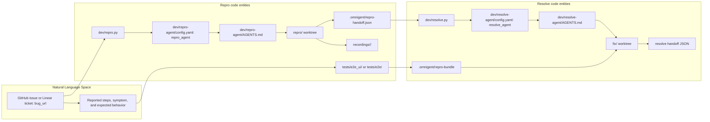
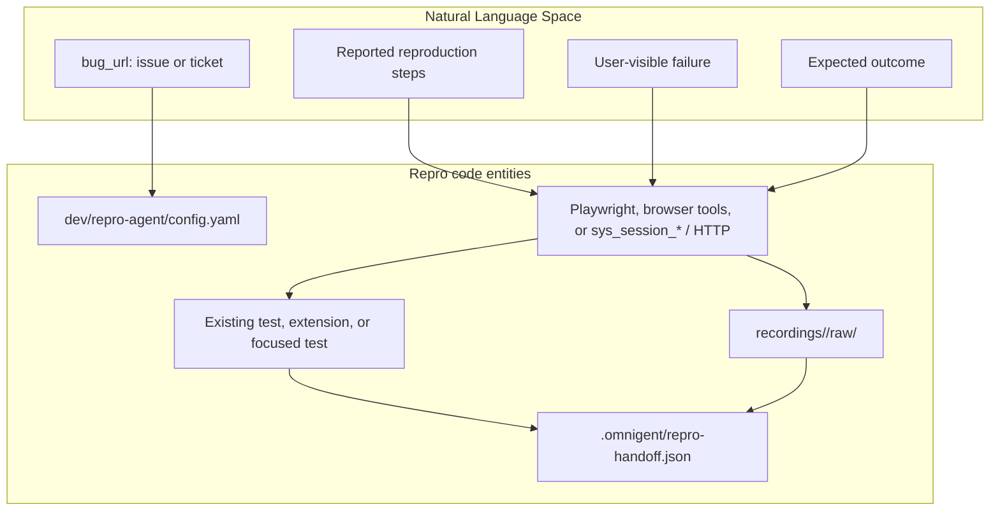
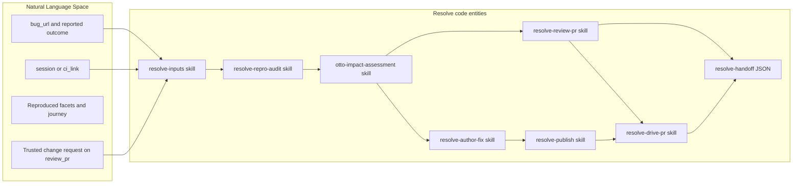

# repro-agent & resolve-agent: Automated Bug Lifecycle

<details>
<summary>Relevant source files</summary>

The following files were used as context for generating this wiki page:

- [dev/agent-environment.md](dev/agent-environment.md)
- [dev/caption_recording.py](dev/caption_recording.py)
- [dev/recording-lanes.md](dev/recording-lanes.md)
- [dev/repro-agent/AGENTS.md](dev/repro-agent/AGENTS.md)
- [dev/repro-agent/README.md](dev/repro-agent/README.md)
- [dev/repro-agent/config.yaml](dev/repro-agent/config.yaml)
- [dev/repro.py](dev/repro.py)
- [dev/resolve-agent/AGENTS.md](dev/resolve-agent/AGENTS.md)
- [dev/resolve-agent/README.md](dev/resolve-agent/README.md)
- [dev/resolve-agent/config.yaml](dev/resolve-agent/config.yaml)
- [dev/resolve-agent/skills/resolve-author-fix/SKILL.md](dev/resolve-agent/skills/resolve-author-fix/SKILL.md)
- [dev/resolve-agent/skills/resolve-drive-pr/SKILL.md](dev/resolve-agent/skills/resolve-drive-pr/SKILL.md)
- [dev/resolve-agent/skills/resolve-drive-pr/final-review.md](dev/resolve-agent/skills/resolve-drive-pr/final-review.md)
- [dev/resolve-agent/skills/resolve-handoff/SKILL.md](dev/resolve-agent/skills/resolve-handoff/SKILL.md)
- [dev/resolve-agent/skills/resolve-inputs/SKILL.md](dev/resolve-agent/skills/resolve-inputs/SKILL.md)
- [dev/resolve-agent/skills/resolve-inputs/reproduction.md](dev/resolve-agent/skills/resolve-inputs/reproduction.md)
- [dev/resolve-agent/skills/resolve-inputs/ticket-only.md](dev/resolve-agent/skills/resolve-inputs/ticket-only.md)
- [dev/resolve-agent/skills/resolve-investigate/SKILL.md](dev/resolve-agent/skills/resolve-investigate/SKILL.md)
- [dev/resolve-agent/skills/resolve-publish/SKILL.md](dev/resolve-agent/skills/resolve-publish/SKILL.md)
- [dev/resolve-agent/skills/resolve-review-pr/SKILL.md](dev/resolve-agent/skills/resolve-review-pr/SKILL.md)
- [dev/resolve.py](dev/resolve.py)
- [tests/dev/test_caption_recording.py](tests/dev/test_caption_recording.py)
- [tests/dev/test_feature.py](tests/dev/test_feature.py)
- [tests/dev/test_repro.py](tests/dev/test_repro.py)
- [tests/dev/test_resolve.py](tests/dev/test_resolve.py)
- [tests/spec/test_recording_carveout_scope.py](tests/spec/test_recording_carveout_scope.py)
- [tests/spec/test_resolve_agent_bundle.py](tests/spec/test_resolve_agent_bundle.py)
- [tests/spec/test_resolve_agent_contract.py](tests/spec/test_resolve_agent_contract.py)

</details>


## Purpose and scope

`repro-agent` reproduces a reported bug in a running Omnigent app, selects minimal reliable regression coverage, and hands off evidence. `resolve-agent` consumes a completed reproduction or a ticket-only input, audits the evidence, and either reviews an existing fix or authors and verifies one. Neither agent merges code; `repro-agent` does not fix or publish, while `resolve-agent`’s publication behavior depends on its selected mode. [dev/repro-agent/README.md:3-8](), [dev/repro-agent/README.md:113-117](), [dev/resolve-agent/AGENTS.md:3-11](), [dev/resolve-agent/README.md:3-24]()

Sources: [dev/repro-agent/README.md:3-8](), [dev/repro-agent/README.md:113-117](), [dev/resolve-agent/AGENTS.md:3-11](), [dev/resolve-agent/README.md:3-24]()

---

## System Overview

The lifecycle has two distinct inputs and handoffs: repro takes a bug report; resolve normally takes a pointer to a completed repro session or CI run. Resolve also supports ticket-only work and review remediation, so the agents are a handoff-oriented workflow rather than a requirement that every invocation follow one fixed path. [dev/repro-agent/README.md:37-39](), [dev/resolve-agent/README.md:51-68](), [dev/resolve-agent/AGENTS.md:37-50]()

| Phase | Agent | Main input | Work product |
|---|---|---|---|
| Reproduction | `repro-agent` | `bug_url` | Live reproduction, selected test coverage, recordings when available, and a machine-readable handoff. [dev/repro-agent/README.md:37-39](), [dev/repro-agent/README.md:71-111]() |
| Resolution | `resolve-agent` | `session` or `ci_link`; alternatively `bug_url` or `review_pr` for other modes | Audited evidence, an existing-PR review or authored fix, validation results, and a resolution handoff. [dev/resolve-agent/README.md:51-68](), [dev/resolve-agent/AGENTS.md:37-50](), [dev/resolve-agent/skills/resolve-handoff/SKILL.md:6-27]() |

### Data Flow: Bug Report to Resolution

The diagram maps the natural-language report and user journey to the concrete agent specs, driver scripts, worktree paths, and handoff artifact names. The `repro-agent` handoff is consumed by resolve through a session or CI pointer; the reproduction test itself is recovered from the repro worktree or CI artifacts rather than relying on potentially truncated transcript content. [dev/repro-agent/README.md:71-111](), [dev/resolve-agent/README.md:51-68]()



Sources: [dev/repro-agent/README.md:37-46](), [dev/repro-agent/README.md:71-111](), [dev/repro.py:8-18](), [dev/resolve-agent/README.md:51-89](), [dev/resolve-agent/config.yaml:30-67](), [tests/spec/test_resolve_agent_contract.py:62-75]()

### Natural-Language Inputs and Code Entities

This view emphasizes the key association between user-reported behavior and the code artifacts that represent it. Repro starts from `bug_url`; resolve’s reproduction-driven modes start from `session` or `ci_link`, then recover the report identity, facets, journey, and test evidence. [dev/repro-agent/AGENTS.md:45-53](), [dev/resolve-agent/README.md:51-68](), [dev/resolve-agent/AGENTS.md:37-55]()



Sources: [dev/repro-agent/config.yaml:32-49](), [dev/repro-agent/AGENTS.md:45-53](), [dev/repro-agent/README.md:71-111]()



Sources: [dev/resolve-agent/AGENTS.md:13-35](), [dev/resolve-agent/AGENTS.md:37-64](), [dev/resolve-agent/AGENTS.md:102-120]()

---

## repro-agent: Automated Bug Reproduction

`repro-agent` takes a `bug_url` and drives the app it is connected to through the reported user journey. Its responsibility is to produce a live-confirmed reproduction and suitable test coverage, not to fix the bug. [dev/repro-agent/AGENTS.md:3-27](), [dev/repro-agent/README.md:3-8](), [dev/repro-agent/README.md:113-117]()

### Implementation Details

- **Running app and checkout:** The app being reproduced against is the running app connected to the agent, either the local server started by `omnigent run` or a server passed with `--server`. The agent’s workspace must be the Omnigent source checkout containing product code and the `tests/` tree. [dev/repro-agent/AGENTS.md:12-27](), [dev/repro-agent/AGENTS.md:97-105]()
- **Report access:** The input is a GitHub issue or Linear ticket URL. The procedure describes using `gh issue view <url> --comments` for GitHub and Linear GraphQL for Linear; linked GitHub issues from Linear tickets are also fetched and reconciled. [dev/repro-agent/AGENTS.md:45-82]()
- **Journey execution:** Headless web UI journeys use Playwright and `tests/e2e_ui/`; local sessions with a connected desktop may use embedded-browser tools; backend journeys use `sys_session_*` or HTTP. [dev/repro-agent/README.md:71-76]()
- **Coverage selection:** The agent searches existing tests and fixtures before adding coverage. An existing test, a small extension, or a narrower test can be enough; retain e2e coverage where the failure depends on its boundary. [dev/repro-agent/AGENTS.md:3-10](), [dev/repro-agent/README.md:77-83]()
- **Recordings:** For each settled facet, the agent records the user-facing journey when feasible. Reproduced or likely-reproduced facets produce `before` footage; already-fixed facets produce `fixed` footage. Recording is best-effort. [dev/repro-agent/README.md:84-93](), [dev/recording-lanes.md:7-10](), [dev/recording-lanes.md:57-74]()
- **Handoff:** The agent checkpoints `.omnigent/repro-handoff.json` as the verdict becomes known and evidence arrives. Its final machine-readable report includes a verdict, facet breakdown, test path, recordings, session ID, journey, and evidence. [dev/repro-agent/README.md:94-111]()

### Input Contract

| Parameter | Meaning |
|---|---|
| `bug_url` | Required GitHub issue or Linear ticket link describing the bug. [dev/repro-agent/AGENTS.md:45-53]() |
| `public` | Optional boolean. When true, the agent shares the calling session read-only as a preflight action; otherwise it does not share. [dev/repro-agent/AGENTS.md:83-86](), [dev/repro-agent/AGENTS.md:108-118]() |

The agent reproduces against the running build, described as the latest `main`; the report’s version is context, not a checkout target. [dev/repro-agent/AGENTS.md:88-92]()

### Driver Script: `dev/repro.py`

`dev/repro.py` is a source-checkout convenience wrapper. It accepts a bug URL or prompts for one, creates an isolated `repro/<slug>` worktree off the current repository state, and runs `omnigent run dev/repro-agent` from that worktree. The worktree is retained and its path and branch are printed at completion. [dev/repro.py:1-18](), [dev/repro-agent/README.md:41-60]()

The driver accepts `--server` to target an existing server and `--public` to request read-only session sharing. For Linear URLs, `_launch_env` forwards the Linear credential through `OMNIGENT_RUNNER_ENV_PASSTHROUGH`; it mirrors `LINEAR_API_KEY` into `DATABRICKS_LINEAR_API_KEY` when needed. [dev/repro.py:51-82](), [dev/repro.py:131-155]()

Example invocation: [dev/repro-agent/README.md:25-35]()

```text
python dev/repro.py https://github.com/omnigent-ai/omnigent/issues/1234
```

Sources: [dev/repro-agent/AGENTS.md:3-27](), [dev/repro-agent/AGENTS.md:45-105](), [dev/repro-agent/README.md:71-117](), [dev/repro.py:1-18](), [dev/repro.py:51-82](), [dev/repro.py:131-175]()

---

## resolve-agent: Automated Bug Resolution & Verification

`resolve-agent` consumes a completed reproduction pointer or another explicitly selected work source. For reproduction-driven work, it audits the recovered evidence, searches for an existing fix PR, and either reviews that PR or authors a fix. It does not merge. [dev/resolve-agent/README.md:3-24](), [dev/resolve-agent/AGENTS.md:37-50]()

### Operation Modes

| Mode | Input / selection | Behavior |
|---|---|---|
| Reproduction-driven | `session` or `ci_link` | Recover and audit the reproduction, then find an existing fix PR. Review it if sound; otherwise use the author procedure. [dev/resolve-agent/AGENTS.md:37-47]() |
| Ticket-only | `bug_url` alone | There is no inherited repro; selected regression coverage supplies the behavioral fail-to-pass proof, with a stated exception for instruction-only changes. [dev/resolve-agent/AGENTS.md:48-50]() |
| Review remediation | `review_pr` | Work on the named PR’s current branch and address trusted human change requests under the review-remediation procedure. This mode does not use inherited repro recovery or new recordings. [dev/resolve-agent/AGENTS.md:43-47]() |
| Author publication | Author path | Depending on input and workflow contract, the agent may publish directly, prepare a workflow-owned handoff, or stop after a local commit with `skip_push`. [dev/resolve-agent/AGENTS.md:59-64](), [dev/resolve-agent/README.md:104-117]() |

### Handoff Recovery

Resolve accepts exactly one work source to select its mode. For reproduction-driven runs, the pointer is either a local session reference or a CI run URL. [dev/resolve-agent/AGENTS.md:37-50](), [dev/resolve-agent/README.md:51-60]()

For a local session, resolve obtains the repro session’s workspace through `sys_session_get_info` and reads the complete uncommitted test from disk because large tool arguments may be truncated in the transcript. For CI, it retrieves the test from run artifacts. The session ID associates the test with the correct reproduction worktree. [dev/resolve-agent/README.md:61-68]()

The contract tests require CI bundle recovery instructions to stage the bundle at `.omnigent/repro-bundle` inside the worktree, reflecting that the runner’s file tools are worktree-scoped. [tests/spec/test_resolve_agent_contract.py:62-75]()

### Audit, Investigation, and Fix Workflow

Resolve loads phase-specific skills through its `AGENTS.md` instructions. The required sequence begins with input recovery, runs the shared repro audit before either resolution path, and performs impact assessment during investigation and again against the final diff. [dev/resolve-agent/AGENTS.md:13-35]()

For reproduction-driven work, the audited assertions must fail behaviorally on the unfixed base and pass on the candidate; setup failures, skipped checks, and xfailed checks do not establish the bug or its fix. Resolve assesses the full final diff and relevant consumers, records evidence, and distinguishes focused validation from repository-wide CI. [dev/resolve-agent/AGENTS.md:102-120]()

The existing-PR path checks out the candidate PR, runs the audited repro test against it, captures the journey against the PR head, and reviews the full diff for scope and quality. A passing test alone does not establish that the PR is a sound fix. [dev/resolve-agent/skills/resolve-review-pr/SKILL.md:6-27](), [dev/resolve-agent/skills/resolve-review-pr/SKILL.md:28-69]()

The author path is described as using a fresh worktree, selecting permanent regression coverage, and proving the fail-to-pass transition. Investigation-only reproduction source remains in the evidence archive with its command, tested revision, and result. [dev/resolve-agent/README.md:17-24]()

### PR Management and Publication

Publication has three documented choices:

- **Direct publication:** the agent pushes, opens a ready-for-review PR, and drives preview, CI, Polly and OCR reviews, live-validation instructions, and maintainer handoff. [dev/resolve-agent/README.md:104-108]()
- **Workflow-owned publication:** the agent commits and prepares `.omnigent/pr-body.md` and a deferred validation prompt, but makes no GitHub writes; the workflow owns publication and recovery. [dev/resolve-agent/README.md:109-114]()
- **Local-only:** with `skip_push: true`, the agent commits locally and does not push or open a PR. This takes precedence over a generic publisher overlay. [dev/resolve-agent/README.md:115-117]()

Resolve does not merge. The configured agent may perform publication and review-cycle operations, while independent review and the final maintainer decision remain separate. [dev/resolve-agent/config.yaml:79-99](), [dev/resolve-agent/AGENTS.md:102-107]()

### Input Contract

| Parameter | Meaning |
|---|---|
| `session` | Local repro session link or ID. [dev/resolve-agent/README.md:51-60]() |
| `ci_link` | CI run URL for a repro run whose worktree is no longer available. [dev/resolve-agent/README.md:56-60]() |
| `bug_url` | In `bug_url`-only mode, the ticket is the work source; when explicitly supplied, it is authoritative for bug identity. [dev/resolve-agent/AGENTS.md:48-55]() |
| `review_pr` | Selects review-remediation mode for a named PR. [dev/resolve-agent/AGENTS.md:43-47]() |
| `skip_push` | On the author path, commits locally and stops before push or PR creation; it does not change the reproduction-driven review path. [dev/resolve-agent/AGENTS.md:59-64]() |

The final resolution handoff uses `mode` values `reviewed_existing_pr`, `authored_fix`, or `review_remediation`, and outcome values `fixed`, `partially_fixed`, `not_fixed`, `nothing_to_fix`, or `needs_more_info`. [dev/resolve-agent/skills/resolve-handoff/SKILL.md:20-27]()

### Driver Script: `dev/resolve.py`

`dev/resolve.py` wraps agent launch. It takes a session pointer or `--ci-link`, creates a fresh isolated worktree off latest `main` on a `fix/<slug>` branch, confirms before launch unless `--yes` is supplied, then runs the agent from that worktree. It does not try to locate the repro worktree; the agent recovers the evidence from the session or CI source. [dev/resolve-agent/README.md:82-97]()

The driver supports `--skip-push` for author mode. The documented CLI examples include session URLs, bare session IDs, and CI run URLs. [dev/resolve-agent/README.md:91-102]()

Example invocation: [dev/resolve-agent/README.md:91-97]()

```text
python dev/resolve.py http://localhost:6767/c/dc59e331-...
```

Sources: [dev/resolve-agent/AGENTS.md:13-35](), [dev/resolve-agent/AGENTS.md:37-64](), [dev/resolve-agent/AGENTS.md:102-120](), [dev/resolve-agent/README.md:17-24](), [dev/resolve-agent/README.md:51-68](), [dev/resolve-agent/README.md:82-117](), [dev/resolve-agent/config.yaml:79-109](), [dev/resolve-agent/skills/resolve-review-pr/SKILL.md:6-69](), [dev/resolve-agent/skills/resolve-handoff/SKILL.md:20-27](), [tests/spec/test_resolve_agent_contract.py:62-75]()

---

## Recording Lanes: Evidence Capture for Repro and Resolve

`dev/recording-lanes.md` defines shared recording mechanics for repro-agent, resolve-agent, and feature-agent. Repro produces `before` footage for reproduced or likely-reproduced facets and `fixed` footage for already-fixed facets; resolve produces an `after` clip of the fixed journey, or the reviewed PR head on the review path. [dev/recording-lanes.md:1-21]()

| Surface / evidence | Capture guidance |
|---|---|
| Web or terminal journey | Use a suitable journey driver and `OMNIGENT_E2E_RECORD_DIR`; the shared guide uses `tests/e2e_ui/` for web/terminal recordings. [dev/recording-lanes.md:84-95]() |
| CLI journey | Use a rendered VHS tape for CLI facets. [dev/recording-lanes.md:7-14]() |
| Internal/API-only result | Written evidence is sufficient when no user interface displays the result; declare an empty recordings list and describe the observation and check. [dev/recording-lanes.md:28-42]() |

A recording must show actual product behavior, not test output or debug logs. Each declared recording includes a `capture_mode`; raw capture goes under `recordings/<slug>/raw/`, while the captioned render uses `recordings/<slug>/<kind>-<facet>.mp4`. Only the finished clip is declared. [dev/recording-lanes.md:44-55](), [dev/recording-lanes.md:76-86]()

Recordings are best-effort: when a recorder is missing or the necessary state cannot be reached, the agent records the blocker and continues with other evidence rather than blocking the fix or PR. [dev/recording-lanes.md:57-74]()

### Recording startup and environment

For web or terminal recording, the guide says to let the `tests/e2e_ui/` fixtures start their own local server and runner rather than pointing the recorder at the app used by the agent. It also says to build the SPA before starting the recorder, since a lazy build can delay runner startup. [dev/recording-lanes.md:88-106]()

When the recording process runs inside a server-spawned runner, ambient runner and host environment variables must be stripped before launching the fixture’s runner; otherwise the child may take a zygote-fork path and wait on unavailable control file descriptors. [dev/recording-lanes.md:108-128]()

Sources: [dev/recording-lanes.md:1-25](), [dev/recording-lanes.md:28-86](), [dev/recording-lanes.md:88-128]()

---

## Environment and Agent Execution

Both agent specs select the `claude-sdk` harness and use a large configured context window. Their `os_env` configuration uses `caller_process` with `cwd: .` and `sandbox: none`; both configure a `blast_radius` tool-call policy with `gate_pushes: false`. [dev/repro-agent/config.yaml:51-63](), [dev/repro-agent/config.yaml:76-102](), [dev/resolve-agent/config.yaml:54-67](), [dev/resolve-agent/config.yaml:82-109]()

The operational instructions require running from the Omnigent source checkout. Repro’s environment note warns that under `--server`, public npm and PyPI registries may be blocked and directs the agent to `dev/agent-environment.md` before installing packages. [dev/repro-agent/AGENTS.md:18-22](), [dev/repro-agent/AGENTS.md:97-105]()

Resolve is configured with `spawn: false`; its configuration says Polly and OCR review published PRs and Resolve does not need child-session tools. [dev/resolve-agent/config.yaml:76-80]()

Sources: [dev/repro-agent/config.yaml:51-63](), [dev/repro-agent/config.yaml:76-102](), [dev/repro-agent/AGENTS.md:18-22](), [dev/repro-agent/AGENTS.md:97-105](), [dev/resolve-agent/config.yaml:54-109]()

---

## Contract Tests and Workflow Boundaries

`tests/spec/test_resolve_agent_contract.py` loads the Resolve agent spec and assembles its instructions and skill resources. Its assertions pin important workflow contracts: Resolve does not spawn child sessions for independent review, local validation is bounded rather than running the full repository suite, CI repro bundles are staged in the worktree, repro audit precedes author/reviewer procedures, and impact assessment applies across resolution paths. [tests/spec/test_resolve_agent_contract.py:10-40](), [tests/spec/test_resolve_agent_contract.py:43-75](), [tests/spec/test_resolve_agent_contract.py:94-111](), [tests/spec/test_resolve_agent_contract.py:161-168]()

`tests/dev/test_resolve.py` covers pure input-normalization helpers used by `dev/resolve.py`, including session-reference parsing, CI URL parsing, payload construction, and branch-slug behavior. Its module documentation states that subprocess and git plumbing in `main` is exercised manually rather than by these helper tests. [tests/dev/test_resolve.py:1-29](), [tests/dev/test_resolve.py:32-123]()

Sources: [tests/spec/test_resolve_agent_contract.py:10-40](), [tests/spec/test_resolve_agent_contract.py:43-75](), [tests/spec/test_resolve_agent_contract.py:94-111](), [tests/spec/test_resolve_agent_contract.py:161-168](), [tests/dev/test_resolve.py:1-29](), [tests/dev/test_resolve.py:32-123]()

---

## Summary

The two agents separate reproduction from resolution. Repro turns a reported bug into a live-observed journey, selected test coverage, and evidence handoff. Resolve recovers and audits that evidence, then reviews an existing candidate or authors a fix, validates affected behavior, and follows the selected publication mode. Recordings support the evidence trail but are best-effort; they do not replace test validation. [dev/repro-agent/README.md:71-117](), [dev/resolve-agent/README.md:3-24](), [dev/resolve-agent/AGENTS.md:102-120](), [dev/recording-lanes.md:57-74]()

Sources: [dev/repro-agent/README.md:71-117](), [dev/resolve-agent/README.md:3-24](), [dev/resolve-agent/AGENTS.md:102-120](), [dev/recording-lanes.md:57-74]()