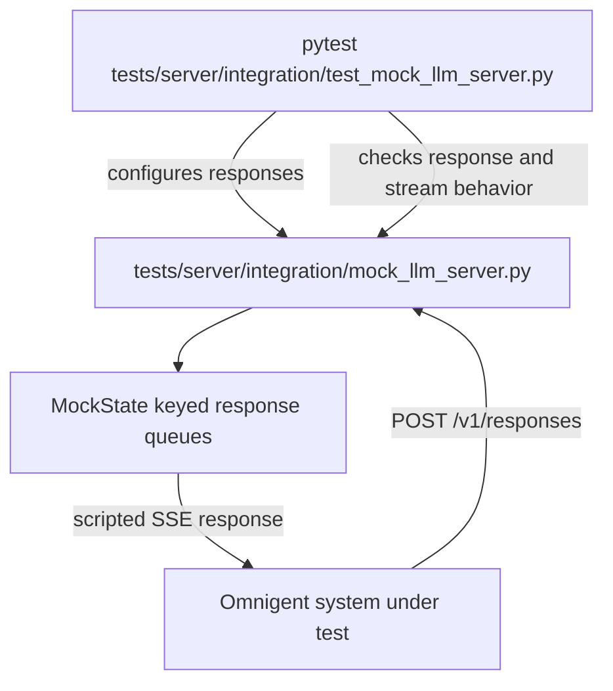
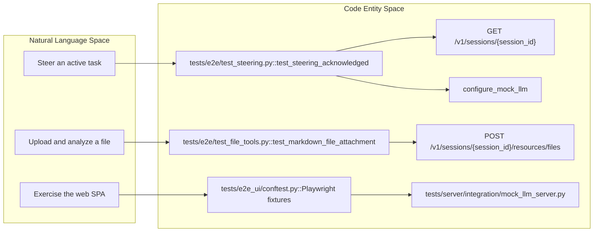
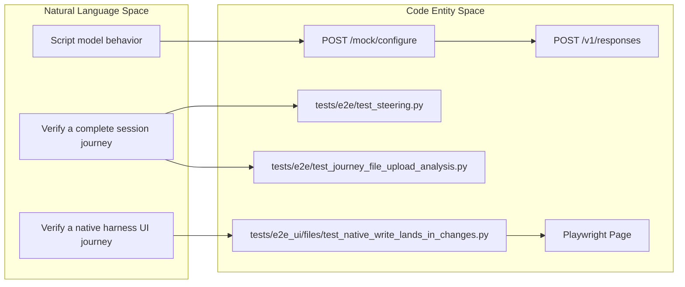

# Testing

Relevant source files

The following files were used as context for generating this wiki page:

- [omnigent/harnesses/claude_native/submit_verification.py](omnigent/harnesses/claude_native/submit_verification.py)
- [tests/browser_ui/chat/test_native_shell_settlement.py](tests/browser_ui/chat/test_native_shell_settlement.py)
- [tests/e2e/conftest.py](tests/e2e/conftest.py)
- [tests/e2e/test_file_tools.py](tests/e2e/test_file_tools.py)
- [tests/e2e/test_journey_file_upload_analysis.py](tests/e2e/test_journey_file_upload_analysis.py)
- [tests/e2e/test_sessions_live_smoke.py](tests/e2e/test_sessions_live_smoke.py)
- [tests/e2e/test_steering.py](tests/e2e/test_steering.py)
- [tests/e2e/test_tool_call_policy_e2e.py](tests/e2e/test_tool_call_policy_e2e.py)
- [tests/e2e_ui/chat/test_claude_native_permission_switch_from_dont_ask.py](tests/e2e_ui/chat/test_claude_native_permission_switch_from_dont_ask.py)
- [tests/e2e_ui/conftest.py](tests/e2e_ui/conftest.py)
- [tests/e2e_ui/files/test_native_write_lands_in_changes.py](tests/e2e_ui/files/test_native_write_lands_in_changes.py)
- [tests/e2e_ui/messages/test_fork_carries_attachments.py](tests/e2e_ui/messages/test_fork_carries_attachments.py)
- [tests/e2e_ui/messages/test_native_claude_hook_retry_stop.py](tests/e2e_ui/messages/test_native_claude_hook_retry_stop.py)
- [tests/e2e_ui/messages/test_native_claude_shell_input.py](tests/e2e_ui/messages/test_native_claude_shell_input.py)
- [tests/harnesses/claude_native/test_hook_block_submit_retries.py](tests/harnesses/claude_native/test_hook_block_submit_retries.py)
- [tests/helpers/ui_configuration.py](tests/helpers/ui_configuration.py)
- [tests/runner/test_app_spec_workdir_paths.py](tests/runner/test_app_spec_workdir_paths.py)
- [tests/server/integration/mock_llm_server.py](tests/server/integration/mock_llm_server.py)
- [tests/server/integration/test_mock_llm_server.py](tests/server/integration/test_mock_llm_server.py)
- [tests/test_e2e_session_helpers.py](tests/test_e2e_session_helpers.py)
- [tests/test_ui_fixture_configuration.py](tests/test_ui_fixture_configuration.py)
- [tests/test_ui_fixture_wiring.py](tests/test_ui_fixture_wiring.py)

## Purpose and Scope

Omnigent’s test suite is organized into layers, from focused Python tests and integration infrastructure to end-to-end journeys, browser-driven UI checks, and performance benchmarks. This page maps those layers at a high level; the child pages cover their setup and scenarios in detail. [tests/server/integration/mock_llm_server.py:1-31]()

Sources: [tests/server/integration/mock_llm_server.py:1-31]()

## Test Suite Overview and Structure

Test suites exercise different parts of the system and use different levels of isolation. For example, the mock LLM server provides scripted responses for integration and e2e scenarios, while browser-driven UI tests launch the SPA and a server configured to use a mock model service. [tests/server/integration/mock_llm_server.py:1-18]()[tests/e2e_ui/conftest.py:1-8]()

### Unit & Integration Tests

Python tests under `tests/` include integration tests for shared test infrastructure. The mock LLM server supports keyed response queues, streaming responses, request capture, and gates, allowing tests to script and inspect model interactions. Its own tests check response generation and stream behavior. [tests/server/integration/mock_llm_server.py:1-31]()[tests/server/integration/test_mock_llm_server.py:1-19]()

For details on Python unit tests, integration tests, fixtures, and helpers, see [Unit & Integration Tests](#11.1).

Sources: [tests/server/integration/mock_llm_server.py:1-31]()[tests/server/integration/test_mock_llm_server.py:1-19]()

### End-to-End & Harness Bench Tests

The e2e suite in `tests/e2e/` is excluded from the default `pytest` run and supports runs with a real LLM API key. Individual journeys can also use the mock LLM server: for example, the steering tests script responses and verify that a message sent during an active task affects its eventual output. [tests/e2e/conftest.py:1-24]()[tests/e2e/test_steering.py:1-15]()

For details on e2e scenarios, CI, resilience coverage, and the Harness Bench conformance suite, see [End-to-End & Harness Bench Tests](#11.2).

Sources: [tests/e2e/conftest.py:1-24]()[tests/e2e/test_steering.py:1-15]()

### Frontend & UI Tests

Browser-driven tests use Playwright to exercise the web SPA alongside a spawned Omnigent server and mock LLM server. The UI suite is excluded from the default `pytest` run; its fixture uses a temporary database and artifact location to isolate test state. [tests/e2e_ui/conftest.py:1-8]()[tests/e2e_ui/conftest.py:25-30]()

For details on frontend component and hook tests, Storybook, Playwright suites, and visual regression workflows, see [Frontend & UI Tests](#11.3).

Sources: [tests/e2e_ui/conftest.py:1-8]()[tests/e2e_ui/conftest.py:25-30]()

### Performance Benchmarks & Load Tests

Performance benchmarks and load tests form a separate layer from functional tests. Their suite structure, journeys, and gating are covered in [Performance Benchmarks & Load Tests](#11.4).

Sources: [tests/e2e/conftest.py:1-24]()

## Mock LLM Server Infrastructure

The mock LLM server in `tests/server/integration/mock_llm_server.py` implements the OpenAI Responses API streaming format and supports keyed response queues. Tests can configure response sequences, inspect captured requests, and use gates to control when blocked requests proceed. Scripted responses can cover text, tool calls, errors, delays, and truncated streams. [tests/server/integration/mock_llm_server.py:1-31]()[tests/server/integration/mock_llm_server.py:37-60]()

### Mock LLM Server Interaction Flow

This illustrates the test infrastructure’s central seam: tests set up scripted model behavior, and the system under test receives responses through the mock server’s Responses API endpoint. [tests/server/integration/mock_llm_server.py:1-31]()[tests/server/integration/test_mock_llm_server.py:121-167]()

Sources: [tests/server/integration/mock_llm_server.py:1-31]()[tests/server/integration/test_mock_llm_server.py:121-167]()

## Linking Test Layers to Code Entities

The following examples connect user-facing test goals to test files and the code entities or interfaces they exercise. [tests/e2e/test_steering.py:91-140]()[tests/e2e/test_file_tools.py:33-97]()[tests/e2e_ui/conftest.py:1-8]()

### User Journeys and Their Test-Code Paths

The steering journey configures mock responses and polls the session API, while the file journey uploads a resource and attaches it to a message. The UI fixture provides a separate browser-driven path through the SPA. [tests/e2e/test_steering.py:91-140]()[tests/e2e/test_file_tools.py:33-97]()[tests/e2e_ui/conftest.py:1-8]()

Sources: [tests/e2e/test_steering.py:91-140]()[tests/e2e/test_file_tools.py:33-97]()[tests/e2e_ui/conftest.py:1-8]()

### Test Scope Mapped to Assertions

These paths represent distinct validation scopes: scripted model interactions, API-level session journeys, and browser-driven native-harness behavior. [tests/server/integration/mock_llm_server.py:20-31]()[tests/e2e/test_steering.py:91-140]()[tests/e2e/test_journey_file_upload_analysis.py:29-43]()[tests/e2e_ui/files/test_native_write_lands_in_changes.py:140-147]()

Sources: [tests/server/integration/mock_llm_server.py:20-31]()[tests/e2e/test_steering.py:91-140]()[tests/e2e/test_journey_file_upload_analysis.py:29-43]()[tests/e2e_ui/files/test_native_write_lands_in_changes.py:140-147]()

## Summary

The test layers complement one another: Python integration tests validate shared test infrastructure, e2e tests exercise session journeys, and Playwright tests validate browser-facing behavior against a spawned server. The mock LLM server provides a configurable way to exercise model interactions in selected tests; other e2e runs may use a real LLM API key. [tests/server/integration/test_mock_llm_server.py:121-167]()[tests/e2e/conftest.py:1-24]()[tests/e2e_ui/conftest.py:1-8]()

For details on each layer, continue to the child pages below.

Sources: [tests/server/integration/test_mock_llm_server.py:121-167]()[tests/e2e/conftest.py:1-24]()[tests/e2e_ui/conftest.py:1-8]()

## Child Pages

- [Unit & Integration Tests](#11.1) — Python unit tests, integration tests, mock LLM server, fixtures, and helpers.
- [End-to-End & Harness Bench Tests](#11.2) — E2E scenarios, resilience coverage, CI workflow, and Harness Bench conformance suite.
- [Frontend & UI Tests](#11.3) — Frontend tests, Storybook, Playwright suites, and visual regression.
- [Performance Benchmarks & Load Tests](#11.4) — Benchmark journeys, database comparisons, CI thresholds, comparison tools, and load tests.

Sources: [tests/server/integration/mock_llm_server.py:1-31]()[tests/e2e/conftest.py:1-24]()[tests/e2e_ui/conftest.py:1-8]()