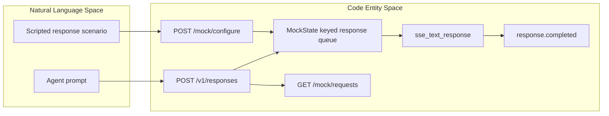
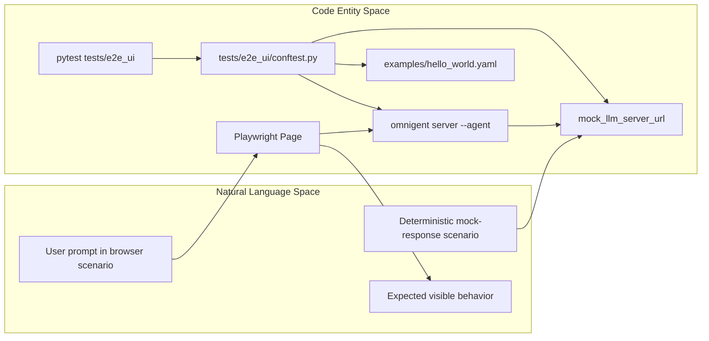
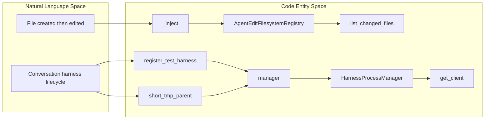

# Unit & Integration Tests

Relevant source files

The following files were used as context for generating this wiki page:

- [omnigent/harnesses/claude_native/submit_verification.py](omnigent/harnesses/claude_native/submit_verification.py)
- [omnigent/native/owner_claim.py](omnigent/native/owner_claim.py)
- [omnigent/runtime/filesystem_registry.py](omnigent/runtime/filesystem_registry.py)
- [omnigent/runtime/harnesses/process_manager.py](omnigent/runtime/harnesses/process_manager.py)
- [scripts/backend-smoke.sh](scripts/backend-smoke.sh)
- [tests/_helpers/README.md](tests/_helpers/README.md)
- [tests/_helpers/host.py](tests/_helpers/host.py)
- [tests/_helpers/live_server.py](tests/_helpers/live_server.py)
- [tests/_helpers/pi_native.py](tests/_helpers/pi_native.py)
- [tests/_helpers/server_runner.py](tests/_helpers/server_runner.py)
- [tests/browser_ui/chat/test_native_shell_settlement.py](tests/browser_ui/chat/test_native_shell_settlement.py)
- [tests/e2e/conftest.py](tests/e2e/conftest.py)
- [tests/e2e/resilience/lab/lab.py](tests/e2e/resilience/lab/lab.py)
- [tests/e2e/resilience/test_lab_smoke.py](tests/e2e/resilience/test_lab_smoke.py)
- [tests/e2e/test_file_tools.py](tests/e2e/test_file_tools.py)
- [tests/e2e/test_files_upload_e2e.py](tests/e2e/test_files_upload_e2e.py)
- [tests/e2e/test_filesystem_changed_files_e2e.py](tests/e2e/test_filesystem_changed_files_e2e.py)
- [tests/e2e/test_inaccessible_git_metadata_e2e.py](tests/e2e/test_inaccessible_git_metadata_e2e.py)
- [tests/e2e/test_journey_file_upload_analysis.py](tests/e2e/test_journey_file_upload_analysis.py)
- [tests/e2e/test_non_git_changed_files_e2e.py](tests/e2e/test_non_git_changed_files_e2e.py)
- [tests/e2e/test_orphan_sweep_unreadable_tmp_parent_e2e.py](tests/e2e/test_orphan_sweep_unreadable_tmp_parent_e2e.py)
- [tests/e2e/test_sessions_live_smoke.py](tests/e2e/test_sessions_live_smoke.py)
- [tests/e2e/test_steering.py](tests/e2e/test_steering.py)
- [tests/e2e/test_subagent_model_override_respawn_e2e.py](tests/e2e/test_subagent_model_override_respawn_e2e.py)
- [tests/e2e/test_tool_call_policy_e2e.py](tests/e2e/test_tool_call_policy_e2e.py)
- [tests/e2e_ui/chat/test_claude_native_permission_switch_from_dont_ask.py](tests/e2e_ui/chat/test_claude_native_permission_switch_from_dont_ask.py)
- [tests/e2e_ui/conftest.py](tests/e2e_ui/conftest.py)
- [tests/e2e_ui/files/test_native_write_lands_in_changes.py](tests/e2e_ui/files/test_native_write_lands_in_changes.py)
- [tests/e2e_ui/files/test_non_git_stray_gitdir.py](tests/e2e_ui/files/test_non_git_stray_gitdir.py)
- [tests/e2e_ui/messages/test_fork_carries_attachments.py](tests/e2e_ui/messages/test_fork_carries_attachments.py)
- [tests/e2e_ui/messages/test_native_claude_hook_retry_stop.py](tests/e2e_ui/messages/test_native_claude_hook_retry_stop.py)
- [tests/e2e_ui/messages/test_native_claude_shell_input.py](tests/e2e_ui/messages/test_native_claude_shell_input.py)
- [tests/harnesses/claude_native/test_hook_block_submit_retries.py](tests/harnesses/claude_native/test_hook_block_submit_retries.py)
- [tests/helpers/ui_configuration.py](tests/helpers/ui_configuration.py)
- [tests/inner/test_terminal_orphan_ownership.py](tests/inner/test_terminal_orphan_ownership.py)
- [tests/native/test_owner_claim.py](tests/native/test_owner_claim.py)
- [tests/runner/test_app_pi_native_model.py](tests/runner/test_app_pi_native_model.py)
- [tests/runner/test_app_spec_workdir_paths.py](tests/runner/test_app_spec_workdir_paths.py)
- [tests/runner/test_enforce_sandbox_gate.py](tests/runner/test_enforce_sandbox_gate.py)
- [tests/runtime/harnesses/test_process_manager.py](tests/runtime/harnesses/test_process_manager.py)
- [tests/runtime/harnesses/test_process_manager_idle_config.py](tests/runtime/harnesses/test_process_manager_idle_config.py)
- [tests/runtime/test_filesystem_git_discovery.py](tests/runtime/test_filesystem_git_discovery.py)
- [tests/runtime/test_filesystem_registry.py](tests/runtime/test_filesystem_registry.py)
- [tests/server/integration/mock_llm_server.py](tests/server/integration/mock_llm_server.py)
- [tests/server/integration/test_mock_llm_server.py](tests/server/integration/test_mock_llm_server.py)
- [tests/test_e2e_session_helpers.py](tests/test_e2e_session_helpers.py)
- [tests/test_local_server_helper.py](tests/test_local_server_helper.py)
- [tests/test_ui_fixture_configuration.py](tests/test_ui_fixture_configuration.py)
- [tests/test_ui_fixture_wiring.py](tests/test_ui_fixture_wiring.py)

## Purpose and Scope

The Python test suite uses `pytest` to exercise Omnigent code at different levels, from focused module tests to tests that run real server, runner, harness, or browser processes. The files provided here show representative coverage for runtime behavior, mock-provider behavior, end-to-end scenarios, and shared test infrastructure; they do not establish a complete inventory of every test directory or CI partition. [tests/runtime/test_filesystem_registry.py:1-12](), [tests/runtime/harnesses/test_process_manager.py:1-20](), [tests/server/integration/test_mock_llm_server.py:1-19]()

This page focuses on the test mechanisms visible in those files: the mock LLM server, runtime tests, integration and end-to-end fixtures, and reusable helpers. [tests/server/integration/mock_llm_server.py:1-60](), [tests/e2e/conftest.py:1-25](), [tests/_helpers/README.md:1-23]()

Sources: [tests/runtime/test_filesystem_registry.py:1-12](), [tests/runtime/harnesses/test_process_manager.py:1-20](), [tests/server/integration/test_mock_llm_server.py:1-19](), [tests/e2e/conftest.py:1-25](), [tests/_helpers/README.md:1-23]()

---

## Test Organization and CI Partitioning

The test paths shown here separate focused runtime tests from server-integration tests and broader end-to-end suites. For example, `tests/runtime/test_filesystem_registry.py` tests registry behavior, while `tests/runtime/harnesses/test_process_manager.py` runs a real harness subprocess. The mock LLM server itself has tests under `tests/server/integration/`. [tests/runtime/test_filesystem_registry.py:1-12](), [tests/runtime/harnesses/test_process_manager.py:1-20](), [tests/server/integration/test_mock_llm_server.py:1-19]()

| Test area | Example path | Demonstrated scope |
|---|---|---|
| Runtime module tests | `tests/runtime/test_filesystem_registry.py` | Change-event merging, snapshots, baselines, and path normalization. [tests/runtime/test_filesystem_registry.py:1-12]() |
| Runtime harness lifecycle tests | `tests/runtime/harnesses/test_process_manager.py` | Harness subprocess startup, client acquisition, lifecycle, and orphan handling. [tests/runtime/harnesses/test_process_manager.py:1-20]() |
| Mock-provider tests | `tests/server/integration/test_mock_llm_server.py` | Response routing and formatting, including streaming and token usage. [tests/server/integration/test_mock_llm_server.py:22-40](), [tests/server/integration/test_mock_llm_server.py:64-91](), [tests/server/integration/test_mock_llm_server.py:121-183]() |
| Real-LLM end-to-end tests | `tests/e2e/` | Tests use a live server and accept an LLM API key; the directory is excluded from the default `pytest` run. [tests/e2e/conftest.py:1-25]() |
| Browser-driven end-to-end tests | `tests/e2e_ui/` | Playwright drives the SPA against a spawned server wired to a mock LLM server; the directory is excluded from the default run. [tests/e2e_ui/conftest.py:1-23]() |

The supplied files document exclusions for `tests/e2e` and `tests/e2e_ui`; they do not provide enough information to describe the full CI matrix or all default pytest configuration. [tests/e2e/conftest.py:23-25](), [tests/e2e_ui/conftest.py:1-8]()

Sources: [tests/runtime/test_filesystem_registry.py:1-12](), [tests/runtime/harnesses/test_process_manager.py:1-20](), [tests/server/integration/test_mock_llm_server.py:22-40](), [tests/e2e/conftest.py:1-25](), [tests/e2e_ui/conftest.py:1-23]()

---

## Mock LLM Server for Integration Testing

`tests/server/integration/mock_llm_server.py` implements a FastAPI mock for the OpenAI Responses API streaming format. Tests can configure response sequences, capture requests, and coordinate blocked requests through gate endpoints. [tests/server/integration/mock_llm_server.py:1-31](), [tests/server/integration/mock_llm_server.py:79-85]()

### Features of the Mock LLM Server

- **Keyed queues:** `POST /mock/configure` accepts an optional queue key. Requests to `POST /v1/responses` are routed using the request’s `model` field; unmatched models use the `"default"` queue. The documented use case includes isolating parent-agent and sub-agent response sequences. [tests/server/integration/mock_llm_server.py:9-18](), [tests/server/integration/mock_llm_server.py:134-135]()
- **Scripted responses:** Configuration can describe text, tool calls, errors, delays, blocking, and streamed responses truncated after a specified number of events. [tests/server/integration/mock_llm_server.py:37-60]()
- **Captured requests and gates:** The documented endpoints include `GET /mock/requests`, `GET /gate/pending`, and `POST /gate/release`, as well as `POST /mock/reset`. [tests/server/integration/mock_llm_server.py:20-31]()
- **SSE construction:** `sse_text_response` builds the event sequence expected by the OpenAI Agents SDK, including response creation, output-item and text events, and completion. `_response_usage` merges scripted token counts and derives a total when omitted. [tests/server/integration/mock_llm_server.py:138-169](), [tests/server/integration/mock_llm_server.py:146-150]()
- **Evidence recording:** When a repro evidence directory is configured, `_record_evidence` writes provider-mock events to a `Journal`; `_record_evidence_async` offloads that operation with `asyncio.to_thread`. [tests/server/integration/mock_llm_server.py:88-131]()

### Key API Endpoints

| Endpoint | Purpose |
|---|---|
| `POST /mock/configure` | Load a keyed response sequence. [tests/server/integration/mock_llm_server.py:20-31]() |
| `POST /v1/responses` | Consume a queued response selected using the request model, with fallback to the default queue. [tests/server/integration/mock_llm_server.py:9-23]() |
| `GET /v1/models` | Return an empty model list for SDK preflight checks. [tests/server/integration/mock_llm_server.py:20-26]() |
| `GET /mock/requests` | Retrieve captured request bodies. [tests/server/integration/mock_llm_server.py:20-31]() |
| `GET /gate/pending`, `POST /gate/release` | Inspect pending blocked requests and release the oldest gate. [tests/server/integration/mock_llm_server.py:20-31]() |
| `POST /mock/reset` | Clear mock state. [tests/server/integration/mock_llm_server.py:20-31]() |
| `GET /stats` | Return the documented request count. [tests/server/integration/mock_llm_server.py:20-31]() |

### Mock LLM Server Response Flow Diagram

The flow connects test configuration and a runtime request to the mock’s named code entities. [tests/server/integration/mock_llm_server.py:9-31](), [tests/server/integration/mock_llm_server.py:138-169]()

Sources: [tests/server/integration/mock_llm_server.py:9-31](), [tests/server/integration/mock_llm_server.py:138-169]()

---

## Runtime Unit Tests

### Filesystem Registry

`tests/runtime/test_filesystem_registry.py` tests `AgentEditFilesystemRegistry` through its public `record_change` API. Its `_inject` helper supplies synthetic events, and the `registry` fixture creates an in-memory registry rooted at pytest’s `tmp_path`. [tests/runtime/test_filesystem_registry.py:34-62]()

The tests cover the session-level merge behavior for created, modified, and deleted files, including the invariant that a file created and then modified remains reported as `"created"`, while a file created and then deleted is omitted. They also check suppression of ephemeral artifacts. [tests/runtime/test_filesystem_registry.py:65-91](), [tests/runtime/test_filesystem_registry.py:94-128](), [tests/runtime/test_filesystem_registry.py:130-159]()

The production module distinguishes `GitFilesystemRegistry`, which derives changes from Git state, from `AgentEditFilesystemRegistry`, which tracks agent-recorded changes for non-Git workspaces. `create_filesystem_registry` is documented as the selection function for a workspace path. [omnigent/runtime/filesystem_registry.py:1-22]()

### Harness Process Manager

`tests/runtime/harnesses/test_process_manager.py` exercises `HarnessProcessManager` using a fixture harness registered in `_HARNESS_MODULES`. Its `short_tmp_parent` fixture uses a short temporary path to accommodate Unix-domain socket path limits, and the `manager` fixture configures the manager with that isolated directory. [tests/runtime/harnesses/test_process_manager.py:58-131]()

The test module describes its intent as covering lazy spawn, caching, crash detection, release, idle reaping, and orphan sweep. It uses a real runner subprocess and `uvicorn` rather than mocking the socket-startup handshake. [tests/runtime/harnesses/test_process_manager.py:1-20]()

The process manager module describes a per-conversation subprocess contract: the subprocess is spawned lazily when a conversation first calls `get_client`, and callers receive an `httpx.AsyncClient` connected over per-conversation IPC. [omnigent/runtime/harnesses/process_manager.py:1-17]()

Sources: [tests/runtime/test_filesystem_registry.py:34-62](), [tests/runtime/test_filesystem_registry.py:65-159](), [omnigent/runtime/filesystem_registry.py:1-22](), [tests/runtime/harnesses/test_process_manager.py:1-20](), [tests/runtime/harnesses/test_process_manager.py:58-131](), [omnigent/runtime/harnesses/process_manager.py:1-17]()

---

## Sandbox & Isolation Tests

The supplied files show test isolation mechanisms for filesystem-registry tests and harness-process tests, but do not include sandbox-specific test implementations. The filesystem-registry fixture uses a fresh `tmp_path`; the process-manager tests use a short per-test temporary parent and remove it during teardown. [tests/runtime/test_filesystem_registry.py:54-62](), [tests/runtime/harnesses/test_process_manager.py:78-110]()

Sources: [tests/runtime/test_filesystem_registry.py:54-62](), [tests/runtime/harnesses/test_process_manager.py:78-110]()

---

## Database & Store Layer Tests

The provided file contents do not include database- or store-specific test implementations, so this section makes no claims about their coverage or fixtures.

Sources: [tests/runtime/test_filesystem_registry.py:1-12]()

---

## Integration & API Route Tests

The mock server’s own tests use FastAPI’s `TestClient` and replace the module-level `_state` with a fresh `MockState` for isolated test cases. The examples verify nested user-input extraction, marker-based content routing, SSE truncation, streamed text deltas, and token-usage merging. [tests/server/integration/test_mock_llm_server.py:22-62](), [tests/server/integration/test_mock_llm_server.py:64-91](), [tests/server/integration/test_mock_llm_server.py:121-183]()

The helper guidance describes reusable primitives for session bundles, operator-created agents, isolated servers, explicit server-and-runner stacks, polling, and isolated hosts. It recommends keeping configuration, fault injection, and behavioral assertions with the calling scenario. [tests/_helpers/README.md:1-23]()

Sources: [tests/server/integration/test_mock_llm_server.py:22-62](), [tests/server/integration/test_mock_llm_server.py:64-91](), [tests/server/integration/test_mock_llm_server.py:121-183](), [tests/_helpers/README.md:1-23]()

---

## End-to-End Testing and UI Tests

The `tests/e2e` fixtures support tests against a live server and real LLM credentials; the documented command accepts `--llm-api-key`, and the directory is excluded from the default pytest run. The fixtures include a `server_version` fixture and minimum-version checks for server and runner compatibility. [tests/e2e/conftest.py:1-25](), [tests/e2e/conftest.py:83-96](), [tests/e2e/conftest.py:99-160]()

The `tests/e2e_ui` suite launches a real `omnigent server --agent` subprocess using `examples/hello_world.yaml` and drives the rendered SPA with Playwright. It wires the server to a mock LLM server for deterministic responses and is excluded from the default pytest run. [tests/e2e_ui/conftest.py:1-8]()

A representative UI test creates a native Claude mock session, waits for Claude session identity and transcript information, submits a prompt through the bridge, and asserts that a hook refusal results in one Enter submission and unconfirmed delivery. [tests/e2e_ui/messages/test_native_claude_hook_retry_stop.py:22-31](), [tests/e2e_ui/messages/test_native_claude_hook_retry_stop.py:67-80](), [tests/e2e_ui/messages/test_native_claude_hook_retry_stop.py:107-150]()

Sources: [tests/e2e/conftest.py:1-25](), [tests/e2e/conftest.py:83-160](), [tests/e2e_ui/conftest.py:1-8](), [tests/e2e_ui/messages/test_native_claude_hook_retry_stop.py:22-31](), [tests/e2e_ui/messages/test_native_claude_hook_retry_stop.py:67-80](), [tests/e2e_ui/messages/test_native_claude_hook_retry_stop.py:107-150]()

---

## Test Fixtures and Helpers

The shared helper guide maps common setup needs to reusable primitives. Examples include `bundle_files` and `post_session_bundle` for session uploads, `operator_agent_store` and `post_operator_session` for trusted test agents, `isolated_local_server` for a local server, `server_runner` for a server with an explicitly started runner, and `poll_until` / `poll_until_async` for condition polling. [tests/_helpers/README.md:8-23]()

`ServerRunner` owns server, runner, and host process handles while leaving session creation and fault injection to callers. It creates isolated workspace and home directories, chooses a free port, configures a database URI and artifact location, spawns processes with isolated environments, captures logs, and polls health or runner status endpoints for readiness. [tests/_helpers/server_runner.py:27-68](), [tests/_helpers/server_runner.py:70-142]()

The end-to-end fixtures apply compatibility checks where marked: `_enforce_min_server_version` resolves the live server version when needed, while `_enforce_min_runner_version` uses the pinned runner version during compatibility runs. [tests/e2e/conftest.py:83-96](), [tests/e2e/conftest.py:99-160]()

Sources: [tests/_helpers/README.md:8-23](), [tests/_helpers/server_runner.py:27-68](), [tests/_helpers/server_runner.py:70-142](), [tests/e2e/conftest.py:83-96](), [tests/e2e/conftest.py:99-160]()

---

## Detailed Data Flow: From Natural Language to Code Entities

This diagram relates test scenarios and user-facing inputs to concrete fixture and test entities shown in the supplied files. It represents the browser-test setup, not a complete production request path. [tests/e2e_ui/conftest.py:1-8](), [tests/e2e_ui/conftest.py:59-104](), [tests/e2e_ui/conftest.py:106-109]()

Sources: [tests/e2e_ui/conftest.py:1-8](), [tests/e2e_ui/conftest.py:59-104](), [tests/e2e_ui/conftest.py:106-109]()

### Runtime Test Scenario to Code Entities

This diagram connects named runtime behaviors to the classes, fixtures, and assertions used in the corresponding tests. [tests/runtime/test_filesystem_registry.py:22-62](), [tests/runtime/test_filesystem_registry.py:65-128](), [tests/runtime/harnesses/test_process_manager.py:41-55](), [tests/runtime/harnesses/test_process_manager.py:58-131]()

Sources: [tests/runtime/test_filesystem_registry.py:22-62](), [tests/runtime/test_filesystem_registry.py:65-128](), [tests/runtime/harnesses/test_process_manager.py:41-55](), [tests/runtime/harnesses/test_process_manager.py:58-131]()

---

## Summary

The supplied test files demonstrate a layered approach: focused runtime tests validate module behavior, mock-server tests validate response routing and SSE construction, and end-to-end fixtures coordinate real server, runner, harness, and browser processes. Shared helpers provide reusable process, session, and polling mechanics while leaving scenario-specific inputs and assertions to individual tests. [tests/runtime/test_filesystem_registry.py:1-12](), [tests/server/integration/test_mock_llm_server.py:1-19](), [tests/e2e/conftest.py:1-25](), [tests/e2e_ui/conftest.py:1-8](), [tests/_helpers/README.md:1-23]()

Sources: [tests/runtime/test_filesystem_registry.py:1-12](), [tests/server/integration/test_mock_llm_server.py:1-19](), [tests/e2e/conftest.py:1-25](), [tests/e2e_ui/conftest.py:1-8](), [tests/_helpers/README.md:1-23]()