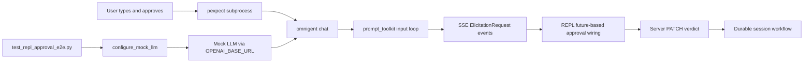
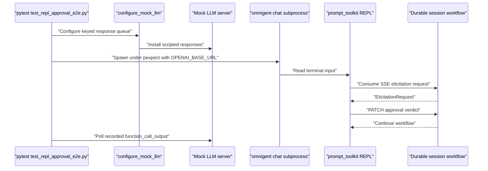
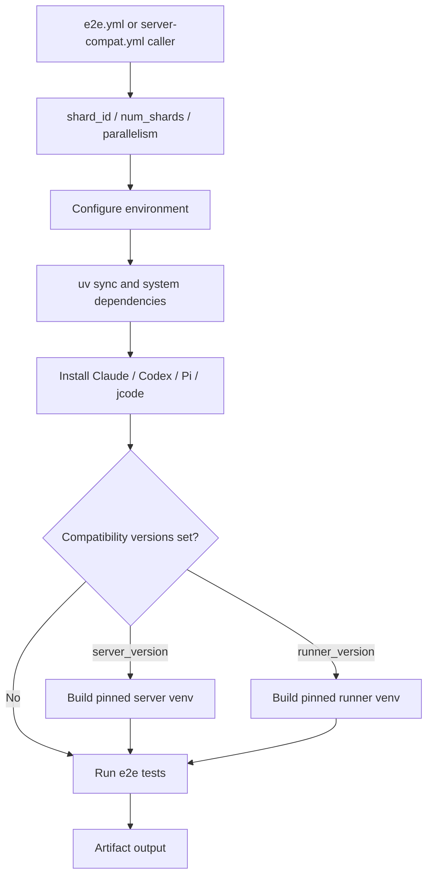
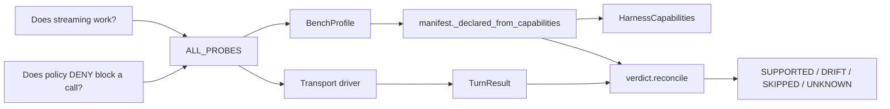
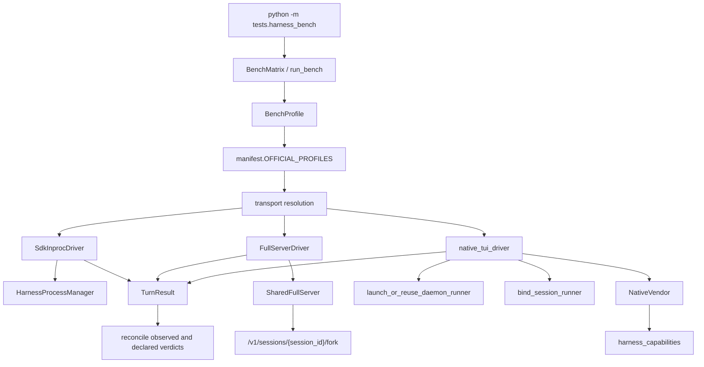

# End-to-End & Harness Bench Tests

Relevant source files

The following files were used as context for generating this wiki page:

- [.github/actions/compat-smoke-run/action.yml](.github/actions/compat-smoke-run/action.yml)
- [.github/actions/e2e-run/action.yml](.github/actions/e2e-run/action.yml)
- [.github/actions/integration-run/action.yml](.github/actions/integration-run/action.yml)
- [.github/workflows/ui-snapshot-update.yml](.github/workflows/ui-snapshot-update.yml)
- [.github/workflows/ui-snapshot.yml](.github/workflows/ui-snapshot.yml)
- [docs/harness-bench-design.md](docs/harness-bench-design.md)
- [omnigent/models/model_catalog_store.py](omnigent/models/model_catalog_store.py)
- [omnigent/runtime/policies/approval.py](omnigent/runtime/policies/approval.py)
- [tests/_fixtures/agents/e2e-subagent-tool-gate/e2e-subagent-tool-gate.yaml](tests/_fixtures/agents/e2e-subagent-tool-gate/e2e-subagent-tool-gate.yaml)
- [tests/e2e/omnigent/test_host_ctrl_c_stop_server.py](tests/e2e/omnigent/test_host_ctrl_c_stop_server.py)
- [tests/e2e/omnigent/test_host_daemon_gcloud_adc_env_e2e.py](tests/e2e/omnigent/test_host_daemon_gcloud_adc_env_e2e.py)
- [tests/e2e/omnigent/test_host_daemon_lifecycle_lock_e2e.py](tests/e2e/omnigent/test_host_daemon_lifecycle_lock_e2e.py)
- [tests/e2e/omnigent/test_host_daemon_telemetry_env_e2e.py](tests/e2e/omnigent/test_host_daemon_telemetry_env_e2e.py)
- [tests/e2e/omnigent/test_host_no_open.py](tests/e2e/omnigent/test_host_no_open.py)
- [tests/e2e/test_pi_native_gateway_claude_404_e2e.py](tests/e2e/test_pi_native_gateway_claude_404_e2e.py)
- [tests/e2e/test_repl_approval_e2e.py](tests/e2e/test_repl_approval_e2e.py)
- [tests/e2e/test_repl_sessions_approval_e2e.py](tests/e2e/test_repl_sessions_approval_e2e.py)
- [tests/e2e_ui/visual/README.md](tests/e2e_ui/visual/README.md)
- [tests/e2e_ui/visual/conftest.py](tests/e2e_ui/visual/conftest.py)
- [tests/e2e_ui/visual/regen_baseline_docker.sh](tests/e2e_ui/visual/regen_baseline_docker.sh)
- [tests/e2e_ui/visual/snapshots/test_storybook_snapshot/test_story_matches_baseline/test_story_matches_baseline[chromium-components-agents-createagentdialog--two-mcp-servers][linux].png](tests/e2e_ui/visual/snapshots/test_storybook_snapshot/test_story_matches_baseline/test_story_matches_baseline[chromium-components-agents-createagentdialog--two-mcp-servers][linux].png)
- [tests/e2e_ui/visual/snapshots/test_storybook_snapshot/test_story_matches_baseline/test_story_matches_baseline[chromium-components-blocks-systemmessage--task-completed][linux].png](tests/e2e_ui/visual/snapshots/test_storybook_snapshot/test_story_matches_baseline/test_story_matches_baseline[chromium-components-blocks-systemmessage--task-completed][linux].png)
- [tests/e2e_ui/visual/snapshots/test_storybook_snapshot/test_story_matches_baseline/test_story_matches_baseline[chromium-components-media-imagelightbox--open-and-zoomed][linux].png](tests/e2e_ui/visual/snapshots/test_storybook_snapshot/test_story_matches_baseline/test_story_matches_baseline[chromium-components-media-imagelightbox--open-and-zoomed][linux].png)
- [tests/e2e_ui/visual/snapshots/test_storybook_snapshot/test_story_matches_baseline/test_story_matches_baseline[chromium-components-scheduled-scheduledtaskrow--paused-menu-open][linux].png](tests/e2e_ui/visual/snapshots/test_storybook_snapshot/test_story_matches_baseline/test_story_matches_baseline[chromium-components-scheduled-scheduledtaskrow--paused-menu-open][linux].png)
- [tests/e2e_ui/visual/snapshots/test_storybook_snapshot/test_story_matches_baseline/test_story_matches_baseline[chromium-components-shell-subagentspanel--brand-icons-collapsed][linux].png](tests/e2e_ui/visual/snapshots/test_storybook_snapshot/test_story_matches_baseline/test_story_matches_baseline[chromium-components-shell-subagentspanel--brand-icons-collapsed][linux].png)
- [tests/e2e_ui/visual/snapshots/test_storybook_snapshot/test_story_matches_baseline/test_story_matches_baseline[chromium-components-shell-subagentspanel--deep-tree-active-grandchild][linux].png](tests/e2e_ui/visual/snapshots/test_storybook_snapshot/test_story_matches_baseline/test_story_matches_baseline[chromium-components-shell-subagentspanel--deep-tree-active-grandchild][linux].png)
- [tests/e2e_ui/visual/snapshots/test_storybook_snapshot/test_story_matches_baseline/test_story_matches_baseline[chromium-components-shell-subagentspanel--status-spectrum][linux].png](tests/e2e_ui/visual/snapshots/test_storybook_snapshot/test_story_matches_baseline/test_story_matches_baseline[chromium-components-shell-subagentspanel--status-spectrum][linux].png)
- [tests/e2e_ui/visual/snapshots/test_storybook_snapshot/test_story_matches_baseline/test_story_matches_baseline[chromium-foundations-primitives--gallery][linux].png](tests/e2e_ui/visual/snapshots/test_storybook_snapshot/test_story_matches_baseline/test_story_matches_baseline[chromium-foundations-primitives--gallery][linux].png)
- [tests/e2e_ui/visual/test_chat_snapshot.py](tests/e2e_ui/visual/test_chat_snapshot.py)
- [tests/e2e_ui/visual/test_chat_turn_rail_snapshot.py](tests/e2e_ui/visual/test_chat_turn_rail_snapshot.py)
- [tests/e2e_ui/visual/test_landing_snapshot.py](tests/e2e_ui/visual/test_landing_snapshot.py)
- [tests/e2e_ui/visual/update_baseline_from_pr.sh](tests/e2e_ui/visual/update_baseline_from_pr.sh)
- [tests/harness_bench/README.md](tests/harness_bench/README.md)
- [tests/harness_bench/__main__.py](tests/harness_bench/__main__.py)
- [tests/harness_bench/bench.py](tests/harness_bench/bench.py)
- [tests/harness_bench/driver.py](tests/harness_bench/driver.py)
- [tests/harness_bench/events.py](tests/harness_bench/events.py)
- [tests/harness_bench/full_server.py](tests/harness_bench/full_server.py)
- [tests/harness_bench/full_server_driver.py](tests/harness_bench/full_server_driver.py)
- [tests/harness_bench/manifest.py](tests/harness_bench/manifest.py)
- [tests/harness_bench/native_tui_driver.py](tests/harness_bench/native_tui_driver.py)
- [tests/harness_bench/probes/__init__.py](tests/harness_bench/probes/__init__.py)
- [tests/harness_bench/report.py](tests/harness_bench/report.py)
- [tests/harness_bench/richreport.py](tests/harness_bench/richreport.py)
- [tests/harness_bench/session_items.py](tests/harness_bench/session_items.py)
- [tests/harness_bench/test_bench.py](tests/harness_bench/test_bench.py)
- [tests/harness_bench/test_full_server.py](tests/harness_bench/test_full_server.py)
- [tests/harness_bench/test_full_server_driver.py](tests/harness_bench/test_full_server_driver.py)
- [tests/harness_bench/test_native_tui_driver.py](tests/harness_bench/test_native_tui_driver.py)
- [tests/harness_bench/test_session_items.py](tests/harness_bench/test_session_items.py)
- [tests/harness_bench/transport.py](tests/harness_bench/transport.py)
- [tests/harness_bench/verdict.py](tests/harness_bench/verdict.py)
- [tests/onboarding/test_harness_probe_terminal.py](tests/onboarding/test_harness_probe_terminal.py)
- [tests/runtime/policies/test_approval.py](tests/runtime/policies/test_approval.py)
- [tests/runtime/policies/test_ask_cycle_e2e.py](tests/runtime/policies/test_ask_cycle_e2e.py)
- [tests/test_host_daemon_telemetry_helpers.py](tests/test_host_daemon_telemetry_helpers.py)

## Purpose and scope

This page describes two complementary test layers: the end-to-end suite under `tests/e2e/`, which exercises complete user-facing and runtime paths, and the Harness Bench under `tests/harness_bench/`, which compares observed harness behavior with declared capabilities. It also covers the shared e2e CI action and how it configures a test run. The available implementation details here include the REPL approval test, the Harness Bench profiles and drivers, and the e2e action; they do not establish the contents of every e2e test or the full workflow matrix. [tests/e2e/test_repl_approval_e2e.py:1-30]() [tests/harness_bench/README.md:1-10]() [.github/actions/e2e-run/action.yml:1-10]()

Sources: `tests/e2e/test_repl_approval_e2e.py`, `tests/harness_bench/README.md`, `.github/actions/e2e-run/action.yml`

## 1. E2E suite in `tests/e2e/`

### Test scope and harness probes

The e2e suite is intended to cover harness probes, multi-agent orchestration, native resume, sandbox behavior, policies, and sessions. The supplied implementation details show one concrete user-path example: `test_repl_approval_e2e.py` starts `omnigent chat` as a subprocess under a pseudo-terminal and exercises the approval flow through the interactive REPL rather than only through a polling API. The test module says its scope includes prompt-toolkit input, SSE `ElicitationRequest` events, future-based REPL approval wiring, and the server PATCH that returns the verdict to the durable session workflow. [tests/e2e/test_repl_approval_e2e.py:1-15]()

The same test documents a mock-LLM setup: the test configures a keyed response queue before spawning the subprocess and injects `OPENAI_BASE_URL` so the inner OpenAI harness can route to the mock server. The module imports `configure_mock_llm`, `get_mock_requests`, and `reset_mock_llm` from `tests.e2e.conftest`; the shown test content does not include those helpers’ implementations. [tests/e2e/test_repl_approval_e2e.py:17-21] [tests/e2e/test_repl_approval_e2e.py:47-54]()

#### REPL approval path: natural-language action to code entities

The diagram maps the documented human action—typing into the REPL and approving a request—to the named test and runtime interfaces. It represents the test module’s stated path, not an inferred call graph beyond that description. [tests/e2e/test_repl_approval_e2e.py:1-15] [tests/e2e/test_repl_approval_e2e.py:47-54]()

**Diagram: REPL approval test path**

Sources: `tests/e2e/test_repl_approval_e2e.py`

### REPL test setup and timing

The module marks `pexpect` as an optional test dependency by using `pytest.importorskip("pexpect")`. It defines fixture paths for the ask-demo agent and several e2e policy/tool-gate agents. [tests/e2e/test_repl_approval_e2e.py:47-66]()

The launch timeout is deliberately separate from the assertion timeouts used after launch. The test documents a CLI cold-start budget that can include host-online waiting, daemon-runner launch/reconnect, and runner-online waiting; `_LAUNCH_TIMEOUT` is set to 120 seconds to accommodate that launch path while retaining tighter post-launch checks. [tests/e2e/test_repl_approval_e2e.py:67-91]()

The test strips ANSI terminal escape sequences before making text assertions, because prompt-toolkit styling can split or interleave escape sequences in captured output. `_strip_ansi` applies `_ANSI_RE` to the captured text. [tests/e2e/test_repl_approval_e2e.py:93-107]()

For tool round-trip assertions, `_wait_for_function_call_outputs` repeatedly reads recorded mock requests, extracts `function_call_output` values, and returns the joined outputs once any are present or the deadline expires. The helper is explicitly designed to wait on the persisted output rather than sample once after the REPL renders its follow-up response, avoiding a race between rendering and mock-server request persistence. [tests/e2e/test_repl_approval_e2e.py:110-147]()

The module-scoped `repl_env` fixture builds the child-process environment and redirects `HOME` to a temporary directory with a seeded Omnigent config. Its documented reason is to persist the TUI theme so the first-launch theme picker does not block under the pexpect pseudo-terminal. [tests/e2e/test_repl_approval_e2e.py:150-170]()

Sources: `tests/e2e/test_repl_approval_e2e.py`

### E2E test data flow

The test’s data flow separates setup, interactive execution, and observation: mock responses are configured before the CLI subprocess starts; the subprocess follows the interactive streaming path; and the test can inspect mock requests to verify tool outputs. [tests/e2e/test_repl_approval_e2e.py:13-21] [tests/e2e/test_repl_approval_e2e.py:110-147]()

**Diagram: mock-backed interactive e2e data flow**

Sources: `tests/e2e/test_repl_approval_e2e.py`

### E2E CI action

`.github/actions/e2e-run/action.yml` defines a composite action that runs the `tests/e2e/` suite in the same general mock-LLM and sharded mode used by the e2e gate. The action is also shared with the server-compat workflow so those callers use the same test-run configuration. [`.github/actions/e2e-run/action.yml:1-10`]() 

The action accepts shard index and count, pytest worker parallelism, a nightly-full switch, optional server and runner versions, and an artifact suffix. The default worker parallelism is two; the default nightly setting excludes nightly tests according to the action’s input description. [`.github/actions/e2e-run/action.yml:12-52`]()

The environment step disables the web UI build and blanks provider credentials to prevent the spawned server from accidentally using the CI runner’s credentials. The action then installs Python, project/test dependencies, and system packages including `tmux` and `bubblewrap`; it also applies an AppArmor user-namespace setting required for the Linux bubblewrap sandbox on Ubuntu 24.04. [`.github/actions/e2e-run/action.yml:57-100`]()

The action installs Claude Code, Codex, Pi, and a pinned `jcode` CLI. It also installs a separate Claude CLI for a billing-notice regression test, recording its binary path in `OMNIGENT_E2E_CLAUDE_BILLING_NOTICE_BIN`. [`.github/actions/e2e-run/action.yml:101-138`]()

For backwards-compatibility runs, `server_version` builds a tagged server in an isolated virtual environment and redirects the server subprocess to it. `runner_version` is a separate, orthogonal input for pinning the runner/host subprocess. In both cases, the checked-out client, tests, and other components remain on the caller’s checkout according to the action description. [`.github/actions/e2e-run/action.yml:31-45`]() [`.github/actions/e2e-run/action.yml:140-163`]()

**Diagram: e2e action configuration and execution**

Sources: `.github/actions/e2e-run/action.yml`

## 2. Harness Bench conformance suite

### Purpose and operating modes

The Harness Bench is a pluggable conformance suite that probes harness behavior and reconciles the observed verdicts with the capability model, surfacing drift between declarations and runtime behavior. Its README distinguishes the conformance suite from the release latency benchmark under `dev/benchmarks/omnigent/`. [tests/harness_bench/README.md:1-10] [tests/harness_bench/README.md:75-80]()

The bench has offline and live test layers. Offline tests require no network or credentials and cover registry membership, profile completeness, reconciliation semantics, community-profile resolution, and matrix rendering. Live tests are gated on `--profile` and a runnable harness CLI; they run probes against harnesses and check that selected P0 dimensions agree with the declared profile, including a working `basic_turn`. [tests/harness_bench/test_bench.py:1-11]()

The CLI can list profiles, render the declared matrix without live turns, or run live probes for selected harnesses and dimensions. By default, it runs live only when gateway credentials can be resolved; otherwise it renders the declared matrix. A successful default exit does not by itself prove that probes ran. [tests/harness_bench/README.md:12-46]()

For automation that requires actual observations, `--require-complete` must be combined with `--live`. Missing CLIs, startup failures, timeouts, probe exceptions, and inconclusive `SKIPPED` or `UNKNOWN` results make the selected run incomplete, while non-applicable dimensions are allowed. [tests/harness_bench/README.md:48-73]()

### Profiles and capability-derived declarations

`manifest.py` builds profiles from the canonical capability registry and e2e probe metadata. `_profile_from_probe` associates a harness probe’s name, model, environment prefix, marker, and CLI binary with its capability-derived declarations. The official SDK-family profile set is selected from `claude-sdk`, `codex`, `pi`, and `openai-agents`. [tests/harness_bench/manifest.py:1-18] [tests/harness_bench/manifest.py:79-103]()

Native TUI profiles are derived from the registered capabilities whose integration mode is `NATIVE_TUI`. `_native_profile` selects a CLI binary through the install-spec registry, assigns the `native-tui` transport, and supplies the native model, environment prefix, marker, and declared verdicts. [tests/harness_bench/manifest.py:105-154]()

`_declared_from_capabilities` maps known capability fields to verdicts: streaming and interrupt are binary; resume maps `Resume.NONE` to unsupported; steering, live queue, images, and compaction are included when their values are known. The function leaves unmodeled capabilities unknown, and marks model override supported when the harness has model environment keys or is native. [tests/harness_bench/manifest.py:35-76]()

The profile registry also maps integration modes to transport families: SDK-in-process, CLI subprocess, and ACP subprocess use `sdk-inproc`; native TUI uses `native-tui`. The README describes `full-server` as the default for SDK-family profiles, with `--fast` selecting `sdk-inproc`; native profiles use `native-tui`. [tests/harness_bench/manifest.py:157-162] [tests/harness_bench/README.md:132-140]()

### Natural-language capability claims to code entities

The matrix turns questions such as “does policy DENY block a call?” into probe dimensions and compares observed results with profile declarations. The profile builder supplies declarations from `HarnessCapabilities`; the tests verify that a concrete disagreement becomes `DRIFT`, while inconclusive results do not create drift. [docs/harness-bench-design.md:1-7] [tests/harness_bench/manifest.py:55-76] [tests/harness_bench/test_bench.py:118-128]()

**Diagram: capability claims mapped to bench entities**

Sources: `docs/harness-bench-design.md`, `tests/harness_bench/manifest.py`, `tests/harness_bench/test_bench.py`, `tests/harness_bench/driver.py`

### Transport drivers and data flow

The bench provides three transport families: `sdk-inproc`, `full-server`, and `native-tui`. The README explains that `full-server` runs through a real server and runner, enabling observation of server-dispatched tools and fixed ALLOW/ASK/DENY policy behavior; `sdk-inproc` is a cheaper direct wrapping path with narrower policy and tool observations; and native harnesses use `native-tui`. [tests/harness_bench/README.md:132-140]()

`SdkInprocDriver` is defined in `driver.py` and holds a `HarnessProcessManager`, an asynchronous HTTP client, and temporary-path state. Its shared `TurnResult` records observable events, text and reasoning deltas, tool calls, policy actions, completion/cancellation/failure state, usage, cost, elicitation, and whether a tool call was allowed. [tests/harness_bench/driver.py:139-168] [tests/harness_bench/driver.py:193-204]()

`FullServerDriver` owns or reuses a `SharedFullServer`. Entering the driver creates the shared server when needed, registers an agent for the profile, and creates a session. Its asynchronous methods delegate blocking operations to worker threads. The fork probe posts to the session fork endpoint, binds the clone to the runner, checks copied history, and runs a recall turn on the fork. [tests/harness_bench/full_server_driver.py:59-118] [tests/harness_bench/full_server_driver.py:120-143] [tests/harness_bench/full_server_driver.py:153-177]()

`NativeVendor` captures per-vendor details used by the native TUI driver, including harness and agent names, terminal name, authentication ownership, lazy external-session creation, and shell-tool metadata. `native_vendor` derives this metadata from harness capabilities and only treats `NATIVE_TUI` harnesses as candidates; the driver imports host-daemon launch helpers, `bind_session_runner`, and session-item parsing helpers. [tests/harness_bench/native_tui_driver.py:23-57] [tests/harness_bench/native_tui_driver.py:99-137] [tests/harness_bench/native_tui_driver.py:166-174]()

The native driver recognizes session event types such as output-text deltas, output-item completion, failure, interruption, policy denial, and elicitation requests. Its declared timing constants distinguish health, host-online, turn, forwarder-readiness, tool-turn, and denial-observation timeouts. [tests/harness_bench/native_tui_driver.py:59-97]()

**Diagram: Harness Bench name-to-code transport map**

Sources: `tests/harness_bench/README.md`, `tests/harness_bench/driver.py`, `tests/harness_bench/full_server_driver.py`, `tests/harness_bench/native_tui_driver.py`, `tests/harness_bench/manifest.py`

### Probe selection and verdict reconciliation

The test suite checks that each official profile is registered, that required profile fields are populated, and that every P0 probe has a declared verdict. It also checks that declared streaming verdicts match the capability registry and that `PARTIAL` is not used as a declared streaming value. [tests/harness_bench/test_bench.py:20-78]()

The reconciliation tests establish the key semantics: a concrete mismatch such as declared `UNSUPPORTED` versus observed `SUPPORTED` produces `DRIFT`; matching supported results remain supported; and a skipped or unknown side does not create a drift result. [tests/harness_bench/test_bench.py:118-128]()

A `TurnResult` is the shared observation record for a turn. Its terminal-state property is true when a turn completed, was cancelled, or failed; its event type list is derived from the event records. `ForkResult` separately records fork creation, copied history, recall, failure, and timeout state. [tests/harness_bench/driver.py:139-179]()

| Bench concept | Implementation point | Role |
|---|---|---|
| Capability declaration | `manifest._declared_from_capabilities` | Converts known capability fields into declared verdicts. [tests/harness_bench/manifest.py:55-76]() |
| Per-harness profile | `BenchProfile` construction in `manifest.py` | Combines harness identity, model, CLI, transport, and declarations. [tests/harness_bench/manifest.py:79-103]() |
| Turn observation | `TurnResult` | Stores events, text, tool calls, policy outcomes, terminal state, and usage. [tests/harness_bench/driver.py:139-168]() |
| Fork observation | `ForkResult` | Stores fork and history-replay outcomes. [tests/harness_bench/driver.py:170-179]() |
| Drift classification | `reconcile` tests | Confirms concrete mismatches become `DRIFT`. [tests/harness_bench/test_bench.py:118-128]() |

Sources: `tests/harness_bench/manifest.py`, `tests/harness_bench/driver.py`, `tests/harness_bench/test_bench.py`

### Running and interpreting the Harness Bench

The README documents these representative invocations:

| Goal | CLI usage |
|---|---|
| List official harnesses | `python -m tests.harness_bench --list` [tests/harness_bench/README.md:12-20]() |
| Render declared matrix without live turns | `python -m tests.harness_bench --no-live` [tests/harness_bench/README.md:17-20]() |
| Probe one harness | `python -m tests.harness_bench --harness codex` [tests/harness_bench/README.md:21-27]() |
| Probe selected dimensions | Use `--dimension`; `basic_turn` is automatically added as a prerequisite. [tests/harness_bench/README.md:100-103]() |
| Require complete live observations | Pair `--live` with `--require-complete`. [tests/harness_bench/README.md:48-61]() |
| Write machine-readable results | Use `--json` and optionally `--report PATH`. [tests/harness_bench/README.md:52-55] [tests/harness_bench/README.md:117-125]() |

Exit status distinguishes drift and incomplete execution: status 1 means at least one observed capability differs from its declaration; status 2 indicates invalid configuration, missing required credentials, or incomplete results when completeness is required. [tests/harness_bench/README.md:64-73]()

Sources: `tests/harness_bench/README.md`

## 3. CI and test boundaries

### E2E action and compatibility reuse

The supplied CI implementation is the composite `Run e2e suite` action. Its description says it is shared by the normal e2e gate and `server-compat.yml`, preventing their test-run configurations from diverging. The action supports shard selection and pytest worker parallelism, and configures dependencies and harness CLIs before running the suite. [`.github/actions/e2e-run/action.yml:1-10`]() [`.github/actions/e2e-run/action.yml:12-29`]() [`.github/actions/e2e-run/action.yml:57-138`]()

The action’s compatibility options independently pin server and runner versions in isolated virtual environments. The supplied excerpt shows the server build setup and the action inputs for both version controls; it does not include the remainder of the action’s test invocation or artifact-upload steps. [`.github/actions/e2e-run/action.yml:31-45`]() [`.github/actions/e2e-run/action.yml:140-163`]()

### Harness Bench is conformance, not latency testing

Harness Bench results concern observed capability behavior and declaration drift, not throughput or release latency. The README cautions that live turns depend on model behavior, vendor login, CLI versions, and timing, and recommends pinning those inputs and repeating a chosen slice before using it as a regression gate. It also states that a local mock provider validates execution plumbing, not live model reliability. [tests/harness_bench/README.md:75-80]()

Offline tests provide deterministic checks of profile and registry consistency without network or credentials. Live tests have a different evidentiary meaning: they probe harnesses and can be incomplete due to missing CLIs, startup failures, timeouts, exceptions, or other inconclusive outcomes. [tests/harness_bench/test_bench.py:1-11] [tests/harness_bench/README.md:58-61]()

Sources: `.github/actions/e2e-run/action.yml`, `tests/harness_bench/README.md`, `tests/harness_bench/test_bench.py`

## Summary

The REPL approval e2e test exercises an interactive terminal path using `pexpect`, mock-LLM responses, SSE elicitation events, and a server-side verdict update. The e2e action supplies a reusable, configurable CI environment with sharding inputs, test dependencies, harness CLIs, and optional server/runner compatibility builds. [tests/e2e/test_repl_approval_e2e.py:1-21] [.github/actions/e2e-run/action.yml:1-10] [.github/actions/e2e-run/action.yml:12-45]()

Harness Bench complements those journey tests with transport drivers, capability-derived profiles, observable turn results, and verdict reconciliation. Its offline layer checks suite metadata; its live layer checks actual harness behavior and can report drift when observations contradict declarations. [tests/harness_bench/test_bench.py:1-11] [tests/harness_bench/manifest.py:55-76] [tests/harness_bench/driver.py:139-168] [tests/harness_bench/test_bench.py:118-128]()

Sources: `tests/e2e/test_repl_approval_e2e.py`, `.github/actions/e2e-run/action.yml`, `tests/harness_bench/test_bench.py`, `tests/harness_bench/manifest.py`, `tests/harness_bench/driver.py`