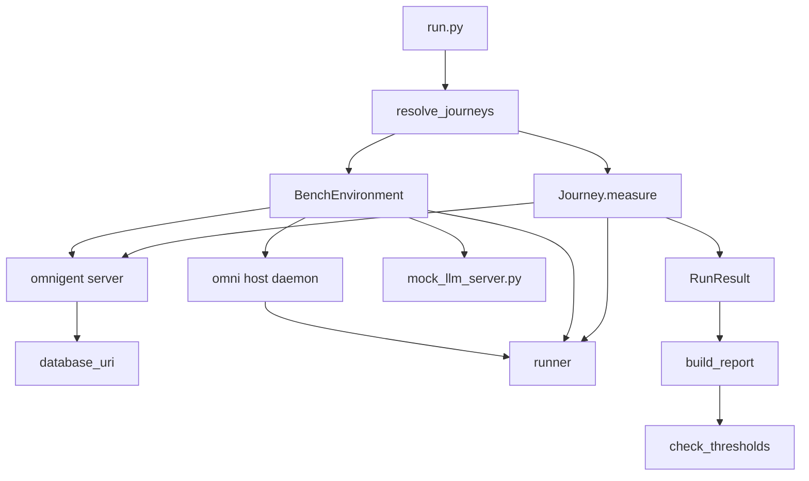
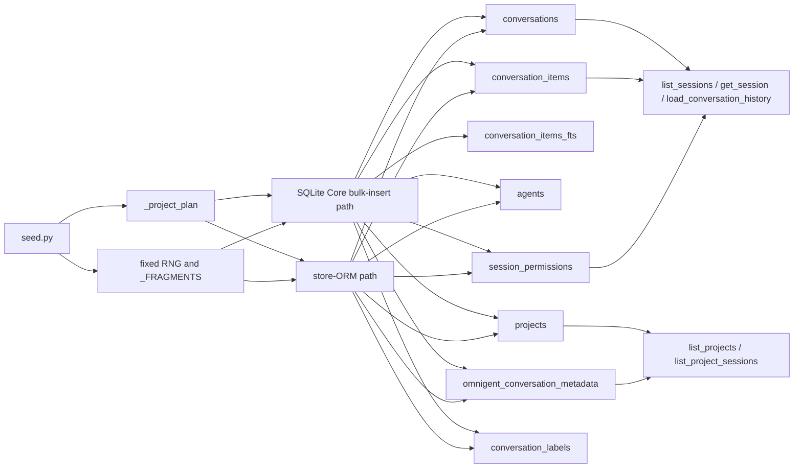
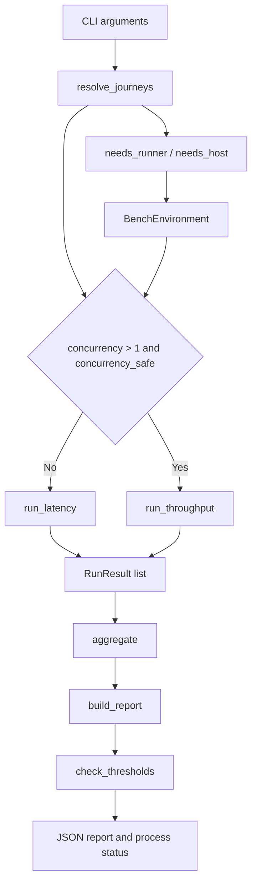
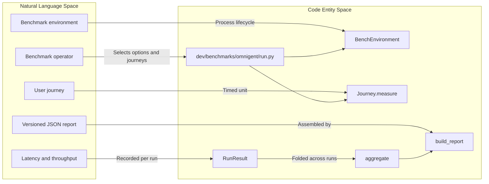
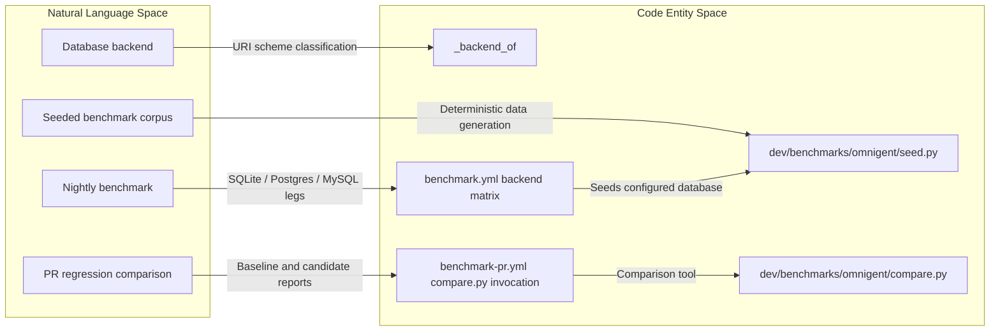

# Performance Benchmarks & Load Tests

Relevant source files

The following files were used as context for generating this wiki page:

- [.github/workflows/benchmark-host.yml](.github/workflows/benchmark-host.yml)
- [.github/workflows/benchmark-pr.yml](.github/workflows/benchmark-pr.yml)
- [.github/workflows/benchmark.yml](.github/workflows/benchmark.yml)
- [dev/benchmarks/__init__.py](dev/benchmarks/__init__.py)
- [dev/benchmarks/omnigent/README.md](dev/benchmarks/omnigent/README.md)
- [dev/benchmarks/omnigent/__init__.py](dev/benchmarks/omnigent/__init__.py)
- [dev/benchmarks/omnigent/environment.py](dev/benchmarks/omnigent/environment.py)
- [dev/benchmarks/omnigent/journeys.py](dev/benchmarks/omnigent/journeys.py)
- [dev/benchmarks/omnigent/measure.py](dev/benchmarks/omnigent/measure.py)
- [dev/benchmarks/omnigent/report_markdown.py](dev/benchmarks/omnigent/report_markdown.py)
- [dev/benchmarks/omnigent/run.py](dev/benchmarks/omnigent/run.py)
- [dev/benchmarks/omnigent/sample_output.json](dev/benchmarks/omnigent/sample_output.json)
- [dev/benchmarks/omnigent/schema.py](dev/benchmarks/omnigent/schema.py)
- [dev/benchmarks/omnigent/seed.py](dev/benchmarks/omnigent/seed.py)
- [tests/benchmarks/test_benchmark_smoke.py](tests/benchmarks/test_benchmark_smoke.py)
- [tests/benchmarks/test_seed_fast_path.py](tests/benchmarks/test_seed_fast_path.py)

## Purpose and scope

The benchmark suite in `dev/benchmarks/omnigent/` measures repeatable latency and throughput for HTTP/API journeys and full agent-turn journeys. HTTP/API runs exercise the server and database without a runner or LLM; full-turn runs exercise the runner with a zero-latency mock LLM. The suite also supports seeded corpora, database-backend comparison, report generation, and CI regression checks. [dev/benchmarks/omnigent/README.md:1-22]() [dev/benchmarks/omnigent/journeys.py:9-41]()

Sources: `dev/benchmarks/omnigent/README.md:1-22`, `dev/benchmarks/omnigent/journeys.py:9-41`

---

## Benchmark Suite Overview

The benchmark harness is split across environment lifecycle, journey definitions, measurement, and CLI orchestration. `BenchEnvironment` starts a real server and can add a runner, mock LLM, or host daemon depending on the selected journeys. `Journey` describes one operation and its optional setup, preparation, validation, and teardown. `RunResult` accumulates measurements for one run, while `run.py` selects journeys, chooses the environment mode, runs measurements, and constructs the report. [dev/benchmarks/omnigent/environment.py:1-18]() [dev/benchmarks/omnigent/journeys.py:77-145]() [dev/benchmarks/omnigent/measure.py:28-45]() [dev/benchmarks/omnigent/run.py:88-114]() [dev/benchmarks/omnigent/run.py:142-172]()

| Component | Responsibility |
|---|---|
| `BenchEnvironment` | Async lifecycle for server-only, runner-enabled, and host-enabled benchmark environments. [dev/benchmarks/omnigent/environment.py:1-18]() |
| `Journey` | Stable journey name, operation kind, measurement coroutine, optional lifecycle hooks, and concurrency/dependency flags. [dev/benchmarks/omnigent/journeys.py:77-145]() |
| `RunResult` | Per-run latency samples, failure counts, elapsed time, and server request counters. [dev/benchmarks/omnigent/measure.py:28-51]() |
| `run.py` | Resolves journeys, configures the environment, runs measurements, builds the report, and applies supplied thresholds. [dev/benchmarks/omnigent/run.py:88-114]() [dev/benchmarks/omnigent/run.py:142-172]() |
| `seed.py` | Builds a deterministic benchmark corpus in the database used by the benchmark server. [dev/benchmarks/omnigent/seed.py:1-13]() |

Sources: `dev/benchmarks/omnigent/environment.py:1-18`, `dev/benchmarks/omnigent/journeys.py:77-145`, `dev/benchmarks/omnigent/measure.py:28-51`, `dev/benchmarks/omnigent/run.py:88-114`, `dev/benchmarks/omnigent/run.py:142-172`, `dev/benchmarks/omnigent/seed.py:1-13`

---

## Data Flow & System Interaction

The CLI resolves requested journeys and derives whether the environment needs a runner or host. It then creates one `BenchEnvironment` for the selection; mixed selections use the superset environment required by the most demanding journey. Journeys issue requests or drive turns, and measurement results are aggregated into report blocks. [dev/benchmarks/omnigent/run.py:142-172]() [dev/benchmarks/omnigent/journeys.py:97-129]() [dev/benchmarks/omnigent/measure.py:151-166]()

### Diagram: Benchmark orchestration and Omnigent runtime entities

Sources: `dev/benchmarks/omnigent/run.py:36-51`, `dev/benchmarks/omnigent/run.py:142-172`, `dev/benchmarks/omnigent/environment.py:1-18`, `dev/benchmarks/omnigent/environment.py:74-76`, `dev/benchmarks/omnigent/journeys.py:77-129`, `dev/benchmarks/omnigent/measure.py:28-51`

Sources: `dev/benchmarks/omnigent/run.py:142-172`, `dev/benchmarks/omnigent/environment.py:1-18`, `dev/benchmarks/omnigent/journeys.py:77-129`

---

## Journey Types

### HTTP/API Journeys — Server + DB Only

HTTP/API journeys exercise server endpoints without requiring a runner or LLM. The documented operations include session listing, creation and cleanup, snapshot reads, conversation-history reads, session search, forks, comments, project listing, and project-session filtering. Read journeys use a pre-seeded session when a corpus exists; on an empty database, they can create a small fallback session through the `external_conversation_item` event. [dev/benchmarks/omnigent/README.md:55-74]() [dev/benchmarks/omnigent/journeys.py:9-24]()

| Journey | Operation timed | Workload characteristic |
|---|---|---|
| `list_sessions` | `GET /v1/sessions` | Session count. [dev/benchmarks/omnigent/README.md:57-70]() |
| `create_session` | `POST /v1/sessions`, then `DELETE` | Write path. [dev/benchmarks/omnigent/README.md:57-70]() |
| `get_session` | `GET /v1/sessions/{id}` | Single-session snapshot. [dev/benchmarks/omnigent/README.md:57-70]() |
| `load_conversation_history` | `GET /v1/sessions/{id}/items` | Items per session. [dev/benchmarks/omnigent/README.md:57-74]() |
| `search_sessions` | `GET /v1/sessions?search_query=` | Unindexed `LIKE` search over total item count. [dev/benchmarks/omnigent/README.md:57-70]() |
| `fork_session` | `POST /v1/sessions/{id}/fork`; cleanup is outside timing | Deep-copy of session items. [dev/benchmarks/omnigent/README.md:57-70]() |
| `add_comment` | `POST /v1/sessions/{id}/comments` | Comment write path. [dev/benchmarks/omnigent/README.md:57-70]() |
| `list_projects` | `GET /v1/sessions/projects` | Project-list dual-read union. [dev/benchmarks/omnigent/README.md:57-70]() |
| `list_project_sessions` | `GET /v1/sessions?project=` | Project-filtered session list. [dev/benchmarks/omnigent/README.md:57-70]() |

A separate `native_hook_spawn` journey measures spawning the `MessageDisplay` hook subprocess; it does not require the server. `read_runner_file` requires a runner but does not require an LLM turn, because it measures the server-to-runner filesystem read proxy. [dev/benchmarks/omnigent/README.md:76-89]() [dev/benchmarks/omnigent/journeys.py:23-24]()

Sources: `dev/benchmarks/omnigent/README.md:55-89`, `dev/benchmarks/omnigent/journeys.py:9-24`

### Full-turn Journeys — Runner + Mock LLM

Full-turn journeys exercise a real agent turn through the runner and a mock LLM. The documented path is `POST …/events` through the server to the runner and executor, then to the mock LLM, with the response streamed back until the turn becomes idle or the first text delta is observed. Selecting a journey with `needs_runner=True` makes `run.py` start a runner-enabled environment; journeys requiring a host set `needs_host=True`, which also implies a runner. [dev/benchmarks/omnigent/README.md:91-100]() [dev/benchmarks/omnigent/journeys.py:25-41]() [dev/benchmarks/omnigent/journeys.py:97-129]() [dev/benchmarks/omnigent/run.py:156-172]()

| Journey | Operation timed |
|---|---|
| `session_cold_start` | Create a host-bound session and measure fresh runner launch through first token. [dev/benchmarks/omnigent/README.md:113-125]() |
| `session_cold_restart` | Stop an existing session’s runner before the sample; measure automatic relaunch and first token after a user message. [dev/benchmarks/omnigent/README.md:113-125]() |
| `warm_turn` | Measure a turn on an already-warm session. [dev/benchmarks/omnigent/README.md:113-121]() |
| `time_to_first_token` | Measure until the first streamed `output_text` delta. [dev/benchmarks/omnigent/README.md:113-121]() |
| `interrupt` | Measure the cancellation path from `POST interrupt` until the turn goes idle. [dev/benchmarks/omnigent/README.md:113-121]() |
| `read_runner_file` | Measure a proxied runner filesystem read. [dev/benchmarks/omnigent/README.md:113-121]() |

Journey-level `max_iterations` and `max_warmup` caps clamp requested values down, never up. The README documents up to 50 samples for `warm_turn`, `time_to_first_token`, and `interrupt`; up to 14 for cold journeys; and up to six for `cli_startup`. [dev/benchmarks/omnigent/journeys.py:97-129]() [dev/benchmarks/omnigent/README.md:97-111]()

Sources: `dev/benchmarks/omnigent/README.md:91-125`, `dev/benchmarks/omnigent/journeys.py:25-41`, `dev/benchmarks/omnigent/journeys.py:97-129`, `dev/benchmarks/omnigent/run.py:156-172`

---

## Corpus Seeding

`seed.py` creates a deterministic corpus directly in the target database rather than issuing HTTP requests or launching a runner. Its seeded sessions have session-scoped agent rows, owner permissions for the reserved `local` user, conversation items, and project membership for a configurable fraction of sessions. It uses a fixed RNG seed and message fragments, and includes the Alembic head in the seed marker so that a corpus from an older schema can be detected and reseeded. [dev/benchmarks/omnigent/seed.py:1-27]() [dev/benchmarks/omnigent/seed.py:85-123]() [dev/benchmarks/omnigent/seed.py:140-158]()

The default corpus configuration in the seeder is 5,000 sessions, 50 items per session, 20 projects, and 50% of sessions filed into projects. The nightly workflow’s configurable defaults use 5,000 sessions and 200 items per session. [dev/benchmarks/omnigent/seed.py:89-103]() [.github/workflows/benchmark.yml:24-43]() [.github/workflows/benchmark.yml:54-60]()

The seeder has two write strategies: the store-ORM path for non-SQLite dialects, including Postgres, and a SQLAlchemy Core bulk-insert fast path for SQLite. Tests pin the SQLite fast path to the store path’s expected corpus shape, including rows, item data, positions, labels, and project membership. [tests/benchmarks/test_seed_fast_path.py:1-12]() [tests/benchmarks/test_seed_fast_path.py:96-164]()

### Diagram: Seed corpus paths and read-journey tables

Sources: `dev/benchmarks/omnigent/seed.py:1-27`, `dev/benchmarks/omnigent/seed.py:85-137`, `tests/benchmarks/test_seed_fast_path.py:1-12`, `tests/benchmarks/test_seed_fast_path.py:96-164`, `dev/benchmarks/omnigent/README.md:57-74`

Sources: `dev/benchmarks/omnigent/seed.py:1-27`, `dev/benchmarks/omnigent/seed.py:85-137`, `tests/benchmarks/test_seed_fast_path.py:1-12`

---

## Supported Backends

The benchmark runner labels the backend from the URI scheme: no URI or a `sqlite` URI maps to `sqlite`, `postgres` schemes map to `postgres`, and `mysql` schemes map to `mysql`. The nightly workflow runs a backend matrix for SQLite, Postgres, and MySQL; it uses Postgres 16 and MySQL 8.0 service containers for their respective matrix legs. [dev/benchmarks/omnigent/run.py:61-74]() [.github/workflows/benchmark.yml:69-107]()

| Backend | Benchmark role |
|---|---|
| SQLite | Default throwaway database for local runs and smoke tests; the workflow can cache a seeded SQLite database. [dev/benchmarks/omnigent/README.md:18-22]() [.github/workflows/benchmark.yml:141-161]() |
| Postgres | Production-representative comparison for the Postgres round-trip and pooling profile described by the workflow. [dev/benchmarks/omnigent/README.md:18-22]() [.github/workflows/benchmark.yml:6-10]() |
| MySQL | Additional backend leg in the nightly matrix. [dev/benchmarks/omnigent/run.py:67-73]() [.github/workflows/benchmark.yml:75-107]() |

A seeded database can be passed with `--database-uri`. The workflow’s SQLite cache key includes the database schema head, corpus parameters, and `seed.py` content hash; the Postgres and MySQL services are fresh per run rather than cached. [dev/benchmarks/omnigent/README.md:48-53]() [.github/workflows/benchmark.yml:141-161]()

Sources: `dev/benchmarks/omnigent/run.py:61-74`, `dev/benchmarks/omnigent/README.md:18-22`, `dev/benchmarks/omnigent/README.md:48-53`, `.github/workflows/benchmark.yml:69-107`, `.github/workflows/benchmark.yml:141-161`

---

## Benchmark Execution & Reporting

The runner resolves the requested journeys, derives the backend and harness labels, and selects environment requirements from `Journey.needs_runner` and `Journey.needs_host`. For each journey and each requested run, it chooses throughput mode only when concurrency exceeds one and the journey is marked `concurrency_safe`; otherwise it uses sequential latency measurement. [dev/benchmarks/omnigent/run.py:61-74]() [dev/benchmarks/omnigent/run.py:88-114]() [dev/benchmarks/omnigent/run.py:151-172]()

`run_latency` measures operations sequentially; `run_throughput` drives concurrency-safe operations with multiple operations in flight. `Journey` setup runs once before measurement, `prepare` can run before each timed operation, validation occurs after the operation, and teardown runs after the journey. [dev/benchmarks/omnigent/journeys.py:1-7]() [dev/benchmarks/omnigent/journeys.py:131-145]()

The CLI supports journey selection, database URI, latency iterations, throughput request count and concurrency, number of runs, warmup count, JSON output, threshold limits, and simulated client-to-server network delay. [dev/benchmarks/omnigent/README.md:24-53]()

### Diagram: Journey selection through measurement and gating

Sources: `dev/benchmarks/omnigent/run.py:88-114`, `dev/benchmarks/omnigent/run.py:142-172`, `dev/benchmarks/omnigent/journeys.py:131-145`, `dev/benchmarks/omnigent/measure.py:151-166`

Sources: `dev/benchmarks/omnigent/run.py:88-114`, `dev/benchmarks/omnigent/run.py:142-172`, `dev/benchmarks/omnigent/measure.py:151-166`

---

## Result Aggregation & JSON Report Schema

`RunResult` stores successful-operation latencies, failure counts, run wall time, and optional server-side HTTP request counts and route counts. It derives success and failure totals, throughput, percentiles, mean and maximum latency, and HTTP requests per successful operation. Percentiles use a sorted sample list and a ceiling-index calculation. [dev/benchmarks/omnigent/measure.py:28-102]()

`aggregate` produces per-run rows and a summary. Fully failed runs remain visible in the run details but are excluded from metric averages, because including zero-valued metrics would distort summaries. When route counters are present, the summary includes a route appendix grouped across runs and sorted by requests per operation. [dev/benchmarks/omnigent/measure.py:104-159]() [dev/benchmarks/omnigent/measure.py:162-166]()

`build_report` creates the versioned report document with timestamp, Git metadata, host facts, harness, configuration, optional resource usage, and per-journey results. The current `SCHEMA_VERSION` is 6; the schema comments document the additions of skip/error representation, HTTP request counts, network-delay configuration, and route breakdowns. [dev/benchmarks/omnigent/schema.py:15-28]() [dev/benchmarks/omnigent/schema.py:72-105]()

Sources: `dev/benchmarks/omnigent/measure.py:28-102`, `dev/benchmarks/omnigent/measure.py:104-166`, `dev/benchmarks/omnigent/schema.py:15-28`, `dev/benchmarks/omnigent/schema.py:72-105`

---

## CI Integration & Threshold Gating

### Nightly multi-backend benchmark

The nightly `benchmark.yml` workflow runs on a schedule or manual dispatch, seeds a corpus, runs the benchmark across SQLite, Postgres, and MySQL matrix legs, and uploads JSON artifacts. The workflow is documented as artifact production for later trend analysis; it does not access Databricks directly. [`.github/workflows/benchmark.yml:1-13]() [`.github/workflows/benchmark.yml:15-43]() [`.github/workflows/benchmark.yml:69-107]()

The workflow exposes iteration, run, corpus-size, and network-delay inputs. Its SQLite seed cache is bound to the schema head, corpus configuration, and seed-script hash so schema or seed changes invalidate the cache. [`.github/workflows/benchmark.yml:24-43]() [`.github/workflows/benchmark.yml:141-161]()

### PR regression comparison

The `benchmark-pr.yml` workflow is triggered by changes to migrations, database models, session/project routes, schemas, stores, benchmark files, or its own workflow definition. It runs a SQLite candidate benchmark on the seeded corpus and downloads the latest successful nightly SQLite artifact when available. If a baseline is available, it invokes `compare.py` to produce Markdown and JSON comparison outputs. [`.github/workflows/benchmark-pr.yml:1-25]() [`.github/workflows/benchmark-pr.yml:91-122]() [`.github/workflows/benchmark-pr.yml:124-175]()

The workflow comments that hosted runner speeds vary and therefore uses a same-runner base-versus-PR re-check before failing a PR on a nightly comparison flag. If no nightly artifact is available, comparison is skipped while the candidate benchmark still runs. [`.github/workflows/benchmark-pr.yml:1-12]()

### Thresholds and smoke coverage

The CLI accepts `--min-rps`, `--max-p50-ms`, and `--max-p99-ms`; supplying thresholds makes the run eligible for threshold evaluation, and the runner’s report path returns a pass/fail result. [dev/benchmarks/omnigent/README.md:39-53]() [dev/benchmarks/omnigent/run.py:117-120]() [dev/benchmarks/omnigent/run.py:142-149]()

The normal-CI smoke test boots the real server in HTTP-only mode with small counts and no runner, LLM, or Databricks credentials. It also directly tests measurement and schema logic without server startup, and checks backend classification, percentile and throughput calculations, aggregation keys, and request-count summaries. [tests/benchmarks/test_benchmark_smoke.py:1-9]() [tests/benchmarks/test_benchmark_smoke.py:88-139]()

Sources: `.github/workflows/benchmark.yml:1-13`, `.github/workflows/benchmark.yml:15-43`, `.github/workflows/benchmark.yml:69-107`, `.github/workflows/benchmark.yml:141-161`, `.github/workflows/benchmark-pr.yml:1-25`, `.github/workflows/benchmark-pr.yml:91-122`, `.github/workflows/benchmark-pr.yml:124-175`, `dev/benchmarks/omnigent/README.md:39-53`, `dev/benchmarks/omnigent/run.py:117-120`, `dev/benchmarks/omnigent/run.py:142-149`, `tests/benchmarks/test_benchmark_smoke.py:1-9`, `tests/benchmarks/test_benchmark_smoke.py:88-139`

---

## Load Testing Utility

The provided benchmark documentation describes repeatable journey measurements and offers throughput mode, which drives concurrency-safe journeys with a configured request count and concurrency level. It also describes simulated client-to-server delay through `--network-delay-ms`. [dev/benchmarks/omnigent/README.md:35-53]()

The supplied file contents do not include implementation details for `dev/loadtest`, so this section does not infer its command-line interface, ramping behavior, or implementation. [dev/benchmarks/omnigent/README.md:35-53]()

Sources: `dev/benchmarks/omnigent/README.md:35-53`

---

## Summary Table

| Feature | Implementation location | Role |
|---|---|---|
| Benchmark runner | `dev/benchmarks/omnigent/run.py` | Selects journeys, environment requirements, measurement mode, and report/gate flow. [dev/benchmarks/omnigent/run.py:88-114]() [dev/benchmarks/omnigent/run.py:142-172]() |
| Journey definitions | `dev/benchmarks/omnigent/journeys.py` | Describes timed operations and their lifecycle hooks and requirements. [dev/benchmarks/omnigent/journeys.py:77-145]() |
| Benchmark environment | `dev/benchmarks/omnigent/environment.py` | Manages server-only and runner-enabled environments. [dev/benchmarks/omnigent/environment.py:1-18]() |
| Measurement | `dev/benchmarks/omnigent/measure.py` | Stores per-run metrics and aggregates results. [dev/benchmarks/omnigent/measure.py:28-45]() [dev/benchmarks/omnigent/measure.py:151-166]() |
| Report schema | `dev/benchmarks/omnigent/schema.py` | Builds the versioned JSON report. [dev/benchmarks/omnigent/schema.py:72-105]() |
| Corpus seeding | `dev/benchmarks/omnigent/seed.py` | Creates deterministic benchmark data. [dev/benchmarks/omnigent/seed.py:1-13]() |
| Nightly CI | `.github/workflows/benchmark.yml` | Runs backend-matrix benchmarks and produces artifacts. [`.github/workflows/benchmark.yml:1-13]() [`.github/workflows/benchmark.yml:69-107]()` |
| PR comparison | `.github/workflows/benchmark-pr.yml` | Runs a SQLite candidate benchmark and compares it with a nightly artifact when available. [`.github/workflows/benchmark-pr.yml:91-122]() [`.github/workflows/benchmark-pr.yml:124-175]()` |

Sources: `dev/benchmarks/omnigent/run.py:88-114`, `dev/benchmarks/omnigent/run.py:142-172`, `dev/benchmarks/omnigent/journeys.py:77-145`, `dev/benchmarks/omnigent/environment.py:1-18`, `dev/benchmarks/omnigent/measure.py:28-45`, `dev/benchmarks/omnigent/measure.py:151-166`, `dev/benchmarks/omnigent/schema.py:72-105`, `dev/benchmarks/omnigent/seed.py:1-13`, `.github/workflows/benchmark.yml:1-13`, `.github/workflows/benchmark.yml:69-107`, `.github/workflows/benchmark-pr.yml:91-122`, `.github/workflows/benchmark-pr.yml:124-175`

---

## Natural Language Space to Code Entity Space

This mapping connects benchmark terminology to the concrete names engineers can search for in the repository. The CLI entry point is `run.py`; `BenchEnvironment` owns process setup; `Journey` represents a timed operation; `RunResult` and `aggregate` represent its measurements; and `build_report` assembles the JSON document. [dev/benchmarks/omnigent/run.py:36-51]() [dev/benchmarks/omnigent/environment.py:1-18]() [dev/benchmarks/omnigent/journeys.py:77-145]() [dev/benchmarks/omnigent/measure.py:28-45]() [dev/benchmarks/omnigent/measure.py:151-166]() [dev/benchmarks/omnigent/schema.py:72-105]()

### Diagram: Benchmark concepts mapped to code entities

Sources: `dev/benchmarks/omnigent/run.py:36-51`, `dev/benchmarks/omnigent/environment.py:1-18`, `dev/benchmarks/omnigent/journeys.py:77-145`, `dev/benchmarks/omnigent/measure.py:28-45`, `dev/benchmarks/omnigent/measure.py:151-166`, `dev/benchmarks/omnigent/schema.py:72-105`

Sources: `dev/benchmarks/omnigent/run.py:36-51`, `dev/benchmarks/omnigent/environment.py:1-18`, `dev/benchmarks/omnigent/journeys.py:77-145`, `dev/benchmarks/omnigent/measure.py:28-45`, `dev/benchmarks/omnigent/schema.py:72-105`

### Diagram: Corpus and backend concepts mapped to code entities

Sources: `dev/benchmarks/omnigent/seed.py:1-13`, `dev/benchmarks/omnigent/run.py:61-74`, `.github/workflows/benchmark.yml:69-107`, `.github/workflows/benchmark-pr.yml:154-175`

Sources: `dev/benchmarks/omnigent/seed.py:1-13`, `dev/benchmarks/omnigent/run.py:61-74`, `.github/workflows/benchmark.yml:69-107`, `.github/workflows/benchmark-pr.yml:154-175`