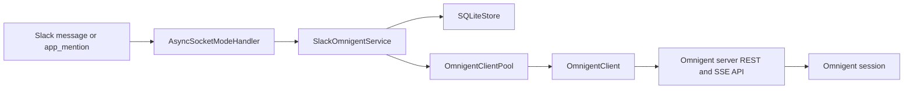
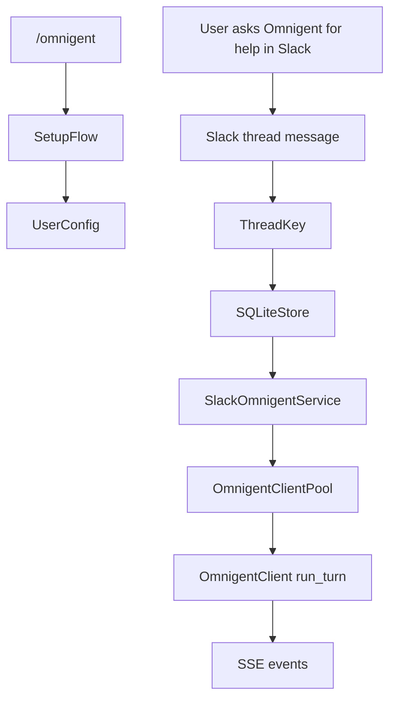

# Integrations & Extensions

Relevant source files

The following files were used as context for generating this wiki page:

- [integrations/slack/.env.example](integrations/slack/.env.example)
- [integrations/slack/DESIGN.md](integrations/slack/DESIGN.md)
- [integrations/slack/README.md](integrations/slack/README.md)
- [integrations/slack/docs/CUJS.md](integrations/slack/docs/CUJS.md)
- [integrations/slack/src/omnigent_slack/app.py](integrations/slack/src/omnigent_slack/app.py)
- [integrations/slack/src/omnigent_slack/approvals.py](integrations/slack/src/omnigent_slack/approvals.py)
- [integrations/slack/src/omnigent_slack/config.py](integrations/slack/src/omnigent_slack/config.py)
- [integrations/slack/src/omnigent_slack/elicitation.py](integrations/slack/src/omnigent_slack/elicitation.py)
- [integrations/slack/src/omnigent_slack/events.py](integrations/slack/src/omnigent_slack/events.py)
- [integrations/slack/src/omnigent_slack/models.py](integrations/slack/src/omnigent_slack/models.py)
- [integrations/slack/src/omnigent_slack/notifications.py](integrations/slack/src/omnigent_slack/notifications.py)
- [integrations/slack/src/omnigent_slack/oauth.py](integrations/slack/src/omnigent_slack/oauth.py)
- [integrations/slack/src/omnigent_slack/omnigent.py](integrations/slack/src/omnigent_slack/omnigent.py)
- [integrations/slack/src/omnigent_slack/service.py](integrations/slack/src/omnigent_slack/service.py)
- [integrations/slack/src/omnigent_slack/setup.py](integrations/slack/src/omnigent_slack/setup.py)
- [integrations/slack/src/omnigent_slack/store.py](integrations/slack/src/omnigent_slack/store.py)
- [integrations/slack/src/omnigent_slack/streaming.py](integrations/slack/src/omnigent_slack/streaming.py)
- [integrations/slack/tests/fakes.py](integrations/slack/tests/fakes.py)
- [integrations/slack/tests/test_app.py](integrations/slack/tests/test_app.py)
- [integrations/slack/tests/test_approvals.py](integrations/slack/tests/test_approvals.py)
- [integrations/slack/tests/test_auth_manager.py](integrations/slack/tests/test_auth_manager.py)
- [integrations/slack/tests/test_client_auth.py](integrations/slack/tests/test_client_auth.py)
- [integrations/slack/tests/test_config.py](integrations/slack/tests/test_config.py)
- [integrations/slack/tests/test_failed_launch_orphaned_session.py](integrations/slack/tests/test_failed_launch_orphaned_session.py)
- [integrations/slack/tests/test_integration.py](integrations/slack/tests/test_integration.py)
- [integrations/slack/tests/test_managed_provisioning_notice.py](integrations/slack/tests/test_managed_provisioning_notice.py)
- [integrations/slack/tests/test_oauth.py](integrations/slack/tests/test_oauth.py)
- [integrations/slack/tests/test_omnigent.py](integrations/slack/tests/test_omnigent.py)
- [integrations/slack/tests/test_sdk_message_boundary.py](integrations/slack/tests/test_sdk_message_boundary.py)
- [integrations/slack/tests/test_service.py](integrations/slack/tests/test_service.py)
- [integrations/slack/tests/test_setup.py](integrations/slack/tests/test_setup.py)
- [integrations/slack/tests/test_setup_submit_missing_identity.py](integrations/slack/tests/test_setup_submit_missing_identity.py)
- [integrations/slack/tests/test_store.py](integrations/slack/tests/test_store.py)
- [tests/budgets.py](tests/budgets.py)
- [tests/e2e/test_slack_stream_reconnect_connect_blip.py](tests/e2e/test_slack_stream_reconnect_connect_blip.py)
- [tests/test_kimi_native_forwarder.py](tests/test_kimi_native_forwarder.py)

## Purpose and scope

This parent page introduces Omnigent’s first-party integration surfaces and how they connect external platforms to Omnigent. It stays at the architectural level; detailed implementation and operator guidance belong in the linked child pages.

**Sources:** [integrations/slack/README.md:1-12](), [integrations/slack/DESIGN.md:7-18]()

---

## Overview

The provided integration example is the separate `omnigent-slack` package. It connects Slack to one operator-configured Omnigent server: Slack users do not supply the server URL, and each user authenticates as their own Omnigent identity. The integration uses an HTTP/SSE client and a service layer to connect Slack activity with Omnigent sessions. [integrations/slack/README.md:1-7](), [integrations/slack/DESIGN.md:26-37]()

The wider integration topic also includes session import, telemetry, and observability. Those facilities are covered by the child page **[Session Import, Telemetry & Observability](#12.2)**; this page does not detail their implementation.

**Sources:** [integrations/slack/DESIGN.md:26-37]()

---

## First-Party Integration Surface

| Surface | Role at a glance |
| --- | --- |
| Slack bot | Bridges Slack conversations to Omnigent sessions using Socket Mode, `SlackOmnigentService`, and `OmnigentClient`. [integrations/slack/README.md:1-7](), [integrations/slack/DESIGN.md:26-37]() |
| Session import, telemetry & observability | A separate extension topic for bringing local CLI sessions and diagnostic signals into Omnigent workflows; see the child page for details. |

The provided code excerpts document the Slack integration. They do not establish implementation details or production status for other products or extensions, so those are not described here.

**Sources:** [integrations/slack/README.md:1-12](), [integrations/slack/DESIGN.md:20-37]()

---

## Integration Architecture

The Slack integration separates platform event handling, setup and authentication, session-service orchestration, HTTP/SSE communication, and Slack message rendering. Its design treats the server as the authoritative source for session state and uses server events to drive the interaction. [integrations/slack/DESIGN.md:14-18](), [integrations/slack/DESIGN.md:26-37]()

### Slack concepts mapped to Omnigent code entities

**Diagram: Slack event to Omnigent session**

Sources: [integrations/slack/src/omnigent_slack/app.py:7-24](), [integrations/slack/src/omnigent_slack/app.py:128-149](), [integrations/slack/src/omnigent_slack/service.py:23-48](), [integrations/slack/src/omnigent_slack/omnigent.py:45-76](), [integrations/slack/DESIGN.md:26-37]()

### Natural-language interactions and code entities

A Slack message enters through the Socket Mode application, is handled by `SlackOmnigentService`, and is associated with Omnigent through the client layer. Setup is a distinct path: `SetupFlow` registers `/omnigent` and setup actions, while the service handles session turns. [integrations/slack/src/omnigent_slack/app.py:128-149](), [integrations/slack/src/omnigent_slack/setup.py:93-134](), [integrations/slack/src/omnigent_slack/service.py:23-48]()

**Diagram: User intent to integration components**

Sources: [integrations/slack/src/omnigent_slack/setup.py:39-53](), [integrations/slack/src/omnigent_slack/setup.py:93-134](), [integrations/slack/src/omnigent_slack/service.py:14-48](), [integrations/slack/src/omnigent_slack/omnigent.py:45-76](), [integrations/slack/DESIGN.md:26-37]()

---

## Slack Bot Integration

The `omnigent-slack` bot uses Slack Socket Mode and maps one Slack thread to one Omnigent session. Its setup flow connects users to the operator-configured server; its service layer handles turns, and the client layer consumes Omnigent HTTP/SSE events. [integrations/slack/README.md:1-7](), [integrations/slack/DESIGN.md:7-12](), [integrations/slack/DESIGN.md:26-37]()

The code also separates Slack message streaming and interactive elicitation from turn orchestration. For setup, OAuth, DM and channel behavior, and deployment details, see **[Slack Bot Integration](#12.1)**. [integrations/slack/DESIGN.md:26-37]()

**Sources:** [integrations/slack/README.md:1-12](), [integrations/slack/DESIGN.md:7-12](), [integrations/slack/DESIGN.md:26-37]()

---

## Session Import, Telemetry & Observability

Session import, telemetry, and observability are a separate extension area from the Slack event-to-session adapter. For details on importing local CLI sessions and the observability topics listed for this section, see **[Session Import, Telemetry & Observability](#12.2)**.

**Sources:** [integrations/slack/DESIGN.md:20-37]()

---

## Summary

The Slack integration illustrates the connection pattern at this page’s scope: platform events are handled by an adapter, associated with Omnigent sessions, and connected to the server through an HTTP/SSE client. Setup and per-user authentication are separate from turn handling. [integrations/slack/README.md:1-7](), [integrations/slack/DESIGN.md:26-37]()

The child pages provide the detailed treatment of the Slack bot and the session import, telemetry, and observability surface.

**Sources:** [integrations/slack/README.md:1-12](), [integrations/slack/DESIGN.md:26-37]()

---

## Child Pages

- **[Slack Bot Integration](#12.1)** — The `omnigent-slack` Socket Mode bot: thread-to-session mapping, operator setup, device-grant OAuth, DM/channel patterns, and deployment.
- **[Session Import, Telemetry & Observability](#12.2)** — Local CLI session import, telemetry, logging, crash handling, performance metrics, and CLI diagnostics.