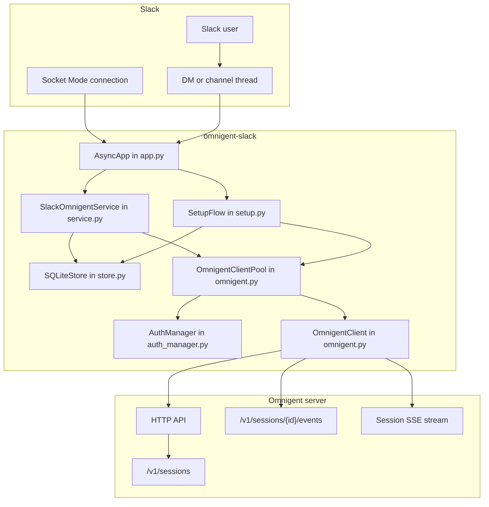
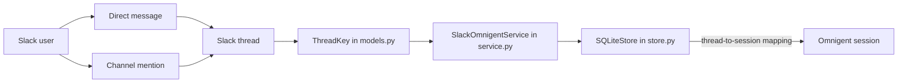
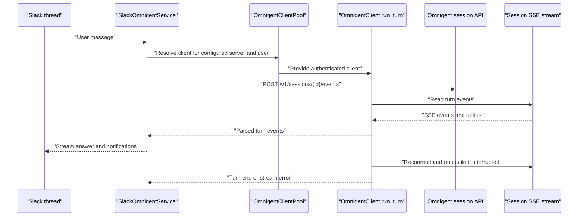
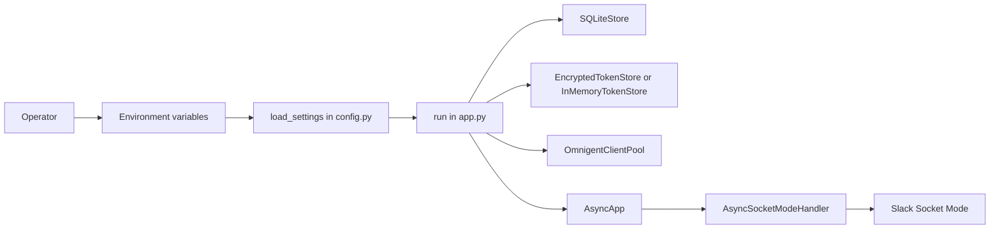

# Slack Bot Integration

Relevant source files

The following files were used as context for generating this wiki page:

- [integrations/slack/.env.example](integrations/slack/.env.example)
- [integrations/slack/DESIGN.md](integrations/slack/DESIGN.md)
- [integrations/slack/README.md](integrations/slack/README.md)
- [integrations/slack/docs/CUJS.md](integrations/slack/docs/CUJS.md)
- [integrations/slack/src/omnigent_slack/app.py](integrations/slack/src/omnigent_slack/app.py)
- [integrations/slack/src/omnigent_slack/approvals.py](integrations/slack/src/omnigent_slack/approvals.py)
- [integrations/slack/src/omnigent_slack/config.py](integrations/slack/src/omnigent_slack/config.py)
- [integrations/slack/src/omnigent_slack/elicitation.py](integrations/slack/src/omnigent_slack/elicitation.py)
- [integrations/slack/src/omnigent_slack/events.py](integrations/slack/src/omnigent_slack/events.py)
- [integrations/slack/src/omnigent_slack/models.py](integrations/slack/src/omnigent_slack/models.py)
- [integrations/slack/src/omnigent_slack/notifications.py](integrations/slack/src/omnigent_slack/notifications.py)
- [integrations/slack/src/omnigent_slack/oauth.py](integrations/slack/src/omnigent_slack/oauth.py)
- [integrations/slack/src/omnigent_slack/omnigent.py](integrations/slack/src/omnigent_slack/omnigent.py)
- [integrations/slack/src/omnigent_slack/service.py](integrations/slack/src/omnigent_slack/service.py)
- [integrations/slack/src/omnigent_slack/setup.py](integrations/slack/src/omnigent_slack/setup.py)
- [integrations/slack/src/omnigent_slack/store.py](integrations/slack/src/omnigent_slack/store.py)
- [integrations/slack/src/omnigent_slack/streaming.py](integrations/slack/src/omnigent_slack/streaming.py)
- [integrations/slack/tests/fakes.py](integrations/slack/tests/fakes.py)
- [integrations/slack/tests/test_app.py](integrations/slack/tests/test_app.py)
- [integrations/slack/tests/test_approvals.py](integrations/slack/tests/test_approvals.py)
- [integrations/slack/tests/test_auth_manager.py](integrations/slack/tests/test_auth_manager.py)
- [integrations/slack/tests/test_client_auth.py](integrations/slack/tests/test_client_auth.py)
- [integrations/slack/tests/test_config.py](integrations/slack/tests/test_config.py)
- [integrations/slack/tests/test_failed_launch_orphaned_session.py](integrations/slack/tests/test_failed_launch_orphaned_session.py)
- [integrations/slack/tests/test_integration.py](integrations/slack/tests/test_integration.py)
- [integrations/slack/tests/test_managed_provisioning_notice.py](integrations/slack/tests/test_managed_provisioning_notice.py)
- [integrations/slack/tests/test_oauth.py](integrations/slack/tests/test_oauth.py)
- [integrations/slack/tests/test_omnigent.py](integrations/slack/tests/test_omnigent.py)
- [integrations/slack/tests/test_sdk_message_boundary.py](integrations/slack/tests/test_sdk_message_boundary.py)
- [integrations/slack/tests/test_service.py](integrations/slack/tests/test_service.py)
- [integrations/slack/tests/test_setup.py](integrations/slack/tests/test_setup.py)
- [integrations/slack/tests/test_setup_submit_missing_identity.py](integrations/slack/tests/test_setup_submit_missing_identity.py)
- [integrations/slack/tests/test_store.py](integrations/slack/tests/test_store.py)
- [tests/budgets.py](tests/budgets.py)
- [tests/e2e/test_slack_stream_reconnect_connect_blip.py](tests/e2e/test_slack_stream_reconnect_connect_blip.py)
- [tests/test_kimi_native_forwarder.py](tests/test_kimi_native_forwarder.py)

## Purpose and scope

`omnigent-slack` is a Slack Socket Mode integration that connects Slack conversations to one operator-configured Omnigent server. Its central mapping is one Slack thread to one Omnigent session; each Slack user authenticates to that fixed server as their own Omnigent identity. This page covers the bot’s components, thread and turn flow, per-user setup and delegated authentication, Slack interaction patterns, and operator deployment. [integrations/slack/README.md:1-12]()

Sources: [integrations/slack/README.md:1-12]()

---

## Overview and architecture

The bot is divided by responsibility: `app.py` wires Slack Bolt and Socket Mode; `service.py` handles event acceptance and turn lifecycle; `omnigent.py` provides the Omnigent HTTP/SSE client and connection pool; and `store.py` persists thread/session mappings and user configuration. Setup and authentication are handled by `SetupFlow`, `AuthManager`, and token-store implementations. The design keeps event parsing, Slack streaming, elicitation, notifications, and orchestration in separate modules. [integrations/slack/DESIGN.md:20-37]()

The bot talks to one configured server, not a URL supplied by a Slack user. The server-side API is authoritative for session state; the Slack bot creates a stream per turn rather than holding a persistent stream open for every idle thread. [integrations/slack/README.md:3-7](), [integrations/slack/DESIGN.md:39-54]()

### Component and data-flow diagram

**Interpretation.** Slack events enter through the Socket Mode handler and Bolt `AsyncApp`. `app.py` registers setup and service handlers; the service uses the local store and client pool to route a thread’s turn. The pool resolves per-user authentication and supplies an Omnigent client for the configured server. [integrations/slack/src/omnigent_slack/app.py:7-25](), [integrations/slack/src/omnigent_slack/app.py:86-149](), [integrations/slack/src/omnigent_slack/setup.py:93-133](), [integrations/slack/src/omnigent_slack/service.py:9-48](), [integrations/slack/DESIGN.md:26-37]()

Sources: [integrations/slack/src/omnigent_slack/app.py:7-25](), [integrations/slack/src/omnigent_slack/app.py:86-149](), [integrations/slack/src/omnigent_slack/setup.py:93-133](), [integrations/slack/src/omnigent_slack/service.py:9-48](), [integrations/slack/DESIGN.md:26-37]()

---

## Thread-to-session mapping

The integration’s design contract is one Slack thread to one Omnigent session. `ThreadKey` represents the Slack thread identity, and `SQLiteStore` persists the thread-to-session mapping as well as per-user configuration. A Slack user’s setup is stored for the `(team_id, user_id)` pair; the configured server URL is shared across bot users and is not entered during setup. [integrations/slack/DESIGN.md:7-12](), [integrations/slack/DESIGN.md:26-37](), [integrations/slack/src/omnigent_slack/setup.py:93-102]()

The exact key fields and store method names are not shown in the supplied implementation excerpts. At the behavioral level, DMs and channel threads are both supported entry points; the README describes a first-time setup prompt for either interaction type. [integrations/slack/README.md:133-140]()

### Natural-language-to-code mapping: Slack conversation identity

Sources: [integrations/slack/README.md:3-7](), [integrations/slack/README.md:133-140](), [integrations/slack/DESIGN.md:7-12](), [integrations/slack/DESIGN.md:26-37]()

---

## Live turns and Slack replies

A turn follows the sequence: submit a user message to the session, consume its SSE event stream, render events in the Slack thread, detect the turn’s end, and close the per-turn stream. The client’s `run_turn` loop is the stream boundary; `events.py` contains event parsing and extractors, while `service.py` dispatches events to Slack-facing behavior. [integrations/slack/DESIGN.md:26-30](), [integrations/slack/DESIGN.md:39-54]()

The service displays a temporary “Working on it…” acknowledgement while work begins. It is removed only when answer content becomes visible, avoiding a gap between the acknowledgement disappearing and the streamed answer appearing. The service also defines a two-second idle-flush interval for buffered answer text when the upstream stream goes quiet. [integrations/slack/src/omnigent_slack/service.py:50-65]()

### Stream lifecycle and recovery

Turn-end detection is based on server events rather than a particular harness name. The design documents response-open tracking for id-bearing status events, handling id-less idle events from in-process harnesses, ignoring id-less idle flaps while an id-bearing response remains open, and never treating `waiting` as a turn end. Explicit failed or cancelled lifecycle events are hard terminals. [integrations/slack/DESIGN.md:56-84]()

A mid-turn stream drop can be a proxy duration limit rather than a server outage. The client reconnects and reconciles replayed output; reconnect attempts are bounded, with progress resetting the consecutive-attempt budget and a separate total cap preventing pathological loops. If reconnect is exhausted, the service distinguishes an interrupted live stream from a server-unreachable condition. [integrations/slack/DESIGN.md:100-118](), [integrations/slack/src/omnigent_slack/omnigent.py:120-169](), [integrations/slack/src/omnigent_slack/service.py:79-87]()

### Natural-language-to-code mapping: turn and reply path

Sources: [integrations/slack/DESIGN.md:26-30](), [integrations/slack/DESIGN.md:39-54](), [integrations/slack/DESIGN.md:56-84](), [integrations/slack/DESIGN.md:100-118](), [integrations/slack/src/omnigent_slack/service.py:50-65]()

---

## Approvals and elicitation

The integration represents approvals and user questions as Slack interactive Block Kit cards. `ElicitationController` coordinates in-turn prompts, while `ElicitationCoordinator` connects user clicks to the corresponding resolver. `approvals.py` also owns click routing and action-value parsing; event extractors identify elicitation requests and their resolutions. [integrations/slack/DESIGN.md:26-34](), [integrations/slack/src/omnigent_slack/service.py:9-16](), [integrations/slack/src/omnigent_slack/service.py:33-40]()

`app.py` imports the approval and form action identifiers and registers the interaction routing entry point. The available handlers cover approval, denial, form answer, form cancellation, and form submission. [integrations/slack/src/omnigent_slack/app.py:10-16]()

Sources: [integrations/slack/DESIGN.md:26-34](), [integrations/slack/src/omnigent_slack/service.py:9-16](), [integrations/slack/src/omnigent_slack/service.py:33-40](), [integrations/slack/src/omnigent_slack/app.py:10-16]()

---

## Slack entry points and setup interactions

### Direct messages and channel messages

The bot supports DMs and channel mentions. The README identifies `message.im` as the DM event and `app_mention` as the channel-join path. For plain channel messages, event subscriptions and history scopes are required for the channel types in use; channel history scopes can be omitted when the bot is used only in DMs and channel `@mention`s. [integrations/slack/README.md:51-76](), [integrations/slack/README.md:84-91]()

When a user has not configured the bot, the first DM or channel mention prompts them to set up Omnigent. The bot sends a setup button in a DM and, for a channel mention, an ephemeral pointer in the thread. [integrations/slack/README.md:133-140]()

### `/omnigent` and `SetupFlow`

`SetupFlow.register` connects the `/omnigent` command, the setup-start action, and the setup-selection modal submission to their handlers. The command opens setup against the fixed operator-configured server; it can validate connectivity, fold login into the modal flow, and then present agent, host, and workspace selection. `/omnigent logout` clears saved user settings and revokes server tokens, according to the command handler’s documented behavior. [integrations/slack/src/omnigent_slack/setup.py:29-47](), [integrations/slack/src/omnigent_slack/setup.py:93-102](), [integrations/slack/src/omnigent_slack/setup.py:130-164]()

The setup flow supports operator defaults for agent and host type as pre-selections, not as substitutes for unavailable choices. Its host picker can include a managed-sandbox option: `MANAGED_HOST_VALUE` is a sentinel asking the server to provision a host, not a real host ID. [integrations/slack/src/omnigent_slack/setup.py:49-58](), [integrations/slack/src/omnigent_slack/setup.py:104-127]()

### DM and channel interaction patterns

| Interaction | Behavior |
| --- | --- |
| DM message | A first-time user receives a setup prompt; configured users can converse through the DM entry point. [integrations/slack/README.md:133-140]() |
| Channel `@mention` | The mention can start setup or a turn; an unconfigured user is directed to the setup DM with an ephemeral thread pointer. [integrations/slack/README.md:58-61](), [integrations/slack/README.md:133-140]() |
| `/omnigent` | Opens setup against the operator’s configured server; the user does not enter a server URL. [integrations/slack/src/omnigent_slack/setup.py:93-102](), [integrations/slack/src/omnigent_slack/setup.py:158-164]() |
| `/omnigent logout` | The command handler documents revoking the user’s server tokens and clearing saved settings. [integrations/slack/src/omnigent_slack/setup.py:158-164]() |

Sources: [integrations/slack/README.md:51-76](), [integrations/slack/README.md:84-91](), [integrations/slack/README.md:133-140](), [integrations/slack/src/omnigent_slack/setup.py:29-58](), [integrations/slack/src/omnigent_slack/setup.py:93-102](), [integrations/slack/src/omnigent_slack/setup.py:130-164]()

---

## Per-user authentication and token handling

The bot uses delegated authentication so each Slack user authenticates as their own Omnigent identity. The app initialization creates a `TokenStore`, an `OmnigentClientPool`, and an `AuthManager`; the pool uses `AuthManager.resolve_auth` to resolve credentials. When a token changes, the app invalidates the cached client for that server and packed team/user identity. [integrations/slack/README.md:3-7](), [integrations/slack/src/omnigent_slack/app.py:69-94](), [integrations/slack/src/omnigent_slack/app.py:120-126]()

### Device-grant and server login

`SetupFlow` validates the operator-configured server and incorporates authentication into the setup modal when the server requires it. The README describes the user approving login in a browser while the same modal advances automatically afterward. The setup module documents a historical device-grant/OIDC-ticket path when a Databricks enrollment URL is not in use. [integrations/slack/README.md:139-144](), [integrations/slack/src/omnigent_slack/setup.py:93-127]()

The server can require `OMNIGENT_DEVICE_CLIENT_SECRET` for an authorized device-grant client. Operators should configure the same value for the bot when the server uses it. [integrations/slack/README.md:37-42]()

### Databricks web-auth mode

For Databricks server-auth mode, `app.py` constructs `DatabricksOAuthClient` and `WebAuthServer`, and passes the resulting enrollment URL into `SetupFlow`. The app comments describe this as a custom user-to-machine OAuth flow using authorization code, PKCE, and `offline_access`; the OAuth client is also used for token refresh and revocation. [integrations/slack/src/omnigent_slack/app.py:96-118]()

In Databricks web-auth mode, the README says the bot needs the Slack `users:read` and `users:read.email` scopes to retrieve the user’s email for enrollment and identity matching. These scopes are not required for the `accounts` or `oidc` modes described there. [integrations/slack/README.md:63-64]()

### Token persistence

When `OMNIGENT_SLACK_TOKEN_ENCRYPTION_KEY` is set, the app initializes an `EncryptedTokenStore` using the configured database path and key. Without the key, it uses `InMemoryTokenStore`, warns that tokens are lost on restart, and requires affected users to authenticate again. The app explicitly avoids writing bearer credentials to disk in clear text. [integrations/slack/src/omnigent_slack/app.py:69-84]()

Sources: [integrations/slack/README.md:3-7](), [integrations/slack/README.md:37-42](), [integrations/slack/README.md:63-64](), [integrations/slack/README.md:139-144](), [integrations/slack/src/omnigent_slack/app.py:69-94](), [integrations/slack/src/omnigent_slack/app.py:96-126](), [integrations/slack/src/omnigent_slack/setup.py:93-127]()

---

## Operator setup and configuration

### Slack app requirements

The recommended initial setup is to create the Slack app from `deploy/slack-app-manifest.yaml`. The manifest configures Socket Mode, Interactivity, default scopes and events, and the `/omnigent` command. Operators must still generate an app-level token with `connections:write` and install the app in the workspace; a manifest cannot create those tokens. [integrations/slack/README.md:14-26]()

For manual setup, enable Socket Mode and Interactivity, configure the required scopes and event subscriptions, add `/omnigent`, and install the app. Socket Mode uses an app-level token with `connections:write`; the bot token needs `chat:write`, `im:write`, `im:history`, `commands`, `team:read`, and `app_mentions:read` for the described core behaviors. Add channel-history scopes and corresponding message events only for channel types where the bot will run. [integrations/slack/README.md:28-43](), [integrations/slack/README.md:45-91]()

### Required environment variables

| Variable | Purpose |
| --- | --- |
| `OMNIGENT_SLACK_BOT_TOKEN` | Slack bot token used to initialize `AsyncApp`. [integrations/slack/README.md:37-42](), [integrations/slack/src/omnigent_slack/app.py:144-149]() |
| `OMNIGENT_SLACK_APP_TOKEN` | Slack app-level token used to start Socket Mode. [integrations/slack/README.md:37-42](), [integrations/slack/src/omnigent_slack/app.py:149-156]() |
| `OMNIGENT_SERVER_URL` | Fixed Omnigent server URL used by the bot. [integrations/slack/README.md:3-7](), [integrations/slack/README.md:37-42]() |
| `OMNIGENT_DEVICE_CLIENT_SECRET` | Optional device-grant client secret; configure it to match the server when required. [integrations/slack/README.md:37-42]() |
| `OMNIGENT_SLACK_TOKEN_ENCRYPTION_KEY` | Enables encrypted token persistence; without it, delegated tokens remain in memory and are lost on restart. [integrations/slack/README.md:114-121](), [integrations/slack/src/omnigent_slack/app.py:69-84]() |

The bot reads real environment variables and does not load a `.env` file itself. For local development, the README gives examples of using a tool to inject a `.env` file or exporting its values before launch. [integrations/slack/README.md:112-121]()

### Natural-language-to-code mapping: operator configuration and startup

`run()` loads settings, initializes the SQLite store and token store, builds the client pool and setup/service objects, registers handlers on `AsyncApp`, and starts `AsyncSocketModeHandler`. Configuration errors are printed to standard error and terminate startup with exit status 2. [integrations/slack/src/omnigent_slack/app.py:29-43](), [integrations/slack/src/omnigent_slack/app.py:66-84](), [integrations/slack/src/omnigent_slack/app.py:86-149]()

Sources: [integrations/slack/README.md:14-43](), [integrations/slack/README.md:45-91](), [integrations/slack/README.md:112-129](), [integrations/slack/src/omnigent_slack/app.py:29-43](), [integrations/slack/src/omnigent_slack/app.py:66-84](), [integrations/slack/src/omnigent_slack/app.py:86-156]()

---

## Running and deployment

The package is named `omnigent-slack` and must be installed in the same environment as `omni` for the CLI integration command to find it. The README documents installation through the `slack` extra and foreground or background execution through `omni integration slack`. [integrations/slack/README.md:123-129]()

| Command | Purpose |
| --- | --- |
| `omni integration slack` | Run the bot in the foreground. [integrations/slack/README.md:95-106]() |
| `omni integration slack --background` | Start a detached background bot; starting it again while it is already running is a no-op. [integrations/slack/README.md:97-110]() |
| `omni integration slack status` | Check whether the background bot is running. [integrations/slack/README.md:99-105]() |
| `omni integration slack stop` | Stop the background bot. [integrations/slack/README.md:101-105]() |
| `omni integration slack logs` | Print the background bot’s log path; `-f` follows the log. [integrations/slack/README.md:103-106]() |

In production, the deployment environment supplies the configuration variables directly. The README identifies Docker and Databricks deployment as examples; the provided startup code can also start a Databricks web-auth server when configured for that mode. [integrations/slack/README.md:112-121](), [integrations/slack/src/omnigent_slack/app.py:96-118]()

Set `LOG_LEVEL=DEBUG` to investigate why Slack events are not producing replies. `app.py` applies the configured log level to both the application and Slack SDK/Bolt loggers so connection diagnostics are available at that level. [integrations/slack/README.md:131-131](), [integrations/slack/src/omnigent_slack/app.py:44-58]()

Sources: [integrations/slack/README.md:95-131](), [integrations/slack/src/omnigent_slack/app.py:44-58](), [integrations/slack/src/omnigent_slack/app.py:96-118]()

---

## Error handling

The integration distinguishes several failure classes so it can choose an appropriate user-facing response. `omnigent.py` defines errors for authentication, unavailable hosts or runners, unconfigured harnesses, server transport failures, and interrupted streams. The service defines separate messages for unreachable servers, interrupted streams, managed sandboxes that are not ready, and sessions without an available runner. [integrations/slack/src/omnigent_slack/omnigent.py:81-147](), [integrations/slack/src/omnigent_slack/omnigent.py:120-147](), [integrations/slack/src/omnigent_slack/service.py:67-119]()

| Condition | Integration behavior |
| --- | --- |
| Server unreachable | The service directs the user to `/omnigent` to reconfigure if the server moved or is down. [integrations/slack/src/omnigent_slack/service.py:67-70]() |
| Live stream interrupted | The service says the turn may still finish server-side and its result may still arrive in the thread. [integrations/slack/src/omnigent_slack/service.py:79-87]() |
| Managed sandbox has no runner | The service asks the user to retry and contact the operator if the condition persists; it avoids promising that provisioning will recover. [integrations/slack/src/omnigent_slack/service.py:101-112]() |
| No runner for an external session | The service asks the user to try again shortly. [integrations/slack/src/omnigent_slack/service.py:114-119]() |
| Authentication required during a turn | The service distinguishes auth expiry from an ordinary turn abort; the documented path sends a DM with a re-login setup button. [integrations/slack/src/omnigent_slack/service.py:72-77](), [integrations/slack/src/omnigent_slack/service.py:130-137]() |
| Harness not configured | The client error documents host-side setup as the resolution rather than treating a retry as sufficient. [integrations/slack/src/omnigent_slack/omnigent.py:141-147]() |

Sources: [integrations/slack/src/omnigent_slack/omnigent.py:81-147](), [integrations/slack/src/omnigent_slack/service.py:67-119](), [integrations/slack/src/omnigent_slack/service.py:130-137]()

---

## Tests and implementation seams

The integration tests exercise the bot at both sides of its external boundary: a recording Slack client captures outbound Slack calls, and a fake Omnigent server records HTTP requests and responses. This allows tests to check not only rendered Slack behavior but also request method, path, authorization, and body shape. [integrations/slack/tests/fakes.py:1-20]()

Setup tests provide fake Slack clients for DM opening, message posting, ephemeral messages, and modal open/update operations. The setup tests also cover the managed-host selection sentinel and workspace-field behavior for managed sandboxes. [integrations/slack/tests/test_setup.py:33-76](), [integrations/slack/tests/test_setup.py:140-185]()

Client tests verify session creation and message submission request shapes, including managed-session creation. The service test module provides fake Slack streaming behavior for buffered output, flushes, and streams closed by Slack during a turn. [integrations/slack/tests/test_omnigent.py:131-172](), [integrations/slack/tests/test_service.py:33-44](), [integrations/slack/tests/test_service.py:106-145]()

Sources: [integrations/slack/tests/fakes.py:1-20](), [integrations/slack/tests/test_setup.py:33-76](), [integrations/slack/tests/test_setup.py:140-185](), [integrations/slack/tests/test_omnigent.py:131-172](), [integrations/slack/tests/test_service.py:33-44](), [integrations/slack/tests/test_service.py:106-145]()

---

## Summary

`omnigent-slack` is a Socket Mode bridge to one operator-configured Omnigent server. It routes Slack conversation turns through a local thread/session mapping, authenticates users individually, streams each turn’s output into Slack, and uses interactive cards for approvals and elicitation. Operators configure Slack tokens, the server URL, and optional token-persistence settings through environment variables, then run the integration through the `omni integration slack` CLI. [integrations/slack/README.md:1-7](), [integrations/slack/DESIGN.md:7-12](), [integrations/slack/DESIGN.md:39-54](), [integrations/slack/README.md:95-129]()

Sources: [integrations/slack/README.md:1-7](), [integrations/slack/DESIGN.md:7-12](), [integrations/slack/DESIGN.md:39-54](), [integrations/slack/README.md:95-129]()