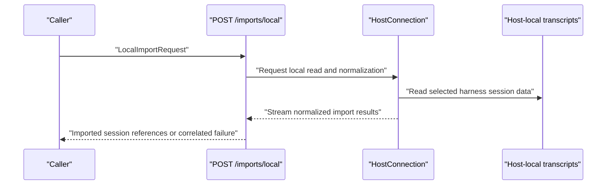
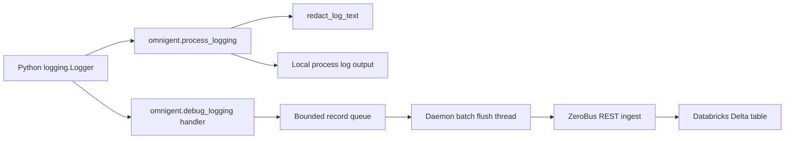
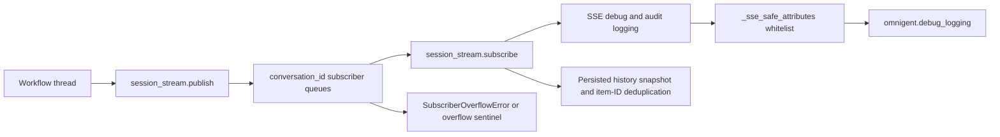
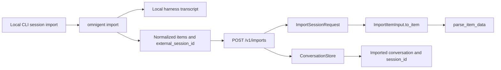
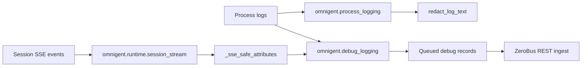

# Session Import, Telemetry & Observability

Relevant source files

The following files were used as context for generating this wiki page:

- [docs/session-compaction.md](docs/session-compaction.md)
- [omnigent/cli_diagnostics.py](omnigent/cli_diagnostics.py)
- [omnigent/debug_logging.py](omnigent/debug_logging.py)
- [omnigent/process_logging.py](omnigent/process_logging.py)
- [omnigent/runner/transports/ws_tunnel/frames.py](omnigent/runner/transports/ws_tunnel/frames.py)
- [omnigent/runtime/session_stream.py](omnigent/runtime/session_stream.py)
- [omnigent/server/event_loop_watchdog.py](omnigent/server/event_loop_watchdog.py)
- [omnigent/server/routes/_host_launch.py](omnigent/server/routes/_host_launch.py)
- [omnigent/server/routes/default_policies.py](omnigent/server/routes/default_policies.py)
- [omnigent/server/routes/imports.py](omnigent/server/routes/imports.py)
- [omnigent/server/routes/session_policies.py](omnigent/server/routes/session_policies.py)
- [omnigent/session_import/local.py](omnigent/session_import/local.py)
- [omnigent/session_import/models.py](omnigent/session_import/models.py)
- [omnigent/telemetry/anon.py](omnigent/telemetry/anon.py)
- [omnigent/telemetry/client.py](omnigent/telemetry/client.py)
- [omnigent/telemetry/environment.py](omnigent/telemetry/environment.py)
- [omnigent/telemetry/events.py](omnigent/telemetry/events.py)
- [omnigent/telemetry/request_headers.py](omnigent/telemetry/request_headers.py)
- [tests/cli/test_cli_diagnostics.py](tests/cli/test_cli_diagnostics.py)
- [tests/cli/test_import.py](tests/cli/test_import.py)
- [tests/e2e/test_chat_import_e2e.py](tests/e2e/test_chat_import_e2e.py)
- [tests/e2e/test_copilot_cli_launcher_e2e.py](tests/e2e/test_copilot_cli_launcher_e2e.py)
- [tests/e2e_ui/sessions/test_import_sessions.py](tests/e2e_ui/sessions/test_import_sessions.py)
- [tests/runner/transports/ws_tunnel/test_frames.py](tests/runner/transports/ws_tunnel/test_frames.py)
- [tests/runtime/test_session_stream.py](tests/runtime/test_session_stream.py)
- [tests/server/integration/test_lifespan.py](tests/server/integration/test_lifespan.py)
- [tests/server/routes/test_default_policies.py](tests/server/routes/test_default_policies.py)
- [tests/server/routes/test_host_launch.py](tests/server/routes/test_host_launch.py)
- [tests/server/routes/test_imports.py](tests/server/routes/test_imports.py)
- [tests/server/routes/test_session_policies_crud.py](tests/server/routes/test_session_policies_crud.py)
- [tests/server/test_event_loop_watchdog.py](tests/server/test_event_loop_watchdog.py)
- [tests/terminals/test_registry_io.py](tests/terminals/test_registry_io.py)
- [tests/test_debug_logging.py](tests/test_debug_logging.py)
- [tests/test_process_logging.py](tests/test_process_logging.py)
- [tests/test_session_import.py](tests/test_session_import.py)
- [tests/test_telemetry.py](tests/test_telemetry.py)
- [web/src/components/AgentInfo.test.tsx](web/src/components/AgentInfo.test.tsx)
- [web/src/components/AgentInfo.tsx](web/src/components/AgentInfo.tsx)
- [web/src/components/ModelValueCombobox.test.tsx](web/src/components/ModelValueCombobox.test.tsx)
- [web/src/hooks/useDefaultPolicies.ts](web/src/hooks/useDefaultPolicies.ts)
- [web/src/pages/MembersPage.test.tsx](web/src/pages/MembersPage.test.tsx)
- [web/src/pages/MembersPage.tsx](web/src/pages/MembersPage.tsx)
- [web/src/pages/PoliciesPage.test.tsx](web/src/pages/PoliciesPage.test.tsx)
- [web/src/pages/PoliciesPage.tsx](web/src/pages/PoliciesPage.tsx)
- [web/src/shell/ImportSessionsPanel.test.tsx](web/src/shell/ImportSessionsPanel.test.tsx)
- [web/src/shell/ImportSessionsPanel.tsx](web/src/shell/ImportSessionsPanel.tsx)

## Purpose and scope

This page describes local CLI session import, the telemetry behavior established by the available tests, process and remote debug logging, live session-event delivery, and the evidence available for crash handling, performance metrics, and CLI diagnostics. The import route and logging modules are available here in detail; the telemetry client, diagnostics, crash, and metrics implementations are not included in the supplied excerpts, so their internal behavior is not inferred. [omnigent/server/routes/imports.py:1-172]()

Sources: [omnigent/server/routes/imports.py:1-172]()

---

## 1. Session Import: Local CLI Session Integration

### Purpose and overview

Session import turns a transcript from a supported local harness into a normal Omnigent conversation. The CLI reads local session data, normalizes it into Omnigent item shapes, and submits it to `POST /v1/imports`; the server validates each item and persists it through the conversation store. [tests/cli/test_import.py:20-90]() [omnigent/server/routes/imports.py:66-82]()

There is also a host-mediated import path. Unlike the normalized `/imports` request, `LocalImportRequest` asks a connected host to read and normalize transcripts on the machine where they reside. It can request a particular session or a bounded set of sessions from one harness or all supported harnesses. [omnigent/server/routes/imports.py:123-157]()

Sources: [tests/cli/test_import.py:20-90](), [omnigent/server/routes/imports.py:66-82](), [omnigent/server/routes/imports.py:123-157]()

### Request model and validation

`ImportSessionRequest` describes one normalized import. Its fields include `source`, `external_session_id`, optional `workspace`, `title`, `project_id`, and `host_id`, a `force` flag, and a non-empty `items` list capped at 100,000 entries. The external ID is stripped and rejected if it is blank. [omnigent/server/routes/imports.py:46-48] [omnigent/server/routes/imports.py:85-113]()

Each `ImportItemInput` carries an item `type`, a bounded non-empty `response_id`, and a data object. Its `to_item()` method delegates type-specific validation to `parse_item_data()` and builds a `NewConversationItem`; malformed payloads are converted to an `OmnigentError` with `ErrorCode.INVALID_INPUT`. [omnigent/server/routes/imports.py:66-83]()

`LocalImportRequest` requires a `host_id` and a source that is either a specific `ImportSource` or `"all"`. Its session limit defaults to 10 and is bounded from 1 to 1,000. An exact `session_id` must not be blank, and exact-session import cannot use source `"all"` because the ID is scoped to a harness namespace. [omnigent/server/routes/imports.py:123-157]()

| Request path | Input contract | Main validation |
|---|---|---|
| `POST /v1/imports` | Already-normalized session and item records | Source ID nonblank; at least one item; no more than 100,000 items; item payload parsed by type [omnigent/server/routes/imports.py:46-48] [omnigent/server/routes/imports.py:66-113]() |
| Host-mediated local import | Host ID, source or `"all"`, optional exact session ID, bounded limit | Exact ID must be nonblank and requires a specific harness [omnigent/server/routes/imports.py:123-157]() |

Sources: [omnigent/server/routes/imports.py:46-48](), [omnigent/server/routes/imports.py:66-113](), [omnigent/server/routes/imports.py:123-157]()

### CLI-to-server flow

The CLI test exercises `omnigent import --harness claude --session …`: it creates a local Claude JSONL transcript, invokes the CLI, and verifies that the request to `/v1/imports` contains normalized Omnigent item data rather than the original transcript record. The CLI output includes the new session’s browser path. [tests/cli/test_import.py:20-90]()

The request includes `source`, `external_session_id`, `workspace`, `title`, `force`, and normalized `items`. When the importing machine has a configured `HostIdentity`, the CLI includes `host_id`; without one, it omits that field. [tests/cli/test_import.py:48-90] [tests/cli/test_import.py:117-173]()

**Diagram: CLI transcript normalization and import**

Sources: [tests/cli/test_import.py:20-90](), [omnigent/server/routes/imports.py:66-113]()

### Persistence, deduplication, and host ownership

The import tests establish that a successful import creates a conversation with the selected agent, external session ID, workspace, a title derived from the first user message, and the `omnigent.wrapper` label. The imported message items are then retrievable from the session items endpoint. [tests/server/routes/test_imports.py:100-151]()

Repeating an import with the same external session ID is rejected with HTTP 409 and identifies the existing session. The tests also cover deduplication against a session created natively: the native session’s external ID is sufficient for the import to find the existing conversation, even though that native record does not carry import-provenance labels. [tests/server/routes/test_imports.py:100-163]()

When a request supplies `host_id`, the ownership check is performed before persistence: the host owner can import, another user receives 403, and an unknown host receives 404. On success, the stored conversation is associated with that host. [tests/server/routes/test_imports.py:41-98]()

| Concern | Behavior demonstrated |
|---|---|
| Duplicate import | A retry returns 409 rather than creating a second imported session. [tests/server/routes/test_imports.py:100-150]() |
| Native-session duplicate | An existing native conversation with the same external ID is found and not duplicated. [tests/server/routes/test_imports.py:153-187]() |
| Host authorization | Host ownership is checked before an import is persisted. [tests/server/routes/test_imports.py:41-98]() |
| Local host association | The CLI sends `host_id` only when local host identity is configured. [tests/cli/test_import.py:117-173]() |

Sources: [tests/server/routes/test_imports.py:41-98](), [tests/server/routes/test_imports.py:100-187](), [tests/cli/test_import.py:117-173]()

### Host-streamed import and failure correlation

`LocalImportRequest` documents the host-streamed design: the server asks the selected host to read and normalize local transcripts over the host tunnel, rather than expecting the server to access the caller’s filesystem. An exact session ID avoids enumerating local history. [omnigent/server/routes/imports.py:123-149]()

For local-import failures, `_record_local_import_failure()` creates an error ID, logs the exception with that ID, and returns a safe client-facing message that includes the correlation ID. [omnigent/server/routes/imports.py:49-64]()

**Diagram: host-mediated local import boundary**

Sources: [omnigent/server/routes/imports.py:123-157](), [omnigent/server/routes/imports.py:49-64]()

### Import tests

The supplied tests cover CLI transcript normalization and request construction, force override submission, optional host binding, unsupported source rejection, server-side duplicate handling, native-session deduplication, and host ownership checks. [tests/cli/test_import.py:48-184] [tests/server/routes/test_imports.py:41-187]()

Sources: [tests/cli/test_import.py:48-184](), [tests/server/routes/test_imports.py:41-187]()

---

## 2. Telemetry Client and Events

### Opt-out behavior established by tests

The telemetry test suite exercises `omnigent.telemetry.client.is_disabled()`. It verifies that telemetry is disabled by `OMNIGENT_ANALYTICS=0`, `DO_NOT_TRACK=1`, `CI=true`, `GITHUB_ACTIONS=true`, `DISABLE_TELEMETRY=true`, and `OMNIGENT_DISABLE_TELEMETRY=1`. It also verifies that telemetry remains enabled when none of the tested opt-out and CI indicators is set. [tests/test_telemetry.py:63-176]()

The tests also identify `telemetry: false` in `config.yaml` as a disable case, although the supplied excerpt does not show the complete test body or the client’s configuration-loading implementation. [tests/test_telemetry.py:179-203]()

The tests reset an internal `_IS_DISABLED_CACHE` around test execution so environment-variable changes are observed independently by each test. This establishes that the disable decision is cached in the client and that the tests explicitly clear that cache; the excerpt does not establish the cache’s exact lifetime or refresh policy in normal operation. [tests/test_telemetry.py:63-74]()

Sources: [tests/test_telemetry.py:63-74](), [tests/test_telemetry.py:76-176](), [tests/test_telemetry.py:179-203]()

### Surface classification

`classify_surface` is tested against user-agent strings representing Electron desktop, iPhone and iPad iOS, Android, `python-httpx` CLI, an empty string, a regular browser, and a missing user agent. The expected classifications are respectively `desktop`, `ios`, `ios`, `android`, `cli`, `cli`, `web`, and `unknown`. [tests/test_telemetry.py:13-60]()

| Input category | Expected surface |
|---|---|
| Missing user agent | `unknown` [tests/test_telemetry.py:18-20]() |
| Electron | `desktop` [tests/test_telemetry.py:23-25]() |
| iPhone or iPad | `ios` [tests/test_telemetry.py:28-35]() |
| Android | `android` [tests/test_telemetry.py:38-40]() |
| `python-httpx` or empty string | `cli` [tests/test_telemetry.py:43-50]() |
| Regular browser | `web` [tests/test_telemetry.py:53-60]() |

Sources: [tests/test_telemetry.py:13-60]()

### Telemetry implementation limits

The supplied material includes the test file and identifies `omnigent/telemetry/client.py`, `omnigent/telemetry/events.py`, `omnigent/telemetry/environment.py`, `omnigent/telemetry/request_headers.py`, and `omnigent/telemetry/anon.py` as related files, but does not include their contents. As a result, batching, event schemas, endpoint configuration, transport, event names, and delivery guarantees cannot be documented from the excerpts without speculation. [tests/test_telemetry.py:1-203]()

Sources: [tests/test_telemetry.py:1-203]()

---

## 3. Process and Debug Logging

### Process logging setup and redaction

`omnigent.process_logging` defines environment-variable names for the data directory, log level, stderr output, color, process log file, terminal file descriptor, and harness stderr behavior. It also defines `log_once()` and `log_info_once()` helpers: the formatted message is deduplicated per process, and `log_once()` can retain exception information for the first occurrence. [omnigent/process_logging.py:20-26] [omnigent/process_logging.py:35-75]()

The log format uses fixed-width source and function columns. `redact_log_text()` masks authorization values, named secrets, and recognized token-like strings with `[REDACTED]`; it can optionally apply additional matching for ambiguous whitespace-separated credential labels. [omnigent/process_logging.py:86-110] [omnigent/process_logging.py:131-177]()

The tests confirm that redaction is applied to log messages, exception text, and structured attributes when those values contain explicit secret assignments. They also check that repeated redaction is stable and that ordinary diagnostic prose is preserved by the default matching behavior. [tests/test_process_logging.py:117-179]()

Sources: [omnigent/process_logging.py:20-26](), [omnigent/process_logging.py:35-75](), [omnigent/process_logging.py:86-110](), [omnigent/process_logging.py:131-177](), [tests/test_process_logging.py:117-179]()

### Remote debug-log sink

`omnigent.debug_logging` describes an optional handler that forwards process log records as JSON to a Databricks Delta table using the ZeroBus REST ingest endpoint. The sink is configured through `OMNIGENT_DEBUG_LOG_*` environment variables and is described as disabled by default when those variables are absent. [omnigent/debug_logging.py:1-15] [omnigent/debug_logging.py:50-57]()

Records are queued and flushed by a daemon thread. The module declares a maximum batch size of 100 records, a two-second flush interval, a queue bound of 10,000 records, and a 10-second HTTP timeout. Delivery is best-effort: the module documentation says failures drop rows instead of disrupting the process. [omnigent/debug_logging.py:9-15] [omnigent/debug_logging.py:106-127]()

The sink’s context fields include request/session/runner identifiers and an error phase. The code comments describe request-scoped context for multi-tenant server attribution, process-level environment fallbacks for runner and host identity, and explicit-record-field precedence for session attribution. [omnigent/debug_logging.py:59-85]()

The sink also defines a throttled diagnostic helper: each diagnostic category is limited to at most one message per minute, and the uploader thread’s own logs are not re-ingested by the sink. [omnigent/debug_logging.py:135-155]()

| Area | Implementation detail |
|---|---|
| Configuration | `OMNIGENT_DEBUG_LOG_CLIENT_ID`, secret or secret command, workspace URL, and endpoint are named in the environment contract. [omnigent/debug_logging.py:50-57]() |
| Delivery | Queue-backed daemon-thread batching, with stated defaults of 100 records and two seconds. [omnigent/debug_logging.py:106-110]() |
| Failure posture | Best-effort delivery; rows are dropped rather than allowed to interrupt application work. [omnigent/debug_logging.py:9-15]() |
| Correlation | Context variables carry user, session, runner, request, and error-phase context. [omnigent/debug_logging.py:59-85]() |
| Diagnostics | Sink diagnostic categories are throttled to one occurrence per minute. [omnigent/debug_logging.py:135-155]() |

Sources: [omnigent/debug_logging.py:1-15](), [omnigent/debug_logging.py:50-85](), [omnigent/debug_logging.py:106-110](), [omnigent/debug_logging.py:135-155]()

### Log-record flow

`process_logging` supplies local process logging and redaction facilities, while `debug_logging` adds an optional remote sink. The provided source excerpts establish those roles and the remote sink’s queue-and-flush design; they do not show the complete logging configuration call chain for each process entrypoint. [omnigent/process_logging.py:1-26] [omnigent/debug_logging.py:1-15] [omnigent/debug_logging.py:106-127]()

**Diagram: process logs and remote debug sink**

Sources: [omnigent/process_logging.py:1-26](), [omnigent/process_logging.py:131-177](), [omnigent/debug_logging.py:1-15](), [omnigent/debug_logging.py:106-127]()

### Live session-event stream and observability

`omnigent.runtime.session_stream` is an in-process pub-sub broadcaster keyed by `conversation_id`. Each active `subscribe()` call owns a bounded queue, and synchronous producers publish to subscribers through thread-safe scheduling onto the subscribers’ event loops. The stream does not buffer or replay events emitted before a subscriber connects; its module documentation directs clients recovering after disconnect to fetch persisted session history and deduplicate by item ID. [omnigent/runtime/session_stream.py:1-25] [omnigent/runtime/session_stream.py:62-70] [omnigent/runtime/session_stream.py:92-112]()

Subscriber queues are bounded at 1,024 events. A full queue is cleared and replaced with an overflow sentinel, while a subscriber whose event loop has closed is removed from the registry. [omnigent/runtime/session_stream.py:50-60] [omnigent/runtime/session_stream.py:73-90] [omnigent/runtime/session_stream.py:92-112]()

The module imports debug/audit/SSE logging helpers and defines event-type sets for events omitted from frequent-event logging, events marked as failures, and terminal events mapped to turn outcomes. It also defines a whitelist of safe event attributes and explicitly excludes free-text content such as deltas, tool arguments and outputs, reasoning data, error messages, and human- or model-authored reasons. [omnigent/runtime/session_stream.py:36-46] [omnigent/runtime/session_stream.py:115-179]()

**Diagram: session stream and safe event observability**

Sources: [omnigent/runtime/session_stream.py:1-25](), [omnigent/runtime/session_stream.py:50-90](), [omnigent/runtime/session_stream.py:115-179]()

### Logging and stream tests

`tests/test_process_logging.py` exercises log redaction and formatting and includes tests for process logging helpers such as `log_once`, terminal handlers, and child logging file descriptors. [tests/test_process_logging.py:17-39] [tests/test_process_logging.py:42-115] [tests/test_process_logging.py:117-179]()

`tests/runtime/test_session_stream.py` documents and tests the stream’s pub-sub invariants, including silent dropping when no subscriber is present, ordered delivery to subscribers, cleanup of closed loops, and stream termination behavior. [tests/runtime/test_session_stream.py:1-19] [tests/runtime/test_session_stream.py:81-150] [tests/runtime/test_session_stream.py:153-169]()

Sources: [tests/test_process_logging.py:17-39](), [tests/test_process_logging.py:42-179](), [tests/runtime/test_session_stream.py:1-19](), [tests/runtime/test_session_stream.py:81-169]()

---

## 4. Crash Handling

The supplied excerpts do not include crash-reporting or crash-UI implementation files, so they do not establish crash capture, upload, shutdown flushing, or user-facing crash workflows. The debug-log sink does document best-effort remote delivery and throttled diagnostics, but those behaviors alone do not establish a crash-handling mechanism. [omnigent/debug_logging.py:9-15] [omnigent/debug_logging.py:135-155]()

Sources: [omnigent/debug_logging.py:9-15](), [omnigent/debug_logging.py:135-155]()

---

## 5. Performance Metrics

The supplied excerpts do not include the performance-metrics implementation or its tests. They therefore do not establish which metrics are collected, how they are exposed, or whether they are integrated with telemetry. [tests/test_telemetry.py:1-203]()

Sources: [tests/test_telemetry.py:1-203]()

---

## 6. CLI Diagnostics

The supplied file list identifies `omnigent/cli_diagnostics.py` and `tests/cli/test_cli_diagnostics.py`, but their contents are not included. This page therefore does not infer the available diagnostic commands, output fields, or collection behavior. [tests/cli/test_import.py:1-15]()

Sources: [tests/cli/test_import.py:1-15]()

---

## Natural-language concepts mapped to code entities

### Diagram: importing a local CLI session

Sources: [tests/cli/test_import.py:20-90](), [omnigent/server/routes/imports.py:66-113](), [tests/server/routes/test_imports.py:100-151]()

### Diagram: process logging and session-event observability

Sources: [omnigent/process_logging.py:131-177](), [omnigent/debug_logging.py:1-15](), [omnigent/debug_logging.py:106-127](), [omnigent/runtime/session_stream.py:115-179]()

---

## Summary

- `POST /v1/imports` accepts normalized local-harness items; `ImportItemInput.to_item()` validates their type-specific payloads before producing conversation items. [omnigent/server/routes/imports.py:66-113]()
- The import tests demonstrate duplicate prevention, native-session deduplication, and host-ownership checks before persistence. [tests/server/routes/test_imports.py:41-98] [tests/server/routes/test_imports.py:100-187]()
- Telemetry tests establish opt-out cases and user-agent surface classifications, but the supplied excerpts do not show the telemetry client’s event transport or batching implementation. [tests/test_telemetry.py:13-60] [tests/test_telemetry.py:63-176]()
- Process logging provides secret redaction and per-process log-once helpers; the optional debug sink batches records asynchronously and treats remote delivery as best-effort. [omnigent/process_logging.py:35-75] [omnigent/process_logging.py:131-177] [omnigent/debug_logging.py:1-15] [omnigent/debug_logging.py:106-127]()
- The live session stream is bounded, non-replaying pub-sub; its observability helpers whitelist safe event attributes rather than logging free-text content. [omnigent/runtime/session_stream.py:1-25] [omnigent/runtime/session_stream.py:50-90] [omnigent/runtime/session_stream.py:145-179]()
- Crash handling, performance metrics, and CLI diagnostic internals are not described because their implementation excerpts were not supplied. [omnigent/debug_logging.py:9-15] [tests/test_telemetry.py:1-203]()

Sources: [omnigent/server/routes/imports.py:66-113](), [tests/server/routes/test_imports.py:41-187](), [tests/test_telemetry.py:13-60](), [tests/test_telemetry.py:63-176](), [omnigent/process_logging.py:35-75](), [omnigent/process_logging.py:131-177](), [omnigent/debug_logging.py:1-15](), [omnigent/debug_logging.py:106-127](), [omnigent/runtime/session_stream.py:1-25](), [omnigent/runtime/session_stream.py:145-179]()